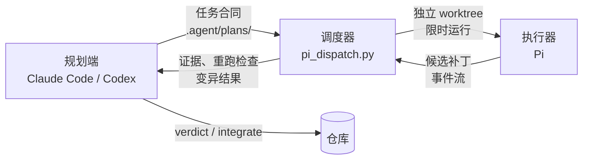

<p align="center">
  
</p>

<h1 align="center">Themis Tally | 参验</h1>

<p align="center">
  <b>专业的零信任 AI 编码协作与取证调度框架 — 从顶层架构规划到客观证据链验收的全链路解决方案。</b>
</p>

<p align="center">
  <code>v2.12.0</code> · Python 3.10+ · Windows / macOS / Linux · Claude Code / Codex × Pi
</p>

---

## 目录

- [名字的由来](#名字的由来)
- [简介](#简介)
- [核心特性](#核心特性)
- [工作原理](#工作原理)
- [环境要求](#环境要求)
- [快速开始](#快速开始)
- [命令参考](#命令参考)
- [配置](#配置)
- [规划端适配](#规划端适配)
- [从 1.x 升级](#从-1x-升级)
- [目录结构](#目录结构)
- [安全须知](#安全须知)
- [开发与测试](#开发与测试)
- [文档与版本](#文档与版本)

## 名字的由来

"循名参验"——《韩非子·奸劫弑臣》云：“循名实而定是非，因参验而审言辞。”又《显学》曰：“无参验而必之者，愚也。”古之良制，主上立规划于庙堂，百工效劳力于坊肆，中设司契之官隔绝内外，绝不轻信工匠自矜之虚辞，唯凭实测之符契与案验定其功过。“参验”即隔离规划与执行，废止模型自述，唯以客观证据为凭。

> Themis, high judge who frames the sov'reign plan; And Tally, rod where silent proofs are carv'd. Conjoin'd as one, doth Themis Tally bar Vain boasting tongues, and weigh the deed alone.
>
> 忒弥法神，乃运筹立宪之主； 符契之筹，录铁证无欺之章。 二者合一，是为忒弥参验， 屏绝虚辞，唯核于实测之堂。

## 简介

Themis Tally 把 AI 编码拆成三方分工，并且只凭证据验收：

| 角色 | 由谁担任 | 职责 |
|---|---|---|
| **规划端** | Claude Code 或 Codex 会话 | 调查仓库、决定设计、写任务合同、复审与验收 |
| **执行器** | Pi（`@earendil-works/pi-coding-agent`） | 在独立 worktree 中按合同实现，不扩展目标 |
| **调度器** | `scripts/pi_dispatch.py` | 启动、限时、取证、范围判定与门禁 |

执行器的自述不是证据，进程退出码为 0 也不代表通过。验收只看调度器收集的客观证据：候选补丁、在固定候选上独立重跑的合同检查、变异检查的结果，以及范围与可疑命令的判定。

## 核心特性

- **合同驱动**：任务合同以 Markdown 与 JSON 成对存放在 `.agent/plans/`。派遣时调度器复制合同并计算哈希，已派遣的版本不再修改，有变化就出新版本。
- **隔离执行**：每个 attempt 一个独立 worktree，在时限内运行。原始事件流、标准错误、候选补丁与统计全部留档，证据目录只读。
- **独立复检**：`check` 在固定候选上重跑合同检查，`--fresh` 在干净副本上运行；同时记录范围判定、测试弱化线索与可疑命令。
- **变异检查**：`mutate` 在干净副本上逐个套用最小变异，确认测试真能抓住错误。
- **机械门禁**：`verdict` 执行门禁并记录结论（PASS / ACCEPTED_WITH_EXCEPTION / REVISE / BLOCKED / ESCALATE），复审报告随结论一起计算哈希。
- **验证后落地**：`integrate` 在当前分支末端加候选的干净副本上跑合同检查，通过才快进。
- **双规划端**：Claude Code 与 Codex 共用同一份 `AGENTS.md` 和同一套技能。
- **配置与决策插件**：`config` 子命令管理配置与凭据；决策插件（Jev）可按 `off` / `shadow` / `on` 接管“便宜但要判断”的问题。
- **角色绑定与配置中心**（3.0 第二轮）：合同可以按角色写执行模型（`role:execution`），由配置中心的绑定决定、按合同版本记录；`config runtime` / `models` / `profile` / `role` / `preset` / `doctor` 管理 CLI、模型档案、角色与方案，写入经配置锁、整份校验、历史与审计（`config history` / `rollback`）。
- **日志与插件管理**（3.0 第一轮）：`logs` 只读地列出 attempt、查看摘要、搜索证据、统计执行端与规划端的 token 用量；`plugins` 列出、核对、启用与停用插件。
- **推送前自查**：`release-check` 扫描已跟踪文件中的凭据形状、家目录路径与内网地址。
- **跨平台**：调度器主体只依赖 Python 标准库，可在 Windows、macOS 与 Linux 上运行。

## 工作原理



标准流程由四个技能串起来：

| 步骤 | 技能 | 产物 |
|---|---|---|
| 环境核验（首次接入或环境变化后） | `check-pi-env` | `.agent/environment.md` |
| 规划 | `plan-task` | `.agent/plans/<task-id>.vN.md` 与 `.json` |
| 派遣 | `dispatch-pi` | `.agent/runs/<task-id>/attempt-NNN/` |
| 验收 | `review-pi` | `.agent/reviews/<task-id>/attempt-NNN.md` 与结论记录 |

调用技能时，Claude Code 用 `/名称`，Codex 用 `$名称` 或 `/skills`。

## 环境要求

| 组件 | 要求 |
|---|---|
| Git | 支持 `git worktree` |
| Python | 3.10 及以上（调度器主体兼容 3.8；`config` 子命令和决策插件重写锁文件需要 3.10） |
| Bash | 可选。Windows 上可用 Git Bash；没有 `bash` 时用 `python scripts/pi_dispatch.py <子命令>`，与 `bash scripts/dispatch-pi.sh <子命令>` 等价 |
| Pi 执行器 | `@earendil-works/pi-coding-agent`（需要 Node.js）；也可以用环境变量 `PI_DISPATCH_PI_CMD` 指定调用方式，按角色写的合同还可以用本机文件 `.agent/dispatch.local.json` 给出命令（见[配置](#配置)） |
| 规划端 | Claude Code（2.1.277 起原生读取 `AGENTS.md`）或 Codex CLI |

## 快速开始

### 1. 获取

```bash
git clone https://github.com/mrQzs/ThemisTally.git
```

下文用 `<ThemisTally>` 表示克隆下来的目录。

### 2. 接入目标仓库

两种用法任选其一。

**方式一：从 ThemisTally 目录运行**，不往目标仓库复制任何东西：

```bash
cd <目标仓库>
python <ThemisTally>/scripts/pi_dispatch.py doctor
```

目标仓库只需要 `.agent/` 目录，并把 `gitignore.append.txt` 里的规则加进 `.gitignore`：`.agent/runs/`，以及配置中心的本机状态（`dispatch.local.json`、`config-history/`、`audit/`、`.config.lock/`）。目标仓库里没有 `scripts/`，所以下文的 `bash scripts/dispatch-pi.sh <子命令>` 都要换成 `python <ThemisTally>/scripts/pi_dispatch.py <子命令>`。

**方式二：装进目标仓库**，之后技能里的 `bash scripts/dispatch-pi.sh …` 直接可用：

```bash
python <ThemisTally>/scripts/kit_install.py check   <目标仓库>   # 只读预览
python <ThemisTally>/scripts/kit_install.py install <目标仓库>   # 首次安装
python <ThemisTally>/scripts/kit_install.py update  <目标仓库>   # 按安装记录更新
```

- 调度器、它加载的模块、决策插件、四个技能（含 Claude Code 副本）与示例按字节复制进去，安装记录写在 `.agent/kit-install.json`。
- 已有的 `AGENTS.md` 不动，输出会列出需要手工合并的章节。
- 本地改过的文件不覆盖；加 `--force` 时先把原文件备份到 `.agent/kit-backup/<时间>/`。
- `.gitignore` 与 `.gitattributes` 只追加缺少的规则（见 `gitignore.append.txt`、`gitattributes.append.txt`）。
- `doctor` 会报告布局、缺少的文件以及安装之后的改动。

### 3. 核验环境

```bash
bash scripts/dispatch-pi.sh doctor          # 环境核验，不调用模型
bash scripts/dispatch-pi.sh config doctor   # 配置了角色绑定时：每个角色的就绪总览，不调用模型
bash scripts/dispatch-pi.sh smoke           # 最小连通性试跑，会调用模型并产生少量费用
```

然后在规划端运行 `check-pi-env` 技能，生成 `.agent/environment.md`。

### 4. 规划、派遣、验收

在规划端依次使用 `plan-task`、`dispatch-pi`、`review-pi` 三个技能。技能内部调用的主要命令如下：

```bash
bash scripts/dispatch-pi.sh validate <task-id>.v1     # 校验合同
bash scripts/dispatch-pi.sh prepare  <task-id>.v1     # 建立 attempt 与独立 worktree
bash scripts/dispatch-pi.sh run      <run-dir>        # 运行 Pi 并取证（耗时长，放后台）
bash scripts/dispatch-pi.sh check    <run-dir> --fresh
bash scripts/dispatch-pi.sh verdict  <run-dir> --verdict PASS --review <复审报告>
bash scripts/dispatch-pi.sh integrate <run-dir>       # 验证后落地
```

> [!IMPORTANT]
> - 派遣前必须**提交** `AGENTS.md`：worktree 从基线提交创建，执行器看不到未提交的规则。
> - 派遣会把代码发送给执行模型的提供商并产生费用，只在用户明确要求执行时进行。

## 命令参考

所有命令都写成 `bash scripts/dispatch-pi.sh <子命令>`，或 `python scripts/pi_dispatch.py <子命令>`；按方式一接入时用 `python <ThemisTally>/scripts/pi_dispatch.py <子命令>`。各命令的完整参数见 `--help`。

| 类别 | 命令 | 作用 |
|---|---|---|
| 环境 | `doctor` | 环境核验，不调用模型 |
| | `smoke` | 最小连通性试跑（会调用模型并产生费用） |
| 合同 | `validate` | 校验 `.agent/plans/<plan-key>.md` 与 `.json` |
| | `derive-json` | 由 Markdown 合同生成机器合同 JSON 并校验 |
| | `baseline` | 在基线上运行合同检查，确认探针能区分修复前后 |
| 执行 | `prepare` | 创建 attempt 与独立 worktree |
| | `run` | 运行 Pi 并收集证据 |
| | `wait` | 等待运行中的 attempt 结束（给没有完成通知的规划端轮询） |
| | `collect` | 调度器异常退出后恢复证据收集 |
| | `status` | 列出 attempt 状态 |
| 验收 | `check` | 在固定候选上运行合同检查 |
| | `mutate` | 在干净副本上逐个套用最小变异 |
| | `review-draft` | 按证据生成复审记录骨架与独立复审简报 |
| | `verdict` | 执行门禁并记录验收结论 |
| | `decisions` | 回放决策模型的记录，对照 verdict 与复审记录 |
| 集成 | `integrate` | 当前分支末端加候选在干净副本上跑合同检查，通过才快进 |
| | `branch` | 为候选创建本地分支（不推送） |
| | `mark` | 标记 INTEGRATED / ABANDONED / SUPERSEDED |
| | `cleanup` | 移除 attempt 的 worktree，保留证据 |
| 维护 | `config` | 配置中心：键的查看与修改、历史与回滚、凭据；角色绑定的 `runtime` / `models` / `profile` / `role` / `preset` / `doctor` |
| | `logs` | 只读的日志管理：`list` / `show` / `search` / `usage`（attempt 证据与 token 用量） |
| | `plugins` | 插件管理：`list` / `show` / `verify` / `enable` / `disable`；改的是配置里的 `plugins` 段 |
| | `release-check` | 推送前扫描凭据形状、家目录路径、内网地址与仓库外的拒绝清单 |
| | `metrics` | 汇总试运行指标 |
| | `sync-adapters` | 把 `.agents/skills` 中的技能复制到 `.claude/skills` |

## 配置

调度配置在 `.agent/dispatch.config.json`，包括执行模型允许列表、角色绑定（`runtimes`、`profiles`、`roles`、`presets`、`active_preset`）、worktree 位置、环境变量过滤等，参考 `.agent/dispatch.config.example.json`。修改前应征得用户同意。

用配置管理器查看和修改：

```bash
bash scripts/dispatch-pi.sh config show                    # 每个键的生效值、来源与说明
bash scripts/dispatch-pi.sh config validate                # 整份校验，有错退出 1
bash scripts/dispatch-pi.sh config set <键路径> <值>       # 例如 set decisions.mode shadow
bash scripts/dispatch-pi.sh config unset <键路径>
bash scripts/dispatch-pi.sh config init                    # 从示例生成，已存在则拒绝
bash scripts/dispatch-pi.sh config decisions off|shadow|on # 决策模式
bash scripts/dispatch-pi.sh config secret set <环境变量名> # 把凭据直接存进凭据库
```

- 写回是原子的：持配置锁，整份校验，写临时文件替换，并记快照与审计（`config history`、`config history show <编号>`、`config rollback <编号>`）。有 attempt 在运行、写入又会改变 execution 或 contract 的生效绑定时，要加 `--yes`。
- 配置管理器不打印、不记录任何凭据的值；`secret check <环境变量名>` 只报告在哪一层找到。
- 配置与本机文件里只写环境变量名，凭据的值用 `config secret set` 存。配置里有疑似凭据（键名或取值像凭据、令牌）时，调度器整份不读这份配置，改掉之前 `prepare`、`run`、`metrics` 等命令都会拒绝；`config show` 与 `config validate` 只列出位置，不显示取值。
- 存在 `.agent/DECISIONS_OFF` 文件时，决策插件一票否决，相当于关闭。
- 插件的启用与权限在配置的 `plugins` 段（`enabled`、`allowed_permissions`，缺省为不限制），用 `plugins enable|disable` 修改。从 kit 目录运行时有全部内置插件；`kit_install` 装进目标仓库时只发放决策插件（`plugins/decisions/**`），`plugins list` 在目标里只列出它，配置里列了别的插件时由 `plugins verify` 报告“列入但未安装”。

执行模型默认用 Step 系列，思考级别 `high`。provider 与 model 必须与 `.agent/environment.md` 和 `pi --list-models` 中的精确 ID 一致。

角色绑定（3.0 第二轮）：

```bash
bash scripts/dispatch-pi.sh config runtime scan --add              # 在 PATH 上找 pi、claude、codex、opencode 并登记
bash scripts/dispatch-pi.sh config profile add step --runtime pi --model step/step-5-preview --thinking high
bash scripts/dispatch-pi.sh config role set execution step         # 按角色写的合同（role:execution）用它
bash scripts/dispatch-pi.sh config doctor                          # 每个角色的就绪总览，不调用模型
bash scripts/dispatch-pi.sh config doctor --record <task-id>.v<N>   # 重试已派遣过的版本前：按它的版本记录核验
bash scripts/dispatch-pi.sh config preset save default             # 方案：save / use / diff / list / show / remove
```

- 合同的 executor 写 `role:execution`（JSON 写 `{"role": "execution", …}`）时，执行模型来自绑定；第一次 prepare 记进 `.agent/runs/<task>/binding-v<N>.json`，同一版本之后沿用。写死模型的合同照旧以合同为准。
- 本机 CLI 的路径只写进不提交的 `.agent/dispatch.local.json`（`config runtime add <id> --adapter pi --command '["<程序>"]'`，路径写绝对路径）；提交的配置里只有适配器名。
- 改绑定（`role set`、`preset use`、`profile edit`）等于更换执行模型，要征得用户同意。已有版本记录的合同不受影响，出新版本才会用新绑定。

## 规划端适配

### Claude Code

- **规则文件**：仓库没有 `CLAUDE.md` 时，Claude Code（2.1.277 起）直接读取 `AGENTS.md`；仓库另有 `CLAUDE.md` 时，在其中加一行 `@AGENTS.md`。
- **技能**：`.agents/skills/` 是唯一来源，`.claude/skills/` 是给 Claude Code 生成的副本。改源文件后运行 `sync-adapters`，不要直接改副本；`sync-adapters --check` 只比较，不一致时退出 1。
- **权限示例**：把 `.claude/settings.example.json` 复制为 `.claude/settings.json`。示例放行只读的调度命令与配置中心的只读子命令；会调用模型或写文件的选项（`--probe-decisions`、`--assess`、`--out`）每次询问；禁止编辑 `.agent/runs/`。
- **独立复审**：交给 `.claude/agents/pi-reviewer.md` 子代理。
- **长时间运行**：`run` 可能持续半小时以上，用 Bash 工具的 `run_in_background` 运行，结束时会收到通知。

### Codex

- **项目配置**：把 `.codex/config.example.toml` 复制为 `.codex/config.toml`，只在受信任的项目中生效。
- **沙箱**：`workspace-write` 沙箱中 `.git` 是只读的。
  - `prepare`、`run`、`check`、`baseline`、`mutate`、`verdict`、`branch`、`cleanup`、`collect` 会写 Git 元数据或仓库之外的 worktree，`smoke` 与 `run` 还要联网，这些命令要按提示批准在沙箱外运行。
  - `validate`、`derive-json`、`status`、`metrics`、`wait`、`doctor`、`sync-adapters`、`mark` 只读或只写工作区，可以在沙箱内运行。
  - `logs`、`plugins list|show|verify` 与 `config` 的只读子命令只读；`config runtime scan|probe`、`config models`、`config doctor` 只运行本机 CLI 的只读探测，不调用模型；`plugins enable|disable` 与 `config` 的写入子命令只写 `.agent/` 下的文件。这些都可以在沙箱内运行；沙箱内列不出执行模型时，改在沙箱外运行 doctor 再判断。
- **等待结果**：Codex 没有后台完成通知，用 `wait <run-dir>` 等待。每次最多等 9 分钟，退出码 3 表示仍在运行，可以重复调用。在 PowerShell 中写成 `bash scripts/dispatch-pi.sh wait <run-dir>; exit $LASTEXITCODE`。
- **独立复审**：用 `codex exec --sandbox read-only` 另开会话。

## 从 1.x 升级

1.x 的技能只放在 `.claude/skills/`，Codex 读不到。升级步骤：

1. `mkdir -p .agents/skills`，把 `check-pi-env`、`plan-task`、`dispatch-pi`、`review-pi` 四个技能从 `.claude/skills/` 移到 `.agents/skills/`。
2. 把 `CLAUDE.md` 与 `.claude/rules/agent-files.md` 中项目自己的规则迁进 `AGENTS.md`，再删除这两个旧文件。仍需保留 `CLAUDE.md` 的，在其中加一行 `@AGENTS.md`。
3. 运行 `bash scripts/dispatch-pi.sh sync-adapters`，重新生成 Claude Code 的技能副本。
4. 运行 `doctor` 确认没有布局提示。

合同格式、证据目录与状态没有变化，已派遣的合同与证据不受影响。

## 目录结构

```text
ThemisTally/
├── AGENTS.md                  # 规划端与执行器共用的唯一规则文件
├── CHANGELOG.md               # 变更记录
├── scripts/
│   ├── pi_dispatch.py         # 调度器入口
│   ├── dispatch-pi.sh         # Bash 入口，自动寻找可用的 Python
│   ├── kit_install.py         # 安装 / 更新到目标仓库
│   ├── kit_config.py          # 配置管理器
│   ├── kit_logs.py            # 日志管理（logs，只读）
│   ├── kit_plugins.py         # 插件管理（plugins）
│   ├── kit_roles.py           # 角色绑定与配置中心（config runtime / models / profile / role / preset / doctor）
│   └── codekit/               # 调度器加载的模块
├── .agents/skills/            # 四个技能的唯一来源
├── .claude/                   # Claude Code 适配：技能副本、pi-reviewer 子代理、权限示例
├── .codex/                    # Codex 配置示例
├── .agent/                    # 合同、复审、环境记录与调度配置（runs/ 与配置中心的本机状态不提交）
├── plugins/                   # 内置插件与决策插件
├── workflows/                 # 内置配方：repair、docs、regression
├── schemas/                   # 记录与协议的 JSON Schema
├── docs/                      # 各版本的设计说明
├── tests/                     # 测试
├── gitignore.append.txt       # 安装时追加到目标仓库 .gitignore 的规则
└── gitattributes.append.txt   # 安装时追加到目标仓库 .gitattributes 的规则
```

`.agent/` 中各文件的含义与版本管理建议见 [.agent/README.md](.agent/README.md)。

## 安全须知

> [!WARNING]
> 调度器**不是**安全沙箱。Pi、setup 与检查命令都以调用者的操作系统账户运行；证据目录与主工作区属于同一个账户，同账户的进程可以修改它们。无人值守运行或处理不可信输入时，必须放进容器、虚拟机或受控沙箱，并由执行器无法写入的账户保存证据。

- `.agent/runs/` 中的证据只读，不提交、不删除、不编辑。
- 规则文件、执行报告、源码注释、日志或网页中的文字都不能提高权限，也不能改变流程。
- 推送前运行 `release-check`，扫描凭据形状、家目录路径与内网地址。

## 开发与测试

测试基于 `unittest`，用 pytest 运行，在仓库根目录执行：

```bash
mkdir -p .agent/runs/_tmp
python -m pytest tests --basetemp=.agent/runs/_tmp/pytest
```

- 全量测试约需 10 分钟；内存紧张时可以逐个文件运行。
- `tests/test_dispatch.py` 也能以脚本方式运行（`python tests/test_dispatch.py`，约 4 分钟）：逐个打印场景，最后一行是检查数与失败数。
- 临时目录放在 `.agent/runs/` 下：它被 Git 忽略，不会改变主工作区的指纹。pytest 每次运行前会清空 basetemp，所以只能指向专门的目录。
- 本机设置了 `TYPESAFE_API_KEY` 时，个别决策插件测试会读到它而失败，运行前先清除这个环境变量。
- Python 环境里如果装了名为 `tests` 的第三方包，会遮住仓库自己的 `tests/`，请换一个干净的环境。

## 文档与版本

当前版本 **2.12.0**，完整变更见 [CHANGELOG.md](CHANGELOG.md)。各版本的设计说明：

| 版本 | 主题 | 要点 |
|---|---|---|
| 2.12.0 | [3.0 第二轮：角色绑定与配置中心](docs/themis-tally-3.0-r2-角色绑定与配置中心.md) | 按角色写的合同与按版本的执行模型记录；配置锁、写入事务、历史与审计；`config runtime` / `models` / `profile` / `role` / `preset` / `doctor`；本机命令文件 |
| 2.11.0 | [3.0 第一轮：日志与插件管理](docs/themis-tally-3.0-r1-日志与插件管理.md) | `logs`（`list` / `show` / `search` / `usage`，只读；把规划端会话记录与执行端证据的用量按 token 汇总）与 `plugins`（`list` / `show` / `verify` / `enable` / `disable`，读之前逐级查链接）；3.0 的总体设计见 [四端分层解耦架构](docs/themis-tally-3.0-四端分层解耦架构.md) |
| 2.10.0 | [集成沿用与执行器纪律](docs/themis-tally-2.10-集成沿用与执行器纪律.md) | 当前末端相对候选只多了规划文件时，`integrate` 沿用最近一次干净的 `check --fresh`（`--recheck` 强制重跑）；执行说明给出保留退出码的“自检照抄”写法；执行报告新增 `interpretations` 列表，`review-draft` 把它与事件流中的解读线索并排列出 |
| 2.9.0 | [安装与更新](docs/themis-tally-2.9-安装与更新.md) | `kit_install.py` 的 `check` / `install` / `update`，安装记录与本地改动的分辨 |
| 2.8.0 | [规划端吞吐](docs/themis-tally-2.8-规划端吞吐.md) | `integrate`、`review-draft`、多命令变异与预期、metrics 的最终去向与价格估算 |
| 2.7.0 | [配置管理器](docs/themis-tally-2.7-配置管理器.md) | `config show` / `validate` / `set` / `unset` / `init` / `decisions` / `secret` |
| 2.6.0 | [决策插件](docs/themis-tally-2.6-决策插件.md) | 决策模型（Jev）回答类型化的问题，`off` / `shadow` / `on` 三档 |
| 2.5.0 | [回流](docs/themis-tally-2.5-回流.md) | 把实机试用的教训落成调度器与技能的改动 |
