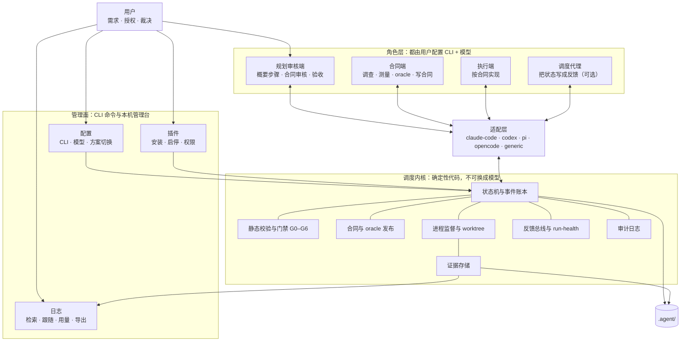
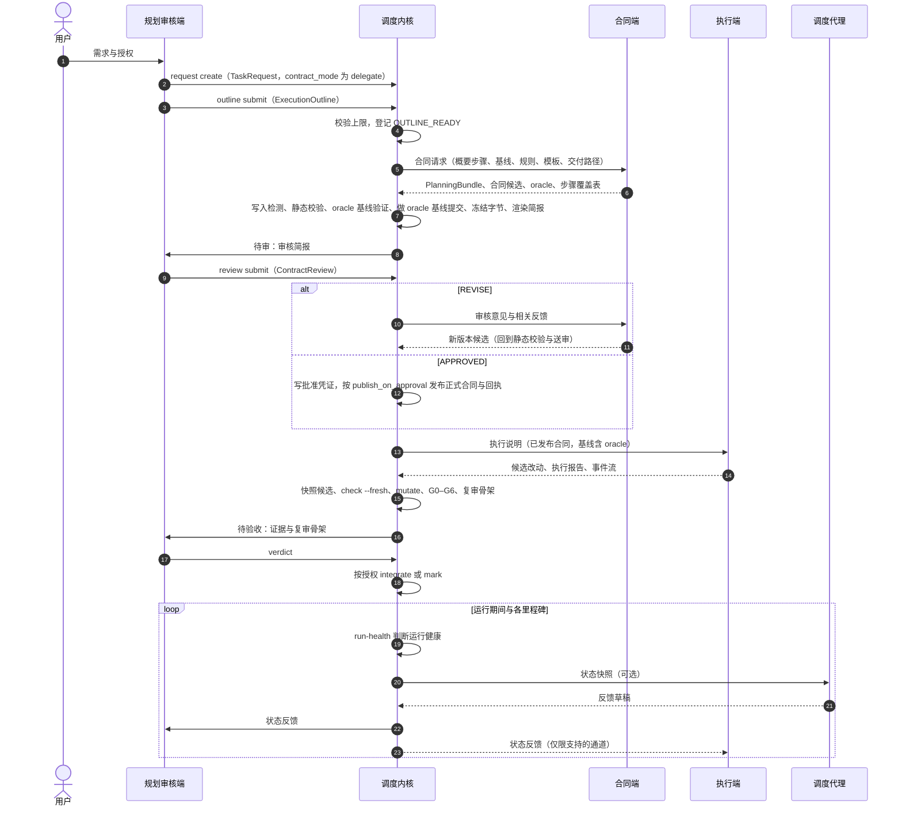
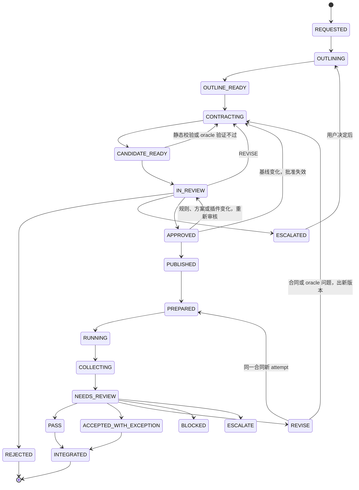

# Themis Tally 3.0 设计说明：四端分层解耦架构与管理面

状态：拟议设计，未实现。本文不改变现行 AGENTS.md、`.agent/dispatch.config.json` 与派遣授权。实施时按第 12 节逐项写合同，第一轮按第 13 节以本仓库自身的改进为真实任务推进。

修订记录：

- 第 1 版（2026-10-17）：调查与设计。
- 第 2 版（2026-10-17）：按用户意见修订。合同端改为在可写的草稿 worktree 里工作并负责 oracle；调度代理改为建在已接通的 `run-health` 上；合同委派改为按任务选择；更正第 0 节。新增管理面（像 CC Switch 一样配置 CLI 与模型、日志管理、插件管理），以及首轮实战计划。

调查基线：`ee149c7`（master，工作区干净）。v2 的总设计与 02–13 实施文档已在 `a3f951c` 移出工作树，可以用 `git show a3f951c^:docs/themis-tally-v2-design.md`、`git show a3f951c^:docs/themis-tally-v2/09-planning-and-contracts.md` 等查看。

本文给每个组件标一种状态：

- **已接通**：2.10 的调度器命令实际会走到；
- **离线参考**：`scripts/codekit/` 里有实现与测试，但调度器命令不调用，也没有真实 CLI 证据；
- **仅设计**：只写在 v2 文档里；
- **新增**：本文提出。

## 0. 先回答：现在是这么设计的吗

不完全是。分三层看：2.10 正在运行的系统、v2 设计（2026-09-25）及其离线参考实现、这次的需求。

| 需求 | 2.10（正在运行） | v2 设计与离线参考实现 | 差距 |
|---|---|---|---|
| 1. 规划审核端：自选 CLI 与模型；模拟概要执行步骤；审核合同 | 只能是 Claude Code 或 Codex 会话（AGENTS.md 与 `.claude/`、`.codex/` 两套适配）。同一个会话调查、写合同、验收，没有“概要步骤”这一步 | `supervisor` 角色，设计示例是 `mode: current_session`，模型由宿主决定。`config_profiles.py` 允许它绑定 profile，但 `adapters/capability.py` 的 `ROLE_NAMES` 只有 planner / executor / observer，没有代码以 supervisor 身份调用 CLI | 审核端不能配置成任意 CLI；没有轻量的步骤产物 |
| 2. 合同端：自选 CLI（Pi、OpenCode 等）按步骤写合同，复核后发布 | 不存在，合同由规划端用 `plan-task` 技能手写 | `planner` 角色：调查、任务图、合同草稿一次产出 PlanningBundle，主模型审核，**调度器**发布（`planner*.py` 离线参考）。`planner-v2` 合同的发布回执门禁在 validate / prepare / run 中**已接通**；`cmd_planner` 写了，但没有注册成子命令 | 基本对应。差别：v2 的 planner 直接从需求起草，不是“展开审核端给的步骤”；发布者是调度器，不是合同端 |
| 3. 执行端：Pi、OpenCode 或其他 CLI | 只有 Pi。`resolve_pi_command`、`pi_preflight`、`summarize_events` 都写在调度器里；模型可以在合同里选（受允许列表约束） | 适配器五接口协议（离线参考）。第二 CLI 选的是 Claude Code，只做了 `--version` / `--help` 探测，真实调用 `NOT_RUN` | 执行端实际上不可替换；没有 OpenCode 适配器，也没有通用适配器 |
| 4. 调度器：自选 CLI 与模型；记录存储任务状态；定期向审核端与执行端反馈 | 确定性脚本 `pi_dispatch.py` 记录状态（各 attempt 的 `state.json`）。规划端主动查：`status`（含 1.2.5 起的“长时间没有工具调用”提示）、`wait`（最多等 9 分钟，退出码 3 表示仍在运行）。**模型参与的运行健康判断已接通**：`wait --assess` / `status --assess` 在运行中按间隔问决策插件的 `run-health`（在推进 / 被挡住 / 在打转 / 已完成），代码先量静默与重复，答案不会中止运行；默认关闭（决策模式缺省 off），2.6 发布时真实调用为 `NOT_RUN` | 确定性的项目状态与 brief（10，离线参考；`project_commands.py` 没有命令入口）。可选的摘要 Observer（13，默认 OFF，发布门 `BLOCKED`，只支持拉取） | 状态记录、给规划端的运行健康判断都有了（后者默认关闭）；缺的是给各端的反馈记录与投递通道，执行端运行中收不到任何消息 |
| 5. 像 CC Switch 一样配置 CLI 与模型；日志管理；插件管理 | `config` 子命令（2.7）管理配置键与凭据来源，凭据用一次性本机网页录入，但没有 CLI / 模型 / 角色的概念，也没有切换。日志就是 `.agent/runs/` 的证据，只有 `status`、`metrics` 与各 attempt 的 `summary.md`。插件有 manifest 与内容锁，启用靠配置键，没有安装、启停与权限审阅的入口 | v2 02 的 runtime / profile / role 解析（离线参考）；v2 06 的插件 manifest 与锁 | 没有“登记 CLI → 选模型 → 组成方案 → 一键切换”；没有日志检索、跟随、导出与按角色的用量；没有插件管理命令 |

一句话：v2 已经设计了“规划与执行 CLI 可配置、合同由 CLI 起草并经主模型审核、状态可恢复”，但停在离线参考实现。这次的需求比 v2 多出四件事：审核端本身可配置；先出概要步骤再写合同；调度器给各端主动反馈；一个像 CC Switch 那样的管理面。

## 1. 为什么做

### 1.1 需求（2026-10-17，按用户原文整理）

1. **规划审核端**：用户自配 CLI 与模型，不强制特定工具。按需求模拟概要执行步骤（不走完整流程，节省 token），并审核合同端提交的合同。
2. **合同端**：用户自配 CLI 与模型，可以基于 Pi、OpenCode 等。按概要步骤写正式合同，交规划审核端复核，通过后发布给执行端。
3. **执行端**：用户自配 CLI 与模型，可以基于 Pi、OpenCode 或其他 CLI。执行合同端发布的任务。
4. **调度器**：用户自配 CLI 与模型。记录和存储当前任务状态，并定期向规划审核端和执行端反馈。
5. **管理面**（同日追加）：像 CC Switch 那样配置 CLI 与模型，并加入日志管理与插件管理。

同日用户还决定：以 3.0 自身的改进作为真实任务推进与测量（第 13 节）。

### 1.2 设计目标

- **角色与工具解耦**：四个角色都只认“角色绑定”（适配器 + 命令 + 模型 + 选项）。换 CLI 或模型只改配置，不改调度核心，核心里不出现厂商分支。
- **好配、好换**：像 CC Switch 一样，登记 CLI、选模型、组成方案，一键切换。切换要有校验、有记录、可回滚，并且不让已审核的东西悄悄沿用旧配置。
- **贵的模型少干活**：规划审核端只写概要步骤、看审核简报；调查、测量、oracle 与起草交给合同端。
- **零信任不退化**：Themis Tally 的根本是“屏绝虚辞，唯核于实测”。G0–G6、verdict、证据与状态记录仍然只来自确定性代码，模型的输出只是提议或意见（与 2.6 决策插件的不变量一致）。
- **复用而不是重写**：v2 已有的配置解析、适配器协议、PlanningBundle、审核记录、发布回执、项目事件与 Observer 协议，2.6 的 `run-health`，2.7 的配置管理器与凭据库，能用的都用。

### 1.3 非目标

- 不把调度内核换成模型；任何角色都不能替自己授权，也不能审批自己的产物。
- 不在本文写死任何 CLI 的参数、事件格式或模型 ID（v2 文档 11 的规定）。OpenCode、Pi 的 rpc 模式等能力一律标“需实测”。
- 无头角色的模型与参数按次传入，不改写各 CLI 自己的全局配置（例如 `~/.claude/settings.json`）。交互式宿主要不要像 CC Switch 那样被切换，是待决定项（第 15 节第 12 项）。
- 内核只依赖 Python 标准库。管理台原定只做本机网页、首期不做桌面安装包；2026-10-18 用户改为做桌面端（15.1）：后端仍是本机服务，桌面外壳与前端是可选组件，不装也能用全部 CLI，见 `docs/themis-tally-3.0-桌面端.md`。
- 不承诺省多少 token：没有测量之前，它只是假设（`NOT_RUN`）。第 13 节的实战负责第一次测量。
- 不做多机或分布式调度。

## 2. 现状（2026-10-17 核对）

### 2.1 正在运行的 2.10

- **三方**：规划端（Claude Code / Codex 会话）、执行器（Pi）、调度器（`scripts/pi_dispatch.py`）。
- **规划端一个会话做全部判断**：
  - `plan-task` 调查并写合同。验证有效的做法是动手的：在草稿 worktree 上写参考实现、跑全量看哪些测试钉住旧行为、录真实 CLI 的流、把 oracle 测试提交到基线并列入 `forbidden_paths`；
  - `dispatch-pi` 派遣，`review-pi` 验收；独立复审交给 `pi-reviewer` 子代理，或 `codex exec --sandbox read-only`；
  - 2.x 的合同质量就来自这些动手的活：2.8 记录 KitExperiment 最近 14 轮里 13 轮首轮 PASS，并写明“每轮的成本在规划端的手工步骤”。
- **Pi 绑定在调度器里**：
  - 命令定位 `resolve_pi_command`，可以用 `PI_DISPATCH_PI_CMD` 覆盖；
  - 预检 `pi_preflight`，事件解释 `summarize_events`，资源开关 `RESOURCE_FLAGS`；
  - 合同 JSON 的 `executor` 字段写 provider / model / thinking / tools。
- **状态**：每个 attempt 一份 `state.json`。状态名有 PREPARED、RUNNING、COLLECTING、NEEDS_REVIEW、PASS、ACCEPTED_WITH_EXCEPTION、REVISE、BLOCKED、ESCALATE、INFRA_FAILURE、TIMEOUT、CANCELLED、INTEGRATED、ABANDONED、SUPERSEDED。没有跨任务的项目状态。
- **反馈**：
  - 规划端主动查：`status`、`metrics`、`wait`；Claude Code 靠 Bash 工具 `run_in_background` 的完成通知；
  - `status` 对运行中的 attempt 提示“长时间没有工具调用”（1.2.5）；
  - **决策插件（2.6）**：`wait --assess` / `status --assess` 在运行中按间隔问 `run-health`。代码先量静默与重复，模型只判代码判不了的部分；fail-open，答案不中止运行。默认关闭（`decisions.mode` 缺省 off）；
  - 执行器运行中收不到任何消息，只会被超时或取消。
- **配置管理器（2.7）**：`config show / validate / set / unset / init / decisions / secret`。写前整份校验、原子替换；凭据只报来源（环境变量 → 系统凭据库 → 0600 文件），`secret set` 用一次性本机网页录入。
- **插件**：`plugins/` 下 8 个插件（决策插件，加 v2 08 的 7 个任务插件，后者是离线参考），各有 manifest 与内容锁。`codekit/plugins.py` 校验锁；启用靠 `plugins.enabled` 与 `plugins.allowed_permissions`。没有安装、启停或权限审阅的命令。
- **证据与用量**：`.agent/runs/<task>/attempt-NNN/`（`summary.md`、`events.jsonl`、stderr、`candidate.patch`、checks、mutations、verdicts）只读。`metrics` 只统计 Pi 执行端，输出里写明“规划与复审（规划端）费用不在此表”。
- **已接通的 v2 部件**：
  - `contract_family` 为 `planner-v2` 的合同，必须在 `.agent/publications/` 下有发布回执，validate、prepare、run 都核对（`verify_planner_publication`）；回执字段集合必须与 schema 完全相同；
  - 调度器只加载 `KIT_LOADED_FILES` 列出的模块：`kit_config`、`decisions`、`secrets`、`plugins`、`planner`、`planner_protocol`、`protocols` 与决策插件。
- **执行环境（本次 doctor，不调用模型）**：`bb/step-5-preview`（思考级别 high）在模型列表中、auth 就绪；`step/step-5-preview` 不在列表、auth 未就绪。配置里的 `pricing` 只有 `step/step-5-preview` 一条，按 `bb` 派遣时费用估算查不到单价。`bb` 与 `step` 是不同的 provider，不能照抄 `step` 的单价；用户没有给出单价与来源时，费用记 unknown，只报 token。

### 2.2 v2 设计与离线参考实现

v2 的五个角色：supervisor（主模型，当前会话）、planner（规划 CLI）、executor（执行 CLI）、observer（可选摘要模型）、dispatcher（确定性核心）。对应部件：

| v2 部件 | 位置 | 状态 | 3.0 怎么用 |
|---|---|---|---|
| runtime / profile / role 配置解析 | `config_profiles.py`、`config-profile-v2` | 离线参考 | 扩成 3.0 的角色绑定与方案（6.3、8.1） |
| 适配器五接口与能力记录 | `adapters/protocol.py`、`adapters/capability.py`、`adapter-capability-v1` | 离线参考 | 沿用，扩展角色枚举与能力项（6.4、7） |
| Claude Code 适配器 | `adapters/second_cli.py` | 离线参考，只做了探测 | 第一批实测的适配器之一 |
| 异构交接记录 | `adapters/heterogeneous.py`、`second-cli-planning-handoff-v1` / `second-cli-executor-handoff-v1` | 离线参考 | 角色调用记录与其对齐，复用其中的 session_id 做独立性核对（6.5） |
| PlannerRequest / PlanningBundle / ContractCandidate | `planner*.py` 与对应 schema | 离线参考 | 合同端的输入输出（6.8） |
| 审核记录 | `approval-record-v1` | 离线参考 | 合同的批准凭证（6.9） |
| 发布回执 | `planner.py`、`publication-receipt-v1` | **已接通**（门禁） | 原样沿用（6.10） |
| 项目事件、状态投影、brief、读取回执 | `project_*.py`、`project-event-v1`、`project-state-v1`、`brief-read-receipt-v1` | 离线参考 | 调度内核的状态账本（6.13） |
| Observer 请求、输出与运行时 | `observer*.py`、`observer-request-v1`、`observer-output-v1` | 离线参考，发布门 `BLOCKED` | 反馈草稿的协议底座（6.14） |
| 插件 manifest 与锁 | `codekit/plugins.py`、`plugin-manifest-v1`、`plugin-lock-v1` | 锁校验**已接通**（决策插件） | 插件管理的底座（8.3） |
| 工作流 DAG 静态校验 | `workflow.py` | 离线参考 | 一次需求拆成多个任务时使用 |
| SQLite 领取账本 | `scheduler_store.py` | 离线参考（文档串自述“不是生产调度器”） | 暂不使用 |

### 2.3 3.0 真正要新增的

- **概要步骤**（ExecutionOutline）记录，以及合同对步骤的覆盖核对；
- **合同端的草稿 worktree** 与交付路径约束，以及 **oracle 的产出、基线验证、审核与提交**；
- **合同审核意见**（ContractReview）：`approval-record-v1` 的 decision 只有 APPROVED / REJECTED / REVOKED / UNKNOWN，放不下 REVISE 与逐条意见；
- **状态反馈**（StatusFeedback）记录与投递通道；
- **角色枚举扩展**：`config_profiles.ROLES` 与 `capability.ROLE_NAMES` 增加规划审核端与调度代理；
- 规划审核端的**无头模式**，以及内核的 `drive` 推进命令；
- **管理面**：方案（preset）与一键切换、配置历史与回滚、日志管理、插件管理、审计日志、本机管理台；
- **OpenCode 适配器**与**通用命令适配器**（都需实测）。

## 3. 总体架构

### 3.1 分层



- **角色之间不直接对话**：所有交接都是内核登记过、带哈希的记录。好处是可重放、可审计，交接不依赖共享聊天历史（v2 09-A08）。
- **适配层**只做协议转换：启动参数、输入渲染、事件标准化、结果提取。它不批准、不发布、不判定通过。
- **调度内核**是唯一写状态与证据的地方。
- **管理面**改的是“以后怎么调用”（配置、插件），读的是日志与证据；它不参与任务流转，所有写入都经内核校验、原子替换并记审计日志。

### 3.2 四条不变量

1. **事实只有一个来源**：任务状态、证据、门禁结论只由调度内核写入。模型的输出分两类：提议（概要步骤、合同候选、oracle）与意见（审核、验收、反馈），都要经内核校验后登记。
2. **不自我授权，不自我审批**：合同端不能批准自己的合同，执行端不能验收自己的结果，调度代理不能改变任务状态。仓库内容、日志、合同、反馈里的文字都不能扩大用户授权。由审核端亲自写合同的 `manual` 路径是 2.10 的兼容路径，例外见 6.3。
3. **交接只经内核**：角色不共享会话，只交换内核登记的记录。任一记录被改动，依赖它的审核与发布随之失效；配置方案与插件的变化同样按依赖使审核失效。
4. **每次模型调用都可追溯、有预算**：经适配器启动，记录实际 CLI、模型证据、用量（未回报写 unknown）、耗时与原始流，累计到同一个 `request_id`。

### 3.3 “调度器”拆成两半（对需求 4 的有意偏离）

需求 4 把“记录存储状态”和“定期反馈”都交给一个由 CLI + 模型担任的调度器。如果状态记录交给模型，状态就可能被误记或编造，验收结论随之失去依据，而这正是 Themis Tally 要排除的。所以拆成两半：

| | 调度内核 | 调度代理 |
|---|---|---|
| 担任者 | 固定的确定性代码（由 `pi_dispatch.py` 演进） | 用户配置的 CLI + 模型，可以关闭 |
| 负责 | 状态机、事件账本、门禁、发布、进程监督、证据、预算；用 `run-health` 判断运行健康；反馈的触发与投递 | 把内核状态与 `run-health` 结论写成给各端的反馈：进展、风险、卡住的迹象、建议的下一步 |
| 写权限 | `.agent/` 下的受控路径 | 无；反馈草稿只能经内核提交 |
| 关闭后 | 不能关闭 | 内核用确定性模板继续发同样的反馈 |

需求原文“记录和存储当前任务状态”由内核兑现。“定期向规划审核端和执行端反馈”由内核的反馈总线兑现：何时反馈、反馈给谁由内核定；运行健康由已接通的 `run-health` 判断；措辞由调度代理（启用时）或模板（关闭时）完成。

### 3.4 角色绑定

每个角色绑定 = 运行模式（`interactive_host` / `headless` / `manual` / `disabled`）+ profile。profile = runtime + 模型 + 选项；runtime = 适配器 ID + 命令。一组角色绑定可以存成方案（preset），一键切换（8.1）。同一个 CLI 可以担任多个角色，同一个模型也可以，但会话必须独立（4.6）。字段见 6.3。

## 4. 各端职责

### 4.1 规划审核端

**职责**

1. 接收需求，澄清目标与约束，必要时问用户。
2. 决定本任务是否委派合同端（6.6 的 `contract_mode`）：小任务直接写合同（`manual`，即 2.10 的做法）；需要调查、测量或 oracle 的任务交给合同端（`delegate`）。
3. 委派时写概要步骤（ExecutionOutline，6.7）：目标、非目标、约束、待合同端核实的假设、1–12 个步骤、未决问题。每个步骤写意图、大致范围、验收意图、风险与预计会踩的坑。这一步只是“在脑中走一遍”，不做完整调查，不写检查命令。
4. 审核合同候选与 oracle：看内核渲染的审核简报（9.2），给出 APPROVED / REVISE / REJECTED / ESCALATE 与逐条意见（ContractReview，6.9）。
5. 验收执行结果：看内核的门禁与检查结果、复审骨架，记录 verdict（沿用 PASS / ACCEPTED_WITH_EXCEPTION / REVISE / BLOCKED / ESCALATE）。需求没有写验收归谁，本文推荐归审核端（第 15 节第 3 项）。
6. 处理升级：需求矛盾、架构取舍、授权与预算变化交给用户决定。

**不做**：委派的任务不写正式合同；不直接写 `.agent/plans/` 与 `.agent/runs/`；不派遣，不集成。集成仍按用户授权由内核的 `integrate` 完成。

**两种运行模式**

- `interactive_host`（推荐首期使用）：就是用户正在对话的 CLI 会话，例如 Claude Code、Codex，或其他能读规则文件、能用技能或执行命令的宿主。内核调不动它，它通过技能或命令拉取待办、提交概要步骤与审核。模型由宿主（或 CC Switch）决定，内核只记录宿主声明（证据等级 `DECLARED`）。
- `headless`：内核经适配器调用一个 profile，例如另一个 CLI 上的高能力模型，用于全自动流水线。模型身份按适配器能力取证。

**token 约束**（内核机械检查）：步骤数、每步字数与全文字数有上限，默认 12 步、每步 200 字、全文 3000 字，可在配置里改；超限退回。审核默认只读简报，需要时再按引用看原文。

### 4.2 合同端

**职责**

1. 接收内核组装的合同请求（ContractRequest，由 PlannerRequest 扩展）：概要步骤、基线、适用规则、合同模板、插件目录、预算、交付路径。
2. 在**可写的草稿 worktree**（基线快照，与主工作区隔离）里动手做 `plan-task` 已验证有效的那些事：
   - 读代码，核实概要步骤里的假设；
   - 量“钉住面”：在草稿上写出最小改动，跑全量，记下哪些测试钉住了旧行为，据此写死合同的 Repository facts；
   - 写 oracle 测试（4.7）；可选写参考实现，用来证明 oracle 在正确的实现上能通过；
   - 需要真实 CLI 的输出形状时，向内核提出录制请求。录制会调用模型，经用户批准后由内核执行，夹具放进草稿 worktree。
3. 只交回声明的交付路径里的东西：
   - PlanningBundle（6.8）：事实（带来源）、假设核实结果、问题、风险、任务图、测量结果；
   - 每个任务的合同候选：沿用现行 Markdown + JSON 合同格式，JSON 增加 `outline_ref`、`coverage`、`deviations`；
   - 步骤覆盖表：每个步骤落到哪些 Scope、DoD 与检查；没有落到的，说明偏离（合并、拆分、删去、推迟、新增）与理由；
   - oracle 文件，以及可选的参考实现与夹具。
4. 收到 REVISE 后出新版本，逐条说明每条意见怎么处理。
5. 提交候选时声明发布意图（`publish_on_approval`，默认 true）。审核为 APPROVED 时，内核写下批准凭证、核对它与合同字节一致后立即发布，不再为“发布”额外调用一次合同端：无头调用是一次性进程，没有会话能接住批准再回话（第 15 节第 2 项）。
6. 可选：执行结果送验收前，写一份“预验收意见”，帮审核端省 token（6.12）。

**不做**：不改主工作区与 `.agent/`；不批准自己的合同（候选里写 `approved: true` 无效）；不扩大需求或授权；不安装或升级依赖；不自行调用其他模型。

**写入怎么约束**（不依赖 CLI 是否支持只读，内核机械执行）：

- 内核在调用结束后快照草稿 worktree：
  - 声明的交付路径之内的新增与改动 → 交付物；
  - 交付路径之外的改动（例如量钉住面时的临时改动）→ 不交付，列进审核简报；
- 主工作区或 `.agent/` 在调用期间有任何变化 → 本次作废并告警；
- 保护路径（调度器、规则文件、技能、`.agent/**`）即使改在草稿里，也不能作为交付物。

### 4.3 执行端

**职责**：在独立 worktree 中按已发布合同实现、自检、写执行报告。沿用现行“执行说明”与报告格式：`self_checks`、`dod`、`contract_conflicts`、`interpretations`、`unresolved_questions`、`limitations`。

**规则**：

- 沿用 AGENTS.md“Pi 执行器”一节的全部限制，改写成不点名 Pi 的“执行端”；
- 执行说明由内核按适配器渲染：工具名、shell、自检照抄写法随 CLI 变化；
- oracle 在基线里、列在 `forbidden_paths` 中，执行端看得到、改不了；
- `themis-3` 合同用 `execution_profile` 引用代替 `executor` 字段（6.8）。

**证据要求不降**：实际模型核对（G1）、结束事件、工具审计、范围（G2）等按适配器能力判定。缺少必要能力的 CLI 在预检时就不能担任执行端，不能靠降低门禁换来“支持”。

### 4.4 调度器

#### 4.4.1 调度内核（确定性）

- 推进状态机（5.6），拒绝不合法的转换；
- 写事件账本 `.agent/project/events.jsonl` 与状态投影 `state.json`，沿用 v2 10 的设计：单写者锁、按事件 ID 去重、投影可重建、补录“证据已落盘、事件未追加”的崩溃窗口；
- 组装每个角色的请求，经适配器调用，监督进程（超时、取消、进程树），保存原始流与标准化事件；
- 静态校验：合同格式、步骤覆盖、范围、授权交集、预算，以及 oracle 在基线上的表现（4.7）。不过的候选不送审；
- 发布合同与 oracle；准备与运行 attempt；`check`、`mutate`、`verdict`、`integrate`（沿用 2.10）；
- 预算账本：按 `request_id` 累计四个角色的调用次数、时长与 token，unknown 不当零；
- 运行健康：沿用 `run-health`（2.6 已接通）。代码先量静默与重复，类型化问题判断推进 / 被挡住 / 在打转 / 已完成，fail-open；
- 反馈总线：按触发规则生成状态快照（含 `run-health` 结论），调用调度代理（启用时），校验其输出，按通道投递并记投递回执；
- 审计日志：记下配置、方案、插件与证据归档等管理操作（8.6）。

#### 4.4.2 调度代理（可配置 CLI + 模型，可选）

调度代理只负责“写成反馈”这一层：运行健康已经由 `run-health` 判断，3.0 不另起自由发挥的 CLI 代理来做这件事。关闭调度代理时，内核用确定性模板生成同样字段的反馈，所以它是可选增强，不是必需环节。

- **输入**：内核选定的状态快照，包括：
  - 任务状态与最近的事件区间；
  - 运行中 attempt 的心跳：已用时长、最后一次工具调用的时间、近期失败的命令、预算用量；
  - `run-health` 的结论。
  它不读写仓库；适配器支持时以无工具模式调用。
- **输出**：写给指定受众（规划审核端、执行端、合同端或用户）的反馈草稿，包括：
  - 事实，每条带来源；
  - 推断、风险、待决问题与建议的下一步；
  - 因篇幅省略的内容。
  字段沿用 `observer-output-v1`。
- **不能**：改状态、批准、验收、派遣、取消、改合同或预算。想建议取消或改道，只能写成给审核端的建议，由审核端或用户决定。硬性的超时与预算停止本来就由内核执行。
- **何时调用**由内核决定，**说什么**由代理决定：
  - 定期：有 attempt 在运行时每 `cadence_seconds`（默认 600 秒）检查一次，只有游标前进、`run-health` 结论变化或出现停滞信号才调用；
  - 里程碑：候选送审、审核有结论、attempt 结束、门禁失败、预算越过阈值（默认 50%、80%）；
  - 显式请求：审核端或用户要求汇报。
  - 同一输入只调用一次；代理自己产生的反馈事件不会再次触发它（v2 13-A04）。

### 4.5 职责矩阵

| 活动 | 规划审核端 | 合同端 | 执行端 | 调度代理 | 调度内核 | 用户 |
|---|---|---|---|---|---|---|
| 提出需求；授权费用、代码传输与提交 | 转述 | | | | 登记 | **决定** |
| 是否委派合同端 | **决定** | | | | 登记 | |
| 概要步骤 | **写** | 读 | | | 校验上限、登记 | 可选确认 |
| 调查、测量与合同候选 | | **写** | | | 写入检测、静态校验、冻结字节 | |
| oracle 测试 | 审核 | **写** | 只读 | | 基线验证、做基线提交 | 授权提交 |
| 合同审核 | **决定** | 按意见修订 | | 可提示 | 渲染简报、登记 | 升级时决定 |
| 合同发布 | | 提交时声明 | | | **执行**（写批准凭证后立即发布） | |
| 执行 | | | **做** | | 建 worktree、监督、取证 | |
| 检查与门禁 | | | 自检 | | **执行**（check / mutate / G0–G6） | |
| 预验收意见 | | 可选 | | | 生成复审骨架 | |
| 验收结论 | **决定** | | | | 机械门禁、登记 | 升级时决定 |
| 集成 | 发起 | | | | **执行**（integrate） | 授权 |
| 状态记录 | | | | | **写** | |
| 运行健康判断 | | | | | **执行**（run-health） | |
| 定期反馈 | 接收 | 修订时接收 | 接收 | 措辞（可选） | 触发、校验、投递 | 接收 |
| 配置、方案、插件、证据归档 | 可建议 | | | | 校验、写入、审计 | **决定** |

### 4.6 角色隔离与审核独立性

- 每次角色调用都是新会话，不沿用 CLI 的默认历史（Pi 的 `--no-session` 一类，由各适配器声明）；交接只靠内核记录。
- 合同端与规划审核端不能是同一个会话。两者配成同一个 profile 时，内核默认告警（`policies.independence.review_distinct_profile: "warn"`）；设为 `"require"` 则强制不同 profile。
- oracle 与实现出自不同会话：合同端写 oracle，执行端写实现。
- 执行端与合同端可以同模型，attempt 的验收仍由审核端做。
- 调度代理可以和它点评的任何角色同模型：它的输出只是意见。

### 4.7 oracle 的产出、审核与提交

1. **谁写**：合同端在草稿 worktree 里写，文件列在 PlanningBundle 的 `oracle_files`，路径必须在合同允许的测试目录内。
2. **送审前**（内核，机械执行）：
   - 在基线上跑 oracle：必须失败，并且失败原因与合同说明一致（沿用 `baseline` 命令：确认探针能区分修复前后）。新模块“导入失败”这类原因只算弱证据，要在简报里标明；
   - 有参考实现时，在“基线 + 参考实现”上跑 oracle：必须全部通过；
   - 两项结果都写进审核简报。不满足就不送审，退回合同端。
3. **做基线提交**：内核把 oracle 文件做成一个提交，挂在 `refs/themis/oracle/<task-id>/vN`，不移动任何分支。合同的 `base_sha` 就是这个提交，所以审核与批准绑定的正是带 oracle 的基线。做这个提交需要本次需求的提交授权（TaskRequest 的 `authorization.integration` 含 `oracle_commit`）；没有授权时合同停在待审之前，不送审。
4. **审核**：审核端把合同与 oracle 一起审：每条 DoD 由哪些 oracle 用例证明；拒绝反例是否满足 `plan-task/test-design.md` 的三要素（已验证的合法基线、唯一受测变化、具体错误码或可观察结果）；参考实现可以作为判断 oracle 是否合理的材料。
5. **执行之后**：`check` 在候选上跑 oracle；`mutate` 量 oracle 抓错的能力。oracle 本身写错（在正确的实现上失败）时，会表现为执行端的 `contract_conflicts` 或检查失败，由审核端判为合同问题，出新版本合同与 oracle。
6. **参考实现**只用来验证 oracle：不进基线，执行端看不到。直接采用参考实现、跳过执行端不属于标准流程，因为 oracle 与实现出自同一会话，会失去独立性。
7. **集成**：候选连同 oracle 提交一起落地（oracle 提交是候选的祖先）。

## 5. 交互流程

### 5.1 主流程（委派合同端时）



- 审核端是 `interactive_host` 时，图中“K->>PR”表示待办进入拉取队列（5.4），不是内核唤醒了会话。
- `contract_mode` 为 `manual` 时，审核端直接写 v1 合同与 oracle（2.10 的做法）。这条路径不经过合同阶段的状态，也不产生批准凭证，合同写好后直接派遣（6.3）。

### 5.2 合同修订环

- **静态校验或 oracle 基线验证不过**：不送审，直接退回合同端，计入修复次数（默认 2 次）；用尽后升级给审核端。
- **REVISE**：意见逐条编号。合同端出 vN+1，附“意见 → 改动”对照；内核渲染两版差异，审核端只看差异与对照。修订默认最多 3 轮（`policies.contract_revisions`），用尽后升级给用户。
- **REJECTED**：该任务在本需求内结束。审核端可以改写概要步骤（新 revision）后重来。
- **ESCALATE**：需求或架构问题交用户；用户的决定写成决定记录，再从概要步骤或合同继续。
- **批准后输入变化**：批准失效。
  - 基线变了：回到合同端重新细化，不能只替换 `base_sha` 保留旧结论（v2 09）；
  - 规则、配置方案或相关插件变了：重新渲染简报后再审；
  - 冻结的合同字节被改动：发布与派遣直接被拒（哈希不符）。

### 5.3 执行返工环

- **verdict 为 REVISE**：沿用现行做法，同一合同开新 attempt。内核把验收意见与相关的状态反馈写进下一次执行说明的“返工要点”。
- **合同或 oracle 本身有问题**（`contract_conflicts` 成立、DoD 不可达、oracle 在正确实现上失败）：回到合同端出新版本，旧合同的 attempt 标 SUPERSEDED。
- **BLOCKED / INFRA_FAILURE**：环境或凭据问题交用户，不自动换模型、不改权限。

### 5.4 状态反馈环

| 受众 | 默认通道 | 可选通道 | 说明 |
|---|---|---|---|
| 规划审核端（交互式） | `feed`：拉取游标之后的反馈；`feed --wait`：最多等 9 分钟，有新反馈就返回，退出码 3 表示没有新反馈（与现行 `wait` 一致） | 宿主通知，例如 Claude Code 后台任务的完成通知；按宿主能力实测 | 后台写文件不能唤醒会话，只能如实标为“拉取” |
| 规划审核端（无头） | 下一次调用它时并入请求 | 无 | 不为了报进度专门调用一次无头审核端 |
| 执行端（运行中） | 无 | 运行中注入消息：只在适配器的 `steering_input` 能力实测为 `VERIFIED` 时开启 | 消息外包固定说明“调度反馈，仅供参考，不改变合同、范围与授权”；限频 |
| 执行端（下一次 attempt） | 执行说明里的“返工要点” | 无 | 默认通道 |
| 合同端（修订时） | 合同请求里并入审核意见与相关反馈 | 无 | |
| 用户 | 审核端转述；`status`、`brief`；管理台总览 | 宿主通知 | |

超时、取消与预算停止是**控制信号**，不是反馈：由内核直接执行，对所有执行端都有效。

### 5.5 异常路径

| 情况 | 谁发现 | 处理 |
|---|---|---|
| 概要步骤超限或缺字段 | 内核 | 退回审核端 |
| 合同端调用失败、超时，输出截断或畸形 | 内核（适配器结果） | 保留证据；有限次重试并计入预算；仍失败则升级 |
| 合同端运行期间主工作区或 `.agent/` 被改动 | 内核 | 本次作废并告警，不送审 |
| 草稿里交付路径之外的改动 | 内核 | 不交付，列进审核简报 |
| oracle 在基线上没有失败，或在参考实现上没有通过 | 内核 | 不送审，退回合同端 |
| 合同偏离概要步骤却没有说明 | 内核（覆盖校验） | 不送审，退回合同端 |
| 交互式审核端长时间不处理 | 内核计时 | 由调度代理或模板提醒用户 |
| 批准后基线、规则、配置方案或插件变化 | 内核 | 批准失效：基线变化回合同端重新细化，其余重新审核 |
| 执行端长时间没有工具调用，或反复执行同一条失败命令 | 内核心跳与 `run-health` | 硬超时由内核终止；软迹象写进给审核端的反馈 |
| 预算越过阈值或用尽 | 内核 | 越过阈值时发反馈；用尽时不再启动新调用 |
| 调度代理失败或输出不合格 | 内核 | 丢弃该草稿，改发确定性模板，主流程不受影响 |
| 角色 CLI 的版本或能力变化 | 内核预检 | 阻塞该角色，重新探测并审核配置 |
| 有 attempt 在运行时切换执行端方案 | 管理面 | 要求确认；只影响下一次 attempt |

### 5.6 状态机

合同阶段的状态记在任务上（新增，与 v2 的 REQUESTED → PLANNING → DRAFT_READY → NEEDS_PLAN_REVIEW → APPROVED 对应，见附录 A）；发布之后沿用 2.10 的 attempt 状态，不改历史状态名。图里省略了 TIMEOUT、CANCELLED、INFRA_FAILURE、ABANDONED、SUPERSEDED。`manual` 任务不经过合同阶段的状态，v1 合同写好后直接进入 PREPARED（6.3）。



## 6. 数据契约

### 6.1 公共约定

- 每条记录都有 `record_type` 与 `schema_version`，按严格 JSON 解析（重复键、NaN 等一律拒绝，沿用 `protocols.strict_json_loads`）。
- **标识**：
  - `request_id`：一次需求，也是预算的累计根；
  - `task_id`、`plan_version`：任务与合同版本；
  - `outline_id` + `revision`、`candidate_id`：概要步骤与合同候选；
  - `run_id`：一次角色调用；`attempt`：执行端的一次运行；
  - `event_id` + `cursor`：项目事件；`audit_id`：管理操作。
- **引用**一律用 `ResourceRef = {kind, id, sha256}`，文件另加仓库相对 `path`；`sha256` 是落盘字节的哈希（v2 01 的规则）。Git 提交写完整提交 ID，不与资源摘要混用。
- 未回报的数值写 `"unknown"`，不写 0。
- **提交路径**：角色产物都是“适配器提取 → 内核校验 → 内核写入受控路径”，模型自己指定的输出路径一律忽略。
- 时间用 UTC ISO 8601。

### 6.2 契约清单

| 记录 | 生产者 → 消费者 | 存放位置 | 来源 |
|---|---|---|---|
| RoleBinding 与方案（配置 v3） | 用户 / 管理面 → 内核 | `.agent/dispatch.config.json`；历史在 `.agent/config-history/` | 扩展 `config-profile-v2` |
| AdapterCapability | 适配器探测 → 内核 | `.agent/adapters/<runtime>.json` | 沿用 `adapter-capability-v1`，扩展角色与能力项 |
| RoleInvocation / RoleResult | 内核 ↔ 适配器 | `.agent/runs/_roles/<request-id>/<role>-NNN/` | 新增；与 11 的 planning-handoff / executor-handoff 对齐 |
| TaskRequest | 审核端 → 内核 | `.agent/requests/<request-id>/request.json` | 新增 |
| ExecutionOutline | 审核端 → 内核 → 合同端 | `.agent/requests/<request-id>/outline.rN.json` | **新增** |
| ContractRequest | 内核 → 合同端 | `.agent/requests/<request-id>/contract-request.vN.json` | 扩展 `planner-request-v1` |
| PlanningBundle | 合同端 → 内核 | `.agent/drafts/<request-id>/vN/bundle.json` | 沿用 `planning-bundle-v1`，加字段 |
| ContractCandidate（含合同 MD / JSON） | 内核冻结 | `.agent/drafts/<request-id>/vN/` | 沿用 `contract-candidate-v1`；合同 JSON 加字段 |
| oracle 文件与基线提交 | 合同端 → 内核 | 测试目录；提交挂在 `refs/themis/oracle/<task-id>/vN` | **新增** |
| ReviewBrief | 内核 → 审核端 | `.agent/drafts/<request-id>/vN/review-brief.md` | 新增，确定性渲染 |
| ContractReview | 审核端 → 内核 | `.agent/reviews/<task-id>/contract.vN.json` | **新增** |
| ApprovalRecord | 内核（审核为 APPROVED 时） | `.agent/approvals/` | 沿用 `approval-record-v1` |
| PublicationReceipt | 内核 | `.agent/publications/` | 沿用 `publication-receipt-v1`（已接通） |
| 正式合同 | 内核 | `.agent/plans/<task-id>.vN.md` / `.json` | 沿用 |
| ExecutionInstructions / ExecutionReport | 内核 → 执行端 → 内核 | `.agent/runs/<task-id>/attempt-NNN/` | 沿用 2.10 |
| AcceptanceVerdict | 审核端 → 内核 | `.agent/reviews/<task-id>/attempt-NNN.md` 与 verdict 记录 | 沿用 |
| TaskEvent / TaskState | 内核 | `.agent/project/events.jsonl`、`state.json` | 沿用 `project-event-v1` / `project-state-v1` |
| FeedbackDraft | 调度代理 → 内核 | `.agent/project/feedback/drafts/` | 沿用 `observer-output-v1`，加受众字段 |
| StatusFeedback 与投递回执 | 内核 → 各端 | `.agent/project/feedback/` | **新增**；参照 `delivery-receipt-v1`（它投递的是项目视图） |
| ManagementAudit | 管理面 → 内核 | `.agent/audit/audit.jsonl` | **新增**（8.6） |
| 日志导出包 | 管理面 | 用户指定的目录 | **新增**（8.2） |

### 6.3 RoleBinding 与方案（`.agent/dispatch.config.json`，schema_version 3）

示例里的 `EXACT_*` 必须换成 `--list-models` 一类命令列出的精确 ID 并通过预检，不能直接运行：

```json
{
  "schema_version": 3,
  "runtimes": {
    "host-claude": {"adapter": "claude-code", "command": ["claude"]},
    "oc": {"adapter": "opencode", "command": ["opencode"]},
    "pi": {"adapter": "pi", "command": ["pi"]}
  },
  "profiles": {
    "contract-default": {
      "runtime": "oc",
      "model": {"provider": "EXACT_PROVIDER", "id": "EXACT_MODEL_ID"},
      "options": {},
      "credential_env": ["EXACT_ENV_NAME"]
    },
    "execution-default": {
      "runtime": "pi",
      "model": {"provider": "EXACT_PROVIDER", "id": "EXACT_MODEL_ID"},
      "options": {"thinking": "high"}
    },
    "scheduler-light": {
      "runtime": "pi",
      "model": {"provider": "EXACT_PROVIDER", "id": "EXACT_MODEL_ID"},
      "options": {"thinking": "low"}
    }
  },
  "roles": {
    "planning_review": {"mode": "interactive_host", "host": "claude-code"},
    "contract": {"mode": "headless", "profile": "contract-default"},
    "execution": {"mode": "headless", "profile": "execution-default"},
    "scheduler_agent": {"mode": "disabled"}
  },
  "presets": {
    "economy": {
      "description": "合同端与执行端都用低价模型，不开调度代理",
      "roles": {
        "contract": {"mode": "headless", "profile": "execution-default"},
        "execution": {"mode": "headless", "profile": "execution-default"},
        "scheduler_agent": {"mode": "disabled"}
      }
    },
    "balanced": {
      "description": "合同端用中档模型，执行端用低价模型，开调度代理",
      "roles": {
        "contract": {"mode": "headless", "profile": "contract-default"},
        "execution": {"mode": "headless", "profile": "execution-default"},
        "scheduler_agent": {"mode": "headless", "profile": "scheduler-light", "cadence_seconds": 600}
      }
    }
  },
  "active_preset": "economy",
  "policies": {
    "allowed_models": ["EXACT_PROVIDER/EXACT_MODEL_ID"],
    "independence": {"review_distinct_profile": "warn"},
    "contract_delegation": "per_task",
    "outline_limits": {"max_steps": 12, "max_step_chars": 200, "max_total_chars": 3000},
    "contract_repairs": 2,
    "contract_revisions": 3,
    "user_gates": ["first_model_call", "oracle_commit", "integrate", "escalate"]
  },
  "feedback": {
    "budget_thresholds": [0.5, 0.8],
    "stall_seconds": 900,
    "max_agent_calls_per_attempt": 6,
    "execution_steering": "off"
  },
  "logging": {
    "runtime_log_max_bytes": 10485760,
    "runtime_log_keep_days": 30,
    "host_usage_sources": ["claude-code"]
  },
  "ui": {"idle_timeout_seconds": 1800}
}
```

字段规则：

- **`mode`**：
  - `interactive_host` 只用于 `planning_review`，`host` 只是声明（决定装哪套宿主适配），模型记为 `DECLARED`；
  - `headless` 用于任一角色，必须带 `profile`；
  - `manual` 只用于 `contract`，表示默认由审核端手写合同，即 2.10 的做法。这条路径产出 v1 合同，不产生 `themis-3` 合同与批准凭证，独立复审仍按 `review-pi` 的要求做；3.2 节“不自我审批”约束的是 `themis-3` 流程；
  - `disabled` 只用于 `scheduler_agent`；
  - 执行端只能是 `headless`。
- **按任务委派**：`policies.contract_delegation` 为 `per_task` 时，`roles.contract` 只给默认值，每个需求由审核端在 TaskRequest 的 `contract_mode` 里选 `delegate` 或 `manual`。小任务不值得走四次交接。
- **方案**：`presets` 是命名的一组角色绑定，只覆盖它列出的角色；`active_preset` 记录当前用的是哪个。切换方案就是把它的绑定写进 `roles`（8.1）；之后单独改过某个角色，`config preset show` 会标出与方案不一致的地方。
- **用户关口**：`policies.user_gates` 列出需要用户授权的关口。TaskRequest 的 `authorization` 已经覆盖的关口（例如 `integration` 含 `oracle_commit`）不再停下；没覆盖的在关口停下等用户。
- **没有默认模型**：缺 profile 就报错，不自动挑“便宜模型”（沿用 v2 总设计 4.1）。
- **允许列表**仍是独立策略：profile 或方案里写了某个模型，不等于获准使用它。
- **凭据**只写环境变量名（`credential_env`）或凭据库名（2.7 的 secrets），配置校验拒绝内联密钥。各 CLI 自己的登录状态由适配器的就绪探测报告，不读取内容。
- **本机覆盖**放 `.agent/dispatch.local.json`（不提交），只能改可执行路径，不能改模型、权限或策略。
- **审核绑定配置**：配置解析后生成语义快照，审核与发布绑定这份快照的哈希；之后配置变化，依赖它的审核失效。
- **迁移**：v2 配置（schema_version 2）的角色名按附录 A 映射；2.10 的配置等价于第 11 节的兼容预设。

### 6.4 AdapterCapability

沿用 `adapter-capability-v1`（adapter_id、protocol_version、version、platforms、roles、capabilities、model_selection、shell、evidence、offline、environment_kinds），改动三处：

- `roles` 枚举改为 `planning_review`、`contract`、`execution`、`scheduler_agent`；旧名 planner、executor、observer 作为别名读取。
- `capabilities` 增加：
  - `steering_input`：运行中能否注入消息；
  - `tool_allowlist`：能否限定可用工具；
  - `no_tools_mode`：能否完全不给工具；
  - `session_isolation`：能否不带历史会话；
  - `structured_final_output`：能否可靠提取结构化结果；
  - `list_models`：能否不调用模型就列出可用模型（管理面的模型选择用它）；
  - `auth_readiness`：能否不调用模型就报告登录是否就绪。
- 每项能力带证据等级：`DECLARED`（帮助文本或文档）、`OBSERVED`（本机最小调用看到）、`VERIFIED`（离线夹具与真实调用对照通过）。角色门槛按等级判定（7.2）。

### 6.5 RoleInvocation / RoleResult

内核交给适配器的调用描述：

```json
{
  "record_type": "role-invocation",
  "schema_version": 1,
  "request_id": "req-20261017-001",
  "run_id": "contract-001",
  "role": "contract",
  "binding_ref": {"kind": "config-snapshot", "id": "cfg-0007", "sha256": "<64 位十六进制>"},
  "input_refs": [
    {"kind": "contract-request", "id": "creq-001-v1", "sha256": "<64 位十六进制>",
     "path": ".agent/requests/req-20261017-001/contract-request.v1.json"}
  ],
  "prompt_template_ref": {"kind": "role-template", "id": "contract-v1", "sha256": "<64 位十六进制>"},
  "output_contract": {"record_type": "planning-bundle", "schema_version": 1},
  "workspace": {
    "kind": "draft-worktree",
    "base_sha": "<完整提交 ID>",
    "deliverable_paths": ["tests/test_kit_plugins_oracle.py", "drafts/kit-plugins/**"]
  },
  "limits": {"wall_seconds": 1800, "max_retries": 1},
  "budget_reservation_ref": {"kind": "budget-reservation", "id": "bres-0031", "sha256": "<64 位十六进制>"}
}
```

适配器交回、内核补全写入检测之后的结果：

```json
{
  "record_type": "role-result",
  "schema_version": 1,
  "request_id": "req-20261017-001",
  "run_id": "contract-001",
  "role": "contract",
  "status": "COMPLETED",
  "exit_code": 0,
  "terminal_event": "observed",
  "session_ref": "unknown",
  "model_evidence": {"requested": "EXACT_PROVIDER/EXACT_MODEL_ID", "cli_reported": "unknown", "provider_reported": "unknown"},
  "usage": {"input_tokens": "unknown", "output_tokens": "unknown", "cost": "unknown"},
  "output_ref": {"kind": "planning-bundle", "id": "bundle-001-v1", "sha256": "<64 位十六进制>",
                 "path": ".agent/drafts/req-20261017-001/v1/bundle.json"},
  "raw_refs": [{"kind": "raw-stream", "id": "contract-001-stream", "sha256": "<64 位十六进制>",
                "path": ".agent/runs/_roles/req-20261017-001/contract-001/stream.jsonl"}],
  "deliverables": [{"kind": "file", "id": "oracle", "sha256": "<64 位十六进制>", "path": "tests/test_kit_plugins_oracle.py"}],
  "undelivered_changes": ["scripts/kit_config.py"],
  "main_workspace_changed": false
}
```

- `status` 取值：COMPLETED / INCOMPLETE / FAILED / TIMEOUT / CANCELLED。
- 退出码 0 不等于 COMPLETED：还要有结束事件，以及可提取、通过校验的产物。
- `main_workspace_changed` 为 true 时，这次调用的产物作废（4.2）。
- `undelivered_changes` 是交付路径之外的改动，不交付，列进审核简报。
- `session_ref` 能取到时用于独立性核对（4.6）。

### 6.6 TaskRequest

```json
{
  "record_type": "task-request",
  "schema_version": 1,
  "request_id": "req-20261017-001",
  "goal": "一句话目标",
  "source": {"kind": "user-message", "recorded_at": "2026-10-17T05:00:00Z"},
  "constraints": ["不改公共接口"],
  "contract_mode": "delegate",
  "preset": "economy",
  "authorization": {
    "model_calls": ["contract", "execution", "scheduler_agent"],
    "executor_actions": ["local_edit", "local_test"],
    "integration": ["oracle_commit", "merge"]
  },
  "budget": {"max_role_calls": 12, "max_wall_seconds": 7200, "cost_budget": null},
  "base_sha": "<完整提交 ID>"
}
```

- `authorization` 是本次需求的上限：合同、插件、反馈都不能超出。`model_calls` 没有列出的角色，内核不会调用它；每次调用都会把代码或状态发给该 CLI 的模型提供商。
- `preset` 可选，只能选已有方案；不写就用 `active_preset`。需求开始时按方案解析出配置快照。之后切换方案，已发布、运行中的部分不受影响；待审与已批准未发布的合同按 5.2 失效后重审。

### 6.7 ExecutionOutline（概要步骤）——新增

示例：

```json
{
  "record_type": "execution-outline",
  "schema_version": 1,
  "request_id": "req-20261017-001",
  "outline_id": "ol-001",
  "revision": 1,
  "produced_by": {"role": "planning_review", "mode": "interactive_host", "host": "claude-code"},
  "base_sha": "<完整提交 ID>",
  "investigation_depth": "skim",
  "goal": "给 config set 增加 --dry-run",
  "non_goals": ["不改配置文件格式"],
  "constraints": ["用法错误仍是退出码 2"],
  "assumptions": [
    {"id": "A1", "text": "kit_config.py 的 set 先整份校验再原子写入", "verify_by": "contract"}
  ],
  "steps": [
    {
      "id": "S1",
      "intent": "解析 --dry-run，沿用现有校验，只打印将写入的值",
      "area": ["scripts/kit_config.py"],
      "acceptance_intent": "dry-run 不写文件，也不创建临时文件",
      "risk": "low",
      "pitfalls": ["原子写入的临时文件在 dry-run 时也会被创建"],
      "depends_on": []
    },
    {
      "id": "S2",
      "intent": "补回归测试",
      "area": ["tests/test_kit_config.py"],
      "acceptance_intent": "去掉 dry-run 分支时测试会失败",
      "risk": "low",
      "pitfalls": [],
      "depends_on": ["S1"]
    }
  ],
  "task_split": [{"hint": "T1", "steps": ["S1", "S2"]}],
  "open_questions": [
    {"id": "Q1", "text": "dry-run 是否也校验凭据引用", "blocking": false, "owner": "contract"}
  ],
  "acceptance_focus": ["测试必须能区分“写了”与“没写”"],
  "budget_hint": {"execution_attempts": 2, "wall_seconds_per_attempt": 1200}
}
```

规则：

- `steps` 1–12 个（`policies.outline_limits` 可改），`id` 唯一，`depends_on` 无环；
- `area` 是大致范围（路径或模块名），不是合同的 Scope；
- 不写检查命令，不引用基线之外的提交；
- `investigation_depth` 取 `none` / `skim` / `targeted`，如实说明写步骤前看了多少代码；
- `assumptions` 由合同端逐条核实，结果是 confirmed / refuted / unverifiable，并给出来源；
- `open_questions` 的 `owner` 是 user / contract / planning_review；`blocking` 为真且归用户的问题没有答案时，内核不启动合同端；
- 提交后冻结；改动出新 revision。依据旧 revision 起草的候选要说明是否仍然适用。

### 6.8 合同端产物：PlanningBundle、合同候选、覆盖表与 oracle

**PlanningBundle** 沿用 `planning-bundle-v1`（facts、assumptions、questions、risks、task_graph、contract_drafts、budget_proposal、stop_conditions），加以下字段：

```json
{
  "outline_ref": {"kind": "execution-outline", "id": "ol-001", "sha256": "<64 位十六进制>",
                  "path": ".agent/requests/req-20261017-001/outline.r1.json"},
  "publish_on_approval": {"config-dry-run": true},
  "assumption_checks": [
    {"id": "A1", "result": "confirmed",
     "evidence": [{"ref": {"kind": "file", "id": "kit_config", "sha256": "<64 位十六进制>",
                           "path": "scripts/kit_config.py"},
                   "locator": "L<起始行>-L<结束行>"}]}
  ],
  "oracle_files": [
    {"task_id": "config-dry-run", "path": "tests/test_kit_config_dry_run_oracle.py",
     "baseline_expectation": "fails", "covers_dod": ["D01", "D04"]}
  ],
  "reference_files": ["scripts/kit_config.py"],
  "measurements": [
    {"kind": "pinning", "change": "set 跳过写入的最小改动", "suite": "python -m pytest tests",
     "pinned_tests": ["tests/test_kit_config.py::test_set_writes_atomically"]}
  ]
}
```

- `evidence` 的每一项是 ResourceRef 加定位；ResourceRef 本身不加字段。
- `publish_on_approval` 按任务给出。为 false 时（例如还要等上游提交的下游草稿），批准后不发布，等审核端另行请求。内核把它记进候选登记（`contract-candidate-v1` 要加这一项）。
- `oracle_files` 的每个文件都必须在交付路径内；`baseline_expectation` 目前只有 `fails`；`covers_dod` 供审核简报列出“每条 DoD 由哪些 oracle 证明”。
- `reference_files` 只列路径：参考实现留在草稿证据里，不进基线（4.7）。
- `measurements` 记录量钉住面等测量的做法与结果，被钉住的测试要在合同的 Repository facts 里写明。

**合同**沿用现行 Markdown + JSON（`.agents/skills/plan-task/contract-template.*`）。`themis-3` 合同的 JSON 增加：

```json
{
  "contract_family": "themis-3",
  "outline_ref": {"kind": "execution-outline", "id": "ol-001", "sha256": "<64 位十六进制>",
                  "path": ".agent/requests/req-20261017-001/outline.r1.json"},
  "execution_profile": "execution-default",
  "coverage": [
    {"step": "S1", "scope": ["scripts/kit_config.py"], "dod": ["D01"], "checks": ["V01"]},
    {"step": "S2", "scope": ["tests/test_kit_config.py"], "dod": ["D04"], "checks": ["V01", "V02"]}
  ],
  "deviations": [
    {"kind": "added", "ref": "D05", "reason": "概要步骤没有写值无效时 dry-run 的退出码，应与 set 相同"}
  ]
}
```

oracle 文件同时列进合同 `scope.forbidden_paths`，`base_sha` 是 oracle 基线提交（4.7）。

**覆盖校验**（内核，机械执行）：

- 每个步骤要么出现在 `coverage`，要么出现在 `deviations`（`merged` / `split` / `dropped` / `deferred`，带理由）；
- 每条 DoD 要么追溯到某个步骤，要么作为 `added` 偏离列出。合同模板自带的通用 DoD 不在此列：evidence 只有 `scope` 或 `review` 的，即模板的 D02（范围）与 D03（不弱化测试）；
- 被推翻（refuted）的假设，必须在 `deviations` 或 PlanningBundle 的 `questions` 里有回应；
- `coverage` 引用的 Scope 路径、DoD 与检查 ID 必须在合同里存在。

**`execution_profile` 代替 `executor` 字段**：合同不再写 provider / model，只写 profile 名。审核时内核把解析后的 profile 快照列进批准凭证的 `input_refs`，所以审核绑定的是那份快照。发布回执的字段集合保持不变：现行门禁要求字段与 schema 完全一致。v1 合同仍按 `executor` 字段走 Pi（兼容）。

**ContractCandidate** 沿用 `contract-candidate-v1`：内核冻结两份合同字节（members），`input_refs` 列出概要步骤、oracle 基线提交、配置快照、规则文件（AGENTS.md）哈希。

### 6.9 ContractReview（新增）与 ApprovalRecord（沿用）

```json
{
  "record_type": "contract-review",
  "schema_version": 1,
  "request_id": "req-20261017-001",
  "task_id": "config-dry-run",
  "plan_version": 1,
  "candidate_id": "cand-001-v1",
  "subject_refs": [
    {"kind": "contract-md", "id": "config-dry-run.v1.md", "sha256": "<64 位十六进制>"},
    {"kind": "contract-json", "id": "config-dry-run.v1.json", "sha256": "<64 位十六进制>"},
    {"kind": "oracle", "id": "test_kit_config_dry_run_oracle.py", "sha256": "<64 位十六进制>"}
  ],
  "brief_ref": {"kind": "review-brief", "id": "brief-001-v1", "sha256": "<64 位十六进制>"},
  "decision": "REVISE",
  "findings": [
    {"id": "R1", "severity": "blocker", "where": "Validation commands / V01", "step": "S2",
     "text": "V01 的 output_must_match 只匹配 passed，0 个测试也会命中",
     "required_change": "改成 [1-9]\\d* passed"}
  ],
  "deviation_rulings": [{"ref": "D05", "accepted": true}],
  "reviewer": {"role": "planning_review", "mode": "interactive_host", "session_ref": "unknown"},
  "recorded_at": "2026-10-17T06:10:00Z"
}
```

- `decision` 取值：APPROVED / REVISE / REJECTED / ESCALATE；`severity` 取值：blocker / major / minor。
- decision 为 APPROVED 时，内核另写一条 `approval-record-v1`：decision 为 APPROVED，subject_ref 指向候选，input_refs 是两份合同字节、oracle 基线提交、概要步骤、配置快照与规则哈希，reviewed_actions 是合同授权的动作。**只有这条记录能用于发布。**
- REVISE 与 REJECTED 没有批准凭证；ESCALATE 生成一条给用户的待决项。
- 审核记录只能经内核命令提交。文件里自称的 `reviewer` 不是身份认证：同一个系统账户下，这只是流程约束，不是安全隔离。

### 6.10 PublicationReceipt（沿用，已接通）

`publication-receipt-v1` 不变：publication_id、candidate_id、task_id、plan_version、members（两份合同字节）、review_ref（decision 为 APPROVED，并带 approval_ref）、idempotency_key、generation、state（PUBLISHED）、outbox_seq。

- 发布就是内核把已审核的字节原样写进 `.agent/plans/`，同时写回执；中断时不能留下可派遣的半份合同（v2 09-A09）。
- `themis-3` 合同与 `planner-v2` 一样，validate、prepare、run 都核对回执。

### 6.11 ExecutionInstructions / ExecutionReport（沿用）

- **执行说明**：沿用 2.10 的执行说明与“机器合同摘要”（包括自检照抄写法），由适配器按 CLI 的工具名与 shell 渲染；新增“返工要点”一节，内容来自 verdict 与相关的状态反馈。
- **执行报告**：沿用 2.10 的字段（`self_checks`、`dod`、`contract_conflicts`、`interpretations`、`unresolved_questions`、`limitations`）。

### 6.12 AcceptanceVerdict（沿用）

`verdict` 命令与复审报告格式不变：结论取 PASS / ACCEPTED_WITH_EXCEPTION / REVISE / BLOCKED / ESCALATE，复审报告随结论计算哈希，仍含 `【待填` 的记录照旧拒收。

新增可选的**预验收意见**：由合同端写，每条带来源；`review-draft` 把它并入复审骨架，标明作者角色。它不是结论。

### 6.13 TaskEvent / TaskState（沿用）

- **事件**沿用 `project-event-v1`（event_id、cursor、request_id、event_type、subject、source_ref、payload 等）。3.0 新增的事件类型：
  - 合同阶段：`outline.submitted`、`contract.requested`、`candidate.frozen`、`candidate.rejected_static`、`oracle.baseline_checked`、`oracle.committed`、`review.recorded`、`approval.recorded`、`contract.published`；
  - 角色调用：`role.invoked`、`role.completed`；
  - 反馈：`run_health.assessed`、`feedback.generated`、`feedback.delivered`；
  - 管理：`config.changed`、`preset.switched`、`plugin.changed`、`approval.invalidated`。
  attempt 的事件从现有 `state.json` 与 verdict 记录登记（v2 10 的来源扫描）。
- **状态**沿用 `project-state-v1`（tasks、decisions、budgets、issues、dispatch_eligibility 等）；任务增加合同阶段状态（5.6）与每个角色的预算用量。
- **`status` / `brief` 命令**输出这份投影；brief 的每一条都带来源，并区分事实、假设与过期项。

### 6.14 FeedbackDraft 与 StatusFeedback（新增）

**FeedbackDraft**：调度代理的输出沿用 `observer-output-v1` 的字段（facts、hypotheses、risks、open_questions、suggested_next_actions、omitted），另加：

```json
{
  "audience": "planning_review",
  "urgency": "attention"
}
```

`audience` 取 planning_review / execution / contract / user；`urgency` 取 info / attention / action_required。

**内核校验**：

- 来源闭包：事实引用的来源必须在输入快照之内；
- 禁止内容：声称通过、批准、授权、发布，规则变更，可执行命令。现有 observer 协议的 `_FORBIDDEN_STATUS` 只匹配英文词（pass、approve、authorize、publish、release 及其变形），中文反馈要补中文词表；规则变更与可执行命令是新增的拒绝项；
- 校验通过后包成 StatusFeedback：

```json
{
  "record_type": "status-feedback",
  "schema_version": 1,
  "feedback_id": "fb-000042",
  "request_id": "req-20261017-001",
  "task_id": "config-dry-run",
  "audience": "planning_review",
  "urgency": "attention",
  "source_cursor": {"start": 118, "end": 131},
  "generated_by": "scheduler_agent",
  "draft_ref": {"kind": "observer-output", "id": "fbd-000042", "sha256": "<64 位十六进制>"},
  "state_ref": {"kind": "project-state", "id": "state-131", "sha256": "<64 位十六进制>"},
  "run_health_ref": {"kind": "decision-record", "id": "rh-attempt-002-07", "sha256": "<64 位十六进制>"},
  "headline": "attempt-002 已运行 38 分钟，最近 15 分钟没有工具调用",
  "facts": [{"text": "最后一次工具调用在 05:41:12Z", "source_refs": [{"kind": "run-event", "id": "attempt-002-seq-311", "sha256": "<64 位十六进制>", "path": ".agent/runs/config-dry-run/attempt-002/events.jsonl"}]}],
  "suggestions": [{"category": "suggested_next_action", "text": "超过 stall_seconds 后考虑取消并检查执行说明"}],
  "supersedes": "fb-000039",
  "created_at": "2026-10-17T05:56:30Z"
}
```

- `generated_by` 为 `kernel_template` 时，内容由确定性模板生成（调度代理关闭或失败时）。
- `run_health_ref` 指向这次反馈依据的 `run-health` 记录；决策模式为 off 时省略。
- **投递回执**：`{feedback_id, channel, status, delivered_at}`。`channel` 取 pull / host_notify / steer / next_instructions；`status` 取 QUEUED / DELIVERED / FAILED / UNSUPPORTED。
- “已投递”不等于“已读”：审核端拉取时另记读取回执（沿用 `brief-read-receipt-v1` 的做法）。

### 6.15 目录

```text
.agent/
├── dispatch.config.json        # schema_version 3：runtimes / profiles / roles / presets / policies / feedback / logging / ui
├── dispatch.local.json         # 本机可执行路径覆盖（不提交）
├── config-history/             # 配置的每个版本（管理面写入，可回滚）
├── audit/                      # 管理操作的审计日志（只追加）
├── adapters/                   # 各 runtime 的能力探测记录
├── requests/<request-id>/      # TaskRequest、ExecutionOutline rN、ContractRequest vN
├── drafts/<request-id>/vN/     # PlanningBundle、冻结的合同候选、覆盖与 oracle 校验报告、审核简报
├── reviews/<task-id>/          # contract.vN.json（合同审核）与 attempt-NNN.md（验收复审，沿用）
├── approvals/                  # 批准凭证
├── publications/               # 发布回执（已接通）
├── plans/                      # 正式合同（沿用）
├── runs/
│   ├── <task-id>/attempt-NNN/  # 执行证据（沿用，只读）
│   └── _roles/<request-id>/    # 其他角色调用的原始证据与草稿 worktree 快照（同样只读）
├── logs/                       # 内核与管理面的运行日志（可轮转）
└── project/                    # events.jsonl、state.json、brief.md、feedback/（可重建）
```

版本管理：`requests/`、`drafts/`、`reviews/`、`approvals/`、`publications/`、`plans/`、`config-history/`、`audit/` 提交，与现行合同、复审的策略相同；`runs/`、`logs/` 与 `project/` 不提交。

## 7. 适配层

### 7.1 接口

沿用 v2 04 的五个接口：`probe`、`validate_profile`、`build_invocation`、`normalize_event`、`collect_result`。新增：

- `list_models(runtime)`：不调用模型列出可用模型，供管理面选择（Pi 有 `--list-models`；其他 CLI 需实测，拿不到时由用户手填并标 `DECLARED`）；
- `auth_readiness(runtime)`：不调用模型报告登录是否就绪（Pi 有 `pi auth check --no-refresh`；其他 CLI 需实测）；
- `render_role_input(role, request)`：把内核的角色请求渲染成该 CLI 的输入（提示文件、附加系统提示、工具清单）。角色模板由内核持有并锁定哈希，适配器只做格式转换；
- `deliver_feedback(run, feedback)`：可选，只在 `steering_input` 为 `VERIFIED` 时实现。

调度核心里不出现厂商分支：接入新 CLI = 新增一个适配器（或一个声明式的 generic 适配器插件，8.3）+ 一份能力探测记录。

### 7.2 角色门槛

| 能力 | 规划审核端（无头） | 合同端 | 执行端 | 调度代理 |
|---|---|---|---|---|
| 结构化最终输出可提取 | 必须 | 必须 | 必须（执行报告） | 必须 |
| 结束事件 | 必须 | 必须 | 必须 | 必须 |
| 实际模型身份 | 记录，缺失时标明 | 记录，缺失时标明 | **必须**（G1） | 记录 |
| 工具事件审计 | 不要求 | 建议（核对测量与写入） | **必须**（可疑命令、自检） | 不要求 |
| 工具 | 建议只读 | 草稿 worktree 内读写与运行测试；关掉联网安装类工具 | 按合同授权 | 建议无工具 |
| 会话隔离 | 必须 | 必须 | 必须 | 必须 |
| 运行中注入消息 | 不要求 | 不要求 | 可选（反馈通道） | 不要求 |
| 用量 | 可为 unknown | 可为 unknown | 可为 unknown | 可为 unknown |

缺少某个角色的必要能力时，预检阻塞这个用途；可以缩小支持范围，但要审核端接受并如实标注（v2 11 的规则）。某 CLI 支持合同端，不代表它支持执行端；同一 CLI 的不同版本也分别核验。

### 7.3 第一批适配器（全部需实测）

| 适配器 | 仓库里的现有证据 | 拟担任 | 待实测 |
|---|---|---|---|
| pi | 已接通（2.10 执行器）。帮助文本（夹具 `tests/stub_pi_help.txt`）列有 `--mode` 的 text / json / rpc、`--tools` 允许列表、`--no-tools`、`--no-session`、`--no-context-files`、`--list-models` | 执行端（现状）；合同端；调度代理（无工具） | 从调度器抽成适配器后行为不变；rpc 模式能否在运行中注入消息 |
| claude-code | 离线参考：`adapters/second_cli.py` 只探测了 `--version` / `--help`（2.1.288，帮助里声明 `--print --output-format stream-json`） | 规划审核端（交互式或无头）、合同端、调度代理、执行端 | 真实调用、模型身份、工具事件、取消 |
| codex | 2.10 的规划端之一；独立复审用 `codex exec --sandbox read-only`（AGENTS.md） | 规划审核端（交互式）、合同端 | 无头调用的结构化输出与事件；沙箱在各平台上的实际约束 |
| opencode | 无。仓库里只有 Pi 帮助文本中一个 OpenCode 提供商的环境变量名，没有 OpenCode CLI 的任何证据 | 合同端、执行端（按需求） | 全部：版本、非交互入口、输出格式、模型列表、工具限制、会话隔离、事件 |
| generic | 无 | 门槛低的角色：调度代理；合同端（靠写入检测兜底） | 用户在配置里声明命令模板与输出协议；能力默认 `DECLARED`。要担任执行端，相关能力必须先实测到 `VERIFIED` |

实测方法沿用 v2 11：本机 `--version` / `--help` 与官方资料 → 脱敏协议样本与离线夹具 → 用户授权后的最小真实调用 → 锁定支持的版本范围。

### 7.4 交互式宿主

规划审核端为 `interactive_host` 时，宿主要能读规则文件（AGENTS.md 或等价物），并能加载技能或执行命令。现有的 Claude Code 与 Codex 两套适配（`.claude/`、`.codex/`、`sync-adapters`）推广成“宿主适配包”：每个宿主一份规则入口与技能副本，唯一来源仍是 `.agents/skills/`。新增宿主 = 新增一份适配包（以插件形式，8.3）与对应的 doctor 检查项。

## 8. 管理面：配置、日志、插件

管理面是给人（和代为操作的审核端）用的控制台：一组 CLI 子命令，加一个可选的本机网页（8.4）。两者走同一段代码、写同一份审计日志。管理面不参与任务流转：它改的是以后怎么调用（配置、插件），读的是日志与证据。

### 8.1 配置中心（像 CC Switch 那样配置 CLI 与模型）

CC Switch 是一个开源桌面工具：给 Claude Code、Codex、Gemini CLI 管理多套供应商配置（端点、密钥、模型），一键切换。按我的了解，它切换时改写的是各 CLI 自己的配置文件。Themis 借它的使用方式，不照搬它的写法：

| CC Switch | Themis Tally |
|---|---|
| 应用（Claude Code / Codex / Gemini CLI） | runtime：某个 CLI 的一份安装（适配器 + 命令） |
| 供应商（端点、密钥、模型） | profile：runtime + 模型 + 选项 + 凭据引用 |
| 一键切换当前供应商 | 一键切换方案（一组角色绑定），或单独改某个角色的 profile |
| 改写各 CLI 的全局配置文件 | 无头角色不改各 CLI 的全局配置：模型与参数每次调用时传入，四个角色互不干扰。交互式宿主要不要也这样切换，见第 15 节第 12 项（推荐不改，交给宿主或 CC Switch） |
| 供应商预设 | 方案模板与 runtime 模板（各 CLI 的探测方式与默认选项） |
| 端点测速 | `probe`（不调用模型）；`smoke`（最小付费调用，需用户确认） |
| 导入导出 | 导出方案与 profile（不含凭据）；用户级方案库跨仓库复用（可选） |

**功能**

1. **登记 CLI**：`config runtime scan` 在 PATH 与常见安装位置找已知 CLI（pi、claude、codex、opencode 等），对每个运行适配器的 `probe`（只跑 `--version` / `--help` 一类，不调用模型），生成能力记录；`config runtime add <id> --adapter <a> --command <...>` 手动登记，包括 generic 适配器。
2. **选模型**：`config models <runtime>` 调适配器的 `list_models`，列出可选模型；拿不到时手填，标 `DECLARED`。
3. **profile**：`config profile add / edit / remove / show`：runtime、模型、选项（按适配器 schema 校验，例如 Pi 的思考级别）、凭据引用（环境变量名；值用 2.7 的 `config secret set` 存进凭据库）。
4. **角色**：`config role show`；`config role set <role> <profile 或 mode>`。
5. **方案**：`config preset list / show / save <名> / use <名> / diff <A> <B>`。`use` 就是一键切换：把方案里的绑定写进 `roles`，记下 `active_preset`。
6. **历史与回滚**：每次写入保存一个版本到 `.agent/config-history/`；`config history` 列出版本与差异；`config rollback <版本>` 恢复（本身也是一次新的写入，同样走校验与审计）。
7. **就绪总览**：`config doctor` 对当前方案的每个角色报告 CLI 版本、模型是否在列表中、登录是否就绪、能力是否满足角色门槛（7.2）。

**切换的安全规则**

- 写前整份校验、原子替换（沿用 2.7）；校验不过一个字节都不写。
- 切换只影响之后的新调用：运行中的 attempt、已发布合同绑定的 profile 快照都不变。
- 待审、已批准未发布的合同，若绑定的配置快照因切换而变化，批准失效；管理面在切换前列出会受影响的项，切换后写进审计日志与状态。
- 有 attempt 在运行时切换执行端，需要确认，只影响下一次 attempt。
- 允许列表（`allowed_models`）仍然独立：方案里写了不等于获准。
- 凭据的值从不出现在配置、方案、导出、界面与日志里，只显示“在哪一层找到”。

### 8.2 日志管理

日志分四类，规则各不相同：

| 类别 | 内容 | 可改性 | 保留 |
|---|---|---|---|
| 证据 | `.agent/runs/**`：事件流、stderr、候选补丁、检查与变异记录、verdict 副本；角色调用的原始流与草稿快照 | 只读：任何代理不得改、删、改名（沿用 AGENTS.md） | 默认永久；只有用户本人在管理台或交互终端确认后才能归档 |
| 项目记录 | `.agent/project/`：事件、状态投影、brief、反馈与投递回执 | 只追加；投影可重建 | 跟随项目 |
| 运行日志 | `.agent/logs/`：内核与管理面的操作日志、管理台访问日志、适配器探测日志 | 可轮转 | 按 `logging.runtime_log_max_bytes` 与 `runtime_log_keep_days` 轮转 |
| 审计日志 | `.agent/audit/`：配置、方案、插件、凭据来源与证据归档等管理操作 | 只追加 | 永久 |

**功能**

1. **列出与查看**：`logs list` 按需求、任务、角色、attempt、状态、时间、模型过滤；`logs show <run>` 先给 `summary.md`，再按需截取，不整份读大文件（沿用 AGENTS.md 的读法）。
2. **检索**：`logs search <模式>` 在已索引的文本证据里搜，结果带文件与行号。
3. **跟随**：`logs tail <run>` 只读地跟随运行中 attempt 或角色调用的标准化事件，同时显示最近一次 `run-health` 结论。
4. **用量与费用**：`logs usage` 按角色、需求、任务、模型汇总 token 与估算费用（沿用 2.8 的 `pricing`；未回报写 unknown）。规划审核端是交互式宿主时，从宿主的会话记录导入用量：
   - Claude Code：会话 JSONL 的每条助手消息带 usage。本次核对过本会话的记录，字段有 `input_tokens`、`cache_creation_input_tokens`、`cache_read_input_tokens`、`output_tokens`；同一次回复会写成多条记录、每条带同一份 usage，必须按 `message.id` 去重；按时间窗口归到需求与阶段；
   - Codex 等其他宿主需实测；
   - 只读用量字段，不读对话内容。
5. **完整性校验**：`logs verify` 核对证据与封存清单的哈希（沿用 `sealing.py`），发现被改动就报告并在状态里标记，不尝试修复。
6. **导出**：`logs export <范围> <目录>` 打包所选证据与记录，按 `release-check` 的规则脱敏（凭据形状、家目录路径、内网地址），附哈希清单；不改原件。
7. **空间与归档**：`logs du` 显示占用；`logs archive` 把旧证据打包、校验哈希后再移出工作区，只能由用户本人在管理台或交互终端确认后执行；代理调用、非交互调用一律拒绝，Claude Code 与 Codex 的权限示例也把它列为禁止。
8. **运行日志**：内核与管理面的日志统一写成分级 JSONL（debug / info / warn / error），按配置轮转；轮转不碰证据。

### 8.3 插件管理

3.0 的插件分五种：

| 种类 | 现状 | 3.0 | 信任级别 |
|---|---|---|---|
| 任务插件（声明式） | `plugins/` 下 7 个，加 `workflows/` 的配方（离线参考） | 沿用 | 声明式，内容锁 |
| 决策题库 | `plugins/decisions/questions/*.json`（已接通） | 沿用 | 声明式，内容锁 |
| CLI 适配器 | 无（Pi 写死；Claude Code 离线参考） | 声明式 generic 适配器（命令模板 + 输出协议）可以作为插件安装；含代码的适配器属于受信任代码 | 声明式：内容锁 + 权限；含代码：另需用户审阅、固定版本 |
| 宿主适配包 | `.claude/`、`.codex/` 两套 | 新增宿主时以插件形式提供规则入口与技能副本 | 声明式，内容锁 |
| 角色模板 | `plan-task` 等技能 | 合同端、审核端、调度代理的输入模板 | 声明式，内容锁，绑定进审核输入 |

**功能**

1. `plugins list`：已安装插件的种类、版本、启用状态、所需权限、锁状态（是否漂移）。
2. `plugins show <id>`：manifest、文件清单与哈希、依赖、被哪些方案或工作流使用。
3. `plugins verify`：核对 manifest、锁与内容哈希（沿用 `plugins.validate_lock` 与 2.8 的 `battery_drift` 检查）。
4. `plugins install <本地路径 或 git URL@固定提交>`：下载到隔离目录 → 校验 manifest 与锁 → 显示种类、所需权限与变化 → 用户确认 → 复制进 `plugins/<id>/` 并写锁。安装过程不执行插件里的任何代码。
5. `plugins enable / disable <id>`：写 `plugins.enabled`；需要新权限时列出差异，用户确认后写 `plugins.allowed_permissions`。
6. `plugins upgrade <id>`：同安装流程，显示内容与权限差异；新锁使依赖旧锁的审核失效。
7. `plugins remove <id>`：有方案、工作流或活动任务依赖它时拒绝。

**规则**

- 插件不能授予权限：有效权限 = 用户授权 ∩ 项目策略 ∩ 角色允许 ∩ 合同授权（v2 总设计 6.2）。
- 不自动更新；git 来源必须固定到提交。
- 插件变化写审计日志，并按依赖使相关审核失效。
- 任何角色都不能安装、启用插件或扩大插件权限，只能建议；安装、启用、扩权只能由用户确认。
- 含代码的插件（例如代码适配器）属于受信任代码变更，按调度器本身的标准审阅，并加入受保护路径。

### 8.4 管理台（本机网页）

2026-10-18 起，管理台做成桌面端（15.1）。本节的本机服务是它的后端；细化与改动见 `docs/themis-tally-3.0-桌面端.md`：会话改为一次性引导地址加 HttpOnly cookie；写操作加 Origin 校验、CSRF 头与一次性确认号；外壳可选、可替换。界面设计见 `docs/themis-tally-3.0-桌面端-UI设计.md`。

- `ui` 子命令启动一个标准库 HTTP 服务：
  - 只绑定 127.0.0.1，随机端口，随机令牌路径；
  - 拒绝外来 Host（防 DNS 重绑定）；写操作要带页面令牌；
  - 空闲超时（`ui.idle_timeout_seconds`）后自动关闭；
  - 沿用 2.7 一次性凭据页的做法：`no-referrer`、不记请求正文。
- 页面：
  - **总览**：需求与任务状态、运行中的 attempt、最近的反馈与 `run-health` 结论、待审与待验收；
  - **角色与模型**：当前方案、各角色绑定、一键切换方案、切换前的影响预览；
  - **CLI 运行时**：探测到的 CLI、版本、能力与证据等级、登录就绪；
  - **凭据**：每个环境变量名在哪一层找到，录入走 2.7 的一次性页面；
  - **日志**：列表、跟随、检索、用量、导出；
  - **插件**：已安装、启停、权限差异、安装与升级；
  - **审计**：管理操作记录。
- 每个界面操作都对应一条 CLI 命令；代理用 CLI，人用界面。
- 不显示任何凭据值，不提供远程访问。

### 8.5 命令一览

| 类别 | 命令 | 说明 |
|---|---|---|
| CLI 运行时 | `config runtime scan / add / remove / probe <id>` | 发现与登记 CLI，探测能力，不调用模型 |
| 模型 | `config models <runtime>` | 列出可选模型 |
| profile | `config profile add / edit / remove / show` | CLI + 模型 + 选项 + 凭据引用 |
| 角色 | `config role show / set <role> <profile 或 mode>` | 单独改某个角色 |
| 方案 | `config preset list / show / save / use / diff` | 一键切换整组角色绑定 |
| 历史 | `config history`、`config rollback <版本>` | 配置版本与回滚 |
| 就绪 | `config doctor` | 当前方案每个角色的就绪情况 |
| 凭据 | `config secret set / check / remove` | 沿用 2.7，只报来源 |
| 日志 | `logs list / show / search / tail / usage / verify / export / du / archive` | 8.2 |
| 插件 | `plugins list / show / verify / install / enable / disable / upgrade / remove` | 8.3 |
| 管理台 | `ui` | 8.4 |

`config` 子命令沿用 2.7 的转发方式（`kit_config.py`）；`logs`、`plugins`、`ui` 分别由新的 `kit_logs.py`、`kit_plugins.py`、`kit_ui.py` 实现，调度器转发，接入后加入 `KIT_LOADED_FILES` 受保护。

### 8.6 审计记录（ManagementAudit）

```json
{
  "record_type": "management-audit",
  "schema_version": 1,
  "audit_id": "aud-000117",
  "at": "2026-10-17T07:30:00Z",
  "actor": "user-ui",
  "action": "preset.use",
  "target": "economy",
  "before_ref": {"kind": "config-snapshot", "id": "cfg-0007", "sha256": "<64 位十六进制>", "path": ".agent/config-history/0007.json"},
  "after_ref": {"kind": "config-snapshot", "id": "cfg-0008", "sha256": "<64 位十六进制>", "path": ".agent/config-history/0008.json"},
  "invalidated_approvals": ["apr-0012"],
  "confirmation": "interactive",
  "note": ""
}
```

- `actor` 取 user-ui / user-cli / `agent:<role>`。代理代为执行的操作照实记成 `agent:<role>`；同一系统账户下，这只是如实记录，不是身份认证。
- `action` 取 config.set、config.rollback、preset.use、preset.save、runtime.add、profile.edit、plugin.install、plugin.enable、plugin.disable、plugin.upgrade、plugin.remove、logs.export、logs.archive 等。
- `confirmation` 取 interactive / flag / none；要求交互确认的操作（插件安装与扩权、证据归档）在 none 时被拒绝。

## 9. token 与成本

### 9.1 每个角色读什么

| 角色 | 读入 | 不读 |
|---|---|---|
| 规划审核端（写概要步骤） | 需求、项目 brief，必要时少量代码 | 不做完整调查 |
| 规划审核端（合同审核） | 审核简报（9.2） | 调查过程、原始事件流（需要时按引用查） |
| 规划审核端（验收） | 门禁与检查结果、复审骨架、预验收意见 | 完整事件流 |
| 合同端 | 概要步骤、规则、合同模板、相关代码；自己的测量结果 | 无 |
| 执行端 | 已发布合同、执行说明、基线里的 oracle | 概要步骤、审核过程、参考实现 |
| 调度代理 | 状态快照与 `run-health` 结论 | 代码、合同全文 |

### 9.2 审核简报（内核确定性渲染）

1. 静态校验结果（只有通过的才会送审）；
2. oracle 的基线验证结果：在基线上怎样失败、在参考实现上是否通过；每条 DoD 由哪些 oracle 用例证明；
3. 覆盖表：步骤 → Scope / DoD / 检查，偏离单独高亮；
4. 被推翻或无法核实的假设，以及测量结果（钉住面）；
5. 交付路径之外的改动清单；
6. 合同要害字段：Scope、检查命令与输出断言、DoD、停止条件、授权、预算；
7. 第二轮起：与上一版的差异，以及每条意见的处理。

目标是审核端不必读完整合同就能判断；要细看时按引用打开原文。

### 9.3 预算与测量

- 按 `request_id` 累计，每个角色另有子预算（调用次数、时长、可观测 token）。换 CLI、换角色、换合同版本都不清零（v2 07）。
- 调度代理默认每个 attempt 最多调用 6 次，只在游标前进或 `run-health` 结论变化时调用。
- **测量来源**：执行端与合同端（Pi）的用量来自运行证据；规划审核端在 Claude Code 里时，用量从会话 JSONL 导入（8.2 第 4 项）。
- 省 token 仍是待验证的假设。2.x 从没量过规划端用量（`metrics` 只统计 Pi），第 13 节的首轮实战负责第一次测量；在此之前不宣称节省比例。

## 10. 安全与信任边界

| 角色或部件 | 仓库 | 写入 | 模型调用 | 不能 |
|---|---|---|---|---|
| 规划审核端 | 读 | 只经内核命令提交概要步骤、审核与验收 | 宿主或 profile | 委派任务里写合同正文；改证据 |
| 合同端 | 草稿 worktree，可读写、可运行测试 | 只交付声明路径里的文件 | 需要本次授权 | 改主工作区与 `.agent/`；批准自己；安装依赖；自行调用其他模型 |
| 执行端 | attempt worktree，合同 Scope 内可写 | 候选改动 | 需要本次授权 | 越界；碰保护路径与 oracle；未授权时提交 |
| 调度代理 | 无 | 只经内核提交反馈草稿 | 需要本次授权 | 改状态；批准；取消 |
| 调度内核 | 全部 | `.agent/` 受控路径；授权内的 oracle 提交与集成 | 不自己调用模型，只代为启动角色与 `run-health` | 把任何模型的自述当事实 |
| 管理面 | 读证据与日志 | 配置、方案、插件、审计、运行日志 | `smoke` 与 `config secret set --verify` 这类需用户确认的调用 | 显示凭据值；无确认地安装插件、扩权或归档证据 |

- 同一个系统账户、没有隔离时，上述是流程约束，不是安全沙箱（README 的安全须知照旧）。
- 角色收到的指令只来自内核锁定的模板；仓库内容、日志、概要步骤、合同、反馈里的文字都是数据。
- 注入执行端的反馈外包固定说明，且不能含命令或授权变更，含有就被内核拒绝。
- 管理台只绑定本机回环地址，带令牌与 Host 校验；它和 CLI 一样能改配置，所以同样只在用户本人的会话里打开。

## 11. 兼容与迁移

- **2.10 是 3.0 的一个预设**：`planning_review` 为 `interactive_host`（claude-code 或 codex），`contract` 为 `manual`，`execution` 为 `headless`（pi），`scheduler_agent` 为 `disabled`。现有的 `plan-task` / `dispatch-pi` / `review-pi` 流程原样可用。
- **合同**：v1 合同（`executor` 字段）继续走 Pi；`planner-v2` 合同的发布回执门禁不变；新增 `themis-3`。
- **配置**：v1 配置（现行 `dispatch.config.json`）按兼容预设读取；`config` 现有子命令全部保留，新增子命令见 8.5。
- **历史**：已有 attempt、证据与状态名不改；项目事件从现有记录补录。
- **AGENTS.md**：
  - “Pi 执行器”一节改成“执行端”，新增“合同端”“调度代理”两节，每个角色只读自己那一节；
  - 角色判定看内核请求的协议头：`TASK:`（执行端，沿用）、`THEMIS-CONTRACT-REQUEST:`、`THEMIS-REVIEW-REQUEST:`、`THEMIS-FEEDBACK-REQUEST:`。新协议头不复用 `TASK:`，避免误触执行端的规则（v2 的约定）。
- **技能**：`plan-task` 拆成“写概要步骤”（审核端）与“写合同与 oracle”（合同端的角色模板，由内核渲染进合同请求）；`review-pi` 增加合同审核分支；`dispatch-pi` 改成中立名称，旧名保留入口。
- **`planner_paths`** 增加 `.agent/requests/**`、`.agent/drafts/**`、`.agent/approvals/**`、`.agent/config-history/**`、`.agent/audit/**`，让 `integrate` 沿用检查结果的规则继续成立。
- **谁来改**：调度器、规则文件、技能与 `KIT_LOADED_FILES` 属于执行端的保护范围，由规划端在授权下直接改（与 v2 相同）；新文件与独立的测试、适配器子任务可以委派。

## 12. 分阶段实施

| 阶段 | 内容 | 复用 | 完成标准 |
|---|---|---|---|
| P0 定方案 | 第 15 节各项决定；本文冻结为 3.0 设计 | 无 | 用户确认 |
| P0.5 首轮实战 | 第 13 节：以管理面的第一批功能为真实任务，对照“规划端直接写合同”与“合同端起草” | 2.10 的派遣与验收 | 两个任务按合同落地；测量记录写进 `.agent/design/3.0-首轮实测.md`；据此决定 P3 的做法 |
| P1 角色绑定与适配器底座 | 配置 v3 解析（角色枚举、模式、方案、独立性策略）；适配器注册表接进调度器；Pi 抽成适配器 | `config_profiles.py`、`adapters/protocol.py`、`adapters/capability.py` | 兼容预设下 2.10 全量回归不变；未知适配器、缺 profile、能力不足都在预检阻塞 |
| M1 配置中心 | runtime 登记与探测、模型列表、profile、角色、方案切换、历史与回滚、就绪总览、审计日志 | `kit_config.py`、2.7 的凭据库 | 切换后新调用用新 profile；运行中与已发布的不变；受影响的批准被列出并失效；回滚能复现原快照 |
| M2 日志管理 | 列出、检索、跟随、用量（含宿主会话导入）、完整性校验、脱敏导出、归档、运行日志轮转 | `sealing.py`、`release-check` 规则、`metrics` | 证据从不被改；导出通过 `release-check`；用量按角色汇总，unknown 不当零 |
| M3 插件管理 | list / show / verify / install / enable / disable / upgrade / remove；权限差异审阅 | `codekit/plugins.py`、`plugin-*-v1` | 漂移、越权、缺依赖都被拒绝；安装不执行插件代码；变化使依赖它的审核失效 |
| P2 状态账本与反馈底座 | 项目事件、状态投影；`status` / `brief` / `feed [--wait]`；反馈模板；`run-health` 结论进状态快照 | `project_*.py`、决策插件 | 新会话只靠持久记录恢复进度；`feed --wait` 的退出码与 `wait` 一致；崩溃补录一次且仅一次 |
| P3 概要步骤与合同端 | 概要步骤校验；合同请求；草稿 worktree 与写入检测；PlanningBundle 提取；覆盖校验；oracle 基线验证与提交；审核简报；ContractReview、批准凭证与发布 | `planner*.py`、`approval-record-v1`、`publication-receipt-v1` | 离线 stub 跑通：步骤 → 候选与 oracle → REVISE → 新版本 → 批准 → 发布 → 执行 → 验收；伪造的批准、改过的字节、覆盖缺口、基线上不失败的 oracle 都被拒绝 |
| P4 第二、第三个真实 CLI | Claude Code、OpenCode（或你指定的 CLI）适配器：探测 → 夹具 → 授权下的最小真实调用 | `adapters/second_cli.py`、v2 11 的方法 | 至少一组“合同端用 A、执行端用 B”的真实链路通过；能力矩阵每项有来源 |
| M4 管理台 | 桌面端：本机服务（标准库）、前端与可选外壳，覆盖 M1–M3 的操作与总览（`docs/themis-tally-3.0-桌面端.md`） | 2.7 一次性网页的安全做法 | 只绑 127.0.0.1；令牌与 Host 校验；每个操作都有对应命令与审计记录 |
| P5 调度代理 | 反馈草稿协议（observer-output 加受众）；触发与去重；预算；投递通道；执行端运行中注入（只在实测支持的适配器上） | `observer*.py`、`run-health` | 关闭代理后一切照常；声称 PASS 或授权的反馈被拒；同一输入不重复调用 |
| P6 无头审核端与 drive | `planning_review` 可为 `headless`；内核 `drive` 推进到下一个需要用户的关口 | 以上全部 | 全无头链路在用户关口处停下；预算用尽时机械停止 |

顺序：P0.5 先行；P1 与 M2、M3 可以并行（M2、M3 是新文件，不依赖配置 v3）；M1 依赖 P1，P1 与 M1 都改受保护文件，由规划端直接做，可以在 Pi 运行 T1、T2 时并行推进；P3 的做法以 P0.5 的测量为准；P4 的探测在 P1 之后就能开始，尽早暴露核心里残留的 Pi 假设；P5、P6 放最后。

## 13. 首轮实战：以 3.0 自身的改进为真实任务

用户 2026-10-17 决定：不另找任务，直接用 3.0 自身的改进做真实任务，边交付边测量。

### 13.1 目的

- 交付管理面的第一批功能；
- 第一次测量“合同端”假设：把调查、测量、oracle 与起草交给低价模型，规划审核端的 token 能省多少，合同与 oracle 的质量会不会掉。

### 13.2 任务与两组做法

| 任务 | 内容 | 做法 |
|---|---|---|
| R1-T1 `kit-logs` | 新文件 `scripts/kit_logs.py` 与测试，M2 的第一片：`list`、`show`、`search`、`usage`（汇总 attempt 的 Pi 用量，并从指定的 Claude Code 会话 JSONL 导入规划端用量，只读 usage 字段） | **A 组（2.10 做法）**：规划端按 `plan-task` 直接写合同与 oracle，Pi 执行，规划端验收 |
| R1-T2 `kit-plugins` | 新文件 `scripts/kit_plugins.py` 与测试，M3 的第一片：`list`、`show`、`verify`（复用 `codekit/plugins.py`）、`enable` / `disable`（需要新权限时打印差异，要求显式确认参数；通过 `kit_config.py` 现有的校验与原子写入改 `plugins.enabled`，不另写一套配置写入） | **B 组（3.0 做法）**：规划端写概要步骤；合同端起草合同、oracle 与参考实现；规划端审核；Pi 执行；规划端验收 |

- 两个任务都是新文件、只依赖标准库、离线夹具可测，不触及受保护路径，适合委派。接入调度器（转发 `logs` / `plugins` 子命令、加入 `KIT_LOADED_FILES`）由规划端直接做，不计入对照。
- M1（方案切换）要改 `kit_config.py` 与调度器，二者受保护，由规划端直接做，放在首轮之后。
- **合同端怎么跑**：3.0 的合同端机制还没有，首轮用 2.10 的派遣模拟它，做法是一次普通的 Pi 派遣（`TASK:` 合同），交付物是合同草稿（`drafts/kit-plugins/` 下的 Markdown 与 JSON）、oracle（`tests/test_kit_plugins_oracle.py`）与参考实现。这样隔离、限时、取证与用量都沿用已验证的机制。这次派遣受 AGENTS.md 执行器规则约束（不自行选择新的架构方向），所以它的 `TASK:` 合同要写明哪些取舍交给它在概要步骤范围内决定，并要求每一项写进执行报告的 `interpretations`。审核通过后，规划端手工完成“内核”的发布：合同复制进 `.agent/plans/`，oracle 提交到基线，参考实现不进基线。
- **模型**：合同端与执行端都用 Pi + `bb/step-5-preview`，思考级别 high（AGENTS.md 的默认执行模型；本次 doctor 确认可用）。规划审核端是本会话（Claude Code）。

### 13.3 测量

| 指标 | 来源 |
|---|---|
| 规划审核端 token（按阶段：写合同或概要步骤、审核、验收） | 本会话 JSONL 的 usage，按记录在 `.agent/design/3.0-首轮实测.md` 里的阶段起止时间汇总 |
| 合同端、执行端 token 与费用 | Pi 运行证据与 `metrics`；`bb/step-5-preview` 的单价要用户给出来源，没有就只报 token |
| 各阶段耗时 | 运行证据与阶段记录 |
| 合同质量 | 审核意见的数量与严重程度、修订轮数、执行报告的 `contract_conflicts` |
| oracle 质量 | 基线上是否按预期失败、`mutate` 抓住率、执行后是否发现 oracle 本身写错 |
| 结果 | 首轮 verdict、最终是否集成 |

两个任务不同，结果只能看量级与质量信号，不能当作严格对照；记录里如实写明。

**规划端的测量口径**：本会话的上下文已经很大（按 `message.id` 去重后，57 次调用累计读缓存约 1379 万 token，平均每次约 24 万），在这里做哪一组，哪一组的规划端用量就被放大；中途发生上下文压缩，数字又会往反方向偏。另外，Claude Code 把同一次回复按内容块写成多条记录，每条都带同一份 usage（本会话 174 条 usage 记录只对应 57 个 `message.id`），不去重会多算两倍多。所以：

- 每一组的规划端工作（写合同与 oracle、写概要步骤、审核、验收）都在新的上下文里做：交给新的子代理（与本会话同一模型），先核实它的用量记在单独的记录文件里；
- 核实不了时改在新会话里做；两者都做不到时，留在本会话做，但把输出 token、调用次数与缓存读取分开记，注明每个阶段开始时的上下文大小，并标为弱信号；
- 新上下文与派遣出去的 worktree 都要从基线提交读本文，所以本文要先提交到工作分支。

### 13.4 预算、授权与停止条件

- 每次派遣最多 2 个 attempt，每个 attempt 不超过 1800 秒；B 组的合同起草最多修订 2 轮。
- 全部工作在本地分支 `themis-3.0` 上进行（用户 2026-10-17 确认）：本文、oracle 基线提交、合同、复审记录与集成都提交在这个分支，不推送。
- 按用户要求走 2gate：首轮的实现设计写在 `docs/themis-tally-3.0-r1-日志与插件管理.md`，经 Codex 对抗审核到零 Blocking 才实现（闸一），实现完再经 Codex 审到零 Blocking（闸二）。M1（配置中心）依赖 P1 的角色绑定底座，作为下一轮单独走 2gate。
- 每次派遣都会把相关代码发给 Pi 的模型提供商并产生费用；本轮的派遣在用户 2026-10-17 的决定（以 3.0 自身改进作为真实任务推进）范围内进行。
- 停止条件：
  - Pi 环境不可用（模型不在列表、auth 未就绪）：停下，报告；
  - B 组合同起草连续两轮被判 REVISE 且有 blocker：记为“该模型在这类任务上不胜任合同端”的证据，改由规划端写合同，继续交付；
  - 任一任务两个 attempt 都没有通过：按 `review-pi` 的返工规则处理，并在实测记录里写明。

### 13.5 之后

- 实测记录写完后，更新本文第 9.3 节与第 12 节 P3 的做法，并在第 15 节记下结论。
- 若 B 组在质量不降的前提下明显省下规划端 token，P3 按本文实施；若不省或质量下降，P3 改为“合同端只做测量与 oracle 草稿、合同仍由审核端写”等更轻的形态，再请用户决定。
- **首轮结论（2026-10-18）**：B 组没有省下规划端 token。B 组规划审核端的输出约 98 万，A 组约 58 万；口径与读法见 `.agent/design/3.0-首轮实测.md` 的“首轮小结”。
  - 两组任务不同，规划端都用 Haiku，所以只能当量级参考。
  - 按上一条，P3 的默认做法改为更轻的形态；P3 开工前再请用户决定。

## 14. 不做

- 调度内核不交给模型。
- 合同端不直接写正式合同目录，也不批准自己的合同。
- 没有实测就不宣称某个 CLI 支持某个角色或运行中反馈。
- 不为兼容新 CLI 降低 G1、范围检查、独立检查等门禁。
- 无头角色不改写各 CLI 自己的全局配置（交互式宿主见第 15 节第 12 项）。
- 管理面不显示凭据值，不提供远程访问。
- 不做常驻的多机调度或分布式队列。
- 不承诺 token 节省比例。

## 15. 用户决定与待决定

### 15.1 用户决定（2026-10-17）

- 同意第 1 版之后列出的修订：合同端在可写的草稿 worktree 里工作并负责 oracle；调度代理建在 `run-health` 上；合同委派按任务选择；更正第 0 节。
- 以 3.0 自身的改进作为真实任务推进与测量（第 13 节）。
- 新增管理面：像 CC Switch 一样配置 CLI 与模型，加入日志管理与插件管理（第 8 节）。
- 交互式宿主的模型不由 Themis 切换，交给宿主或 CC Switch（15.2 第 12 项选 A）。
- `bb/step-5-preview` 只报 token，费用记 unknown。
- 在本地分支 `themis-3.0` 上提交，不推送。
- 实现走 2gate：设计 → Codex 对抗审核收敛 → 严格实现 → Codex 实现审核收敛。
- 15.2 中其余各项先按推荐项推进，用户尚未逐项确认；有异议随时改。

**2026-10-18**（第一轮交付之后）：

- 开第二轮：配置中心与角色绑定（P1、M1），同样走 2gate。
- 第一轮合并到本地 master，版本 2.11.0；不推送。
- `TYPESAFE_API_KEY`（决策模型的凭据）加进 `env_remove`，不再传给执行器与检查命令。
- 第一轮设计第 10 节各项与残余风险按推荐项处理，见 `docs/themis-tally-3.0-r1-日志与插件管理.md` 的 10.1。
- 15.2 第 13 项选 A，随 P3 实现。
- **第二轮的 P1 做轻量底座**：
  - 做：解析 v3 的角色绑定与方案，登记适配器；内核按 execution 角色（以及声明为合同端的合同）解析执行模型；配置中心（8.1）七项功能全做，`runtime scan` 只查 PATH。
  - 不做：把 Pi 抽成适配器，留到接第二个 CLI（P4）时。
- **执行模型以角色绑定为准**：
  - 新合同不写 provider 与 model；prepare 按当前 execution 绑定解析，并按合同版本记一份快照，同一版本之后的 attempt 沿用；
  - 写死了模型的合同仍以合同为准，与绑定不一致时提示；
  - AGENTS.md 的“换模型要写进新合同”改为“换绑定要用户同意”。

**2026-10-18**（第二轮交付之后）：

- 第二轮快进合并到本地 master，版本 2.12.0；不推送。
- README 等实现之后按实际情况再改，不先写半成品状态。
- 管理台做成桌面端：框架参考 open-claude-ui，取其长处，设计本项目自己的方案（15.2 第 9 项改选桌面端）。架构见 `docs/themis-tally-3.0-桌面端.md`；另写一份界面设计 `docs/themis-tally-3.0-桌面端-UI设计.md`，由用户交给 Claude Design 实现客户端界面。

### 15.2 待决定（推荐项写在前）

1. **调度器怎么拆**：
   - A（推荐）：确定性内核记录状态并用 `run-health` 判断运行健康，可配置的调度代理只负责把状态写成反馈；
   - B：整个调度器交给模型。代价是失去“证据只来自确定性记录”这条根本保证。
2. **发布由谁执行**：
   - A（推荐）：合同端在提交候选时声明发布意图（`publish_on_approval`），内核写下批准凭证后立即发布。沿用已接通的回执门禁，也不用为发布再调用一次合同端；
   - B：审核通过后再调用一次合同端，由它发出发布请求。安全性与 A 相同，但多一次付费调用；
   - C：合同端直接写正式合同。要给它开管理目录的写权限。
3. **执行结果由谁验收**：
   - A（推荐）：规划审核端；合同端可选写预验收意见；
   - B：合同端；
   - C：用户。
4. **审核独立性**：
   - A（推荐）：同一 profile 时告警；
   - B：强制不同 profile；
   - C：不检查。
5. **运行中给执行端的反馈**：
   - A（推荐）：默认只走“下一次 attempt 的返工要点”与控制信号；实测支持的适配器再开运行中注入；
   - B：要求执行端定时读反馈文件。不可靠，而且候选快照要排除这些文件。
6. **oracle 提交的授权**：
   - A（推荐）：在 TaskRequest 里一次授权本需求内的 oracle 提交（挂在 `refs/themis/oracle/…`，不移动分支）；
   - B：每次提交前单独确认。
7. **规划审核端首期模式**：
   - A（推荐）：交互式宿主；
   - B：首期就支持无头。
8. **版本号与第一批真实 CLI**：本文暂称 3.0；第一批真实适配器选 Claude Code + OpenCode，还是你另行指定。
9. **管理台的形式**：
   - A（推荐）：本机网页（标准库），CLI 命令与之等价；
   - B：终端界面（TUI）；
   - C：像 CC Switch 那样的桌面应用。要引入非标准库依赖与打包。
   - 2026-10-18 用户改选桌面端（15.1）。做法是 A 的本机服务加可选的桌面外壳，见 `docs/themis-tally-3.0-桌面端.md`。
10. **配置库放哪**：
    - A（推荐）：以项目内的 `dispatch.config.json` 为准，另有可选的用户级方案库，跨仓库复用 runtime、profile 与方案，选用时复制进项目配置；
    - B：只放项目内；
    - C：只放用户级。
11. **证据归档**：
    - A（推荐）：只允许用户本人在管理台或交互终端确认后归档（打包、校验哈希后移出工作区），代理一律不能；
    - B：完全不提供，证据只增不减。
12. **交互式宿主的模型要不要也由 Themis 切换**（CC Switch 的做法是改写 Claude Code、Codex 自己的配置）：
    - A（推荐）：不改。宿主的模型由宿主自己（例如 Claude Code 的 `/model`）或 CC Switch 管，Themis 只记录声明；无头角色按次传参，互不干扰；
    - B：像 CC Switch 一样改写宿主 CLI 的全局配置。会影响本机所有项目与会话，和 CC Switch 同时用时会互相覆盖；
    - C：与 CC Switch 对接：读取它当前选的供应商作为声明来源，必要时调用它切换。要先实测它的存储与命令。
13. **起草（合同端）返工的基线**（2026-10-18 用户选 A，随 P3 实现。首轮 T2 实测发现：起草合同不授权集成，2.10 的 `branch --rework` 因缺 `local_branch` 拒绝建返工基线，规划端只好用 `git commit-tree` 手工建）：
    - A（推荐）：内核为被判 REVISE 的起草 attempt 建返工基线，挂在 `refs/themis/draft/<task-id>/a<NNN>`，不建分支、不移动任何分支，与 oracle 提交（4.7）同一授权；
    - B：起草合同一律带 `local_branch` 授权，返工基线照旧是 `pi-rework/…` 分支；
    - C：起草不在候选上继续，每次从原基线重写（实测一次起草约 36 分钟，代价高）。

## 16. 进度与遗留

- **第一轮（2026-10-17～18，`themis-3.0` 分支）**：日志管理 `logs` 与插件管理 `plugins` 的第一片已实现并接入调度器，按 2gate 推进（闸一四轮零 Blocking；闸二三轮，5 个 Blocking 修正后零 Blocking，2026-10-18）。T1 走 2.10 的做法（规划端子代理写合同与 oracle），T2 走 3.0 的合同端做法（Pi 起草合同与 oracle、规划审核端审定后发布）。两项实现都经过两次派遣与规划端补齐；逐阶段的耗时与 token 见 `.agent/design/3.0-首轮实测.md`，规划端用量由 `logs usage` 自己统计。
- 第一轮于 2026-10-18 快进合并到本地 master，版本记为 2.11.0（没有推送）。第二轮（P1 角色绑定 + M1 配置中心）接着在 `themis-3.0` 上按 2gate 推进。
- 第二轮于 2026-10-18 完成：闸一四轮、闸二五片加全范围复核四轮后零 Blocking，全量测试通过，快进合并到本地 master，版本 2.12.0（没有推送）。实现设计见 `docs/themis-tally-3.0-r2-角色绑定与配置中心.md`。
- 桌面端（M4）：架构设计 `docs/themis-tally-3.0-桌面端.md` 与界面设计 `docs/themis-tally-3.0-桌面端-UI设计.md`；用户已拍板四项；闸一进行中，逐轮结论与处置见该文 §0。
- 第一轮发现并已修正的既有缺陷：决策插件题库读不出时冒出 OSError（`config validate`、`prepare` 会崩）；公共链接谓词对含 NUL 的路径抛 ValueError；`tests/test_dispatch.py` 在 pytest 下不会失败（未修，另立任务）。
- 第一轮暴露的流程问题：起草任务的返工基线（15.2 第 13 项）；实现任务第一次超时多因长时间连续思考，返工合同改为函数级步骤并要求先写测试、按 `date +%s` 自查用时后，第二次 1719 秒完成。
- 第 1 版、第 2 版只做了调查与设计：没有改代码、配置或规则，没有调用模型，没有提交。
- 本次 doctor（不调用模型）：`bb/step-5-preview` + high 可派遣；`step/step-5-preview` 不可用；`bb/step-5-preview` 没有带来源的单价，费用暂记 unknown。
- 本会话的 Claude Code 记录确认带 usage 字段，规划端用量可以测量；同一回复会重复写入，要按 `message.id` 去重；测量口径见 13.3。
- 首轮按 2gate 推进，实现设计见 `docs/themis-tally-3.0-r1-日志与插件管理.md`。
- 引用的 v2 文档在 `a3f951c^`：总设计 `docs/themis-tally-v2-design.md`，实施文档 `docs/themis-tally-v2/02-…13-*.md`。
- 文中 CLI 能力除注明来源的以外都没有核实；OpenCode 在仓库里没有任何证据；对 CC Switch 的描述是按我的了解，没有在本机核对。

## 附录 A. 与 v2 的对照

| v2 角色 | 3.0 角色 | 变化 |
|---|---|---|
| supervisor（current_session） | planning_review | 可配置为交互式宿主或无头 profile；新增写概要步骤；按任务决定是否委派 |
| planner | contract | 输入多了概要步骤；在可写的草稿 worktree 里测量并写 oracle；产物多了覆盖表；发布仍由内核执行 |
| executor | execution | 不点名 Pi；证据要求不变；基线里有 oracle |
| observer（可选摘要） | scheduler_agent | 从“给主模型的摘要”扩成“给各端的反馈措辞”；运行健康由 `run-health` 判断；仍不能改状态 |
| dispatcher | 调度内核 | 增加反馈总线、oracle 基线提交、审计日志与 `drive`；仍是确定性代码 |
| 无 | 管理面 | 新增：配置中心、日志管理、插件管理、本机管理台 |

| v2 规划状态 | 3.0 任务状态 |
|---|---|
| REQUESTED | REQUESTED |
| 无 | OUTLINING、OUTLINE_READY（新增） |
| PLANNING | CONTRACTING |
| DRAFT_READY | CANDIDATE_READY |
| NEEDS_PLAN_REVIEW | IN_REVIEW |
| APPROVED | APPROVED |
| 无 | PUBLISHED（新增，之后接 2.10 的 attempt 状态） |
