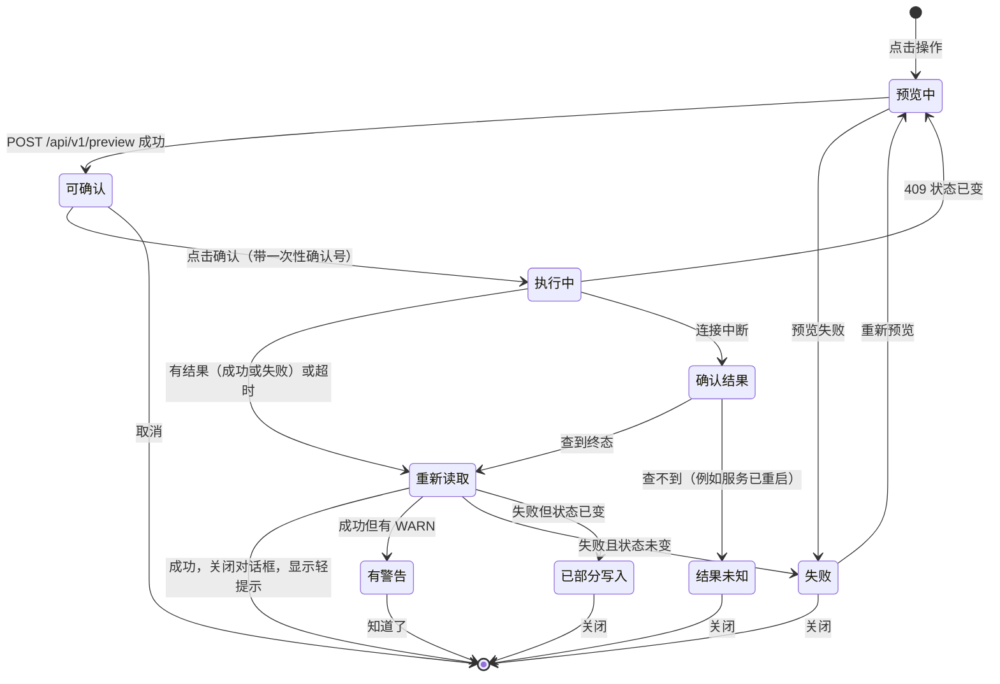

# Themis Tally 桌面端界面设计（UI 设计文档）

状态：**第 4 稿（2026-10-19）**，随架构文档第 6 稿同步闸一第 2–4 轮的处置。

- **用途**：交给 Claude Design 实现客户端界面。
- **依据**：架构设计 `docs/themis-tally-3.0-桌面端.md`（下称“架构文档”）。本文只管界面长什么样、怎么交互；后端、安全边界与接口以架构文档为准。
- **范围**：第一阶段（架构文档第 9 节的 D1–D3）。
  - 能看：状态、证据、日志、用量、配置、插件、历史；
  - 能改配置：角色、方案、profile、runtime、插件启停、回滚；
  - **没有**派遣、验收、合并、试跑等会花钱或改代码的按钮。
- **已定的前提**（用户 2026-10-18 拍板）：
  - Electron 桌面应用，就是 Claude 桌面应用那一路架构：Electron 外壳加 React 界面；
  - 不做浏览器模式；
  - 先做桌面端。

## 0. 给实现者（Claude Design）

### 0.1 要交付什么

1. **高保真页面设计**：第 6 节的全部页面。
   - 亮色、暗色各一套；
   - 窗口宽 1280 与 1024 两档。
2. **组件库**：第 7 节的组件，含全部变体与状态（默认、悬停、按下、聚焦、禁用、加载）。
3. **可运行的前端代码**：
   - React 18 + TypeScript（`strict: true`）+ Vite；
   - 样式写在 `.css` 文件里，只用 `tokens.css` 的变量（第 3 节）；不用 Tailwind、不用 CSS-in-JS 运行时、不用 framer-motion；
   - 图标用 Lucide（ISC 许可），按需引入；
   - **数据层**：`src/api.ts` 按 8.9 的路由写好函数，先返回第 9 节的示例数据，之后由我们接到真实服务；
   - **目录建议**：`src/tokens.css`、`src/components/`（原子与领域组件）、`src/pages/`、`src/api.ts`、`src/mock/`。
4. **关键流程的可点击原型**：
   - 写操作的“预览 → 确认 → 执行 → 结果”（8.3）；
   - 长作业（8.4）；
   - 断线与重连（8.5）。

### 0.2 硬性规则（不可违反）

1. **不加载任何外部资源**：不用网络字体、CDN、远程图片，所有资源随应用打包。内容安全策略只允许本机同源，外部请求会被拦下。
2. **不可信内容只当文本**：
   - 不用 `dangerouslySetInnerHTML`、`innerHTML`、`eval`；
   - 证据、日志、执行报告、补丁、模型输出一律按纯文本显示（7.12）。
   - 示例数据里故意放了一段 ``，界面上必须原样显示成文字。
3. **样式不内联**：HTML 里不写内联的 `<script>` 与 `<style>`，样式放进 CSS 文件。只有宽度、位置这类运行时算出的数值，可以用 React 的 `style` 属性。
4. **不做乐观更新，不自报成功**：写操作的结果只来自服务返回的退出码，以及随后重新读到的数据（8.3）。
5. **先预览，再确认**：每个写操作都要预览与确认，确认框里显示将要运行的 CLI 命令（7.11）。
6. **不显示凭据的值**：后端给出的占位文字（例如“（含疑似凭据，不显示）”“<redacted>”）原样显示，用 7.13 的样式。
7. **不放花钱或改代码的按钮**：第一阶段没有“派遣、验收、合并、试跑”这类按钮。需要时只显示“请在规划端会话里进行”的提示，并附上可复制的命令（6.3）。
8. **视觉是 Themis Tally 自己的**：
   - 品牌色是海军蓝 `#012852` 与符契金 `#D49C32`；
   - 不使用任何其他产品（包括 Claude / Anthropic）的标识、配色、专有字体、插画与文案。
9. **克制的动效**：没有声音；动效只用于状态变化与展开收起，并尊重系统的“减少动态效果”设置。
10. **文字**：界面文字用简体中文（术语见第 10 节）；内核的状态码、命令、路径、模型 ID 原样显示，不翻译。
11. **键盘可达**：所有操作都能用键盘完成；焦点清晰可见（8.6、第 11 节）。
12. **两类页面分开**：首次启动、设置、服务状态三页是外壳页，只用 `window.themisShell`；其余是服务页，用 `src/api.ts` 与少量 `window.themisHost` 函数（5.7）。

## 1. 产品与用户

- **用户**：仓库的主人，也就是规划这个仓库工作的人。代理（Claude Code、Codex、Pi）不用这个界面，它们用 CLI。
- **主要任务**（按频率）：
  1. 一眼看到正在跑什么、哪里需要我判断；
  2. 打开一个 attempt 看证据：摘要、补丁、检查、执行报告、事件；
  3. 像 CC Switch 那样切换角色与模型，方案一键切换；
  4. 检查 CLI 与模型是否就绪；
  5. 看 token 用量；
  6. 管理插件；
  7. 看配置的历史与审计，必要时回滚。

## 2. 设计原则

1. **证据优先**：先显示内核记下的事实，再显示解释。执行器的报告单独标注“这是执行器的自述，不是证据”。
2. **金色只留给“需要你判断”**：符契金只用于四处，不做装饰：
   - 待验收；
   - 需要你注意的计数；
   - 当前页面的指示条；
   - 暗色主题的焦点环。
3. **可追溯**：每个写操作都显示对应的 CLI 命令，结果附审计编号。
4. **克制**：这是信息密度高的工作台，少装饰。状态同时用图标、文字、颜色三种方式表达。
5. **安全默认**：危险操作要确认；不可信内容只当文本；凭据永不显示。

## 3. 设计令牌

所有颜色、字号、间距、圆角、阴影、时长都通过 `tokens.css` 的 CSS 变量取用，前缀 `--tt-`。

### 3.1 原色

| 色系 | 色阶 |
|---|---|
| 海军蓝 navy | 50 `#F0F4FA` · 100 `#DDE6F2` · 200 `#BACCE4` · 300 `#8FA9CF` · 400 `#5C80B4` · 500 `#355E97` · 600 `#1E4679` · 700 `#0F3563` · **800 `#012852`（品牌）** · 900 `#011D3D` · 950 `#00112A` |
| 符契金 gold | 50 `#FCF7EC` · 100 `#F8EBD0` · 200 `#F0D6A0` · 300 `#E7BF6E` · 400 `#DDAA48` · **500 `#D49C32`（品牌）** · 600 `#B5801F` · 700 `#8E6418` · 800 `#694A13` · 900 `#46320E` |
| 冷灰 gray | 0 `#FFFFFF` · 25 `#F9FAFC` · 50 `#F3F5F9` · 100 `#E8ECF2` · 200 `#D5DBE5` · 300 `#B7C0CE` · 400 `#8F9AAD` · 500 `#6A7589` · 600 `#4F596C` · 700 `#3A4354` · 800 `#262E3C` · 850 `#1C2330` · 900 `#141A25` · 950 `#0C111A` |

两个品牌色取自 `Logo/Logo.png` 的像素采样。灰色略偏蓝，与海军蓝协调。

### 3.2 语义色

| 令牌 | 亮色 | 暗色 | 用途 |
|---|---|---|---|
| `--tt-bg` | `#F3F5F9` | `#0C111A` | 内容区背后的底色 |
| `--tt-surface-1` | `#FFFFFF` | `#141A25` | 卡片、面板、表格、对话框 |
| `--tt-surface-2` | `#F9FAFC` | `#1C2330` | 表头、分组底；暗色下的输入框底 |
| `--tt-surface-3` | `#E8ECF2` | `#262E3C` | 悬停、按下 |
| `--tt-surface-selected` | `#F0F4FA` | `#0F2A4D` | 选中的行与项 |
| `--tt-titlebar` | `#FFFFFF` | `#141A25` | 标题栏 |
| `--tt-sidebar` | `#012852` | `#00112A` | 侧栏 |
| `--tt-sidebar-hover` | `#0F3563` | `#0F2A4D` | 侧栏项悬停与选中底 |
| `--tt-sidebar-text` | `#DDE6F2` | `#DDE6F2` | 侧栏文字 |
| `--tt-sidebar-text-muted` | `#8FA9CF` | `#8FA9CF` | 侧栏分组标题 |
| `--tt-text-1` | `#141A25` | `#E8ECF2` | 主文字 |
| `--tt-text-2` | `#4F596C` | `#B7C0CE` | 次要文字 |
| `--tt-text-3` | `#636E82` | `#8F9AAD` | 说明、占位、时间 |
| `--tt-text-disabled` | `#8F9AAD` | `#5A6478` | 禁用（不要求对比度） |
| `--tt-border` | `#D5DBE5` | `#262E3C` | 分割线、卡片边（装饰性） |
| `--tt-border-strong` | `#808B9E` | `#677186` | 输入框、复选框等控件的边框（≥ 3:1） |
| `--tt-primary` | `#012852` | `#8FA9CF` | 主按钮底 |
| `--tt-primary-hover` | `#0F3563` | `#BACCE4` | 主按钮悬停 |
| `--tt-primary-active` | `#011D3D` | `#DDE6F2` | 主按钮按下 |
| `--tt-on-primary` | `#FFFFFF` | `#00112A` | 主按钮文字 |
| `--tt-link` | `#1E4679` | `#8FA9CF` | 链接 |
| `--tt-accent` | `#D49C32` | `#DDAA48` | 金色指示（非文字）：当前页指示条、“需要你判断”的标记 |
| `--tt-accent-text` | `#8E6418` | `#E7BF6E` | 金色文字 |
| `--tt-on-accent` | `#00112A` | `#00112A` | 金底上的文字（计数胶囊） |
| `--tt-focus` | `#355E97` | `#DDAA48` | 焦点环 |
| `--tt-danger` | `#B91C1C` | `#B91C1C` | 危险按钮底（白字） |
| `--tt-danger-text` | `#991B1B` | `#FCA5A5` | 危险文字 |
| `--tt-diff-add` | `#E3F4E8` | `#12301F` | 补丁的新增行底 |
| `--tt-diff-del` | `#FCE4E4` | `#3A1414` | 补丁的删除行底 |
| `--tt-highlight` | `#F8EBD0` | `#3A2C10` | 检索命中的高亮底 |
| `--tt-scrim` | `rgba(12, 17, 26, 0.45)` | `rgba(0, 0, 0, 0.60)` | 对话框遮罩 |

### 3.3 状态色调

状态标签用 8 种色调，每种都是“浅底 + 深字”（暗色主题是“深底 + 浅字”）：

| 色调 | 亮色（底 / 字） | 暗色（底 / 字） |
|---|---|---|
| neutral 中性 | `#E8ECF2` / `#3A4354` | `#262E3C` / `#D5DBE5` |
| info 进行中 | `#DDF1F5` / `#0B5566` | `#0F2E38` / `#67E8F9` |
| attention 需要你判断 | `#F8EBD0` / `#5E420F` | `#3A2C10` / `#F0D6A0` |
| success 通过 | `#E3F4E8` / `#136A34` | `#12301F` / `#86EFAC` |
| warning 注意 | `#FDEBDD` / `#9A3412` | `#3B1D0C` / `#FDBA74` |
| danger 失败 | `#FCE4E4` / `#991B1B` | `#3A1414` / `#FCA5A5` |
| escalate 要你决定 | `#EFE7FD` / `#5B21B6` | `#2A1B4A` / `#C4B5FD` |
| brand 已落地 | `#DDE6F2` / `#012852` | `#0F2A4D` / `#BACCE4` |

### 3.4 attempt 的 17 个状态

状态码来自内核，原样保留；界面显示中文标签，悬停时显示状态码。

| 状态码 | 中文 | 色调 | 图标（Lucide） | 含义 |
|---|---|---|---|---|
| `PREPARING` | 准备中 | info | `hourglass` | 正在建立 attempt 与 worktree |
| `PREPARED` | 待运行 | neutral | `circle-dashed` | 已准备好，等待运行 |
| `PREPARE_FAILED` | 准备失败 | danger | `circle-x` | 准备命令失败 |
| `RUNNING` | 运行中 | info | `loader-circle`（转动；减少动效时静止） | 执行器正在运行 |
| `COLLECTING` | 收集证据 | info | `archive` | 运行结束，正在收集证据 |
| `NEEDS_REVIEW` | 待验收 | attention | `scale` | 证据收齐，等你验收 |
| `PASS` | 通过 | success | `circle-check` | 验收通过 |
| `ACCEPTED_WITH_EXCEPTION` | 带豁免通过 | success | `badge-check`，右上角加 warning 色小圆点 | 通过，但豁免了部分门禁 |
| `REVISE` | 返工 | warning | `rotate-ccw` | 需要出新版本合同返工 |
| `BLOCKED` | 阻塞 | danger | `octagon-x` | 被外部条件挡住 |
| `ESCALATE` | 升级 | escalate | `circle-arrow-up` | 需要用户做决定 |
| `INFRA_FAILURE` | 基础设施故障 | danger | `server-crash` | 环境或证据收集失败 |
| `TIMEOUT` | 超时 | warning | `timer-off` | 超过时限被终止 |
| `CANCELLED` | 已取消 | neutral | `ban` | 被取消 |
| `INTEGRATED` | 已集成 | brand | `git-merge` | 已合入分支 |
| `ABANDONED` | 已放弃 | neutral | `archive-x` | 已放弃 |
| `SUPERSEDED` | 已被取代 | neutral | `layers` | 被后来的 attempt 取代 |
| 其他（将来新增） | 原样显示状态码 | neutral | `circle-help` | 兜底，不报错 |

**状态的分组**（总览与筛选用）：

| 分组 | 状态 |
|---|---|
| 运行中 | PREPARING、RUNNING、COLLECTING |
| 待验收 | NEEDS_REVIEW、TIMEOUT、CANCELLED、INFRA_FAILURE |
| 要你决定 | ESCALATE、BLOCKED |
| 待集成 | PASS、ACCEPTED_WITH_EXCEPTION |
| 已结束 | INTEGRATED、REVISE、ABANDONED、SUPERSEDED、PREPARE_FAILED（修好原因后重新 prepare，是新的 attempt） |

### 3.5 对比度核算

按 WCAG 2.x 公式计算：普通文字要求 ≥ 4.5:1，控件边框与焦点环要求 ≥ 3:1。

| 组合 | 亮色 | 暗色 |
|---|---|---|
| 主文字 / 卡片 | 17.44 | 14.71 |
| 次要文字 / 卡片 | 7.05 | 9.50 |
| 说明文字 / 卡片 | 5.14 | 6.14 |
| 说明文字 / 窗口底 | 4.71 | 5.55（对 surface-2） |
| 链接 / 卡片 | 9.51 | 7.26 |
| 主按钮文字 / 主按钮 | 14.72 | 7.85 |
| 金色文字 / 卡片 | 5.27 | 10.03 |
| 侧栏文字 / 侧栏 | 11.69 | 14.97 |
| 侧栏说明文字 / 侧栏 | 6.13 | 7.85 |
| 控件边框 / 卡片 | 3.44 | 3.56 |
| 焦点环 / 卡片 | 6.56 | 8.24 |
| 危险按钮白字 | 6.47 | 6.47 |
| 8 种状态色调（字 / 底） | 5.85–11.69 | 8.40–10.19 |

### 3.6 字体与字号

- **无衬线**：`system-ui, -apple-system, "Segoe UI", "Microsoft YaHei UI", "Microsoft YaHei", "PingFang SC", "Hiragino Sans GB", "Noto Sans CJK SC", "Noto Sans SC", sans-serif`。
- **等宽**：`"Cascadia Mono", "Cascadia Code", "SF Mono", Menlo, Consolas, "Noto Sans Mono CJK SC", monospace`。
- 不打包字体文件，不用任何专有字体。
- 表格与计数用 `font-variant-numeric: tabular-nums`。

| 令牌 | 字号 / 行高（px） | 字重 | 用途 |
|---|---|---|---|
| `--tt-text-caption` | 12 / 16 | 400 | 时间、计数、辅助说明 |
| `--tt-text-sm` | 13 / 20 | 400 | 表格、次要文字 |
| `--tt-text-md` | 14 / 22 | 400 | 正文（默认） |
| `--tt-text-lg` | 16 / 24 | 400 | 强调正文 |
| `--tt-title-sm` | 14 / 22 | 600 | 卡片标题、表头 |
| `--tt-title-md` | 16 / 24 | 600 | 区块标题 |
| `--tt-title-lg` | 20 / 28 | 600 | 页面标题 |
| `--tt-display` | 28 / 36 | 600 | 总览的大数字 |
| `--tt-mono-sm` | 12 / 18 | 400 | 表格里的 ID、哈希 |
| `--tt-mono-md` | 13 / 20 | 400 | 代码、日志、补丁、命令 |

### 3.7 间距、圆角、阴影、动效、层级与尺寸

| 类别 | 取值 |
|---|---|
| 间距 | `--tt-space-0_5` 2 · `-1` 4 · `-2` 8 · `-3` 12 · `-4` 16 · `-5` 20 · `-6` 24 · `-8` 32 · `-10` 40 · `-12` 48 · `-16` 64（px） |
| 圆角 | `--tt-radius-sm` 4（标签、复选框）· `-md` 6（按钮、输入框、菜单项）· `-lg` 8（卡片、面板、表格容器）· `-xl` 12（对话框、抽屉）· `-full` 999（胶囊、开关） |
| 阴影（亮） | `--tt-shadow-1` `0 1px 2px rgba(1,40,82,.06)` · `-2` `0 4px 12px rgba(1,40,82,.10), 0 1px 3px rgba(1,40,82,.06)` · `-3` `0 16px 40px rgba(1,40,82,.18)` |
| 阴影（暗） | `-1` `0 1px 2px rgba(0,0,0,.40)` · `-2` `0 4px 12px rgba(0,0,0,.50)` · `-3` `0 16px 40px rgba(0,0,0,.60)` |
| 时长 | `--tt-duration-fast` 100ms · `-base` 160ms · `-slow` 220ms；减少动效时全部为 0ms |
| 缓动 | `--tt-ease-standard` `cubic-bezier(0.2, 0, 0, 1)` · `--tt-ease-exit` `cubic-bezier(0.4, 0, 1, 1)` |
| 层级 | 吸顶 10 · 下拉与浮层 100 · 抽屉 200 · 对话框 300 · 轻提示 400 · 工具提示 500 |
| 窗口 | 最小 1024 × 640，默认 1280 × 800 |
| 框架 | 标题栏高 40 · 侧栏宽 220（收起 56）· 状态栏高 26 · 页面内边距 24（内容宽度 < 760 时 16） |
| 控件高 | 小 28 · 中 32（默认）· 大 36 |
| 表格 | 表头 32 · 行 36（紧凑 32） |
| 抽屉 | 默认宽 520，可拖动，范围 400 到窗口宽的 60% |
| 对话框 | 小 400 · 中 560 · 大 760 |

### 3.8 `tokens.css` 草样

只列出结构，完整取值见 3.2–3.7。

```css
:root {
  color-scheme: light;
  --tt-bg: #F3F5F9;
  --tt-surface-1: #FFFFFF;
  --tt-surface-2: #F9FAFC;
  --tt-surface-3: #E8ECF2;
  --tt-text-1: #141A25;
  --tt-text-2: #4F596C;
  --tt-text-3: #636E82;
  --tt-primary: #012852;
  --tt-on-primary: #FFFFFF;
  --tt-accent: #D49C32;
  --tt-focus: #355E97;
  /* 状态色调：--tt-tone-<色调>-bg / --tt-tone-<色调>-fg，见 3.3 */
  --tt-tone-attention-bg: #F8EBD0;
  --tt-tone-attention-fg: #5E420F;
  /* …其余语义色、字号、间距、圆角、阴影、动效同理 */
  --tt-font-sans: system-ui, -apple-system, "Segoe UI", "Microsoft YaHei UI", "Microsoft YaHei", "PingFang SC", "Hiragino Sans GB", "Noto Sans CJK SC", "Noto Sans SC", sans-serif;
  --tt-font-mono: "Cascadia Mono", "Cascadia Code", "SF Mono", Menlo, Consolas, "Noto Sans Mono CJK SC", monospace;
  --tt-duration-base: 160ms;
}

:root[data-theme="dark"] {
  color-scheme: dark;
  --tt-bg: #0C111A;
  --tt-surface-1: #141A25;
  /* …暗色取值见 3.2、3.3 */
}

@media (prefers-color-scheme: dark) {
  :root:not([data-theme="light"]) {
    color-scheme: dark;
    --tt-bg: #0C111A;
    /* …与 [data-theme="dark"] 相同 */
  }
}

@media (prefers-reduced-motion: reduce) {
  :root {
    --tt-duration-fast: 0ms;
    --tt-duration-base: 0ms;
    --tt-duration-slow: 0ms;
  }
}
```

主题在“设置 → 外观”里选：跟随系统（缺省）、亮、暗；选亮或暗时在根元素上写 `data-theme`。

## 4. 品牌与图标

### 4.1 标识

- **原图**：`Logo/Logo.png`，1254 × 1254，透明底。海军蓝的盾与天平，中间一根金色符契。
- **需要的两个 SVG 版本**：照原图的几何形状重画，比例保持一致。
  - **彩色版**：盾与天平 `#012852`，符契 `#D49C32`。用于浅色底，例如亮色标题栏、关于页。
  - **反白版**：盾与天平 `#DDE6F2`，符契 `#D49C32`。用于海军蓝或深色底，例如侧栏、暗色标题栏。
- **最小尺寸**：16px；四周留白至少为标识宽度的 1/8。
- **产品名**：“Themis Tally”，副名“参验”。标题栏只写“Themis Tally”；关于页写全称“Themis Tally · 参验”。
- **应用图标**：彩色版放在海军蓝 `#012852` 的圆角方块上，圆角为边长的 22%，标识占方块宽的 72%。Windows 需要的 `.ico` 尺寸为 16、24、32、48、256。

### 4.2 图标

- 使用 Lucide，线宽 1.75；尺寸 16（表格、按钮里）、18（侧栏）、20（页面头）。
- 只用图标的按钮必须有工具提示与 `aria-label`。

| 用途 | 图标 |
|---|---|
| 总览 | `layout-dashboard` |
| 任务 | `list-checks` |
| 角色与模型 | `sliders-horizontal` |
| CLI 运行时 | `square-terminal` |
| 凭据 | `key-round` |
| 日志与用量 | `scroll-text` |
| 插件 | `puzzle` |
| 历史与审计 | `history` |
| 设置 | `settings` |
| 刷新、复制、外部打开、搜索、筛选、关闭 | `refresh-cw`、`copy`、`external-link`、`search`、`filter`、`x` |
| 仓库切换、主题 | `folder-open`、`sun` / `moon` / `monitor` |
| 自述提示、警告、信息、遮蔽 | `message-square-warning`、`triangle-alert`、`info`、`lock` |
| 补丁、文件、检查 | `file-diff`、`file-text`、`list-checks` |
| 连接断开 | `unplug` |

## 5. 应用框架

### 5.1 线框

```text
┌──────────────────────────────────────────────────────────────────────────────────────┐
│ [盾] Themis Tally │ 📁 demo-repo ▾                        ● 已连接   ◐   [ ─ □ ✕ 系统 ] │ ← 标题栏 40
├──────────────┬───────────────────────────────────────────────────────────────────────┤
│ ▌总览         │  总览                                                      [↻ 刷新]  │
│  任务     [2] │  demo-repo · kit 2.12.0                                               │
│  角色与模型   │ ───────────────────────────────────────────────────────────────────── │
│  CLI 运行时   │                                                                       │
│  凭据         │                         页面内容（第 6 节）                            │
│  日志与用量   │                                                                       │
│  插件         │                                                                       │
│  历史与审计   │                                                                       │
│               │                                                                       │
│  设置         │                                                                       │
│  « 收起       │                                                                       │
├──────────────┴───────────────────────────────────────────────────────────────────────┤
│ ● 运行中 1   ● 待验收 2   上次更新 3 秒前                          kit 2.12.0 · demo-repo │ ← 状态栏 26
└──────────────────────────────────────────────────────────────────────────────────────┘
```

### 5.2 标题栏

- 高 40，底色 `--tt-titlebar`，下边框 `--tt-border`。
- 整条可以拖动窗口；其中的按钮与下拉不参与拖动（`-webkit-app-region: no-drag`）。
- 预留系统按钮的位置：Windows 右侧留 140px 给系统的最小化、最大化、关闭按钮（由 Electron 的标题栏覆盖层绘制，符号颜色跟随主题）；macOS 左侧留 80px 给红绿灯。
- **左侧**：
  - 彩色标识 20px（暗色主题用反白版）；
  - “Themis Tally”（`--tt-title-sm`）；
  - 竖分隔线；
  - 仓库切换按钮：`folder-open` 图标、仓库名、`chevron-down`。
- **右侧**：
  - 连接状态胶囊（7.20）；
  - 主题切换按钮：点击弹出菜单，可选跟随系统、亮、暗。

### 5.3 侧栏

- **尺寸与配色**：宽 220，底色 `--tt-sidebar`。项高 36，左右内边距 12，图标 18 加文字。
- **项的状态**：
  - 当前项：底色 `--tt-sidebar-hover`，文字白色，左侧有 3px 金色指示条 `--tt-accent`；
  - 悬停：底色 `--tt-sidebar-hover`。
- **顺序**：总览、任务、角色与模型、CLI 运行时、凭据、日志与用量、插件、历史与审计；底部是设置与“收起”。
- **计数**：“任务”项右侧显示“待验收 + 要你决定”的数量，用金色胶囊（底 `--tt-accent`，字 `--tt-on-accent`，`--tt-text-caption` 600）；数量为 0 时不显示。
- **收起后**：宽 56，只显示图标，悬停显示工具提示；收起状态要记住。

### 5.4 状态栏

- 高 26，底色 `--tt-surface-1`，上边框 `--tt-border`，文字用 `--tt-text-caption` 与 `--tt-text-2`。
- **左侧**：
  - “运行中 N”（info 色小圆点）；
  - “待验收 N”（金色小圆点）；
  - “上次更新 X 秒前”。
- **右侧**：kit 版本、仓库名。
- 点击“运行中”或“待验收”，跳到“任务”并带上对应筛选。

### 5.5 内容区与页面头

- 内容区底色 `--tt-bg`，内边距 24。
- **页面头**：
  - 第一行：标题（`--tt-title-lg`）加右对齐的操作按钮；
  - 第二行：可选的说明（`--tt-text-sm`，`--tt-text-2`）；
  - 下方：页面级提示条（7.18）。
- 页面内容由卡片（7.10）与表格（7.9）组成，卡片间距 16。

### 5.6 浮层

| 浮层 | 规格 |
|---|---|
| 抽屉 | 从右侧滑出，宽见 3.7；头部有标题与关闭按钮；Esc 关闭；打开时焦点进入抽屉，关闭后回到触发它的元素 |
| 对话框 | 居中，宽见 3.7，带遮罩 `--tt-scrim`；焦点陷阱；Esc 关闭（执行中除外，见 7.11） |
| 提示条 | 页面级，放在页面头下方；色调 info / warning / danger；只有 info 可以关掉 |
| 轻提示 | 右下角，只用于已经确认的结果（例如“已切换到方案 economy · 审计 #42”）与“已复制”；5 秒后消失，悬停时暂停；出错不用轻提示，在原处显示 |

### 5.7 两类页面

| | 外壳页 | 服务页 |
|---|---|---|
| 页面 | 首次启动（6.1）、设置（6.10）、服务状态与恢复（6.12） | 其余全部 |
| 从哪加载 | 打包在应用里，由外壳直接加载 | 由本机服务托管 |
| 服务没起来时 | 能打开 | 打不开 |
| 数据与操作 | `window.themisShell`：读设置与环境、系统选择对话框、保存设置、启动与重启服务、`service-state` 事件 | `src/api.ts`（8.9），加上少量 `window.themisHost` 函数：重新认证、凭据小窗口、外部打开、在资源管理器中显示、通知、打开设置 |
| 显示证据 | 从不 | 是（按 7.12 只当文本） |

两类页面用同一套 `tokens.css` 与组件，视觉上无缝衔接，可以是同一个前端工程的两个入口。原型里两个接口都用桩函数代替（8.9）。

## 6. 页面

每个页面都要设计这几种状态：
- 首次加载：超过 300ms 显示骨架屏；
- 有数据；
- 空；
- 出错：在原处显示错误与重试按钮；
- 断线：保留旧数据，顶部显示提示条。

### 6.1 首次启动

没有配置仓库，或服务没能启动时显示。

```text
┌─────────────────────────────────────────────┐
│               [盾 48px]                      │
│           欢迎使用 Themis Tally              │
│   选一个已经接入 Themis Tally 的 Git 仓库      │
│                                              │
│  ① 选择仓库   C:\Projects\demo-repo  [更换…]  ✓ │
│  ② Python     3.13.1                          ✓ │
│  ③ kit        2.12.0（仓库里装好的）          ✓ │
│  ④ 本机服务   正在启动…                       ◌ │
│                                              │
│                              [ 进入 ]（禁用） │
└─────────────────────────────────────────────┘
```

- 卡片宽 560，居中。四步依次检查，每一步右侧显示 ✓、✗ 或转圈。
- 这是外壳页（5.7）：服务还没起来时也能打开。数据来自 `themisShell.getState()`；[更换…] 与“指定…”按钮调用 `pickRepo()`、`pickPython()`、`pickKit()`（系统对话框）；选中且校验通过后由外壳直接保存，界面只显示返回的结果；第 4 步调用 `startService(repo)`，并监听 `service-state` 事件。
- **错误与处理**（文案见第 10 节）：

| 情形 | 显示 | 操作 |
|---|---|---|
| 不是 Git 仓库 | “这个文件夹不是 Git 仓库” | 重新选择 |
| 没有 `.agent/` | “这个仓库还没有接入 Themis Tally” | 显示可复制的接入命令：`python <ThemisTally>/scripts/kit_install.py install <仓库>` |
| 找不到 Python | “找不到 Python 3.10 及以上” | 指定 python.exe… |
| 找不到 kit | “找不到 Themis Tally 的 kit” | 指定 kit 目录… |
| 服务退出 1，已有服务 | “这个仓库已经在另一个窗口里打开了” | 切换到那个窗口 |
| 服务退出 2，缺少前端资源 | “应用文件不完整，请重新安装” | — |

### 6.2 总览

```text
 总览                                                                    [↻]
 demo-repo · kit 2.12.0
┌──────────────┐┌──────────────┐┌──────────────┐┌──────────────┐
│ 运行中        ││ 待验收  ▌金   ││ 要你决定      ││ 待集成        │
│ 1            ││ 2            ││ 1            ││ 1            │
└──────────────┘└──────────────┘└──────────────┘└──────────────┘
┌ 需要你判断 ───────────────────────────────────────────────────────────┐
│ [待验收] logs-cat.v2 · attempt-002   28 分 39 秒   检查 8/8   [查看证据] │
│ [超时]   plugin-verify-json.v1 · attempt-001   30 分 0 秒     [查看证据] │
│ [升级]   secret-check-json.v1 · attempt-001                   [查看证据] │
│ 验收在规划端会话里进行：/review-pi .agent/runs/logs-cat/attempt-002               [复制]     │
└──────────────────────────────────────────────────────────────────────┘
┌ 运行中 ──────────────────────────────────────────────────────────────┐
│ [运行中] ui-readonly-api.v1 · attempt-001  已用 19 分 6 秒  工具调用 37 次 │
│          ⚠ 长时间没有工具调用（6420 个增量）               [跟随事件]  │
└──────────────────────────────────────────────────────────────────────┘
┌ 最近的配置变更 ──────────────────────────────────────────────────────┐
│ #42  10:02  preset.use  default   [user-ui]                           │
│ #41  09:47  runtime.add pi        [user]                               │
└──────────────────────────────────────────────────────────────────────┘
```

- **指标卡**：四张，按 3.4 的分组计数。
  - 数字用 `--tt-display`；卡片左侧有 3px 的色调条：运行中为 info，待验收为金色，要你决定为 escalate，待集成为 brand；
  - 点击卡片跳到“任务”并带上对应筛选。
- **“需要你判断”**：待验收与要你决定的 attempt，按状态时间倒序。
  - 卡片左边框为 3px 金色；
  - 每行：状态标签、`<task>.v<N> · attempt-NNN`、用时、检查结果、[查看证据]；
  - 卡片底部放“下一步”提示条（7.21）。
- **“运行中”**：每行显示已用时间与工具调用次数。`long_idle` 为真时，加一个 warning 色标签“长时间没有工具调用（N 个增量）”。按钮 [跟随事件] 打开 attempt 详情的“事件”页签。
- **“待集成”**：通过但还没集成的 attempt，同样附“下一步”提示：集成在规划端会话里进行。
- **“最近的配置变更”**：最近 5 条配置历史。每条显示编号、时间、动作、对象、执行者标签（7.8）。
- **空状态**：图标 `list-checks`，文字“还没有 attempt”，说明“在规划端用 /dispatch-pi 派遣第一个任务”。

数据来源：`/api/v1/status`（带 `live`）、`/api/v1/events`（推送）、`/api/v1/config/history`、`/api/v1/meta`。

### 6.3 任务与 attempt

**列表页**：

```text
 任务                                                                       [↻]
┌ 任务 ───────────────────┐┌ logs-cat ──────────────────────────────────────────┐
│ 🔍 搜索任务…              ││ attempt  版本 状态      用时        检查     结论    越界 token        费用 │
│ [运行中][待验收][要你决定]  ││ 002      v2  [待验收]  28 分 39 秒  8/8 fresh  —      0  4,210,385  未知 │
│ [待集成][已结束]           ││ 001      v1  [返工]    18 分 22 秒  6/8 fresh  [返工]  0  5,637,968  未知 │
│ ▌logs-cat        [待验收] ││                                                    │
│  ui-readonly-api [运行中] ││                                                    │
│  status-live-json [通过]  ││                                                    │
└─────────────────────────┘└────────────────────────────────────────────────────┘
```

- **左栏**（宽 320）：任务列表。
  - 每行显示任务 ID 与最新 attempt 的状态，按最近更新排序；
  - 顶部有搜索框与状态分组筛选（多选的胶囊，分组见 3.4）。
- **右栏**：所选任务的 attempt 表格。
  - 列：attempt、版本、状态、用时、检查（`8/8` 加模式）、结论、失败分类、越界数（大于 0 时用 danger 色）、token、费用；
  - 费用为空时显示“未知”，不显示 0；
  - 点击一行进入详情。

**详情页**（面包屑：任务 › logs-cat › attempt-002）：

```text
 logs-cat · attempt-002  [待验收]
 版本 v2 · 状态时间 2026-10-18 14:21 · 用时 28 分 39 秒 · token 4,210,385 · 费用 未知 · 检查 8/8（fresh）· 越界 0
┌ 下一步 ────────────────────────────────────────────────────────────────┐
│ ⓘ 这个 attempt 等你验收。验收在规划端会话里进行：  /review-pi .agent/runs/logs-cat/attempt-002  [复制] │
└────────────────────────────────────────────────────────────────────────┘
 [摘要] [补丁] [检查] [执行报告] [事件] [全部文件]
┌──────────────────────────────────────────────────────────────────────┐
│  （页签内容）                                                          │
└──────────────────────────────────────────────────────────────────────┘
```

**页签**：

| 页签 | 内容 | 组件 |
|---|---|---|
| 摘要 | `summary.md`，用安全的 Markdown 渲染；被截断时提示“摘要较长，只显示前 N KB”，并给 [查看全文] | 安全 Markdown（7.12） |
| 补丁 | `candidate.patch`。左侧是文件列表（每个文件的 +/− 行数）；可切换统一 / 分屏；可开关自动换行；二进制文件显示“二进制文件，不显示内容” | 差异视图（7.14） |
| 检查 | `checks/NN/` 的每次检查：模式（in_place / fresh）、检查 ID、通过或失败、日志 | 表格 + 文本查看器 |
| 执行报告 | 顶部固定一条 warning 提示条：“以下是执行器的自述，不是证据”；内容按纯文本显示 | 文本查看器（7.12） |
| 事件 | `events.jsonl`。运行中的 attempt 可以开启“跟随”；有过滤输入框（按文字包含） | 日志跟随（7.15） |
| 全部文件 | `logs show` 的证据清单（路径、大小）；点击按段打开 | 表格 + 文本查看器 |

**“下一步”提示**（7.21），按状态显示：

| 状态 | 文字 | 可复制的内容 |
|---|---|---|
| 待验收那几个 | 这个 attempt 等你验收。验收在规划端会话里进行。 | `/review-pi .agent/runs/<task>/attempt-NNN`（精确到正在看的 attempt） |
| 待集成 | 已通过，等待集成。集成在规划端会话里进行。 | `/review-pi .agent/runs/<task>/attempt-NNN`（精确到正在看的 attempt） |
| 返工 | 需要出新版本合同返工。 | `/plan-task <task>` |
| 升级、阻塞 | 需要你做决定，见摘要里的阻塞点。 | — |

数据来源：`/api/v1/attempts`、`/api/v1/attempts/<task>/<attempt>`、`/api/v1/attempts/<task>/<attempt>/file`。详情页头部的版本、用时、token、检查结果取自 `/api/v1/status` 里这一行；摘要与证据清单取自 `getAttempt`。

### 6.4 角色与模型

这是“像 CC Switch 那样”切换模型的地方。

```text
 角色与模型                                          [保存当前为方案…] [新建 profile]
 四个角色各用哪个 CLI 与模型；方案可以一键切换
┌ 当前方案 ────────────────────────────────────────────────────────────┐
│ [ default ✓ ][ economy ]                                    [切换…]   │
└──────────────────────────────────────────────────────────────────────┘
┌ 规划审核端  planning_review ─────┐┌ 合同端  contract ─────────────────┐
│ [交互式宿主]  claude-code         ││ [手工]  规划端亲自写合同   [默认]   │
│ 模型由宿主决定，Themis 不切换      ││                                    │
│                         [更改…]  ││                          [更改…]   │
└──────────────────────────────────┘└────────────────────────────────────┘
┌ 执行端  execution ───────────────┐┌ 调度代理  scheduler_agent ─────────┐
│ [无头]  profile step-high         ││ [关闭]  本轮没有实现       [默认]   │
│ runtime pi（pi）· [已接通]        ││                                    │
│ bb/step-5-preview · thinking high ││                                    │
│                         [更改…]  ││                          [更改…]   │
└──────────────────────────────────┘└────────────────────────────────────┘
┌ profile ─────────────────────────────────────────────────────────────┐
│ ID          runtime  模型                   thinking  凭据变量       被引用     │
│ step-high   pi       bb/step-5-preview      high      STEP_API_KEY  执行端     │
│ step-low    pi       bb/step-5-mini         low       STEP_API_KEY  方案 economy │
└──────────────────────────────────────────────────────────────────────┘
┌ 方案 ────────────────────────────────────────────────────────────────┐
│ default ✓  日常：执行端用 step-5-preview（high）   4 个角色  [查看差异]          │
│ economy    省钱：执行端用 step-5-mini（low）        1 个角色  [使用] [删除]      │
└──────────────────────────────────────────────────────────────────────┘
```

- **当前方案**：分段选择列出全部方案，当前方案带勾。
  - 选中另一个方案再点 [切换…]，打开确认框（7.11）；
  - 确认框里显示：命令 `config preset use economy`、每个角色变化前后的对比、运行中的 attempt 与“需要确认”的说明；
  - 没有方案时显示空状态：“还没有方案：把当前的角色绑定存成方案，之后就能一键切换”。
- **四张角色卡**（2 × 2）：
  - 卡头：中文角色名加角色码（等宽、`--tt-text-3`）；
  - 模式标签：交互式宿主、无头、手工、关闭；
  - 无头时显示 profile、runtime（适配器）、provider/model、thinking、接通状态；
  - 没有显式写出的角色显示 neutral 标签“默认”；
  - `differs_from_preset` 为真时，显示 attention 标签“与方案 default 不一致”；
  - 没接通时，显示 warning 标签“本轮未接通”。
- **[更改…] 对话框**：
  - 模式用分段选择，只列这个角色允许的模式：

    | 角色 | 允许的模式 |
    |---|---|
    | 规划审核端 | 交互式宿主、无头 |
    | 合同端 | 手工、无头 |
    | 执行端 | 无头 |
    | 调度代理 | 关闭、无头 |
  - 选无头时再选 profile；
  - 底部实时显示预览（`--dry-run` 的结果）；
  - 本轮只有 pi 能担任执行端与合同端的无头角色；选了不能接通的组合时，预览里显示内核给出的警告。
- **profile 表格**：列为 ID、runtime、模型、thinking、凭据变量（只显示变量名，等宽标签）、被引用。
  - 行操作有 [编辑] 与 [删除]；被引用时 [删除] 禁用，工具提示说明“被执行端引用，先改绑定”。
- **新建 / 编辑 profile 对话框**：

  | 字段 | 控件 | 校验与说明 |
  |---|---|---|
  | ID | 文本框 | 小写字母、数字、连字符 |
  | runtime | 下拉 | 已登记的 runtime |
  | 模型 | 下拉 | 由“列出模型”作业填充（pi）；也可手填，手填时提示“手填的模型没有核实” |
  | thinking | 分段选择 | off、minimal、low、medium、high、xhigh、max；缺省 high |
  | 凭据变量 | 标签输入 | 只写变量名，校验 `^[A-Za-z_][A-Za-z0-9_]*$`；说明“值在‘凭据’页录入” |

- **方案表格**：名称、说明、包含的角色、是否当前。
  - 操作有 [使用]、[查看差异]（与当前方案比较）、[删除]（当前方案不能删）；
  - 页面头的 [保存当前为方案…] 打开对话框，填写名称与说明，再预览、确认。

数据来源：`/api/v1/roles`、`/profiles`、`/presets`、`/presets/<a>/diff/<b>`、`/preview`，以及对应的写路由。

### 6.5 CLI 运行时

```text
 CLI 运行时                                                 [扫描 PATH] [手动登记…]
┌ 已登记 ─────────────────────────────────────────────────────────────────────┐
│ ID           适配器        能担任             命令来源    命令                    版本    操作 │
│ pi           pi            执行端、合同端      [本机文件]  C:/tools/…/cli.js       1.3.0   [探测][模型][删除] │
│ claude-code  claude-code   交互式宿主          [PATH]      …/claude.cmd            —       [探测][删除] │
│ opencode     opencode      未接通              [找不到]    —                       —       [删除] │
└────────────────────────────────────────────────────────────────────────────┘
┌ 就绪检查 ──────────────────────────────────────────────────────────────────┐
│ [运行就绪检查]     按版本记录核验：[ logs-cat.v2 ] [核验]                         │
│ ✗ 执行端  未就绪                                                              │
│   命令  C:/tools/node/node.exe C:/tools/pi/dist/cli.js（本机文件）· 版本 1.3.0      │
│   模型在列表中 是 · 登录 是 · 思考级别 是 · 允许列表 是 · 已接通                   │
│   凭据  STEP_API_KEY 不可用                                                   │
│   − 凭据变量不可用（被移除、没有设置或为空）：STEP_API_KEY                         │
│ ✓ 规划审核端  interactive_host · claude-code（交互宿主的模型不由 Themis 切换）       │
└────────────────────────────────────────────────────────────────────────────┘
```

- **已登记表格**：
  - “命令来源”用标签显示：环境变量、本机文件、PATH、找不到（danger）；
  - 命令用等宽字体，太长时从中间截断，悬停显示全文；
  - “能担任”来自适配器：pi 是执行端与合同端；claude-code、codex 是交互式宿主；opencode 本轮未接通。
- **作业类按钮**：[扫描 PATH]、[探测]、[模型]、[运行就绪检查]、[核验] 都会启动长作业（8.4），用作业进度卡片（7.17）显示，可以取消。
- **扫描结果**：列出找到的 CLI 与版本，每行一个 [登记]。一次确认登记一个（`config runtime add <id> --adapter <a>`），不做“登记全部”。
- **手动登记对话框**：
  - 字段：ID、适配器（下拉）、命令（列表编辑器：程序加若干参数，每项一个文本框）；
  - 说明：“写绝对路径。命令只保存在本机文件 .agent/dispatch.local.json，不进提交的配置。”
- **就绪检查结果**：每个无头角色一张就绪卡（7.22）；其他角色只显示一行文字。“按版本记录核验”的结果卡标题写“版本记录 .agent/runs/logs-cat/binding-v2.json”。
- **模型对话框**：表格列为 provider、model、是否在允许列表；说明“模型列表来自 pi --list-models，不调用模型”。

### 6.6 凭据

```text
 凭据
 这里只显示每个环境变量在哪一层找到，从不显示值
┌──────────────────────────────────────────────────────────────────────┐
│ 变量名           用在哪里                来源             操作       │
│ STEP_API_KEY     profile step-high、step-low  [系统凭据库]   [录入…]    │
│ TYPESAFE_API_KEY 决策模型                [没有]           [录入…]    │
└──────────────────────────────────────────────────────────────────────┘
 ⓘ 录入只在单独的一次性页面里进行，值直接存进系统凭据库；这个界面拿不到值。
```

- 名单由服务合成：决策模型用的变量名，加上各个 profile 的 `credential_env`（`GET /api/v1/secrets`）。
- “来源”标签：环境变量、系统凭据库、0600 文件、没有（danger）。
- [录入…]：
  - 服务启动凭据录入作业（`startSecretEntry(name)`），拿到一次性页面的地址；
  - 界面调用 `themisHost.openSecretWindow(url, jobId)`，外壳另开一个小窗口，标题为“录入凭据 STEP_API_KEY”。窗口里是内核自己的一次性页面，不是本界面的组件；
  - 等待期间，这一行显示作业卡片（7.17）：“等你在弹出的窗口里粘贴并保存…”，附 [取消]；关掉小窗口也算取消，由外壳通知服务，界面不用处理；
  - 作业结束（保存、取消或超时）后，自动重新检查这一行的来源。

### 6.7 日志与用量

两个页签：检索、用量。

- **检索**：
  - 输入：搜索框（说明“Python 正则表达式”）、任务筛选、最多条数（缺省 50）；
  - 结果按 attempt 分组：`路径:行号` 加命中的那一行；摘录取自脱敏之后的文本，被遮蔽的值搜不到是正常的；命中部分用 `--tt-highlight` 底色，全部按文本显示；
  - 点击结果，在文本查看器里打开该文件并跳到那一行。
- **用量**：
  - 两张汇总卡：
    - **执行端（Pi）**：总 token 加分项（input、output、cacheRead、cacheWrite），以及 known、partial、unknown 的计数；
    - **规划端**：没设置会话记录目录时显示空状态“在设置里指定会话记录目录后统计”，按钮 [去设置]；设置后按模型列出，分主线与子代理。目录在设置外壳页里用系统对话框选择，保存后外壳重启本机服务，新目录才生效。
  - 表格按 attempt 列出：任务、attempt、模型、状态标签（known 为 success、partial 为 warning、unknown 为 neutral）与各项 token；
  - 第二张表格按模型列出；
  - 横向条形图只用 CSS 画，不引入图表库；
  - 固定说明：“合计是下界：没有回报的记为未知，不计为 0。”

### 6.8 插件

```text
 插件                                                                  [核对全部]
┌──────────────────────────────────────────────────────────────────────┐
│ ID              版本   启用      锁      资源    缺的权限   状态     操作     │
│ decisions       1.0.0  [启用]    [一致]  [一致]  —          READY   [停用]   │
│ code-change     1.0.0  [停用]    [一致]  [一致]  —          READY   [启用]   │
│ docs-checks     1.0.0  [不限制]  [漂移]  [一致]  fs.write   DRIFT   [详情]   │
└──────────────────────────────────────────────────────────────────────┘
```

- **启用状态**：启用、停用、不限制（没有配置启用名单时）。
- **锁与资源**：一致为 success；其他取值为 warning 或 danger，并显示原因。
- **[启用] / [停用]**：先运行 `--dry-run` 预览，确认框里显示权限的变化，再确认执行。
- **点击一行**：打开抽屉，显示 `plugins show` 的 manifest 字段、资源哈希核对、锁的 generation 与 `lock_sha256`（等宽字体）。
- **表格下方**：“列入但未安装”与“问题”两个列表。

### 6.9 历史与审计

- **表格**：

  | 列 | 显示 |
  |---|---|
  | 编号 | `#42` |
  | 时间 | 本地时间，悬停显示 UTC |
  | 资源 | 配置、本机文件 |
  | 动作 | 例如 `preset.use`，悬停显示中文说明（第 10 节） |
  | 对象 | 等宽 |
  | 执行者 | 标签：`user`、`user-ui`、`agent:<role>`、`undeclared`，见 7.8 |
  | 确认 | `flag`（带了 --yes）、`none` |
  | 状态 | 已发布、已中止、未知 |
  | 改动的键 | 标签 |
  | 外部改动 | 有时显示 warning 标签“检测到外部改动” |

- **点击一行**：打开抽屉，显示前后快照的键级差异。快照只存了哈希时，显示 7.13 的遮蔽样式与“快照里有疑似凭据，只存了哈希”。
- **抽屉底部 [回滚到这一条之后]**：确认框显示与当前配置的差异、运行中的 attempt 与命令 `config rollback 42`。
- **页面头的提示条**：有读不出的历史行时，显示 warning 提示条“历史里有 N 行读不出来”。

### 6.10 设置

这是外壳页（5.7），服务没起来时也能打开。设置保存在桌面应用自己的用户数据目录里，不写进仓库的配置。改了 Python、kit 或会话目录，保存后外壳会重启本机服务。

| 分组 | 内容 |
|---|---|
| 仓库 | 已添加的仓库列表（名称、路径、上次打开）；[添加仓库…]；[从列表移除]（只从应用里移除，不动仓库） |
| 运行环境 | Python 路径（自动检测的值，加 [更改…] 与 [恢复自动检测]）；kit 位置（仓库里装好的，或外部目录，同样两个按钮）；版本信息。[更改…] 调用选择器，选中且校验通过即保存；[恢复自动检测] 调用 `saveSettings` |
| 规划端用量 | 会话记录目录（可选，用系统对话框选择）；只读用量字段，不读对话内容；保存后重启服务生效 |
| 外观 | 主题：跟随系统、亮、暗；密度：标准、紧凑 |
| 关于 | 版本；开源许可清单；项目主页链接（外部打开前确认） |

### 6.11 第一阶段不做的页面

需求与合同、四端拓扑、反馈流、推进：要等内核的后续阶段（架构文档 D11）。第一阶段**不出现在导航里**，也不放“即将推出”的占位。

### 6.12 服务状态与恢复（外壳页）

- 服务启动失败、意外退出、或会话无法恢复（8.2）时显示，替代整个窗口的内容。
- 内容：danger 色的状态图标、标题“本机服务已停止”、退出码、按 6.1 错误表给出的说明，按钮 [重启服务] [打开设置]。
- 数据来自 `themisShell.getState()` 与 `service-state` 事件；[重启服务] 调用 `restartService()`。

## 7. 组件规格

每个组件都要有默认、悬停、按下、聚焦、禁用状态，需要时加上加载与出错状态。

### 7.1 按钮

| 变体 | 底色 / 文字 / 边框 | 用途 |
|---|---|---|
| 主按钮 | `--tt-primary` / `--tt-on-primary` / 无 | 页面里最重要的一个操作 |
| 次按钮 | `--tt-surface-1` / `--tt-text-1` / `--tt-border-strong` | 一般操作 |
| 幽灵按钮 | 透明 / `--tt-text-1`；悬停 `--tt-surface-3` | 表格行内、工具栏 |
| 危险按钮 | `--tt-danger` / 白字 | 删除、回滚的确认按钮 |

- 尺寸：高 28、32、36；圆角 `--tt-radius-md`；左右内边距 12（小）或 16；图标 16；文字 `--tt-text-md` 500。
- 加载状态：图标换成转圈，文字改为“正在…”，按钮禁用。
- 焦点：2px `--tt-focus` 环，外偏 2px。

### 7.2 图标按钮

正方形，28 或 32；必须有工具提示与 `aria-label`。

### 7.3 输入框、下拉、多行文本、标签输入

- 高 32，边框 `--tt-border-strong`，圆角 `--tt-radius-md`。
- 聚焦时边框为 `--tt-focus`，并显示焦点环。
- 出错时边框为 `--tt-danger-text`，下方显示错误文字（`--tt-text-sm`）。
- 帮助文字用 `--tt-text-3`。

### 7.4 分段选择

- 轨道底色 `--tt-surface-2`，圆角 `--tt-radius-md`，内边距 2。
- 选中段：底色 `--tt-surface-1`，阴影 `--tt-shadow-1`。
- 左右方向键切换。

### 7.5 开关与复选框

标准样式，边框 `--tt-border-strong`；选中时底色 `--tt-primary`。

### 7.6 页签

- 下划线样式：当前页签文字 `--tt-text-1`，下面 2px `--tt-primary`；其他页签文字 `--tt-text-2`。
- 左右方向键切换；`role="tablist"`。

### 7.7 状态标签

- 高 22（小号 20），圆角 `--tt-radius-sm`，左右内边距 8。
- 图标 14 加文字（`--tt-text-sm` 500）；色调见 3.3，状态见 3.4。
- 悬停显示状态码。
- 不能只靠颜色：图标与文字必须同时存在。

### 7.8 标签（Tag）

小号中性标签，用于 ID、变量名、键名。等宽版本用 `--tt-mono-sm`。

执行者标签的色调：

| 执行者 | 色调 |
|---|---|
| `user-ui` | brand |
| `user` | neutral |
| `agent:<role>` | info |
| `undeclared` | warning |

### 7.9 表格

- 容器：`--tt-surface-1`，边框 `--tt-border`，圆角 `--tt-radius-lg`。
- 表头：高 32，底色 `--tt-surface-2`，`--tt-title-sm`，文字 `--tt-text-2`，吸顶。
- 行：高 36；悬停 `--tt-surface-3`；选中 `--tt-surface-selected`，左侧 2px `--tt-primary`。
- 数字列右对齐，用等宽数字。
- 键盘：上下方向键移动，Enter 打开，Home / End 到首尾。
- 宽度不够时，表格在容器内横向滚动，不让整个页面出现横向滚动。

### 7.10 卡片

底色 `--tt-surface-1`，边框 `--tt-border`，圆角 `--tt-radius-lg`，内边距 16；卡头是标题（`--tt-title-sm`）加右侧操作。

### 7.11 写操作确认框

所有改配置的操作都用它。

```text
┌ 切换到方案 economy？ ────────────────────────────────────────┐
│ 将运行的命令                                                 │
│ ┌──────────────────────────────────────────────────────┐   │
│ │ bash scripts/dispatch-pi.sh config preset use economy   [复制]│
│ └──────────────────────────────────────────────────────┘   │
│ 变化                                                        │
│   执行端  step-high（bb/step-5-preview · high）               │
│        →  step-low（bb/step-5-mini · low）                    │
│ ⚠ 有 1 个 attempt 正在运行：ui-readonly-api/attempt-001。     │
│   它不受影响（执行模型已固定）。这次切换需要你确认。              │
│                                       [取消]  [确认切换]     │
└────────────────────────────────────────────────────────────┘
```

- **结构**：
  - 标题：动词加对象，例如“切换到方案 economy？”；
  - “将运行的命令”（7.16）；
  - “变化”：预览给出的差异；
  - “影响与风险”：warning 提示，例如运行中的 attempt、需要确认的原因；
  - 按钮：[取消] 与 [确认…]。删除与回滚的确认按钮用危险样式。
- **状态**：

| 状态 | 显示 |
|---|---|
| 预览中 | 变化区显示骨架屏；确认按钮禁用 |
| 可确认 | 正常显示 |
| 执行中 | 确认按钮转圈；对话框不能关闭，[取消] 禁用（命令已经发出，不能撤回）；连接中断时文字改为“连接中断，正在确认结果…”，并轮询操作终态（8.3） |
| 完成 | 重新读取数据后，对话框关闭，并弹出轻提示“已切换到方案 economy · 审计 #42” |
| 完成但有警告 | 重新读取之后对话框不关闭，显示 warning 提示条，列出 WARN 行（来自信封的 `output` 与 `messages`），按钮 [知道了] |
| 失败 | 先重新读取数据；对话框不关闭，显示 danger 提示条：内核的报错（纯文本）与原因标签（内核拒绝、用法错误、状态已变、超时）；按钮改为 [重新预览] [关闭] |
| 已部分写入 | 退出码非 0，但重新读取发现状态已变：显示 warning 提示条“已部分写入，结果待核实”，附内核的报错；按钮 [查看历史] [关闭] |
| 结果未知 | 连接中断之后查不到操作终态（例如服务已重启）：显示 warning 提示条“结果未知，请在历史与审计里核对”，按钮 [打开历史] [关闭] |
| 状态已变（409） | 提示“配置在你确认之前被改动了，请重新预览”，按钮 [重新预览] |

- 没有“不再询问”或“始终允许”的选项。

### 7.12 文本查看器（不可信内容）

- 等宽 `--tt-mono-md`；可选行号（`--tt-text-3`）；可开关自动换行；有 [复制] 按钮；Ctrl+F 在内容里查找。
- 只按文本节点显示：
  - 不解释 HTML；
  - ANSI 转义序列去掉，不解释颜色；
  - 不把网址自动变成链接。
- 大文件按段加载：底部有 [继续加载]，显示“已显示 N 页”；`done` 为真时显示“已到末尾”。行数很多时用虚拟滚动。
- **一行的分片**：一行很长时，服务分几页给出（`part`、`parts`）。界面把同一行的分片接起来显示，行号旁标“第 k/n 片”；后面的片还没加载时，行尾显示 [继续加载]。
- **隐藏的行**：服务对解析不了的 JSONL 行、超过 4 MiB 的行只给占位。界面显示为一行：`eye-off` 图标加 `--tt-text-3` 斜体的“这一行不是合法 JSON，已隐藏”或“这一行超过 4 MiB，已隐藏”，不能展开。
- **文件已变化**（409）：显示 info 提示条“文件已变化”，附 [从头读取]。
- **安全 Markdown**（摘要、复审记录用）：
  - 只渲染标题、段落、列表、表格、代码块、粗体、斜体、行内代码；
  - 原始 HTML 当文字显示；
  - 链接只显示文字与网址，点击时按 8.7 处理。

### 7.13 遮蔽值

后端给出的占位（“（含疑似凭据，不显示）”“（值不显示）”“<redacted>”“（疑似凭据的键名）”）用 `--tt-text-3` 斜体显示，前面加 `lock` 图标 14，工具提示为“内核已遮蔽”。

### 7.14 差异视图

- 统一 / 分屏两种模式。
- 文件头：路径、+/− 行数、折叠按钮。
- 新增行底色 `--tt-diff-add`，删除行底色 `--tt-diff-del`；行首的 `+` / `−` 符号必须显示，不能只靠颜色区分。
- 片段头（`@@ … @@`）：底色 `--tt-surface-2`，文字 `--tt-text-3`。
- 两侧都有行号；内容只按文本显示。

### 7.15 日志跟随

- 是在文本查看器上加两样东西：
  - 右上角的“跟随”开关；
  - 底部的固定状态。
- 用户往上滚动时暂停跟随，并显示“已暂停跟随：你在往上看”和 [回到底部]。
- 规则：离底部 40px 以内、并且用户最后一次滚动已过 150ms，才恢复自动跟随。

### 7.16 命令行

- 底色 `--tt-surface-2`，圆角 `--tt-radius-md`，等宽 `--tt-mono-md`，右侧有 [复制]。
- 显示 `bash scripts/dispatch-pi.sh <参数…>`。参数由后端给出（已脱敏），原样拼接。

### 7.17 作业进度卡

- 显示：标题（例如“就绪检查”）、不确定进度条（`--tt-primary`）、“已用 12 秒”、[取消]。
- 结束后在同一位置显示结果：
  - 成功：显示结果；
  - 失败：显示内核报错；
  - 取消：neutral 文字“已取消”；
  - 超时：warning 文字“超时（超过 N 秒），已停止”。

### 7.18 提示条

- 色调：info、warning、danger。
- 结构：图标、文字、可选的操作按钮。
- 只有 info 可以关闭。danger 提示条用 `role="alert"`。

### 7.19 轻提示

见 5.6。

### 7.20 连接状态胶囊

| 状态 | 圆点 | 文字 |
|---|---|---|
| 已连接 | success | 已连接 |
| 重连中 | warning | 重连中（第 N 次） |
| 已断开 | danger | 已断开 |

点击时显示服务的 pid 与启动时间。

### 7.21 “下一步”提示

- info 色调的卡片：说明文字，后面接一条可复制的命令（7.16 的小号样式）。
- 用于第一阶段界面上不能做、要回到规划端会话做的事。

### 7.22 就绪卡

- **卡头**：✓ 就绪（success）或 ✗ 未就绪（danger）、角色名、profile。
- **键值行**：命令（含来源）、版本、模型在列表中、登录、思考级别、允许列表、凭据（每个变量名后面标“可用 / 不可用”）、接通状态。
- **问题**：列表，用 danger 文字。
- **说明行**：内核给出的 WARN 行，用 `--tt-text-3`。

### 7.23 其他

| 组件 | 说明 |
|---|---|
| 指标卡 | 大数字、标签、左侧色调条 |
| 角色卡 | 6.4 |
| 方案切换 | 分段选择加 [切换…] |
| 仓库切换 | 下拉菜单：最近的仓库、[添加仓库…] |
| 面包屑 | — |
| 工具提示 | 延迟 400ms 出现；Esc 关闭 |
| 菜单 | — |
| 空状态 | 图标 32（`--tt-text-3`）、标题、说明、可选的操作 |
| 骨架屏 | 灰块，用不透明度变化，不用扫光；减少动效时静止 |
| 键值列表 | 标签 `--tt-text-3`（最小宽 96），值 `--tt-text-1`；ID 用等宽 |

## 8. 交互与行为

### 8.1 数据加载与刷新

- **总览与任务页**：订阅 `/api/v1/events`，有变化就更新，不必手动刷新。
- **其他页面**：进入页面、窗口重新获得焦点、写操作完成之后，各刷新一次。
- 每页都有 [↻ 刷新]；状态栏显示“上次更新”。
- 刷新时保留旧数据，只在页面头显示一个小转圈；首次加载才用骨架屏。

### 8.2 错误

| 来源 | 显示 |
|---|---|
| 401（会话失效） | 自动调用一次 `themisHost.reauth()`（外壳用控制令牌换新的引导地址并重新打开）；仍失败时切到“服务状态”外壳页（6.12） |
| 403 | “请求被拒绝”，附技术细节（可折叠） |
| 400 | 在对应字段下显示错误 |
| 409 | 见 7.11 |
| 命令失败（`ok: false`） | 在原处显示内核的报错（纯文本，已脱敏）与退出码；不弹轻提示 |
| 网络或服务没有响应 | 见 8.5 |

### 8.3 写操作流程



- **预览**：`POST /api/v1/preview`，请求体 `{"action", "args"}`。返回：
  - 变化；
  - 运行中的 attempt；
  - 是否需要确认（`needs_yes`）；
  - 将运行的命令；
  - `state` 令牌（界面不用解读，原样随确认号带回）；
  - 确认号（60 秒有效）。
- **执行**：调用对应的写路由，带上确认号。只有预览说需要时，才带“确认切换”的含义，也就是 `--yes`，由服务处理，界面不直接拼参数。
- **结果**：无论成败都重新读取受影响的数据，再按 `ok`、`exit_code` 与重读的结果决定显示哪种状态（7.11）。界面上的“已切换”之类的话，只在重新读取之后出现。
- **连接中断**：确认号就是操作号。断线之后先轮询 `getOperation(id)`，拿到终态再重读；查到的记录里有原命令完整的信封，WARN 与 ERROR 照常显示。查不到时进入“结果未知”（7.11），不凭一次读取下结论。

### 8.4 长作业

- 涉及：就绪检查、按记录核验、扫描 PATH、探测、列出模型。
- 流程：`POST /api/v1/jobs` 拿到作业 ID；每秒查询一次 `GET /api/v1/jobs/<id>`；状态有排队、运行中、成功、失败、已取消、超时。
- 离开页面后作业继续运行；回到页面时显示结果。
- 同一类作业同时只能有一个：按钮在运行期间禁用。
- 凭据录入也是作业（6.6），状态多一个“等待保存”。

### 8.5 连接与重连

- 事件流断开后自动重连：等待 1、2、4、8、16、30 秒（封顶 30 秒），并加 0–20% 的随机延后。服务给出的重试时间是下限。
- 每次（重新）订阅，服务先发一条全量快照：界面用它整体替换本地状态，再接收增量，所以断线期间的变化不会丢。
- 连续 3 次失败后，在页面头显示 danger 提示条“与本机服务的连接断开”，附 [重新连接]。旧数据保留，页面标为“可能已过期”。
- 外壳通知服务进程已退出时，显示全屏提示“本机服务已停止”，附 [重启服务] 与退出码。

### 8.6 键盘与焦点

| 按键 | 作用 |
|---|---|
| Ctrl + 1 … 8 | 切换到侧栏的第 1 到第 8 个页面 |
| Ctrl + , | 设置 |
| Ctrl + R | 刷新当前页 |
| Ctrl + F | 在当前页或文本查看器里查找 |
| Esc | 关闭最上层：对话框，其次抽屉，其次菜单 |
| Alt + ← | 返回上一页 |
| ? | 显示快捷键说明 |

- 焦点环始终可见（`:focus-visible`）。
- 对话框与抽屉打开时焦点进入，关闭后回到触发它的元素。
- 列表与表格用 Roving TabIndex：Tab 只进入一次，里面用方向键移动。

### 8.7 复制、链接与外部打开

- [复制] 之后弹出轻提示“已复制”。
- 外部链接只允许 http 与 https：点击后先确认“在系统浏览器中打开？”并显示完整网址，确认后由外壳打开。其他协议只显示文字。
- 证据路径可以“在资源管理器中显示”，只限 `.agent/` 里的文件。

### 8.8 时间、数字与单位

| 类别 | 格式 |
|---|---|
| 时间 | 列表里用相对时间（“3 分钟前”），悬停显示本地时间 `2026-10-18 14:32:05` 与 UTC；详情页直接显示本地时间 |
| 时长 | “38 秒”“18 分 22 秒”“1 小时 12 分” |
| token | 千分位“4,210,385”；缺失时显示“未知”，不显示 0 |
| 费用 | `cost_status` 为 `unknown` 时显示“未知（只报 token）” |
| 字节 | “3.9 KB”“2.7 MB” |

### 8.9 接口一览（`src/api.ts`）

以架构文档 5.2、5.3 为准。所有响应都包在信封里：

```json
{"ok": true, "exit_code": 0, "data": {}, "output": [], "messages": [], "command": ["…"], "elapsed_ms": 0}
```

| 函数 | 路由 |
|---|---|
| `getMeta()` | `GET /api/v1/meta` |
| `getStatus()` | `GET /api/v1/status` |
| `subscribeEvents(onSnapshot)` | `GET /api/v1/events`（SSE） |
| `listAttempts(task?)` | `GET /api/v1/attempts` |
| `getAttempt(task, attempt)` | `GET /api/v1/attempts/<task>/<attempt>` |
| `readFile(task, attempt, path, cursor?)` | `GET /api/v1/attempts/<task>/<attempt>/file`。按 `mode` 返回两种形状：`text` 模式是 `{mode, text, part?, parts?, next_cursor, done}`；`jsonl` 模式是 `{mode, lines, next_cursor, done}`，`lines` 的每项是一行 `{n, text}`、一行的分片 `{n, text, part, parts}` 或占位 `{n, hidden}`。游标原样带回 |
| `search(q, task?)` | `GET /api/v1/search` |
| `getUsage()` | `GET /api/v1/usage` |
| `getConfig()`、`validateConfig()` | `GET /api/v1/config`、`/config/validate` |
| `getHistory()`、`getHistoryEntry(n)` | `GET /api/v1/config/history`、`/config/history/<n>` |
| `getRoles()`、`getProfiles()`、`getPresets()`、`diffPresets(a, b)`、`getRuntimes()` | 同名路由 |
| `startJob(kind, args)`、`getJob(id)`、`cancelJob(id)` | `/api/v1/jobs` |
| `getPlugins()`、`getPlugin(id)` | `/api/v1/plugins` |
| `listSecrets()`、`checkSecret(name)`、`startSecretEntry(name)` | `/api/v1/secrets`、`/api/v1/secrets/<name>`、`POST /api/v1/secrets/<name>/entry`（作业） |
| `preview(action, args)` | `POST /api/v1/preview` |
| `getOperation(id)` | `GET /api/v1/operations/<id>`：写操作的终态，以及完整的结果信封（含 `output`、`messages`）；断线之后用它恢复警告与报错 |
| `setRole`、`usePreset`、`savePreset`、`removePreset`、`saveProfile`、`removeProfile`、`addRuntime`、`removeRuntime`、`setPluginEnabled`、`rollback` | 对应的写路由 |

**宿主接口**（外壳在窗口里提供，见架构文档 D10）：

| 对象 | 谁用 | 函数与事件 |
|---|---|---|
| `window.themisHost` | 服务页 | `reauth()`、`openSecretWindow(url, jobId)`、`openExternal(url)`、`reveal(relPath)`、`notify(kind)`、`openSettings()` |
| `window.themisShell` | 外壳页 | `getState()`、`pickRepo()`、`pickPython()`、`pickKit()`、`pickTranscriptDir()`（选中且校验通过即由外壳保存）、`saveSettings(patch)`（不接受路径）、`startService(repo)`、`restartService()`、`openExternal(url)`；事件 `service-state` |

原型里两个对象都用桩函数代替；代码里用 TypeScript 接口声明，方便之后接到真实外壳。

## 9. 示例数据（mock）

字段与真实命令的 `--json` 输出同形；标“示意”的是新增或尚未固定的形状。路径、名称都是虚构的。

### 9.1 `getMeta`

```json
{"kit_version": "2.12.0", "repo_name": "demo-repo"}
```

### 9.2 `getStatus`（`status --json`，运行中的行带 `live`）

```json
[
  {"attempt": "ui-readonly-api/attempt-001", "task_id": "ui-readonly-api", "plan_version": 1, "attempt_no": 1,
   "state": "RUNNING", "started": true, "exit_code": null, "wall_seconds": null,
   "events_ok": "live:37t 1146s 长时间没有工具调用（6420 个增量）",
   "violations": null, "checks": "-", "check_mode": null, "verdict": null, "failure_class": null,
   "human_minutes": null, "tokens": null, "cost": null, "cost_status": "unknown",
   "live": {"tool_calls": 37, "elapsed_seconds": 1146, "deltas_since_last_tool": 6420, "long_idle": true}},
  {"attempt": "logs-cat/attempt-002", "task_id": "logs-cat", "plan_version": 2, "attempt_no": 2,
   "state": "NEEDS_REVIEW", "started": true, "exit_code": 0, "wall_seconds": 1719.4, "events_ok": true,
   "violations": 0, "checks": "8/8", "check_mode": "fresh", "verdict": null, "failure_class": null,
   "human_minutes": 0.0, "tokens": 4210385, "cost": null, "cost_status": "unknown"},
  {"attempt": "logs-cat/attempt-001", "task_id": "logs-cat", "plan_version": 1, "attempt_no": 1,
   "state": "REVISE", "started": true, "exit_code": 0, "wall_seconds": 1102.4, "events_ok": true,
   "violations": 0, "checks": "6/8", "check_mode": "fresh", "verdict": "REVISE", "failure_class": "EXECUTION_ERROR",
   "human_minutes": 12.0, "tokens": 5637968, "cost": null, "cost_status": "unknown"},
  {"attempt": "status-live-json/attempt-001", "task_id": "status-live-json", "plan_version": 1, "attempt_no": 1,
   "state": "PASS", "started": true, "exit_code": 0, "wall_seconds": 954.0, "events_ok": true, "violations": 0,
   "checks": "5/5", "check_mode": "fresh", "verdict": "PASS", "failure_class": null, "human_minutes": 8.0,
   "tokens": 2981204, "cost": null, "cost_status": "unknown"},
  {"attempt": "roles-dry-run/attempt-001", "task_id": "roles-dry-run", "plan_version": 1, "attempt_no": 1,
   "state": "INTEGRATED", "started": true, "exit_code": 0, "wall_seconds": 1311.7, "events_ok": true,
   "violations": 0, "checks": "6/6", "check_mode": "fresh", "verdict": "PASS", "failure_class": null,
   "human_minutes": 10.0, "tokens": 3320117, "cost": null, "cost_status": "unknown"},
  {"attempt": "plugin-verify-json/attempt-001", "task_id": "plugin-verify-json", "plan_version": 1, "attempt_no": 1,
   "state": "TIMEOUT", "started": true, "exit_code": 124, "wall_seconds": 1800.0, "events_ok": true,
   "violations": 0, "checks": "-", "check_mode": null, "verdict": null, "failure_class": null,
   "human_minutes": null, "tokens": 6012447, "cost": null, "cost_status": "unknown"},
  {"attempt": "secret-check-json/attempt-001", "task_id": "secret-check-json", "plan_version": 1, "attempt_no": 1,
   "state": "ESCALATE", "started": true, "exit_code": 0, "wall_seconds": 640.2, "events_ok": true,
   "violations": 0, "checks": "3/4", "check_mode": "fresh", "verdict": "ESCALATE",
   "failure_class": "REQUIREMENT_BLOCKED", "human_minutes": 5.0, "tokens": 1504288, "cost": null,
   "cost_status": "unknown"}
]
```

字段说明：
- 运行中的行，`events_ok` 照现状放的是实时进度字符串；新增的 `live` 是同一份数据的结构化版本，界面只用 `live`；
- 没有检查结果时，`checks` 是 `"-"`。

### 9.3 `getAttempt`（`logs show --json`）

```json
{"task": "logs-cat", "attempt": "attempt-002", "state": "NEEDS_REVIEW", "state_at": "2026-10-18T06:21:40Z",
 "summary": {"bytes": 512, "truncated": false,
   "text": "# logs-cat.v2 / attempt-002\n\n- 基线：9461d31\n- 模型：bb/step-5-preview · thinking high\n- 用时：28 分 39 秒；token 4,210,385；费用未知\n- 检查：8/8（fresh）\n- 越界：0\n\n## 复审需要关注\n\n- 无\n"},
 "evidence": [{"path": "summary.md", "bytes": 512}, {"path": "candidate.patch", "bytes": 18342},
              {"path": "events.jsonl", "bytes": 2841107}, {"path": "executor-report.md", "bytes": 3920},
              {"path": "checks/01/V01.log", "bytes": 1844}],
 "skipped_links": 0}
```

### 9.4 `readFile`（示意：新增的 `logs cat --json`）

```json
{"path": "executor-report.md", "mode": "whole-file", "next_cursor": null, "done": true,
 "text": "## 执行报告\n\n已按合同实现 logs cat。\n\n ← 这一行必须原样显示为文字\n\n- self_checks: V01–V08 通过\n"}
```

`events.jsonl` 的一页（示意）：合法的行给出按键名脱敏、紧凑序列化之后的文本；一行超过每页上限时分片给出（`part`、`parts`）；坏行与超长行只给占位。界面按 7.12 显示。

```json
{"path": "events.jsonl", "mode": "jsonl", "done": false, "next_cursor": "c1-0001a2f3",
 "lines": [
   {"n": 1, "text": "{\"type\":\"agent_start\"}"},
   {"n": 2, "text": "{\"type\":\"tool_execution_end\",\"toolName\":\"bash\",\"isError\":false}"},
   {"n": 3, "hidden": "not_json"},
   {"n": 4, "hidden": "too_long"},
   {"n": 5, "text": "{\"type\":\"message_update\",\"api_key\":\"<redacted>\"}"},
   {"n": 6, "text": "{\"type\":\"tool_result\",\"output\":\"aaaa", "part": 1, "parts": 2}]}
```

### 9.5 `getRoles`（`config role show --json`）

```json
{"active_preset": "default", "roles": [
  {"role": "planning_review", "explicit": true, "binding": {"mode": "interactive_host", "host": "claude-code"},
   "differs_from_preset": false},
  {"role": "contract", "explicit": false, "binding": {"mode": "manual"}, "differs_from_preset": false},
  {"role": "execution", "explicit": true, "binding": {"mode": "headless", "profile": "step-high"},
   "differs_from_preset": false, "profile": "step-high", "runtime": "pi", "adapter": "pi", "provider": "bb",
   "model": "step-5-preview", "thinking": "high", "connected": true},
  {"role": "scheduler_agent", "explicit": false, "binding": {"mode": "disabled"}, "differs_from_preset": false}
]}
```

### 9.6 `getProfiles`、`getPresets`、`diffPresets`

```json
{"profiles": [
  {"id": "step-high", "runtime": "pi", "adapter": "pi", "provider": "bb", "model": "step-5-preview",
   "options": {"thinking": "high"}, "credential_env": ["STEP_API_KEY"]},
  {"id": "step-low", "runtime": "pi", "adapter": "pi", "provider": "bb", "model": "step-5-mini",
   "options": {"thinking": "low"}, "credential_env": ["STEP_API_KEY"]}]}
```

```json
{"active_preset": "default", "presets": [
  {"name": "default", "description": "日常：执行端用 step-5-preview（high）",
   "roles": ["contract", "execution", "planning_review", "scheduler_agent"], "active": true},
  {"name": "economy", "description": "省钱：执行端用 step-5-mini（low）", "roles": ["execution"], "active": false}]}
```

```json
{"a": "default", "b": "economy", "roles": [
  {"role": "execution", "a": {"mode": "headless", "profile": "step-high"},
   "b": {"mode": "headless", "profile": "step-low"}, "same": false}]}
```

（`diffPresets` 的行字段与 `config preset diff --json` 相同：`role`、`a`、`b`、`same`。）

### 9.7 `getRuntimes`（`config runtime list --json`）

```json
{"runtimes": [
  {"id": "pi", "adapter": "pi", "source": "local",
   "command": ["C:/tools/node/node.exe", "C:/tools/pi/dist/cli.js"], "notes": []},
  {"id": "claude-code", "adapter": "claude-code", "source": "path", "command": ["C:/tools/npm/claude.cmd"], "notes": []},
  {"id": "opencode", "adapter": "opencode", "source": "missing", "command": null, "notes": []}]}
```

### 9.8 就绪检查作业的结果（`config doctor --json`）

```json
{"ready": false, "roles": [
  {"role": "planning_review", "mode": "interactive_host", "problems": [], "ready": true,
   "text": "interactive_host · claude-code（交互宿主的模型不由 Themis 切换）"},
  {"role": "contract", "mode": "manual", "problems": [], "ready": true, "text": "manual"},
  {"role": "execution", "mode": "headless", "profile": "step-high", "runtime": "pi", "adapter": "pi",
   "provider": "bb", "model": "step-5-preview", "thinking": "high", "connected": true,
   "command": ["C:/tools/node/node.exe", "C:/tools/pi/dist/cli.js"], "source": "local", "version": "1.3.0",
   "model_listed": true, "auth_ready": true, "thinking_supported": true, "allowed": true,
   "credentials": {"STEP_API_KEY": false}, "notes": [],
   "problems": ["凭据变量不可用（被移除、没有设置或为空）：STEP_API_KEY"], "ready": false},
  {"role": "scheduler_agent", "mode": "disabled", "problems": [], "ready": true, "text": "disabled"}]}
```

### 9.9 `getPlugins`（`plugins list --json`）

```json
{"plugins_root_link": false, "plugins": [
  {"id": "decisions", "version": "1.0.0", "enabled": "启用", "lock": "一致", "resource": "一致", "missing": [],
   "status": "READY", "reason": ""},
  {"id": "code-change", "version": "1.0.0", "enabled": "停用", "lock": "一致", "resource": "一致", "missing": [],
   "status": "READY", "reason": ""},
  {"id": "docs-checks", "version": "1.0.0", "enabled": "不限制", "lock": "漂移", "resource": "一致",
   "missing": ["fs.write"], "status": "DRIFT", "reason": "锁与内容不一致"}],
 "not_installed": [], "problems": []}
```

（第三行的“漂移”“DRIFT”“缺的权限”为示意，用来展示异常样式。）

### 9.10 `getHistory`（`config history --json`）

```json
{"entries": [
  {"number": 42, "resource": "config", "at": "2026-10-18T02:02:11Z", "action": "preset.use", "target": "default",
   "actor": "user-ui", "confirmation": "none", "state": "published", "resolved": false,
   "changed_keys": ["active_preset", "roles"], "note": null, "external_changes": 0},
  {"number": 41, "resource": "local", "at": "2026-10-18T01:47:03Z", "action": "runtime.add", "target": "pi",
   "actor": "user", "confirmation": "none", "state": "published", "resolved": false, "changed_keys": null,
   "note": "本机文件不存快照", "external_changes": 0},
  {"number": 40, "resource": "config", "at": "2026-10-17T13:20:45Z", "action": "config.set", "target": "pricing",
   "actor": "agent:planning_review", "confirmation": "none", "state": "published", "resolved": false,
   "changed_keys": ["pricing"], "note": "（含疑似凭据，不显示）", "external_changes": 1}],
 "broken_lines": [], "external_before_first": 0}
```

### 9.11 `getUsage`（`logs usage --json`）

```json
{"executor": {
   "attempts": [
     {"task": "logs-cat", "attempt": "attempt-002", "requested_model": "bb/step-5-preview", "status": "known",
      "usage": {"input": 3990214, "output": 220171, "cacheRead": 0, "cacheWrite": 0, "totalTokens": 4210385}},
     {"task": "ui-readonly-api", "attempt": "attempt-001", "requested_model": "bb/step-5-preview",
      "status": "unknown", "usage": null}],
   "counts": {"known": 5, "partial": 0, "unknown": 1}, "skipped_links": 0,
   "totals": {"input": 21002117, "output": 1029331, "cacheRead": 0, "cacheWrite": 0, "totalTokens": 22031448},
   "by_model": [{"requested_model": "bb/step-5-preview", "known": 5, "partial": 0, "unknown": 1,
     "usage": {"input": 21002117, "output": 1029331, "cacheRead": 0, "cacheWrite": 0, "totalTokens": 22031448}}]},
 "planner": null}
```

### 9.12 `listSecrets`（示意）

```json
{"secrets": [
  {"name": "STEP_API_KEY", "used_by": ["profile step-high", "profile step-low"], "source": "credential_store"},
  {"name": "TYPESAFE_API_KEY", "used_by": ["决策模型"], "source": "none"}]}
```

### 9.13 `preview` 与执行失败（示意）

```json
{"action": "preset.use", "command": ["config", "preset", "use", "economy"],
 "changes": [{"role": "execution", "before": "step-high（bb/step-5-preview · high）",
              "after": "step-low（bb/step-5-mini · low）"}],
 "running_attempts": ["ui-readonly-api/attempt-001"], "needs_yes": true,
 "state": "cfg:9f2c1e…", "confirm_id": "c-8xk2q", "expires_in": 60}
```

```json
{"ok": false, "exit_code": 1, "data": null, "output": [],
 "messages": ["ERROR 有 attempt 在运行，这次写入会改变 execution 或 contract 的生效绑定：ui-readonly-api/attempt-001。运行中的 attempt 不受影响（执行模型已固定）；确认要切换就加 --yes"],
 "command": ["config", "preset", "use", "economy"], "elapsed_ms": 388}
```

成功但有警告（`output` 里的文字为示意）：

```json
{"ok": true, "exit_code": 0, "data": null,
 "output": ["已设置 roles.contract", "WARN  profile oc-x 用的适配器 opencode 本轮没有接通 contract"],
 "messages": [], "command": ["config", "role", "set", "contract", "oc-x"], "elapsed_ms": 402}
```

### 9.14 作业（示意）

```json
{"id": "job-7", "kind": "doctor", "state": "running", "elapsed_ms": 12400}
```

## 10. 文案与术语

### 10.1 术语

界面上保留英文原词的，在第一次出现处用工具提示解释。

| 词 | 界面写法 | 解释 |
|---|---|---|
| attempt | attempt | 一次派遣运行；同一版本合同可以有多个 attempt |
| task | 任务 | 一项工作，由多个版本的合同组成 |
| contract | 合同 | 交给执行端的任务说明 |
| evidence | 证据 | 调度器收集的原始记录，只读 |
| gate | 门禁 | G0–G6 的机械检查 |
| check / mutation / verdict | 检查 / 变异 / 结论 | — |
| integrate | 集成 | 把通过的候选合进分支 |
| role | 角色 | 规划审核端、合同端、执行端、调度代理 |
| headless / interactive_host / manual / disabled | 无头 / 交互式宿主 / 手工 / 关闭 | 角色的运行模式 |
| profile | profile | 一个 CLI、一个模型与选项的组合 |
| runtime | runtime | 一个 CLI 的一份安装 |
| preset | 方案 | 一组角色绑定，可以一键切换 |
| readiness | 就绪 | 命令、模型、登录、思考级别、凭据都可用 |
| credential | 凭据 | 只显示在哪一层找到，不显示值 |
| drift | 漂移 | 内容与锁记录的不一致 |

### 10.2 语气

- 简短、写事实；不用感叹号，不用表情符号。
- 报错说清两件事：发生了什么、下一步做什么。例如“找不到 Python 3.10 及以上。安装后重试，或在设置里指定 python.exe。”
- 结果用完成时，例如“已切换到方案 economy”，不写“成功！”。

### 10.3 常用文案

| 场景 | 文案 |
|---|---|
| 执行报告的提示条 | 以下是执行器的自述，不是证据。 |
| 第一阶段不能做的操作 | 这一步在规划端会话里进行： |
| 凭据页说明 | 这里只显示每个环境变量在哪一层找到，从不显示值。 |
| 用量说明 | 合计是下界：没有回报的记为未知，不计为 0。 |
| 断线 | 与本机服务的连接断开，正在重连（第 N 次，X 秒后）。 |
| 配置已变 | 配置在你确认之前被改动了，请重新预览。 |
| 交互式宿主 | 模型由宿主决定，Themis 不切换。 |
| 本机文件 | 命令只保存在本机文件 .agent/dispatch.local.json，不进提交的配置。 |

### 10.4 动作的中文说明（历史页的工具提示）

| 动作 | 说明 |
|---|---|
| `config.set` / `config.unset` | 设置 / 删除配置键 |
| `config.rollback` | 回滚配置 |
| `preset.use` / `preset.save` / `preset.remove` | 切换 / 保存 / 删除方案 |
| `role.set` | 修改角色绑定 |
| `profile.add` / `profile.edit` / `profile.remove` | 新建 / 修改 / 删除 profile |
| `runtime.add` / `runtime.remove` | 登记 / 删除 runtime |
| `external` | 检测到界面与命令之外的改动 |

## 11. 无障碍与适配

- **标准**：WCAG 2.2 AA，对比度见 3.5。
- **键盘与焦点**：全部操作可用键盘完成；焦点环始终可见。
- **读屏**：
  - 图标按钮有 `aria-label`；
  - 状态标签有文字；
  - 页面级提示用 `role="alert"`；
  - 状态栏的计数变化用 `aria-live="polite"`。
- **不只靠颜色**：状态有图标与文字；补丁有 `+` / `−` 符号。
- **减少动效**：尊重 `prefers-reduced-motion`；转圈图标在减少动效时静止，改用“…”文字。
- **缩放**：窗口缩放 80%–200%（Ctrl + 加号 / 减号）时布局不坏；在 1024 × 640 下不出现整个页面的横向滚动。
- **窄内容区**：内容宽度小于 760 时，卡片单列、页面内边距改为 16、表格在容器内横向滚动（用容器查询，不用视口宽度）。
- **Windows 高对比度**（`forced-colors: active`）：边框与焦点环用系统颜色，确保可见。

## 12. 验收清单

我们审 Claude Design 的产出时逐项核对：

1. 只用 `tokens.css` 的变量，组件里没有写死的颜色；令牌契约检查脚本通过（架构文档 D8）。
2. 17 个状态都有中文、色调与图标；未知状态有兜底（3.4）。
3. 9.4 的示例里那段 `` 在界面上原样显示为文字；DOM 里没有 `img` 元素。
4. 写操作都有预览与确认，确认框显示 CLI 命令；失败时显示内核的报错；没有乐观更新（7.11、8.3）。
5. 没有派遣、验收、合并、试跑等按钮；对应位置是“下一步”提示（7.21）。
6. 凭据只显示来源；遮蔽值的样式正确（6.6、7.13）。
7. 主要流程能只用键盘完成；对话框有焦点陷阱；Esc 的行为符合 8.6。
8. 亮色、暗色主题都达到 3.5 的对比度。
9. 断网时界面照常显示，不请求任何外部资源。
10. 1024 × 640 下没有整个页面的横向滚动；1280 × 800 下信息密度合适。
11. 没有其他产品的标识、配色、字体与文案；标识使用 4.1 的两个版本。
12. 外壳页（首次启动、设置、服务状态）不依赖本机服务也能打开，只用 `window.themisShell`（5.7）。
13. 写操作无论成败都重新读取；“完成但有警告”“已部分写入”两种状态都有设计（7.11）。
14. “下一步”复制的是精确的 attempt 目录（6.3）。
15. 隐藏的行（不合法的 JSON、超长）有占位样式；搜索摘录只来自脱敏之后的文本（7.12、6.7）。
16. “结果未知”状态有设计；连接中断时不凭一次读取下结论，查到的操作记录里的 WARN 与 ERROR 照常显示（7.11、8.3）。
17. 一行的分片能接起来显示，行号旁有“第 k/n 片”（7.12）。
