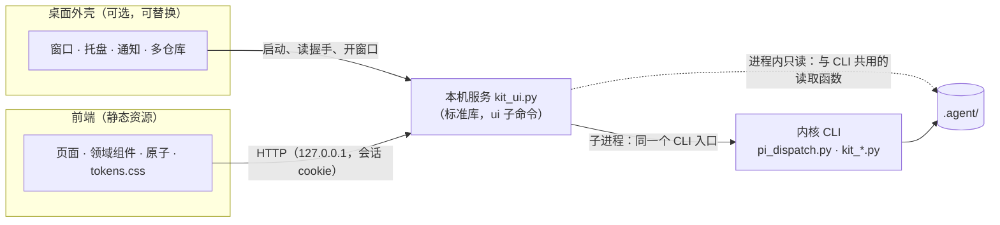

# Themis Tally 3.0 桌面端设计：本机服务、设计系统与可替换外壳

状态：**闸一通过（第 6 轮零 Blocking，“可以进入实现阶段”，2026-10-19）**。共审六轮：第 1 轮因 Codex 额度用尽中途停止；第 2 轮 3 个 Blocking、8 个 Should-fix、3 个 Nit；第 3 轮 2/4/2；第 4 轮 1/2/2；第 5 轮 1/0/2（Blocking 会让配置中心无法使用，不属于小问题，按轮数上限继续审）；第 6 轮 0/1/1，两条小问题当场修掉。处置见 §0。审核按 2gate 的轮数上限执行：审满 5 轮后只剩小问题就直接过闸（用户 2026-10-18 加入）。第 11 节的四项用户已拍板（见 1.1）。界面设计另见 `docs/themis-tally-3.0-桌面端-UI设计.md`。实现阶段带回的设计修订（闸二，以及用户 2026-10-19 的两项决定）见 §0.0。

- 分支：`themis-3.0`（本地，不推送），起点 `9461d31`（2.12.0，与本地 master 相同）。
- 上位设计：`docs/themis-tally-3.0-四端分层解耦架构.md`。本文细化它的 8.4（管理台）与 12 节的 M4，并按用户决定改写 1.3 的一条非目标与 15.2 第 9 项（见 1.1）。角色的运行方式以 `docs/themis-tally-3.0-r3-七端与信箱.md`（下称 r3）为准（用户 2026-10-19，见 §2.9）。
- 参考：open-claude-ui（<https://github.com/Caho1/open-claude-ui>，提交 `638800b`，MIT）。只读阅读，没有运行、安装或构建其中任何东西。
- 下文的 `file:line`：
  - 本仓库的在 `9461d31` 上核对；
  - §0.0、§2.9 与之后新增的本仓库引用在 `13e3d58` 上核对；
  - 参考仓库的在 `638800b` 上核对，路径相对它的根目录。
- 缩写：
  - PD = `scripts/pi_dispatch.py`
  - KC = `scripts/kit_config.py`
  - KR = `scripts/kit_roles.py`
  - KL = `scripts/kit_logs.py`
  - KH = `scripts/kit_hub.py`
  - KP = `scripts/kit_plugins.py`
  - OCU = open-claude-ui

## 0. 审核变更对照表

### 0.0 实现阶段带回的设计修订（闸二）

闸二审实现，审出的问题有的落在设计上，按 2gate 的规定先改设计、再改实现，记在这里；实现的进度与各轮结论见 `.agent/design/3.0-桌面端-实现进度.md`。用户在实现阶段的新决定（2026-10-19，r3）也记在这里，编号“七端-N”。

| 编号 | 结论 | 处置 |
|---|---|---|
| D1A-1-B1 | 搜索先在原文上预筛、再在脱敏结果上确认：带分支的正则（`猜的值\|<redacted>`）让返回与否取决于原文，可以逐步猜出被遮蔽的值 | D7 的“搜索”：去掉预筛，每一行先脱敏、再匹配；`<redacted>` 占位本身也能搜到。搜索全量扫描约 23 秒（原来 0.3 秒），如实写进 D7；第 2 轮收窄了论证（D1A-2-S1）：除文件大小、合法性和超长行保护这些显式元数据门槛外，匹配和摘录只依赖脱敏结果 |
| D1A-1-B2 | JSONL 游标只核格式与范围：偏移被改到行中间时，后半截被当成合法的 JSON，本该隐藏的值被输出；没有换行的末行读完之后又在同一行接着写，正常发出的游标也会落在行中间 | D7 的“缓存与游标”：偏移必须是原始行首；文件没变时停在末尾的游标除外 |
| D1A-1-B3 | 同长度原地改写不会使 JSONL 游标失效，拼出两版内容 | 同上：长度不变而修改时间变了就失效；另核对偏移之前 4096 字节的哈希，以及读到一半的那一行的哈希；写明查不出来的两种改写 |
| D1A-1-S1 | 先查大小再整份读，检查之后文件变大就绕过上限；空行不计分页成本 | D7 的“读取的上限”与“页边界” |
| D1A-1-N1 | 普通文本的分片在行尾多出一片 | D7 的“页边界”：只有从一行的内容中间开始、或在一行的中间结束的页才标片号 |
| D1A-自查-2 | JSONL 游标的两个指纹是对原始字节算的哈希，直接交给界面时，强度低的凭据可以离线猜 | D7 的“缓存与游标”：服务把游标换成随机的不透明句柄，对应关系只在服务内存里（D1-C）；命令行的游标只给本机用户自己 |
| D1A-自查-1 | `redact_secrets` 的键值规则在一长串 `[\w.-]` 上是平方级耗时，安全读取整份脱敏证据，一段十六进制或 base64url 就能卡住 `logs cat`、`logs search` | PD 的 `_SECRET_KV_RE` 只从词首试起（结果不变，一长串变成线性）；仍是平方级的输入写进 D7 的“脱敏的耗时”；据此改 D3：桌面端的证据读取与搜索在子进程里做、带时限，不在服务进程里做 |
| D1A-2-S1 | B1 的论证说得太宽：原文的大小与合法性门槛（超过 4 MiB 的 JSONL 行被隐藏、超过 64 MiB 的文本计入 `skipped_large`）仍会让同一个脱敏结果得到不同的搜索输出；这是 D7 明文的元数据门槛，不是凭据泄漏 | D7 的“搜索”与本表 D1A-1-B1 行：改为“除文件大小、合法性和超长行保护这些显式元数据门槛外，匹配和摘录只依赖脱敏结果”；写明 `skipped_large` 与 `truncated` 各计什么 |
| D1A-2-S2 | 缺几条边界测试：普通文本被截短之后旧游标被拒；搜索遇到超长的 JSONL 行与超过 64 MiB 的文本时 `skipped_large`、`truncated` 的预期；搜索作业遇到平方级脱敏时的超时属于服务层 | 10.1：U14d、U14e 各补一条，U10 补搜索作业的超时（D1-C）。测试代码另做；N1 同为测试项，另做；N2 不用改 |
| 七端-1 | 用户决定：各端都以后台进程调度，claude、pi 一律由内核按信唤醒（r3 §0 第 2、4 项） | §2.9 记事实；D1：桌面端不启动、不唤醒、不停止角色进程，只读它们的状态与记录；D2、D3、D6、D11、D12、§6、§9 与 UI 文档对齐 |
| 七端-2 | 用户决定：思考档位如实记要求与生效（r3 §0 第 6 项）；Pi 会静默降档 | D11 新增“思考档位”：角色绑定与运行记录并列显示要求与生效，不一致标出，未知显示“未知”；UI 文档 7.24；数据缺口记进 D13 |

### 0.1 第 6 轮（零 Blocking，“可以进入实现阶段”）

Codex 审第 7 稿（`8655904`）：零 Blocking、1 个 Should-fix、1 个 Nit，“剩余事项可随实现补齐，不需要再为此开启设计审核轮次”。r5-B1 的处置成立：白名单按路由与具体的 JSON 路径登记，值另做格式或枚举校验，证据不享受豁免；doctor 的 `credentials` 是变量名到布尔值的映射，布尔值不会被抹掉；runtime 的 `command`、history 的 `changed_keys`、preset diff 的 `a`/`b` 不在敏感的祖先键下。两条小问题按 2gate 的规定当场修掉，不再送审：

| 编号 | 第 6 轮结论 | 本稿处置 |
|---|---|---|
| r6-S1 | 凭据名单的 `used_by` 在祖先键 `secrets` 之下，默认的结构脱敏会把它遮掉；实现若只照抄示例里的 `name`、`source`，“用在哪里”会变成 `<redacted>` | `used_by` 改为结构化的 `{"kind": "profile", "id": …}` 或 `{"kind": "decisions"}`；白名单登记 `secrets[*].used_by[*].kind`（枚举）与 `id`（必须符合 profile ID 的规则），不豁免任意描述文本；U22 断言它原样返回 |
| r6-N1 | `/config` 白名单的示例里，`env_remove`、`env_keep` 的值像是顶层字段，实际在 `keys` 数组里按行的 `key` 区分（KC:836–846） | 示例改写为带行条件的路径 `keys[key=env_remove].value[*]`、`keys[key=env_keep].value[*]` |

### 0.2 第 5 轮（1 个 Blocking、0 个 Should-fix、2 个 Nit）

Codex 审第 6 稿（`76fe2a4`）。上一轮的分片游标、完整结果信封、U18b 与 E8 的划分均已闭环；大小写不同的敏感键、顶层数组、嵌套数组都由结构脱敏递归覆盖。这个 Blocking 会让配置中心无法使用，不是小问题，所以按轮数上限的规定继续审，不直接过闸。

| 编号 | 第 5 轮结论 | 本稿处置 |
|---|---|---|
| r5-B1 | 把所有 CLI 的 JSON 都交给 `redact_json`，会遮掉配置中心必需的元数据：`_SECRET_KEY_RE` 匹配 `credential_env`（PD:2566–2568），`{"credential_env":["STEP_API_KEY"]}` 变成 `["<redacted>"]`，profile 编辑框拿不到变量名；`config show` 里 `decisions.secret` 的 `source`、`store_mode` 也被遮掉（KC:858–866）。已用实际代码复现 | D4：二道脱敏分两种。证据等不可信内容仍严格按键名脱敏；内核 CLI 的 `--json` 响应也按键名脱敏，但每条路由登记一份必须原样保留的字段白名单（环境变量名、来源枚举），白名单字段另做约束校验，不符合就照样遮掉；证据内容永远不进白名单。U22 跨层覆盖 profile 的读取、编辑与凭据名单 |
| r5-N1 | UI 文档普通文本的示例仍写 `mode: "whole-file"` | 改为 `"text"` |
| r5-N2 | “拆在多行里识别不了”说得太宽：普通文本里的 `api_key=` 换行接值、PEM 块，整份 `redact_secrets` 能处理（PD:2667–2676） | 改为“拆到不同字段或不同 JSONL 记录、失去关联的上下文时不保证识别” |

### 0.3 第 4 轮（1 个 Blocking、2 个 Should-fix、2 个 Nit）

Codex 审第 5 稿（`8a7a2c7`）。路径选择器自己保存、外壳关窗取消、等到操作终态再重读、缓存不管保留时间戳的原地改写，均未发现需要重提的问题。下列各条都按引用的代码核实成立。

| 编号 | 第 4 轮结论 | 本稿处置 |
|---|---|---|
| r4-B1 | `redact_obj` 只对字符串值逐个脱敏，不看键名（PD:2680–2688）：`{"api_key":"examplevalue"}` 的值、`{"sk-…":"ordinary"}` 的键都原样保留；按键名处理的是 `_redact_json`（PD:2595–2612） | D4、D7、D13：安全读取与服务的二道脱敏都改用按键名处理的结构脱敏，PD 新增公开封装 `redact_json`。U14b、U14c 加上这两种合法 JSON。另写明边界：值被拆在多个字段里（例如 `{"parts":["api_key=","examplevalue"]}`）识别不了，这是脱敏规则本身的边界，与 CLI 的其他输出相同 |
| r4-S1 | JSONL 的超长行按字符拆页，与“游标指向下一条完整的原始行”矛盾 | D7：JSONL 的游标同时记原始行的位置与脱敏之后行内的字符位置；一页优先放完整的行，单行超过上限时给出这一行的分片（第几片、共几片）。U14d 分别覆盖普通文本与 JSONL |
| r4-S2 | 操作终态只有退出码，断线之后丢了原命令的 WARN 与 ERROR | D6、5.2：操作记录保存完整的、已脱敏的结果信封（含 `output`、`messages`），`GET /api/v1/operations/<id>` 原样返回；服务只保留最近 100 个操作。U21 加断言 |
| r4-N1 | `readFile` 的接口声明与 JSONL 的示例不同形 | 5.2 与 UI 文档 8.9：按 `mode` 区分两种返回 |
| r4-N2 | U18b 包含真实的关窗，却列在 D2 的 Python 测试里 | U18b 只用替身验证控制取消接口；“服务页卸载之后关窗仍能取消”的链路放进 D3 的 E8 |

### 0.4 第 3 轮（2 个 Blocking、4 个 Should-fix、2 个 Nit）

Codex 审第 4 稿（`55347ce`）。控制令牌重新认证、SSE 重连先发全量快照、每个服务实例独立的会话分区、命令返回失败后的重读，均未发现需要重提的问题。下列各条都按引用的代码核实成立。

| 编号 | 第 3 轮结论 | 本稿处置 |
|---|---|---|
| r3-B1 | 逐行脱敏仍会漏：`events.jsonl` 就是执行器的原始 stdout（PD:4999–5001），坏行（例如 `api_key=` 换行之后接值）逐行脱敏时，第二行没有上下文；`logs search` 只取命中的那一行（KL:587–597），同样丢掉上下文 | D7：JSONL 先解析，合法的行按结构脱敏（`redact_obj`），解析不了或超过 4 MiB 的行一律隐藏、只显示占位；其他文本整份脱敏（`redact_secrets` 遇到确定不了结束的值，会遮掉其余部分，PD:2667–2676）。D13：`logs search` 的两种输出都改为在同一个安全读取的脱敏结果里搜索，摘录取自脱敏之后的文本。U14b、U14c 覆盖分页与搜索两条入口 |
| r3-B2 | `saveSettings` 的白名单里没有 Python 与 kit 的路径，选了也存不下 | D10：选择器自己负责校验与保存：`pickPython()` 运行版本检查后保存，`pickKit()` 核对 `pi_dispatch.py --version` 后保存，`pickRepo()`、`pickTranscriptDir()` 加进列表；`saveSettings` 只管主题、密度、移除列表项、恢复自动检测，不接受任何路径。E7 断言选完之后服务能启动、重开应用后仍有效 |
| r3-S1 | 关掉凭据小窗口到取消作业之间没有通道 | D10、5.2：`openSecretWindow(url, jobId)`，外壳记下窗口与作业的对应；窗口关闭时外壳主进程用控制令牌调 `POST /control/jobs/<id>/cancel`，服务页已经卸载也能取消。U18b |
| r3-S2 | 断线之后立即重读，判断不了写操作是否已经结束 | D6：执行请求的确认号就是操作号，服务记下每个操作的终态；断线之后界面先查 `GET /api/v1/operations/<id>`，等到终态再重读；服务重启、查不到时显示“结果未知”。U21 |
| r3-S3 | 缓存键（路径、大小、修改时间）不能唯一标识内容；旧游标的版本语义没有规定 | D7：缓存键改为（路径、大小、修改时间纳秒、文件号）；游标绑定这组标识，变了就返回 409，前端从头读；JSONL 的游标是下一条完整行的原始偏移，文件只增长时继续有效。保留时间戳的原地改写不在范围内（证据目录按规定只读；同账户进程不在防护范围，D4） |
| r3-S4 | 超长单行让“页边界落在行边界”与“每页 256 KiB”不能同时成立；JSONL 读一行没有内存上限 | D7：页边界优先落在行边界；单行超过每页上限时，在整份脱敏之后按字符拆页。JSONL 单行超过 4 MiB 就隐藏、只显示占位 |
| r3-N1 | 外壳页也要外部打开，但 UI 文档只把 `openExternal` 列在 `themisHost` | D10 与 UI 文档 8.9：两个对象都有 `openExternal` |
| r3-N2 | 5.3 的信封示例与 U5 没有 `output` | 都已补上 |

### 0.5 第 2 轮（3 个 Blocking、8 个 Should-fix、3 个 Nit）

Codex 审第 3 稿（`2f8c0ad`）。三个 Blocking 与 S1–S8 都按引用的代码核实成立。核对结论里的几条实现要点也一并采纳（D3、D13）：
- `--expect-state` 必须在拿锁之后、第一次 publish 之前一次读齐全部资源；
- 退出码 4 用 `ConfigError(code=4)`；
- plugins 的 dry-run 要改成纯读；
- Windows 复用 Job Object 监督。

| 编号 | 第 2 轮结论 | 本稿处置 |
|---|---|---|
| r2-B1 | 按任意字节偏移截取再脱敏：切片里没有 `api_key=` 一类的上下文，两道脱敏都会放过凭据片段（PD:2647） | D7、D13：分页单位改为“脱敏之后的文本”。JSONL 按完整的行读取、逐行脱敏；其他文本整份脱敏后再分页，整份超过 64 MiB 的不在界面里显示；脱敏结果按（路径、大小、修改时间）缓存。U14b 覆盖任意切点 |
| r2-B2 | 首次启动找不到 Python 时服务起不来，由服务托管的首次启动页根本打不开；外壳接口也不够做选仓库、存设置、重启服务、外部打开 | D10：新增“外壳页”，首次启动、设置、服务状态与恢复三页打包在应用里，不经服务；宿主接口改为一张明确的白名单，路径只能经系统对话框取得 |
| r2-B3 | 凭据录入不能套用普通路由：命令默认打开系统浏览器，地址在 stderr 的握手行里，结果要等保存（KC:1352–1362） | D6 新增“凭据录入”：以作业方式运行 `config secret set <name> --no-browser`，读 stderr 的握手拿到地址，交外壳另开窗口；保存、超时或关窗时结束作业，之后重查 |
| r2-S1 | 写命令失败也可能已部分写入：替换成功而审计追加失败（KC:720–730）；runtime 登记成功而本机文件失败 | D6 第 4 步：无论成败都重读；退出码非 0 而状态已变时，显示“已部分写入，结果待核实” |
| r2-S2 | 401 时原引导地址已作废；SSE 断线期间的变化可能补不上 | D4：握手多给一个只留在外壳主进程里的控制令牌，外壳用它要新的引导地址（`host.reauth()`）。D7：每次订阅先发全量快照，再发增量 |
| r2-S3 | 多个仓库的窗口共用会话分区时，同名 cookie 会互相覆盖（cookie 不按端口隔离） | D10：每个服务实例一个独立的内存会话分区；E6 覆盖两个仓库同时打开 |
| r2-S4 | 规划端用量的会话目录没法传给 `/usage`；“登记全部”没有对应的写动作 | D10、5.1：外壳从设置里用 `ui --transcript <目录>` 传给服务，改设置后重启服务。UI 去掉“登记全部”，改为逐个 [登记]，一次确认一条命令 |
| r2-S5 | 示例数据与真实 JSON 类型不同：没有检查时 `checks` 为 `"-"`；运行中的 `events_ok` 是实时进度字符串（PD:7340–7343）；历史的 `resolved` 是布尔、`external_changes` 是次数（KC:1045–1049） | UI 文档第 9 节改正。D7：`status --json` 新增 `live`，不改 `events_ok` 等现有字段 |
| r2-S6 | `role set`、`preset use` 的 WARN 打在 stdout 上（KR:1065–1067、1194–1196），信封会丢掉 | 5.3：信封加 `output`，放没有 `--json` 时 stdout 的文本行（已脱敏）；界面同时显示两处的 WARN |
| r2-S7 | “下一步”复制 `<task>.v<N>`，会指向这个版本最新的 attempt，可能不是正在看的那个 | UI 文档 6.3：复制精确的 attempt 目录 `.agent/runs/<task>/attempt-NNN` |
| r2-S8 | “预览之后才开始的 attempt 会让写入被拒绝”说得太满：D8 是写入前扫描，run 不拿配置锁（KC:694、725） | D6 改写：执行时扫描到运行中的 attempt 才拒绝；扫描之后、替换之前才开始的 attempt 不在保证之内（第二轮 D8 的既有语义：提醒，不是互斥） |
| r2-N1 | 影响面清单漏列 KR | 8.1 单列 KR |
| r2-N2 | 阶段的验收依赖前后不一致：D1 要 U6–U8，D3 要包含写入的端到端流程 | 第 9 节按阶段划分适用的测试；端到端放到 D3，依赖 D2 |
| r2-N3 | D6 表仍写“待用户决定”；上位设计 §16 仍称“第 1 稿” | 都改为现状 |

### 0.6 第 1 轮（未完成）

Codex 在 2026-10-18 审第 2 稿（`4b06efa`），约 3 分钟后因额度用尽停止，只留下 r1-1。其余三条是规划端顺着它没审完的方向自查发现的。

| 编号 | 结论 | 本稿处置 |
|---|---|---|
| r1-1 | 服务核对配置哈希之后才启动 CLI，外部 CLI 仍可在这两步之间改配置；现有事务也不接收预览时的哈希 | D6：写命令新增 `--expect-state <令牌>`，在配置锁里比对；不一致就退出 4、什么也不写，服务转成 409。服务自己不再核对哈希 |
| 自查-1 | `--dry-run` 若复用写入事务，会写补判与外部改动的审计记录、建锁目录（KC:683–699 的顺序），做不到零写入 | D6、D13：`--dry-run` 不进事务、不拿锁：读配置 → 在内存里修改 → 整份校验 → `binding_switch_in_flight`（KR:420–426）；输出 `state` 令牌 |
| 自查-2 | `config secret check` 没有 `--json`（KC:1531–1537）；凭据页要的“变量名用在哪里”没有现成命令 | D13 补 `secret check --json`；凭据路由由服务合成：从 `config show --json`（决策模型的变量名）与 `config profile show --json`（各 profile 的 `credential_env`）取名单，再逐个 `secret check` |
| 自查-3 | attempt 详情要的版本、token、检查结果不在 `logs show --json` 里 | D11：详情页合并 `status --json` 里这一行与 `logs show --json` |

## 1. 范围

### 1.1 用户决定（2026-10-18）

- **先实现，后改 README**：README 的“简介”等章节等实现之后按实际情况改，不先写半成品状态。
- **桌面端的框架参考 OCU**：取它的长处，设计一套属于本项目的方案。
- 由此：
  - 上位设计 15.2 第 9 项（管理台的形式）由 A（本机网页）改为桌面端；
  - 1.3 的非目标“首期不做桌面安装包”随之改写。
- 本文的做法是两者的组合：
  - 管理台的后端仍是上位设计 8.4 的标准库本机服务；
  - 桌面外壳只负责启动服务、开窗口与系统集成；
  - 不装桌面应用时，CLI 照常全部可用；界面只在桌面应用里提供（不做浏览器模式，见下）。

第 11 节四项的拍板（2026-10-18）：

- **外壳用 Electron**。用户问“为啥不用 Claude Code 的架构”：Claude 的桌面应用就是 Electron 外壳加 React 界面（OCU 拆的就是它的 `app.asar`，见 3.2），本文的 Electron 方案正是这一路。后台不照搬：仍是现有的 Python 内核与本机服务。
- **花钱或集成的操作第一阶段不开放**（D6）：之后逐项开放，每次单独确认。
- **不做浏览器模式**：本机服务只由桌面外壳启动，引导地址只经管道交给外壳（D4、D14）。
- **先做桌面端 D1–D3**（第 9 节），内核 P2 之后再说。
- **界面由用户交给 Claude Design 实现**：依据是 `docs/themis-tally-3.0-桌面端-UI设计.md`；产出接入 `desktop/web` 之前由规划端审核（第 6 节）。

### 1.2 目标

1. **给人一个工作台**：看任务与 attempt 的状态和证据；像 CC Switch 那样切换角色与模型；看日志与用量；管理插件；看历史与审计。
2. **零信任不退化**：
   - 界面只显示内核写下的事实，不自报成功；
   - 每个界面操作都是一条已登记的 CLI 命令，写入经内核原有的锁、校验与审计；
   - 凭据的值永不出现。
3. **内核仍只依赖 Python 标准库**：不装桌面端，CLI 全部照常可用。
4. **外壳可替换**：Electron 与 Tauri 只差一层薄壳（D10），换外壳不动服务与前端。
5. **视觉是自己的**：从 Themis Tally 的品牌出发，不仿任何其他产品的外观。

### 1.3 不在本文

- 内核 P2–P6 的设计（状态账本与反馈、合同端流程、第二个 CLI、调度代理、无头审核端与 `drive`）：各自另出设计。本文只为它们预留页面位置，并标明“等待 P×”。七端与信箱见 r3（§2.9），本文只写桌面端怎样与它衔接（D1、D11）。
- README 的改写（1.1）。
- 发布、签名与自动更新的具体流程：D10 只定原则。

## 2. 现状（承重事实）

### 2.1 上位设计已定的约束

- **管理台**（上位设计 8.4，第 1101–1117 行）：
  - `ui` 子命令启动标准库 HTTP 服务；只绑 127.0.0.1，随机端口，随机令牌路径；
  - 拒绝外来 Host；写操作带页面令牌；空闲超时；`no-referrer`，不记请求正文；
  - 七个页面；“每个界面操作都对应一条 CLI 命令；代理用 CLI，人用界面”；
  - 不显示凭据值，不提供远程访问。
- **审计**（8.6，第 1137–1158 行）：`actor` 取 user-ui / user-cli / `agent:<role>`；`confirmation` 取 interactive / flag / none。
- **管理面的权限**（10 节第 1201、1206 行）与**不做**（14 节第 1306 行）：不显示凭据值；不能无确认地安装插件、扩权或归档证据；管理台只在用户本人的会话里打开。
- **原来的取舍**：
  - 15.2 第 9 项（第 1365–1368 行）推荐 A（本机网页），C（桌面应用）的代价写的是“引入非标准库依赖与打包”；
  - 1.3（第 58 行）：“首期不做桌面安装包：内核只依赖 Python 标准库，管理台用本机网页”。

### 2.2 已有的本机服务做法

2.7 的一次性凭据页（KC:1250–1330）已经是一个标准库本机服务：

- `ThreadingHTTPServer` 绑 127.0.0.1、端口 0（KC:1250、1315）；
- 随机令牌路径 `token_urlsafe(24)`（KC:1253），路径不对一律 404（KC:1276–1286）；
- 只接受 Host 为 127.0.0.1、localhost、::1（KC:1279–1280）；
- `Cache-Control: no-store`、`Referrer-Policy: no-referrer`（KC:1267–1274）；不记请求行与正文（KC:1264–1265）；
- 请求体上限 `MAX_BODY = 8192`（KC:65、1296）；`PAGE_TIMEOUT = 600` 秒到时关闭（KC:66、1326）。

桌面端的本机服务沿用这些做法，再补上 Origin 校验、CSRF 防护与 CSP（D4）。

### 2.3 CLI 的机读输出

- `status --json`（PD:8199–8201）；`decisions replay --json`（PD:8207–8209）。
- `config` 的 `show`、`history`、`runtime list|scan|probe`、`models`、`profile show`、`role show`、`preset list|show|diff`、`doctor` 都有 `--json`（KC:1405–1528）；`validate` 没有。
- `logs list|show|usage` 有 `--json`；`logs search` 没有（KL:958–980）。
- `plugins list|show|verify` 有 `--json`；`enable|disable` 有 `--dry-run` 预览（KP:771–791）。
- 输出都先过内核的脱敏：`redact_secrets`（PD:2647）、`redact_obj`（PD:2680），以及第二轮 D9 的各道防线。

### 2.4 写入的确认与审计

- **执行者**：KC 的审计记录写 `actor`，取自环境变量 `CODEKIT_ACTOR` 的自声明（KC:430、509–517），没设时记 `undeclared`。规则 `ACTOR_RE` 只认 `user` 与 `agent:<role>`（KC:431），上位设计 8.6 的 `user-ui` 目前写不进去。
- **运行中切换**（第二轮 D8）：在事务里、写入之前判断（KC:766–785）。有 attempt 在运行、这次写入又会改变 execution 或 contract 的生效绑定时：
  - 不带 `--yes` 就抛错，什么也不写；
  - 带 `--yes` 时审计记 `confirmation: flag`；
  - 无关时记 `none`。

### 2.5 内核的加载与保护

调度器只加载 `KIT_LOADED_FILES` 列出的模块（PD:96–101），这些文件在执行器的保护范围里。新增的 `kit_ui.py` 也要加进去。

### 2.6 规划端的权限示例

`.claude/settings.example.json`：30 条 allow；4 条 ask（`--probe-decisions`、`--assess`、`--out` 的两种写法）；1 条 deny（`Edit(/.agent/runs/**)`）。目前没有关于 `ui` 的规则。

### 2.7 Python 的查找

`scripts/dispatch-pi.sh:9–19` 依次试 `python3`、`python`、`py -3`，每个都试运行版本检查（Windows 的 `python3` 可能是应用商店的占位程序）。外壳找 Python 用同样的顺序。

### 2.8 品牌

`Logo/Logo.png` 是一面盾形：
- 天平与盾用海军蓝 `#012852`；
- 中间的符契用金色 `#D49C32`。

两个色值都由本仓库的像素采样得到。

### 2.9 七端与信箱（r3，用户 2026-10-19）

r3 改了角色的运行方式。与桌面端有关的事实：

- **每个 CLI 都以后台进程调度**（r3 §0 第 2 项，第 10 行）：工人不常驻，内核监听信箱，来信时按会话号续接、只跑一个回合，交差后进程退出（第 4 项，第 12 行）。执行端由内核代办调度器的 `prepare`、`run`、`check --fresh`（§6.5，第 238–241 行）。
- **记录只由内核写**：任务书、信件、回合记录（`turns/<名字>/<turn-id>/` 下的 `prompt.md`、`stream.jsonl`、`stderr.log`、`result.json`）与账本（`ledger/events.jsonl`、`ledger/state.json`）都在 `.agent/mailbox/` 下，Git 忽略，只有内核写（§3.1，第 68–85 行）。现有的只读命令是 `kit_hub.py status --json`（各主任务的阶段记录与各人未读数，KH:1654–1660），以及站主收信的 `take --peek`（KH:1642–1651、1721）。
- **思考档位**：Pi 对没有映射 xhigh / max 的模型会静默降档，stderr 没有提示，例如 GLM-5.3 要求 max、生效 high（第 14、219、294 行）。claude 的 init 事件不报告档位，会话记录里每条 assistant 记录带 `effort`（第 204、292 行）；pi 事件里 assistant 消息的 `thinkingLevel` 就是生效档位（第 219 行）。
  - hub 的回合记录与账本的 `turn.finished` 已经记了 `effort_requested` 与 `effort_effective`（KH:806–810、822–837）；
  - 调度器的事件摘要只记了要求的档位与提供商回报的档位（`requested_model.thinking`、`provider_thinking_levels`，PD:3186–3187、3236–3242），看不出静默降档，修补另做（第 313 行）；`status --json` 与 `logs show --json` 都不带档位（PD:7331–7353；KL:532–540）；
  - 就绪检查的 `thinking_supported` 只说明本机 pi 的 `--help` 列出了这个档位（KR:1328；PD:2523–2534），不运行模型。
- **配置中心没变**：角色仍是四个（KR:29）；七端的名册在 hub 自己的默认配置里（KH:93–110），没进配置中心（第 38、316 行）。
- **桌面端接入不在 r3 本轮**（第 317 行）。

## 3. 参考：open-claude-ui 拆解

### 3.1 它是什么

- 一个高仿 Claude 官方桌面端的组件与设计令牌样例库：
  - `code-examples/` 下有 26 个 `.tsx`、7 个 `.ts` 与 CSS；
  - `docs/` 下有 v1 八篇、v2 六篇逆向分析（package.json:4）；
  - peer 依赖 React 18、framer-motion、lucide-react（package.json:50–55），Electron 只是 devDependency（package.json:65）。
- 它不是能运行的桌面端骨架：
  - 没有应用外壳、IPC 设计、本地后端、状态管理、打包与更新；
  - 没有测试：package.json 没有 test 脚本，CI 只跑 typecheck、check:tokens、build（.github/workflows/ci.yml:18–21），`tsconfig.json:10` 为 `strict: false`。

### 3.2 借鉴什么

| 长处 | 依据 | 本文怎么用 |
|---|---|---|
| 分层：令牌 → 原子 → 领域组件 → 外壳；令牌层是纯 CSS 自定义属性，可以脱离 React 使用 | `code-examples/cds-theme.css`（183 个令牌）；README.md:40 | D8：`tokens.css` 不依赖框架，标准库的一次性凭据页也能用 |
| 宿主窗口与内容视图分开，内容视图单独开 `sandbox: true`、`contextIsolation: true` | `code-examples/createClaudeMainWindow.ts:49–58` | D10：外壳只开一个内容窗口，安全选项全部显式写出（它的宿主窗口没写，见 3.3） |
| 不可信内容放进 null-origin 沙箱，并校验消息来源 | `code-examples/EpitaxyIframeBridge.tsx:44、48–53、91` | D5：只在必须执行内容时用；第一阶段证据一律按纯文本呈现，不用 iframe |
| 授权判决带原因分类：`user_denied`、`policy_denied`、`PERMISSIONS_ERROR` | `docs/v1/03-会话核心流与指令交互引擎.md` 3.5.3 节 | D6：确认框的结果带原因，显示给用户 |
| 并发修改不静默覆盖：按 `against_sha256` 比对基线，不一致就让用户确认 | `docs/v1/06-系统级桌面架构与协作拓扑.md` 6.8.2 节（只在文档里） | D6：确认时记下读到的配置哈希，执行前不一致就重新预览 |
| 单一权威：副本只收快照，写操作回到权威执行 | 同上 6.8.1 节（只在文档里） | D2、D7：本机服务是唯一权威；多个窗口只读快照，写都经服务 |
| 流式输出的滚动图钉：用户输入后 150ms 内不抢滚动，离底 40px 内才跟随 | `code-examples/useClaudeScrollPinning.ts:36、57` | D7：日志跟随 |
| 统一 / 分屏两种差异视图 | `code-examples/StreamingDiffViewer.tsx:216–332` | D11：候选补丁查看 |
| 退避与上限 | `code-examples/useRateLimitBackoff.ts:14–15、50–57` | D7：断线重连；服务给的等待时间是下限，抖动只往后加（它把抖动乘在 Retry-After 上，见 3.3） |
| 容器查询的多档排版、Roving TabIndex 键盘导航 | `docs/v1/06-…md` 6.5、6.6 节；`code-examples/useClaudeRovingFocus.ts` | D8：窄窗口与键盘操作 |
| 不分发商业字体与音频，用系统字体栈 | `assets/README.md:5–13` | D8：同样只用系统字体，也不用声音 |

### 3.3 不照搬什么

| 问题 | 依据 | 本文的做法 |
|---|---|---|
| 授权卡片在界面里自报成功：批准后本地等 1.2 秒就把状态改成 success | `code-examples/McpToolDecisionCard.tsx:65–69` | 这与“执行器的自述不是证据”正好相反。界面上的结果只来自内核的退出码与随后重新读到的状态（D6） |
| “始终允许”与“单次批准”的处理完全相同；330 秒回收只写在注释与文档里 | `code-examples/McpToolDecisionCard.tsx:58–72`；`docs/v1/03-…md` 第 347–354 行 | 不做“始终允许”：每次改绑定或花钱的操作都单独确认（D6） |
| 手势门禁取的是粘性的 `hasBeenActive`：页面点过一次之后，后续消息都放行 | `code-examples/EpitaxyIframeBridge.tsx:60–64` | 一次确认只放行一条命令：由服务签发一次性确认号（D6） |
| 宿主窗口只设了 `preload`，没有显式的 `sandbox`、`contextIsolation`、`nodeIntegration`；全仓没有 CSP、权限请求处理、导航与新窗口拦截 | `code-examples/createClaudeMainWindow.ts:43–45` | D10 全部显式写出，并有测试（10.4） |
| 确认框的注释说“焦点被锁在弹窗内部”，代码里没有焦点管理 | `code-examples/ConfirmationDialog.tsx:17` | D8：对话框做焦点陷阱，关闭后焦点返回，有测试（10.2 的 W6） |
| 多代理看板是演示数据：“4 个活动 Agent”写死，状态从不转换 | `code-examples/CoworkAgentCanvas.tsx:94、119` | 四端视图等内核 P2 的状态账本（D11 的依赖表） |
| 令牌契约不严：按 `--cds-[a-z0-9-]+` 扫描 `code-examples/*.ts(x)`，用到 62 个，其中 13 个不在 `cds-theme.css` 里（如 `--cds-accent`、`--cds-bg-neutral`）；检查脚本只核对 AGENTS.md 里用反引号列出的变量 | `scripts/check-tokens.mjs:21–22` | D8：组件里用到的每个变量都必须在 `tokens.css` 里定义，组件里不许写死颜色，CI 检查 |
| 总导出包含 Electron 窗口工厂，后者静态导入 `electron` | `src/index.ts:38`；`code-examples/createClaudeMainWindow.ts:12` | 前端与外壳分成两个包，前端不依赖外壳 |
| 品牌与来源：logo 底色是 Claude 的陶土色 `#d97757`，字体栈首位是专有字体 AnthropicSans；多个文件头写着“逆向还原自 Claude Desktop” | `assets/images/logo.svg:2`；`code-examples/tailwind.config.js:29`；`code-examples/createClaudeMainWindow.ts:3`；`code-examples/EpitaxyIframeBridge.tsx:3` | 只借结构与交互模式，不复制它的文件、令牌数值、圆角、配色、文案与命名（D8，第 7 节） |

### 3.4 结论

OCU 的价值在“怎么分层”和“哪些交互细节值得做”，不在代码本身：
- 它的组件大多是演示件，业务状态写在组件内部；
- 安全基线不全；
- 它仿的是另一家公司的产品外观。

本文只借它的结构与模式，代码与视觉都自己写。

## 4. 决策与理由

### D1 定位

- 桌面端是“人的工作台 + 管理面”，不是七端（§2.9）里的任何一端：它不起草、不审核、不执行，也不替任何角色做判断。
- 代理用 CLI，人用界面（上位设计 8.4）：
  - 每个界面操作都对应一条已登记的 CLI 命令；
  - 界面能做的，CLI 都能做；反过来不一定。
- 界面显示的状态与结论只来自内核写下的记录，界面自己不推断“成功”。
- **不启动角色**（用户 2026-10-19）：claude、pi 的角色一律由内核以后台进程按信唤醒（§2.9）。外壳、服务与前端都不启动、不唤醒、也不停止这些进程，不给工人发信；只读它们的状态与记录（信箱、回合记录、账本）。读照 D3 走内核的只读命令，不写 `.agent/mailbox/`。

### D2 架构



- **内核不变**：仍只依赖标准库。
- **本机服务 `kit_ui.py`** 是唯一的后端，也是安全边界（D4）：
  - 路由 → CLI 命令（D3）；
  - 写一律经 CLI 子进程。
- **前端**是静态资源（D9），由本机服务托管，只在桌面外壳的窗口里打开（不做浏览器模式，1.1）。
- **外壳**只做系统集成（D10）：找 Python、启动服务、读握手、开窗口、托盘与通知。它不含业务逻辑，也不直接调用 CLI。
- 为什么不让外壳直接调用 CLI（例如在 Electron 主进程里用 `child_process`）：
  - API 会写在 TypeScript 里，Python 的测试覆盖不到；
  - 换外壳就要重写一遍；
  - 安全边界会分散在外壳与服务两处，不好测。
- **角色的回合不由桌面端调度**（用户 2026-10-19，§2.9）：claude、pi 的角色回合由内核的信箱进程（`kit_hub.py`）以后台进程按信唤醒。本机服务起的子进程只有内核 CLI 的一次性命令（D3），不含角色回合（D1）。

### D3 路由怎么执行命令

- **路由表**：每条路由登记以下几项（5.2）：
  - 对应的 CLI 命令（argv 模板）；
  - 参数校验规则；
  - 读或写；
  - 超时；
  - 是否作为后台作业。

  服务启动时用内核真正的解析器核对每条模板都能解析（10.1 的 U4）。
- **写命令与会运行外部 CLI 的读命令：子进程执行**。
  - 命令为 `<当前解释器> <kit>/scripts/pi_dispatch.py --repo <仓库> <argv…>`；有 `--json` 的读 stdout，退出码原样返回。
  - argv 用列表传递，不经 shell。
  - 为什么不在服务进程里直接调用 CLI 的处理函数：
    1. 处理函数把结果打印到 stdout，进程内只能靠重定向 stdout 取结果，多个请求并发时会互相串；
    2. `config doctor`、`runtime probe` 要运行外部 CLI，耗时数十秒，进程内调用会卡住其他请求；
    3. 每次调用要单独设 `CODEKIT_ACTOR=user-ui`，进程内只能改全局环境。
  - 子进程把这三件事都隔开了，也和用户在终端里敲同一条命令逐字节相同。代价是每次多一次 Python 启动（数百毫秒量级，未测）。
- **这些子进程不是角色回合**（用户 2026-10-19，§2.9）：角色回合只由内核的信箱进程以后台进程跑（D1、D2）。`config doctor`、`runtime scan`、`runtime probe`、`config models` 只运行本机 CLI 的只读探测（`--version`、`--help`、`--list-models`、`auth check --no-refresh`），不调用模型（AGENTS.md:62；KR:1300–1328）。
- **快的只读路由：进程内调用与 CLI 共用的读取函数**。
  - 只适用于状态列表：`status --json` 的同一个函数，按字节计数，不对证据内容跑脱敏的正则。
  - 这些函数只读、返回数据、不打印；对应的 CLI 命令调用的是同一个函数，由 10.1 的 U9 比对两边输出一致。
- **证据的读取与搜索：子进程执行，带时限**（D1-A 自查）。
  - 按段读取走 `logs cat … --json`，搜索走 `logs search … --json`，搜索作为作业（D7）；
  - 原因：脱敏规则在少数输入上仍是平方级耗时（D7 的“脱敏的耗时”），而 Python 的正则匹配期间不释放 GIL。放在服务进程里，一个坏文件就会卡住 SSE 与 `/control/*`；放在子进程里，超时就结束整个子进程树（见下面的“超时与取消”）；
  - 超时按“读不出来”报告，界面提示改用 CLI 查看；
  - 跟随（JSONL 只给已经写完的行）需要 `logs cat` 补一个开关，D1-C 加。
- **环境**：子进程继承服务的环境，另设 `CODEKIT_ACTOR=user-ui`。服务本身不读凭据，凭据仍由内核按 2.7 的分层查找。
- **并发**：
  - 读命令最多并行 4 个（可配）；
  - 写命令逐个执行。内核的配置锁本来也会串行化，第二轮 D7 的事务规则不变。
- **超时与取消**：
  - 每条路由有超时；
  - 超时或客户端取消时，结束整个子进程树。Windows 复用 PD 完整的 Job Object 监督流程：挂起创建、加入 Job 之后再恢复，加入失败就拒绝运行（不能只复用“结束父进程”那一步）；POSIX 用进程组；
  - 作业状态只在服务内存里，服务退出即丢弃，不写 `.agent/`。

### D4 本机服务的安全

- **监听**：只绑定 127.0.0.1，端口随机（0）。每个仓库同时只有一个服务：`.agent/.ui.lock/`（被忽略）记下 pid 与端口；已有活着的服务时，新进程报告它并退出 1，不另起服务。
- **会话**：“引导地址 → cookie”：
  - 服务启动时生成一次性随机串 nonce，组成引导地址 `http://127.0.0.1:<port>/bootstrap/<nonce>`；
  - 引导地址只写进 stdout 的握手行，交给启动它的外壳（5.1），不打印到终端，也不写日志；
  - 外壳在窗口里打开它；第一次访问时，服务设置会话 cookie（32 字节随机令牌，`HttpOnly; SameSite=Strict; Path=/`），并重定向到 `/`；引导地址随即作废；
  - 令牌不出现在地址栏、历史与引用里，页面脚本也读不到（HttpOnly）。
- **重新认证**（r2-S2）：
  - 握手里另有一个控制令牌，只留在外壳主进程里，不进任何页面；
  - 会话失效（401）时，页面调用 `host.reauth()`。外壳带着控制令牌 `POST /control/bootstrap`（头 `X-Themis-Control`），向服务要一个新的一次性引导地址，再在窗口里打开它；
  - 控制接口只认这个令牌，不认 cookie；旧会话随之作废。
- **Host 校验**：只接受 `127.0.0.1:<port>` 与 `localhost:<port>`，防 DNS 重绑定。沿用 KC:1279–1280 的做法，再加上端口。
- **CSRF**：
  - 只有 GET（读）与 POST（写）两种方法；
  - POST 要求 `Origin` 与服务自身相同、`Content-Type: application/json`、自定义头 `X-Themis-UI: 1`；
  - 不开 CORS。
- **响应头**：
  - `Content-Security-Policy: default-src 'none'; script-src 'self'; style-src 'self'; img-src 'self' data:; font-src 'self'; connect-src 'self'; frame-ancestors 'none'; base-uri 'none'; form-action 'self'`；
  - `X-Content-Type-Options: nosniff`；`Referrer-Policy: no-referrer`；
  - API 响应 `Cache-Control: no-store`。
- **请求体**：只收 JSON，上限 64 KiB；字段按路由的规则校验（例如 profile 名必须符合 ID 规则）；不合格时返回 400，不回显原值。
- **日志**：不记请求正文、令牌与 cookie；访问记录只有路由名、状态码与耗时，只保存在内存里。
- **空闲关闭**：无请求超过 `ui.idle_timeout_seconds`（缺省 1800）、且没有作业在跑时退出；桌面模式下外壳退出，服务随之退出（监视父进程）。
- **二道脱敏**：内核已经脱过敏，这里是第二道。分两种（r4-B1、r5-B1）：
  - **证据等不可信内容**（安全读取的 JSONL 行与文本，D7）：按键名处理的结构脱敏 `redact_json`，文本再过 `redact_secrets`，没有例外。不用 `redact_obj`：它不看键名。
  - **内核 CLI 的 `--json` 响应**（结构已知）：同样用 `redact_json`，文本行（`output`、`messages`）再过 `redact_secrets`。但每条路由登记一份字段白名单，列出必须原样保留的元数据（JSON 路径）。不登记就会误伤：`_SECRET_KEY_RE` 匹配 `credential_env`（PD:2566–2568），变量名会被整组遮掉。白名单字段另做约束校验，不符合就照样遮掉：
    - 环境变量名（例如 `/profiles` 的 `profiles[*].credential_env[*]`；`/config` 的 `decisions.env_var_name`，以及 `keys[key=env_remove].value[*]`、`keys[key=env_keep].value[*]`（`keys` 数组里按行的 `key` 区分，KC:836–846，r6-N1）；`/secrets` 的 `secrets[*].name`）：必须匹配 PD 的 `ENV_NAME_RE`，并且不是令牌形状；
    - 来源与模式的枚举（例如 `decisions.secret.source`、`store_mode`、`system_backend`，`/secrets` 的 `secrets[*].source`）：必须在 `codekit/secrets.py` 定义的取值集合里；
    - 关联信息（`/secrets` 的 `secrets[*].used_by[*]`，r6-S1）：只能是结构化的 `{"kind": "profile", "id": …}` 或 `{"kind": "decisions"}`，`kind` 是枚举，`id` 必须符合 profile ID 的规则；不豁免任意描述文本；
    - 证据内容永远不进白名单。
  - 白名单写在路由表里，与路由一起由 U4、U22 核对。
- **不是安全沙箱**：同一系统账户下，以上是流程约束，不是隔离（README 的安全须知照旧）。同账户的进程能连本机端口，也能附加到外壳进程上读取它的内存。

### D5 不可信内容怎么呈现

- 下列内容都是数据，不是指令：
  - 证据：`events.jsonl`、`stderr.log`、`executor-report.*`、`candidate.patch`、`checks/` 下的日志；
  - 执行器与模型的输出；
  - 仓库里的文件内容。
- 前端一律按文本节点渲染，不用 `innerHTML` / `dangerouslySetInnerHTML`。代码与补丁做语法着色时，也只生成文本节点与类名。
- Markdown（`summary.md`、复审记录、合同）用白名单渲染器：
  - 不渲染原始 HTML；
  - 链接只显示，点击时确认，再交给系统浏览器打开，且只允许 http/https。
- 第一阶段不在界面里执行任何内容：不做 HTML 预览，不跑脚本。将来真要预览时：
  - 用 null-origin 沙箱 iframe，不给 `allow-same-origin`，也不给 `allow-popups`；
  - 校验消息来源（3.2 借鉴的做法）；
  - 不认粘性的手势状态（3.3）。
- 大文件按需截取：分页的单位是脱敏之后的文本（D7），前端不整份加载 `events.jsonl`（沿用 AGENTS.md 的读法）。

### D6 写操作与确认

界面上的操作分四档：

| 档 | 例子 | 第一阶段 | 规则 |
|---|---|---|---|
| 读 | 状态、证据、日志、用量、配置、插件、历史、审计 | 有 | 不需要确认 |
| 改配置 | `config role set`、`preset use/save/remove`、`profile add/edit/remove`、`runtime add/remove`、`plugins enable/disable`、`config rollback` | 有 | 先预览，再确认，再执行（见下） |
| 花钱或集成 | `smoke`、`prepare`、`run`、`verdict`、`integrate`、`branch`、`mark`、`status --assess`、`config secret set --verify` | **不开放**（用户 2026-10-18 已定，11 节第 2 项） | 将来开放时：每次单独确认；确认框写明后果，例如“会把代码发送给执行模型的提供商并产生费用”；没有“始终允许”；内核的门禁与预检一项不减；将来开放时同样不由桌面端直接启动模型（D1、§2.9），怎样开放到 D4 阶段另定 |
| 不提供 | 改或删 `.agent/runs/` 下的证据；显示凭据值；从网络安装插件；代替代理操作 | 无 | — |

**改配置的流程**：

1. **预览**：服务运行这条命令的预览，不写任何文件：
   - 插件用现有的 `--dry-run`（D13 补 `--json` 与 `state`）；
   - 改配置的写命令新增 `--dry-run --json`（D13）。它不进写入事务、不拿锁（事务里的补判与外部改动检查都会写审计，KC:683–699），只做：读配置 → 在内存里修改 → 整份校验 → `binding_switch_in_flight`（KR:420–426）。报告：
     - 这次写入的变化，以及改变了哪些角色的生效绑定；
     - 当前在运行的 attempt；
     - 是否需要 `--yes`；
     - `state` 令牌：这条命令要写的每个资源（配置；会改本机文件时还有本机文件）当前字节的哈希组合。
2. **确认**：确认框显示：
   - 将要运行的 CLI 命令；
   - 预览结果；
   - 需要 `--yes` 时的原因。

   用户确认后，服务签发一个一次性确认号：60 秒内有效，绑定这条 argv 与预览给出的 `state`。
3. **执行**：写请求必须带确认号；服务核对确认号之后运行命令，带上 `--expect-state <令牌>`，只有预览说需要时才带 `--yes`。
   - 令牌在内核的配置锁里比对（D13）：与锁内读到的字节不一致，就退出 4、什么也不写；服务把退出 4 转成 409，界面要求重新预览（r1-1）。
   - 这样“核对”与“写入”在同一把锁下，外部 CLI 插不进中间。
   - 预览只是提示。有没有在运行的 attempt，仍由内核在执行这条命令时扫描判断（第二轮 D8）：扫描到了，不带 `--yes` 的写入就被拒绝，界面照实显示内核的提示，回到第 1 步。
   - 扫描之后、替换之前才开始的 attempt 不会被发现（KC:694 判断、725 替换，run 不拿配置锁）。这是第二轮 D8 的既有语义：提醒，不是互斥（r2-S8）。
4. **结果**：只看子进程的退出码与随后重新读到的状态。
   - 执行请求的确认号就是操作号。服务在内存里记下每个操作的终态与完整的结果信封（已脱敏，含 `output`、`messages`），保留最近 100 个，直到服务退出（r3-S2、r4-S2）；
   - 拿到终态之后（成功、失败、超时都算；连接中断时先轮询 `GET /api/v1/operations/<操作号>`，等到终态），都重新读取受影响的数据（r2-S1）：写入可能已部分完成，例如替换成功而审计追加失败（KC:720–730）；
   - 查不到终态（例如服务已经重启）时，显示“结果未知”，提示到历史与审计页核对，不用一次读取下结论；
   - 退出码非 0 而重读发现状态已变时，显示“已部分写入，结果待核实”与内核的报错；
   - 界面不做乐观更新，也不自报成功；
   - 失败时显示内核的报错（已脱敏），附原因分类：用户取消、内核拒绝、状态已变、超时、部分写入。
5. **审计**：
   - `actor` 记 `user-ui`（D13 扩展 `ACTOR_RE`）；
   - `confirmation` 按内核现有规则记：带 `--yes` 为 `flag`，否则 `none`。

**凭据录入**（r2-B3）：它不写配置，不走上面的预览流程，也没有 `--dry-run`、`--expect-state`。

1. 页面请求 `POST /api/v1/secrets/<name>/entry`，服务以作业方式运行 `config secret set <name> --no-browser`（`--no-browser` 已有，KC:1535），不打开系统浏览器；
2. 服务读子进程 stderr 的握手行 `{"url", "note"}`（KC:1359–1360），把一次性页面的地址与作业号交回页面；页面调用 `host.openSecretWindow(url, jobId)`，由外壳另开一个小窗口，并记下窗口与作业的对应（D10）；
3. 子进程存活期间作业保持“等待保存”；用户保存后子进程退出，stdout 的结果 `{"name", "stored", "backend"}` 作为作业结果；
4. 用户关掉小窗口时，外壳主进程用控制令牌调 `POST /control/jobs/<作业号>/cancel`，服务页已经卸载也能取消（r3-S1）；超过 `--timeout`（缺省 600 秒）时，子进程自己关掉页面服务器并退出（KC:1326）。两种情况服务都结束作业，并确认子进程已经退出；
5. 结束之后重查 `config secret check <name> --json`。
6. 值只在 2.7 的一次性页面里输入，服务与界面都拿不到；作业结果与信封里都没有值。

### D7 实时状态与日志跟随

- **状态快照**：服务调用与 `status --json` 共用的函数，从 `.agent/runs/` 计算 attempt 列表（只读）。
- **推送**：
  - `GET /api/v1/events` 用 Server-Sent Events。每次订阅先发一个全量快照（带序号），之后每 2 秒比对一次，有变化才推送增量；断线重连后重新从全量快照开始（r2-S2）。
  - 前端断线后按退避重连：服务给出的等待时间是下限，抖动只往后加。
  - 会话 cookie 对 EventSource 同样有效。
- **证据的安全读取：分页、跟随与搜索**（r2-B1、r3-B1、r3-S3、r3-S4）：
  - 分页的单位是**脱敏之后的文本**，不是原始字节。切片里看不到上下文，单独脱敏会漏：例如只取到 `api_key=` 后面的值。
  - **JSONL**（`events.jsonl` 等）：内容不保证合法，`events.jsonl` 就是执行器的原始 stdout（PD:4999–5001）。逐行先解析：
    - 合法的行用按键名处理的结构脱敏 `redact_json`，再用 `json.dumps` 的缺省格式写出（与原来的搜索输出一致）。不用 `redact_obj`：它不看键名，`{"api_key": "…"}` 的值会原样留下（r4-B1）；
    - 解析不了的行、单行超过 4 MiB 的行一律隐藏，只显示占位，例如“（这一行不是合法 JSON，已隐藏；用 CLI 查看）”，不按没有上下文的文本显示（r3-B1）；
    - 跟随时只追加已经写完的新行。
  - **`.json` 文件**：整份能解析时用 `redact_json` 按键名脱敏，再带缩进写出，保持多行与行号；解析不了就按其他文本处理。（`redact_secrets` 会把嵌着的多行 JSON 重写成一行，PD:2619–2645，所以不直接用它。）
  - **其他文本**：整份脱敏之后再分页（`redact_secrets` 遇到确定不了结束的值，会遮掉其余部分，PD:2667–2676）；整份超过 64 MiB 的不在界面里显示，提示用 CLI 查看。
  - **页边界**：每页最多 256 Ki 个字符（脱敏之后），优先放完整的行；单行超过上限时给出这一行的分片，标明第几片、共几片（r3-S4、r4-S1）。普通文本的分片在整份脱敏之后按字符切，只有从一行的内容中间开始、或在一行的中间结束的页才标片号（闸二 D1-A 第 1 轮 N1）；JSONL 的分片在这一行脱敏、序列化之后按字符切。JSONL 每行另计 16 个字符的开销、隐藏的行计 32：空行再多，一页的行数也有上限（同轮 S1）。
  - **读取的上限**（同轮 S1）：整份读取最多读上限加 1 字节，读到的超过上限就拒绝；不先查大小再整份读，检查之后文件可能变大。JSONL 每次最多读一行的上限加 1 字节，超长的行只计长度、不留内容。
  - **缓存与游标**（r3-S3）：
    - 脱敏结果按（路径、大小、修改时间纳秒、文件号）缓存，总量有上限；
    - 游标由服务给出，前端原样带回；游标对应的文件变了就返回 409“文件已变化”，前端从头读；
    - 普通文本的游标要求大小、修改时间纳秒、文件号都不变；
    - JSONL 的游标记两样：这一行在原始文件里的偏移，以及脱敏之后行内的字符位置（读到一行的中间时）；文件只增长时继续有效（r4-S1）。继续读之前逐项核对（闸二 D1-A 第 1 轮 B2、B3）：
      - 文件号相同，文件没有变短；长度不变而修改时间变了，就是原地改写；
      - 偏移必须是原始行首（前一个字节是换行）：否则后半截可能是合法的 JSON，把本该隐藏的行漏出来。文件没变时停在末尾的游标除外（最后一行没有换行，读完之后不会再给任何内容）；
      - 偏移之前 4096 字节的哈希与发出游标时相同；读到一行中间时，这一行的哈希也相同；
      - 行号由文件本身数出来，不信游标；
    - 游标里的两个指纹是对原始字节算的（SHA-256 的前 64 位）。命令行的游标只给本机用户自己，他本来就能读原文件；界面不能拿到它：窗口里有强度低的凭据、其余字节又都猜得出来时，可以离线逐个试出来。所以服务把 `logs cat` 给的游标换成随机的不透明句柄，对应关系只在服务内存里，服务退出即失效（D1-C）；
    - 查不出来的改写：更早的位置被改写、同时文件又变长；保留修改时间、又在核对范围之外的同长度改写。证据目录按规定只读，同账户进程不在防护范围（D4）。
  - **搜索**：在同一个安全读取的结果里搜，摘录取自脱敏之后的文本；隐藏的行不参加搜索（r3-B1）。
    - 每一行都先脱敏、再匹配，`<redacted>` 占位本身也能搜到。除文件大小、合法性和超长行保护这些显式元数据门槛外，匹配和摘录只依赖脱敏结果。不在原文上预筛：带分支的正则（`猜的值|<redacted>`）会让结果取决于原文，成了逐步猜出被遮蔽的值的通道（闸二 D1-A 第 1 轮 B1）。
    - **元数据门槛**（闸二 D1-A 第 2 轮 S1）：门槛只看原文的大小与能否解析。
      - 单行超过 4 MiB 的 JSONL 行、解析不了的 JSONL 行被隐藏，不参加搜索，也不计数；同一个文件的其他行照常搜，行号照常数（KL:817–826）；
      - 整份超过 64 MiB 或读不出来的其他文本（含 `.json`，见上面的“读取的上限”）整份不搜，计入 `skipped_large`；JSONL 逐行读，没有整份的上限，不计入（KL:603–611、910–911）；
      - `truncated` 只表示匹配超过了 `--max`，与这些门槛无关（KL:905–907）；
      - 所以同一个脱敏结果仍可能得到不同的搜索输出。例如键是 `api_key` 的一行：不超过 4 MiB 时值被遮成 `<redacted>`，搜 `<redacted>` 能命中；超过 4 MiB 时整行隐藏，搜不到。差别只反映原文的大小与能否解析，这些在证据清单（`logs show` 列出每个文件的字节数，KL:538）与 `logs cat` 的占位（KL:650–660）里本来就看得到；不透露被遮蔽的值，不是凭据泄漏。
    - 代价是每次搜索都要把证据全部脱敏一遍。实测（本仓库 `.agent/runs`，搜索覆盖的 418 个文件、21.5 万行，其中 JSONL 约 76 MB）：改造之前约 0.3 秒，现在约 23 秒（搜不到的词与命中 6 行的词都是如此）。`--task` 可以缩小范围；桌面端把搜索作为作业运行（D3），由 D1-C 按文件标识缓存脱敏结果。
  - **脱敏的耗时**（D1-A 自查）：
    - `redact_secrets` 的键值规则原来在一长串 `[\w.-]`（十六进制、base64url）上每个位置都回溯一遍：3.2 万个字符 47 秒，20 万个约半小时。安全读取要整份脱敏证据，执行器输出里的一段这样的内容就能卡住 `logs cat` 与 `logs search`。
    - 键名改为只从词首试起（PD 的 `_SECRET_KV_RE`）：结果不变（20 万例随机输入的模糊对比，以及真实证据的 418 个文件，新旧输出逐字相同），一长串变成线性（100 万个字符的整段脱敏约 0.2 秒）。
    - 仍是平方级的输入：一长串里反复出现键名关键字、后面又没有 `=` 或 `:`（3.2 万个字符的 `tokentoken…` 约 5.6 秒）；很多个解析失败的 JSON 起点：每次失败，标准库都要从文本开头数一遍行号，深层嵌套还要解析到递归上限才失败（2 万行、20 万个字符的 `{"a": 1,}` 约 0.75 秒；6 万个字符的 `[1,[1,…` 约 4.4 秒）。真实证据里没有见到，但执行器的输出不可信。
    - 所以桌面端的证据读取与搜索都在子进程里做、带时限（D3）。CLI 是一次性的进程，用户可以 Ctrl+C。
  - **边界**：值被拆到不同字段或不同 JSONL 记录、失去关联的上下文时（例如 `{"parts":["api_key=","examplevalue"]}`），不保证识别。这是脱敏规则本身的边界，与 CLI 的其他输出相同。同一字段里完整的 `"api_key=examplevalue"`，以及普通文本里 `api_key=` 换行之后接值、PEM 块，现有规则都能遮掉（r4-B1、r5-N2）。
  - 读取函数与新增的 `logs cat`、改造后的 `logs search`（D13）共用，只认证据目录下的相对路径，不跟随链接。
  - 前端用滚动图钉（3.2）。
- **运行中的进度**：`status` 的文本输出已有“已完成的工具调用次数、已用时间、长时间没有工具调用”（PD:7303–7327 的 `_live_progress`），`--json` 里还没有。D13 给 `status --json` 的运行中 attempt 补一个 `live` 对象：`tool_calls`、`elapsed_seconds`、`deltas_since_last_tool`、`long_idle`，与文本输出同一个来源。现有字段一个都不改：运行中的行目前把实时进度字符串放在 `events_ok` 里（PD:7340–7343），照旧（r2-S5）。
- **运行健康**：
  - 只显示上面那条“长时间没有工具调用”的提示；
  - `status --assess` 会调用决策模型，属于“花钱”一档（D6）。
- 多个窗口共用同一个服务的快照，写都回到服务（3.2 的“单一权威”）。

### D8 设计系统（Tally DS）

- **令牌**：`tokens.css` 里只有 CSS 自定义属性，前缀 `--tt-`，分三层。
  - **品牌原色**：海军蓝 `#012852`、符契金 `#D49C32`（2.8），以及由它们推出的明暗阶梯。
  - **语义令牌**：四级表面、文字、发丝边框、焦点环、危险、警告、链接。
  - **状态令牌**：内核的每个 attempt 状态各一个，共 17 个：PREPARING、PREPARED、PREPARE_FAILED、RUNNING、COLLECTING、NEEDS_REVIEW、PASS、ACCEPTED_WITH_EXCEPTION、REVISE、BLOCKED、ESCALATE、INFRA_FAILURE、TIMEOUT、CANCELLED、INTEGRATED、ABANDONED、SUPERSEDED（PD 里出现的全部状态名，见 PD:81–88、4700、6037）。状态标签除了颜色还配图标与文字，不只靠颜色区分。
  - 亮色与暗色两套，跟随系统，也可手动切换。
  - 具体数值见 UI 设计文档（`docs/themis-tally-3.0-桌面端-UI设计.md` 第 3 节），已按 WCAG AA 核算对比度，不取自 OCU。
- **排版**：
  - 只用系统字体栈，中文优先：
    - Windows：Microsoft YaHei UI、Segoe UI；
    - macOS：PingFang SC、SF；
    - Linux：Noto Sans CJK SC。
  - 等宽字体：Cascadia Mono、SF Mono、Consolas。
  - 不打包字体文件。
- **动效**：只用于状态变化与展开收起，100–200ms；尊重 `prefers-reduced-motion`。没有声音，也没有氛围光效。
- **分层**：
  - `tokens.css`；
  - 原子组件：按钮、分段选择、状态标签、对话框、表格、代码块、空状态；
  - 领域组件：attempt 卡片、证据面板、补丁查看、角色绑定卡、方案切换、确认框、日志跟随；
  - 页面。

  `tokens.css` 不依赖框架。2.7 的一次性凭据页可以改用它的配色（可选，D13）。
- **可访问性**：
  - 对话框有焦点陷阱，关闭后焦点回到触发它的按钮；
  - 列表用 Roving TabIndex；
  - 所有操作都能用键盘完成；
  - 用容器查询适配窄窗口。
- **契约检查**：脚本扫描前端源码：
  - 组件里用到的每个 `--tt-*` 都必须在 `tokens.css` 里定义；
  - 组件里不许写死颜色值；
  - 状态令牌必须覆盖内核导出的全部状态名。

  CI 跑这个检查（对照 3.3 的契约漏洞）。

### D9 前端技术栈

- **语言与框架**：TypeScript（`strict: true`）+ React 18 + Vite。
- **样式**：普通 CSS 加令牌。不用 Tailwind 与 framer-motion：动效需求小，可以少两个依赖。
- **图标**：用一套许可清楚（MIT 或 ISC）的 SVG 图标，按需拷入，并记录来源与许可。
- **依赖**：用锁文件固定版本，`npm ci` 安装；不在运行时从网络加载任何资源（CSP 的 `connect-src 'self'` 也会挡住）。
- **状态**：
  - 页面状态从服务的快照与 SSE 推导，不在组件里存业务状态（对照 3.3 的演示件做法）；
  - 写操作走统一的“预览 → 确认 → 执行 → 重读”流程（D6）。
- **测试**：
  - 组件与流程用 Vitest；
  - 契约检查（D8）；
  - 端到端用 Playwright 的 Electron 支持驱动桌面应用，连本机服务与夹具仓库（10.3）。

### D10 桌面外壳（Electron，用户已定；保留换 Tauri 的余地）

**外壳只做这些事**：

1. **找 Python 与 kit**：
   - Python 的查找顺序同 `scripts/dispatch-pi.sh:9–19`，也可以在设置里指定；
   - kit 可以是设置里指定的 ThemisTally 目录，或者目标仓库里由 `kit_install` 装好的 `scripts/pi_dispatch.py`。
2. **启动服务**：运行 `python <kit>/scripts/pi_dispatch.py --repo <仓库> ui --desktop --assets <应用自带的前端目录> [--transcript <目录>]…`。
   - `--transcript` 来自设置里的规划端会话目录（r2-S4）；改了设置就重启服务；
   - 只读 stdout 的第一行握手；之后只监视进程，不读它的输出内容；
   - 握手里的控制令牌只留在主进程里（D4）。
3. **开窗口**：
   - 先加载握手给出的引导地址，之后只允许服务自己的 origin；
   - 每个服务实例一个独立的内存会话分区（分区名随机、不带 `persist:` 前缀），cookie 不写磁盘，多个仓库的会话互不覆盖（r2-S3）。
4. **外壳页**（r2-B2）：首次启动、设置、服务状态与恢复三个页面打包在应用里，用应用自己的协议加载，不经服务，也不显示任何证据。服务起不来时（例如找不到 Python）用户仍能在这里处理。
5. **系统集成**：托盘；通知（attempt 结束、等待验收）；在资源管理器中显示文件；每个仓库单实例；切换多个仓库。
6. **退出与恢复**：关闭窗口时结束服务；服务意外退出时切到“服务状态”外壳页，显示退出码，并允许重启。

**宿主接口**：preload 用 `contextBridge` 暴露下表，参数逐个校验；没有通用的文件、进程或 IPC 接口；渲染进程拿不到控制令牌。

| 接口 | 谁能用 | 做什么 | 校验 |
|---|---|---|---|
| `shell.getState()` | 外壳页 | 设置、检测到的 Python 与 kit、服务状态 | — |
| `shell.pickRepo()`、`shell.pickPython()`、`shell.pickKit()`、`shell.pickTranscriptDir()` | 外壳页 | 打开系统的选择对话框；校验通过后**由外壳直接保存**进设置，返回保存的结果（r3-B2） | 路径只能来自对话框；仓库必须是 Git 仓库；Python 要能运行且 ≥ 3.10；kit 要能运行 `pi_dispatch.py --version` |
| `shell.saveSettings(patch)` | 外壳页 | 保存主题与密度；从列表里移除仓库或会话目录；把 Python 或 kit 恢复为自动检测 | 只认列出的键；不接受任何路径（路径只能经上一行的选择器写入） |
| `shell.startService(repo)`、`shell.restartService()` | 外壳页 | 启动或重启服务，成功后打开服务页 | 仓库必须在设置的列表里 |
| 事件 `service-state` | 外壳页 | 服务的启动中、运行中、已退出（含退出码） | — |
| `host.reauth()` | 服务页 | 会话失效时，外壳用控制令牌要新的引导地址并重新打开（D4） | 每分钟最多 3 次 |
| `host.openSecretWindow(url, jobId)` | 服务页 | 另开一个小窗口显示 2.7 的一次性凭据页（D6 的凭据录入）；外壳记下窗口与作业的对应，窗口关闭时用控制令牌取消作业（r3-S1） | 只认 `http://127.0.0.1:<端口>/<令牌>` 的形状；小窗口没有 preload，用自己的内存分区，只允许这个 origin |
| `host.openExternal(url)`；外壳页里是 `shell.openExternal(url)` | 服务页、外壳页 | 外壳弹出自己的确认框，确认后交给系统浏览器 | 只允许 http/https |
| `host.reveal(relPath)` | 服务页 | 在资源管理器中显示 | 只认 `.agent/` 下的相对路径 |
| `host.notify(kind)` | 服务页 | 发系统通知 | 固定的类型 |
| `host.openSettings()` | 服务页 | 切到设置外壳页 | — |

**Electron 的安全设置全部显式写出**（对照 3.3）：

- `contextIsolation: true`、`sandbox: true`、`nodeIntegration: false`、`webSecurity: true`、`allowRunningInsecureContent: false`；不开 `webviewTag`。
- preload：只暴露上面宿主接口表里的函数（外壳页与服务页各一套），参数逐个校验。
- 导航与外部链接：
  - `setWindowOpenHandler` 一律拒绝；
  - `will-navigate` 只允许服务自己的 origin；
  - 外部链接要用户确认后交给 `shell.openExternal`，而且只允许 http/https。
- `session.setPermissionRequestHandler` 与 `setPermissionCheckHandler` 一律拒绝。
- 打开 Electron Fuses：
  - 关闭 `RunAsNode`、`EnableNodeOptionsEnvironmentVariable`、`EnableNodeCliInspectArguments`；
  - 开启 `OnlyLoadAppFromAsar` 与 `EnableEmbeddedAsarIntegrityValidation`。
- 自动更新缺省关闭；应用不向 127.0.0.1 以外的任何地址发请求。
- 打包用 electron-builder，先做 Windows（NSIS），macOS 与 Linux 之后再做；签名另定。

**为什么用 Electron**（用户 2026-10-18 拍板，1.1）：

- 这就是 Claude 桌面应用的架构：Electron 外壳加 React 界面；OCU 走的也是这条路，交互模式可以直接对照；
- Pi 本来就需要 Node.js（README 的环境要求），开发机不用另装工具链；
- Electron 在 Windows 上最成熟。
- 代价：
  - 安装包大（Electron 应用通常上百 MB，未测）；
  - 攻击面大。这一点靠上面的显式设置与 10.4 的测试来约束。

**Tauri 作为备选**：安装包小，权限按能力声明；但构建要 Rust 工具链，而且各平台 WebView 的行为不同。外壳的契约就是上面这些事与宿主接口表，换成 Tauri 只需重写这一层。

### D11 页面与命令

| 页面 | 内容 | 对应命令 | 现在可做 |
|---|---|---|---|
| 总览 | 运行中的 attempt（已用时间、工具调用次数、“长时间没有工具调用”的提示）；待验收（NEEDS_REVIEW）；已通过待集成；最近的配置变更 | `status --json`；`config history --json` | 是 |
| 任务与 attempt | 任务列表；attempt 的状态、摘要、范围、检查、变异、结论；候选补丁（统一 / 分屏）；执行报告（纯文本）；事件跟随。详情页的版本、用时、token、检查结果取自 `status --json` 里这一行，摘要与证据清单取自 `logs show --json`（自查-3）；思考档位并列显示要求与生效（见表下“思考档位”） | `status --json`；`logs list/show --json`；新增的 `logs cat`（D13） | 是 |
| 角色与模型 | 四个角色的绑定与模式；方案一键切换（先看 `preset diff` 与预览）；profile 的增改删；无头角色的思考档位并列显示要求与生效；这一页显示配置中心的四个角色（KR:29），七端的名册在 hub 自己的配置里（KH:93–110），不在这一页（r3 第 38、316 行） | `config role/profile/preset … --json` 与对应的写命令 | 是 |
| CLI 运行时 | 已登记的 runtime、命令来源、版本；扫描、探测、模型列表；就绪总览（含 `--record`）。扫描结果逐个登记，一次确认一条 `runtime add`（r2-S4）；就绪总览的“思考级别”只说明本机 pi 接受这个档位（KR:1328；PD:2523–2534），不是生效档位 | `config runtime …`、`config models`、`config doctor` | 是（作业） |
| 凭据 | 每个环境变量名在哪一层找到；录入走 D6 的凭据录入流程（r2-B3）。名单由服务从 `config show --json` 与 `config profile show --json` 合出（自查-2） | `config show`、`config profile show`、`config secret check`（补 `--json`）；`config secret set --no-browser` | 是 |
| 日志与用量 | 检索；执行端与规划端的 token 用量。规划端用服务启动时传入的会话目录（r2-S4）；七端工人的会话按 worktree 另存，不混进规划端的用量（r3 第 203 行）；它们的用量记在回合记录里（KH:829–830），接入之后再统计 | `logs search`（补 `--json`）、`logs usage [--transcript …] --json` | 是 |
| 插件 | 列表、核对、启停（先用 `--dry-run` 预览权限差异） | `plugins …` | 是 |
| 历史与审计 | 配置写入的历史、快照差异、回滚 | `config history …`、`config rollback` | 是 |
| 需求与合同 | 需求、概要步骤、合同候选、审核简报、ContractReview | 等 P2、P3 的命令 | 否（推测：13.5 节已把 P3 改为更轻的形态，开工前要用户决定） |
| 七端与信箱 | 七端各在哪个阶段、未读的信、最近的回合（含思考档位的要求与生效），只读；回合记录与信件的只读命令接入时补 | `kit_hub.py status --json`（已有，KH:1654–1660） | 否（r3 第 317 行） |
| 反馈流 | 调度内核与调度代理的反馈 | 等 P2、P5 | 否（推测） |
| 推进 | `drive` 推进到下一个需要用户的关口；会唤醒模型，属于 D6 的“花钱或集成”一档，也不由桌面端直接启动（D1） | 等 P6 | 否（推测） |

**思考档位：要求与生效并列**（用户 2026-10-19；事实见 §2.9）

- 角色绑定（“角色与模型”里的无头角色）与运行记录（attempt；接入之后的回合）都并列显示要求的档位与生效的档位。
- 生效档位只取内核记下的值：pi 是事件里 assistant 消息的 `thinkingLevel`，claude 是会话记录里 assistant 记录的 `effort`。
- 两者逐字相同才算一致；不同就标出来（例如要求 max、生效 high）。生效档位有多个时原样列出，任何一个与要求不同就算不一致。
- 生效档位缺失（内核没有记、读不到）显示“未知”：不当作一致，也不拿要求的档位或提供商回报的档位顶替。
- 没有要求档位的（交互式宿主、手工、关闭，以及 execution 没写绑定、由合同决定）显示“—”，不是“未知”。
- 现状：hub 的回合已经记了两者（KH:828）；角色绑定只有要求的档位（`config role show --json` 的 `thinking`，KR:985–988）；调度器的 attempt 只在 `events-summary.json` 里有要求的档位（PD:3236），`status --json` 与 `logs show --json` 都还没带出档位（PD:7331–7353；KL:532–540）。内核补上之前（D13），没有的值一律显示“未知”。

### D12 代理与界面的边界

- `ui` 是给人用的命令：
  - AGENTS.md 写明代理不启动、也不驱动管理台；
  - Codex 沙箱一节不把 `ui` 列为可运行的命令。
- `.claude/settings.example.json` 给 `Bash(bash scripts/dispatch-pi.sh ui*)` 加 deny。
- 界面上的写操作在审计里记 `user-ui`，与代理的 `agent:<role>` 分开（D6）。
- **七端的工人同样不启动、不驱动管理台**（用户 2026-10-19，§2.9）：它们的回合由内核代办，工具白名单见 r3 §2（门禁端的 Bash 只放行 `python -m pytest`，KH:103–104），内核按白名单审计每个回合（r3 §6.3）。
- 这些都是流程约束：同一系统账户下，代理的进程仍能连本机端口（D4）。

### D13 模块与接入

- **新增 `scripts/kit_ui.py`**（标准库）：本机服务、路由表、子进程执行、SSE、静态资源托管。
  - 调度器登记 `ui` 子命令，惰性转交，方式与 `config`、`logs`、`plugins` 相同；
  - 加进 `KIT_LOADED_FILES`（PD:96–101）。
- **KC**：
  - `ACTOR_RE` 加 `user-ui`（KC:431）；
  - `config validate` 补 `--json`；`config secret check` 本来就只输出 JSON（KC:1340–1342），不用补；
  - 经 `config_transaction` / `config_transactions` 的写命令（界面用到的：`role set`、`preset use/save/remove`、`profile add/edit/remove`、`runtime add/remove`、`rollback`）加两个选项：
    - `--dry-run --json`：不进事务、不拿锁，只读配置、在内存里修改、整份校验、算运行中切换的判断（D6），输出变化、在运行的 attempt、是否需要 `--yes` 与 `state` 令牌；不写文件、不记审计；
    - `--expect-state <令牌>`：拿到配置锁之后、第一次 publish 之前，一次读齐这条命令要写的全部资源并比对，比对之后用同一批字节构造事务；不一致就抛 `ConfigError(code=4)`，一个字节都不写（r1-1）。
      - 两资源的命令（`runtime add --command`、`runtime remove`）在延迟创建本机文件事务之前就要比较本机文件（KC:756–764 的工厂是用到时才读）。
      - 不能用 `pd.DispatchError`：KR 的 `_run` 会把它的退出码映射成 1。
  - 2.7 的一次性凭据页可以改用 `tokens.css` 的配色（可选）。
- **KR**（r2-N1）：role / profile / preset / runtime 的写处理器（例如 KR:885、1038）拆出“在内存里修改配置”的纯函数，供写入与 `--dry-run` 共用；接收并传递 `--expect-state`。
- **KP**：`plugins enable|disable` 现有的 `--dry-run` 在写入事务里运行（KP:627–653），改成同样的纯读路径，并补 `--json` 与 `state`；接受 `--expect-state`（它们写的是配置的 `plugins` 段）。
- **PD**：
  - `status --json` 给运行中的 attempt 补 `live` 对象（D7），文本输出不变；
  - 新增公开的 `redact_json`（就是现有的 `_redact_json`，按键名处理），供安全读取与服务的二道脱敏使用（r4-B1）。现有 `redact_obj` 的调用点不在本文范围，另记一条待办；
  - `redact_secrets` 的键值规则 `_SECRET_KV_RE` 只从词首试起，结果不变、一长串不再是平方级耗时（D7 的“脱敏的耗时”，D1-A 自查）。它是共用的脱敏函数，doctor、预检、smoke 与证据收集同样受益；
  - **另做**：调度器的事件摘要补读 Pi 的 `thinkingLevel`（r3 第 313 行）；`status --json` 带出要求与生效；角色绑定取哪一次运行的生效档位由内核定；补上之前界面显示“未知”（D11）。
- **KL**：
  - `logs search` 补 `--json`，并且两种输出都改为在 D7 的安全读取结果里搜索：摘录取自脱敏之后的文本，隐藏的行不参加搜索（r3-B1）；
  - 搜索框的 PATTERN 是 Python 正则，只做逐行匹配（2026-10-22，r3 §10 第 58 轮）：反向引用（`\1`、`(?P=name)`）与条件分组（`(?(id)yes|no)`）报“PATTERN 不支持反向引用与条件分组（logs search 只做逐行匹配）”，括号嵌套超过 100 层报“PATTERN 的括号嵌套超过 100 层”，退出码都与非法正则相同（2）。用户可控的正则可能灾难性回溯，本机服务调 `logs search` 一定要设超时；

  - 新增只读的 `logs cat <run> <相对路径> [--cursor C] [--limit N] --json`：分页的单位是脱敏之后的文本（D7，r2-B1），只认证据目录下的相对路径，不跟随链接。这样“读证据文件”也有对应的 CLI 命令（D1）。
- **共用的只读函数**：状态列表、证据文件按段读取。KL 与 PD 现有的实现抽成返回数据的函数，CLI 与服务都调用它们（D3）。
- **新目录 `desktop/`**：
  - `desktop/web/` 是前端，`desktop/shell/` 是 Electron 外壳，各自有 `package.json` 与锁文件；
  - `.gitignore` 加 `desktop/**/node_modules/`、`desktop/**/dist/`、`.agent/.ui.lock/`，`gitignore.append.txt` 加 `.agent/.ui.lock/`。
- **`kit_install`**：只装 Python 文件（`kit_ui.py` 随 `KIT_LOADED_FILES` 一起装），不装 `desktop/`。桌面应用单独安装，自带前端资源，可以指向任何仓库。

### D14 前端资源从哪来

- 前端只随桌面安装包提供（用户决定不做浏览器模式，1.1）：安装包自带构建好的前端，用 `--assets` 传给服务。
- 构建产物不提交进仓库；开发时用 Vite 的开发服务器，只在开发机上。
- 服务找不到 `--assets` 指向的资源时拒绝启动并退出 2，不显示残缺的页面。

## 5. 接口

### 5.1 `ui` 子命令

```
ui --desktop --assets <目录> [--transcript <目录>]… [--idle-timeout <秒>]
```

- 只给桌面外壳用（不做浏览器模式，1.1）；不带 `--desktop` 时退出 2，提示“管理台只由桌面应用启动”。
- stdout 写一行握手 JSON：`{"themis_ui": 1, "bootstrap": "http://127.0.0.1:<port>/bootstrap/<nonce>", "origin": "http://127.0.0.1:<port>", "control": "<控制令牌>", "pid": <pid>}`；之后不再向 stdout 写任何内容。外壳只把 `control` 留在主进程里（D4）。
- `--transcript` 可以给多个，用量路由把它们原样传给 `logs usage`（r2-S4）。
- 父进程退出时，服务自己退出。
- **退出码**：
  - 0：正常关闭（空闲超时或外壳退出）；
  - 2：用法错误，或找不到前端资源；
  - 1：已有服务在运行，或其他错误。

### 5.2 路由（第一阶段）

| 方法与路径 | 对应的 CLI | 类别 |
|---|---|---|
| GET `/api/v1/meta` | `--version`；另给仓库目录名（不含上级路径） | 读 |
| GET `/api/v1/status` | 与 `status --json` 共用函数（D3） | 读 |
| GET `/api/v1/events` | SSE，基于上一行（D7） | 读 |
| GET `/api/v1/attempts?task=` | `logs list [--task] --json` | 读 |
| GET `/api/v1/attempts/<task>/<attempt>` | `logs show <task>/<attempt> --json` | 读 |
| GET `/api/v1/attempts/<task>/<attempt>/file?path=&cursor=` | 子进程执行 `logs cat … --json`（新增，带时限，D3）；分页单位是脱敏之后的文本，游标不透明（D7）。按 `mode` 返回：`text` 给 `text`（一行的分片另带 `part`、`parts`）；`jsonl` 给 `lines`，每项是一行、一行的分片或占位（r4-N1） | 读 |
| GET `/api/v1/usage` | `logs usage --json`，加上服务启动时给的每个 `--transcript` | 读 |
| GET `/api/v1/config`、`/config/validate` | `config show --json`、`config validate --json`（补） | 读 |
| GET `/api/v1/config/history`、`/config/history/<n>` | `config history [show <n>] --json` | 读 |
| GET `/api/v1/roles`、`/profiles`、`/presets`、`/presets/<a>/diff/<b>`、`/runtimes` | `config role show`、`profile show`、`preset list`、`preset diff <a> <b>`、`runtime list`（都带 `--json`） | 读 |
| POST `/api/v1/jobs`，`kind` 为 `doctor`、`doctor-record`、`runtime-scan`、`runtime-probe`、`models`、`search` | `config doctor [--record]`、`runtime scan`、`runtime probe <id>`、`models <runtime>`、`logs search <q> [--task] [--max]`（都带 `--json`；搜索是作业，见 D3、D7） | 读（作业） |
| GET `/api/v1/jobs/<id>`；POST `/api/v1/jobs/<id>/cancel` | — | 读 |
| GET `/api/v1/plugins`、`/plugins/<id>` | `plugins list`、`plugins show <id>`（`--json`） | 读 |
| GET `/api/v1/secrets` | 合成：`config show --json` 与 `config profile show --json` 取名单，再逐个 `config secret check <name>`（自查-2） | 读 |
| GET `/api/v1/secrets/<name>` | `config secret check <name>`（本来就输出 JSON） | 读 |
| POST `/api/v1/preview` `{"action", "args"}` | 对应写命令的 `--dry-run --json`；返回预览、`state` 令牌与一次性确认号（D6） | 读 |
| POST `/api/v1/roles/<role>` | `config role set <role> <profile 或模式> [--yes]` | 改配置 |
| POST `/api/v1/presets/<name>/use`、`/save`、`/remove` | `config preset use|save|remove <name> [--yes]` | 改配置 |
| POST `/api/v1/profiles/<id>`（add / edit / remove） | `config profile add|edit|remove …` | 改配置 |
| POST `/api/v1/runtimes/<id>`（add / remove） | `config runtime add|remove …` | 改配置 |
| POST `/api/v1/plugins/<id>/enable`、`/disable` | `plugins enable|disable <id>` | 改配置 |
| POST `/api/v1/config/rollback/<n>` | `config rollback <n> [--yes]` | 改配置 |
| POST `/api/v1/secrets/<name>/entry` | 作业：`config secret set <name> --no-browser`；读 stderr 的握手，返回作业号与一次性页面的地址；作业在保存、超时或取消时结束（D6 的凭据录入） | 凭据录入 |
| GET `/api/v1/operations/<操作号>` | 服务在内存里记下的写操作终态，以及完整的结果信封（已脱敏）（D6，r3-S2、r4-S2） | 读 |
| POST `/control/bootstrap` | 外壳专用：带控制令牌，换一个新的一次性引导地址（D4） | 控制 |
| POST `/control/jobs/<id>/cancel` | 外壳专用：带控制令牌取消作业，例如凭据小窗口被关掉时（r3-S1） | 控制 |

“花钱或集成”一档的路由在第一阶段不登记（D6）。

### 5.3 响应信封

```json
{"ok": true, "exit_code": 0, "data": {}, "output": [], "messages": ["WARN …"], "command": ["config", "role", "show", "--json"], "elapsed_ms": 412}
```

- **字段**：
  - `data`：子进程 stdout 里的 JSON；命令没有 `--json` 时为 null；
  - `output`：命令没有 `--json` 时，stdout 的文本行，已脱敏。例如 `role set`、`preset use` 的 WARN 就打在这里（r2-S6）；
  - `messages`：stderr 里的 ERROR / WARN 行，已脱敏；
  - `command`：显示用的 argv，已脱敏，不含仓库的绝对路径。
- **HTTP 状态**：
  - 路由或参数错误：400；
  - 未认证：401；
  - Host 或 Origin 不对：403；
  - 确认号缺失或过期，内核报告状态已变（`--expect-state` 不一致，退出 4），或游标对应的文件已变化：409；
  - 命令本身失败仍返回 200，看 `ok` 与 `exit_code`。

## 6. 执行方式

- 属于保护范围、由规划端直接做（与第二轮相同）：
  - `kit_ui.py`、调度器登记、`KIT_LOADED_FILES`；
  - KC 与 KL 的改动；
  - 规则文件与权限示例。
- **前端 `desktop/web`**：用户把 UI 设计文档交给 Claude Design 实现（1.1）。产出接入仓库之前，由规划端审核：
  - 第 10 节的前端测试与契约检查；
  - D5（不可信内容只按文本呈现）、D6（不自报成功、确认流程）、D8（令牌契约）的规则；
  - 依赖与许可（D9）。
- **外壳 `desktop/shell`**：新文件、能独立验证。按 2.10 的做法写合同交给执行端；规划端先写 oracle（10.4）。
- 按 2gate：本文闸一通过后才开工；实现按第 9 节的阶段分片，每片过闸二。
- 现状：用户 2026-10-19 提出改用七端流程（§2.9），D1-B 起怎样执行另定（实现进度 L12）；定了之后再改本节与第 9 节。

## 7. 刻意不做

- **不放业务逻辑**：外壳与前端里不写业务逻辑；外壳不直接调用 CLI。
- **不照搬 OCU**：不复制它的文件、令牌数值、圆角、配色、文案与命名；不用它的 logo 与字体名；不把它的逆向分析结论当作本项目的事实。
- **不做“始终允许”**；不做乐观更新，界面不自报成功。
- **不暴露凭据与网络**：不显示凭据值；不提供远程访问；不监听回环地址以外的接口。
- **不动证据**：不改、不删证据；不做证据归档（等上位设计 8.2 的 `logs archive`）。
- **不开放花钱与集成**：第一阶段不开放花钱或集成的操作，等 11 节第 2 项。
- **不执行内容**：界面里不执行证据或模型输出中的任何内容。
- **不连外网**：不自动更新，不收集遥测，不向 127.0.0.1 以外发请求。
- **不打包字体与声音**：不打包商业字体，也不用声音。
- **不动内核**：不为桌面端改变内核的门禁、合同格式与证据布局。

## 8. 影响面清单

### 8.1 要改的

| 位置 | 改动 |
|---|---|
| `scripts/kit_ui.py`（新） | D2–D7、D13 |
| PD 的解析器与 `KIT_LOADED_FILES`（PD:96–101） | 登记 `ui`，惰性转交；状态列表抽成共用函数；`status --json` 补 `live`；新增公开的 `redact_json`；`_SECRET_KV_RE` 只从词首试起 |
| KC:431 `ACTOR_RE` | 加 `user-ui` |
| KC 的解析器与写命令 | `config validate --json`；写命令的 `--dry-run --json`（纯读路径）与 `--expect-state`（锁内、第一次 publish 之前比对） |
| KR | role / profile / preset / runtime 的写处理器拆出纯修改函数；传递 `--expect-state` |
| KP | `plugins enable|disable` 的 `--dry-run` 改为纯读路径，补 `--json` 与 `state`；`--expect-state` |
| KL | `logs search` 改为在安全读取的脱敏结果里搜索，并补 `--json`；新增 `logs cat`；安全读取（D7）抽成共用函数 |
| `.claude/settings.example.json` | `ui` 的 deny |
| `AGENTS.md` | 代理不启动、不驱动管理台；Codex 沙箱一节 |
| `.gitignore`、`gitignore.append.txt` | `.agent/.ui.lock/`；`desktop/` 的构建产物 |
| `desktop/web/`、`desktop/shell/`（新） | D8–D10 |
| `tests/test_kit_ui.py`（新）；`desktop/` 下的测试 | 第 10 节 |
| 上位设计 1.3、8.4、12 节 M4、15.1、15.2 第 9 项、16 节 | 记下用户决定并指向本文（与本文同一提交） |
| README、CHANGELOG | 实现之后再改（1.1） |

### 8.2 刻意不改的

- 内核的门禁、合同、证据布局、状态机与退出码。
- 现有 CLI 命令的语义与输出。只补 `--json`、`--dry-run`、`--expect-state`，新增 `logs cat`。唯一的例外是 `logs search`：改为在脱敏之后的文本里搜索（r3-B1），这是有意的安全修正。
- `kit_install` 的安装清单（`desktop/` 不装进目标仓库）。

## 9. 上线顺序与回滚

| 阶段 | 内容 | 依赖 | 完成标准 |
|---|---|---|---|
| D0 | 本文与闸一 | 用户拍板 11 节 | 零 Blocking |
| D1 | `kit_ui.py` 的读路由、SSE、控制接口与安全基线；安全读取、`logs cat`、改造后的 `logs search` 与各处补的 `--json`；前端的令牌、原子组件与只读页面 | 无 | 10.1 的 U1–U5、U9–U14f、U16、U17；10.2 的 W1、W2、W4–W7 |
| D2 | 改配置的路由、预览、确认号、操作终态与确认框；凭据录入作业；`ACTOR_RE`；`--dry-run --json` 与 `--expect-state` | D1 | 10.1 的 U6–U8、U6b、U6c、U15、U18–U22；10.2 的 W3、W3b；审计记 `user-ui` |
| D3 | Electron 外壳（含外壳页与宿主接口）与 Windows 安装包 | D1、D2 | 10.4 全过；10.3 端到端 |
| D4 | 花钱或集成的操作（若用户同意） | D2；11 节第 2 项 | 每次确认；门禁不减；不由桌面端直接启动模型（D1） |
| D5 | 需求与合同、七端与信箱、反馈流、推进 | 内核 P2、P3、P5、P6；r3 的只读记录（§2.9） | 各阶段另定 |

回滚：每个阶段都只加不改。撤掉 `ui` 的登记就回到现状。界面的写入都是现有的 CLI 命令，留下的配置与审计和 CLI 写入的完全一样，不需要迁移。

## 10. 测试计划

### 10.1 本机服务（`tests/test_kit_ui.py`，Python；命令行的一半在 `tests/test_desktop_cli.py`）

| 编号 | 失败场景 | 断言 |
|---|---|---|
| U1 | 不带 cookie、cookie 错、引导地址被用第二次 | 401 / 404，不返回任何数据 |
| U2 | `Host: evil.example:<port>`（DNS 重绑定） | 403 |
| U3 | POST 不带 `X-Themis-UI`、`Origin` 不同、`Content-Type` 不是 JSON | 403 / 415，命令没有运行（子进程替身的记录为空） |
| U4 | 新加一条路由，却没有对应的 CLI 命令 | 用内核真正的解析器解析每条 argv 模板，解析不了就失败；写路由的集合与 CLI 写命令的集合比对 |
| U5 | 配置里有令牌形状的值与键名（第二轮 D9 的夹具） | 所有响应的 `data`、`output`、`messages`、`command` 都不含它们 |
| U6 | 确认号缺失、过期、用第二次、换了参数 | 409，命令没有运行 |
| U6b | 预览之后、执行之前，另一个进程用 CLI 改了配置（r1-1） | 内核在锁内比对 `--expect-state` 不一致，退出 4，配置与审计都没有变化；服务返回 409 |
| U6c | 两资源的命令（`runtime add --command`）预览之后，只有本机文件被改了 | 同样退出 4，两个资源都没有变化 |
| U7 | 经界面执行 `config role set` | 审计的 `actor` 为 `user-ui`；只有预览说需要时才带 `--yes` |
| U8 | 预览之后有 attempt 开始，执行时扫描能看到它，再执行不带 `--yes` 的切换 | 内核拒绝，配置不变；界面拿到内核的提示（扫描之后才开始的 attempt 不在此列，r2-S8） |
| U9 | `/api/v1/status` 对比 `status --json`；`file` 路由对比 `logs cat --json`；`file` 路由的子进程超时（替身让命令卡住） | 同一夹具上字段完全一致；超时时子进程树被结束，SSE 与 `/control/*` 照常响应 |
| U10 | `doctor` 作业被取消或超时；`search` 作业遇到仍是平方级耗时的脱敏输入（D7 的“脱敏的耗时”，例如一长串 `tokentoken…`；也可以用替身让 `logs search` 卡住），直到超时（闸二 D1-A 第 2 轮 S2） | 子进程树被结束；作业记为取消或超时；搜索作业的终态是超时，不是失败或成功；结果里没有匹配，按“读不出来”报告（D3）；超时期间与之后，SSE、`/control/*` 与其他读路由照常响应 |
| U11 | 不带 `--desktop` 启动；找不到前端资源；已有服务在运行 | 分别退出 2、2、1，提示原文；握手行之外 stdout 没有任何输出 |
| U12 | 任意响应 | 带 CSP、`nosniff`、`no-referrer`；API 响应带 `no-store` |
| U13 | 空闲超时；`--desktop` 的父进程退出 | 服务退出，锁目录被清除 |
| U14 | `logs cat` 读证据目录之外的文件、路径经过链接、超过上限 | 拒绝；超过一页时截断并给出下一段的游标 |
| U14b | 证据里有 `api_key=…`、PEM 块、跨行的 Bearer；`events.jsonl` 里有坏行（例如 `api_key=` 换行之后接值），也有合法的 `{"api_key": …}` 与键名像令牌的对象；按任意切点分页读取（r2-B1、r3-B1、r4-B1） | 任何一页都不含凭据片段；坏行与超过 4 MiB 的行只显示占位；超过 64 MiB 的文本拒绝显示 |
| U14c | 同样的内容（含上一行的两种合法 JSON）放在 `stderr.log` 与 `events.jsonl`，用 `logs search` 搜值的片段（r3-B1、r4-B1） | 搜不到，或摘录里只有 `<redacted>`；文本与 `--json` 两种输出一致 |
| U14d | 读到一半时文件被替换（文件号变了）或被截短；普通文本与 JSONL 各有一行超过 256 KiB（r3-S3、r3-S4、r4-S1）；JSONL 游标的偏移被改到行中间、同长度原地改写、改写之后又追加、改写核对窗口之外的位置并改修改时间（闸二 D1-A 第 1 轮 B2、B3）；普通文本读了一页、拿到游标之后，在同一个文件号上被原地截短：截到仍长于游标的位置，或截到游标之前；截短之后把修改时间改回原值（闸二 D1-A 第 2 轮 S2） | 旧游标返回 409；超长行拆成多片，片与片首尾相接、不重复也不遗漏，每片都来自脱敏之后的文本，同一行的总片数不变；伪造的游标不会输出被隐藏的行；两种截短都拒绝旧游标，与文件被替换时相同：`logs cat` 退出 2、提示“文件已变化”，不输出任何一页（KL:575–579、709–715）；服务层返回 409。修改时间改回原值也一样：大小变了就拒绝。不带游标从头读，给出截短之后的内容 |
| U14e | 普通文本与 JSONL 的字符串里各有 20 万个字符的一长串 `[\w.-]`；检查大小之后文件变大；一页里有大量空行（D1-A 自查，闸二 D1-A 第 1 轮 S1）；`logs search` 遇到元数据门槛（闸二 D1-A 第 2 轮 S2）：同一个 `events.jsonl` 里第 1、3 行合法并含搜索词，第 2 行超过 4 MiB 也含搜索词；`stderr.log` 整份超过 64 MiB 并含搜索词；另一个 JSONL 整份超过 64 MiB、每行都不超过 4 MiB，也含搜索词；`--max` 分别取可见匹配数、比它多、比它少 1 | 读取在时限内完成、内容不被误遮；只读上限加 1 字节就拒绝；一页的行数有上限；匹配只来自可见的行，行号是文件里的真实行号（`events.jsonl` 的第 1、3 行，不是 1、2）；`stderr.log` 不出现在匹配里；整份超过 64 MiB 的 JSONL 照常逐行命中。`--max` 不小于可见匹配数时：`skipped_large` 为 1（只计 `stderr.log`；超长的行与整份超过 64 MiB 的 JSONL 都不计），`truncated` 为 false（隐藏的行与跳过的文件不算匹配）。`--max` 比可见匹配数少 1 时：`truncated` 为 true（搜索提前结束，`skipped_large` 不作断言）。文本输出与 `--json` 的匹配一致；不截断时文本输出有“跳过的大文件或读不出来的文件：1” |
| U14f | `file` 路由翻页（D1-A 自查-2） | 界面拿到的游标是服务给的随机句柄，不含 `logs cat` 游标里的指纹；伪造的句柄、服务重启之前的句柄返回 409 |
| U15 | `--dry-run --json`（含插件），包括有中断事务待补判、有外部改动待记录的仓库 | 不写任何文件（含锁目录）、不记审计；报告的“是否需要 `--yes`”与真正写入时内核的判断一致（固定夹具） |
| U16 | 401 之后 `POST /control/bootstrap`：不带控制令牌、令牌错、只带 cookie（r2-S2） | 403；带对的令牌才返回新的引导地址，旧会话作废 |
| U17 | SSE 断线期间 attempt 由 RUNNING 变为 NEEDS_REVIEW，之后重连（r2-S2） | 重连后的第一条是全量快照，状态正确 |
| U18 | 凭据录入作业（r2-B3）：读 stderr 握手拿到地址；保存后作业结束并重查；超时或取消时 | 作业状态与 `config secret check --json` 一致；超时或取消时子进程被结束；没有打开系统浏览器；作业结果里没有值 |
| U18b | 用替身调用 `POST /control/jobs/<id>/cancel`：带对的控制令牌、令牌错、只带 cookie（r3-S1、r4-N2） | 只有对的令牌能取消；子进程被结束；作业记为取消 |
| U19 | 写命令替换成功、审计追加失败（替身让追加抛错）（r2-S1） | 信封 `ok: false`；重读看到配置已变 |
| U20 | `role set` 绑定到未接通的适配器（r2-S6） | 信封 `output` 里有那条 WARN |
| U22 | 正常的 profile 与凭据元数据经过二道脱敏（r5-B1、r6-S1） | `/profiles` 的 `credential_env` 原样返回；界面回填之后提交，通过内核的变量名校验；`/config` 的 `decisions.secret.source` 与 `keys` 里 `env_remove`、`env_keep` 的值原样返回；`/secrets` 的 `name`、`source`、`used_by` 原样返回；把白名单字段换成令牌形状、枚举之外的值或任意描述文本时被遮掉；证据内容不受白名单影响 |
| U21 | 写请求的子进程还没结束时连接断开（替身让命令在替换之前暂停），之后恢复（r3-S2、r4-S2） | 终态出来之前界面不下结论；终态出来后重读，显示与实际一致；查到的操作记录里，原命令的 WARN 与 ERROR 都在；服务重启之后查不到操作时显示“结果未知” |

### 10.2 前端（Vitest）

| 编号 | 失败场景 | 断言 |
|---|---|---|
| W1 | 执行报告里有 ``、`<script>` | 按原文显示为文本；DOM 里没有对应的元素 |
| W2 | Markdown 里有原始 HTML 与 `javascript:` 链接 | 不渲染 HTML；链接被拒绝 |
| W3 | 写操作返回退出码 3 | 显示内核的报错，状态不变；不显示“成功” |
| W3b | 写操作退出码 1，但重读发现配置已变（r2-S1） | 显示“已部分写入，结果待核实”；不显示“成功”，也不显示“没有变化” |
| W4 | 组件里用到未定义的 `--tt-*`，或写死颜色 | 契约检查失败 |
| W5 | 内核新增一个 attempt 状态 | 状态令牌的覆盖检查失败（状态名与内核导出的列表比对） |
| W6 | 对话框打开后按 Tab | 焦点不离开对话框；关闭后回到触发它的按钮 |
| W7 | 思考档位：生效与要求相同、不同、为 null、有多个且其中一个不同；没有要求档位（七端-2） | 依次显示两个值；加“与要求不同”；显示“未知”（不显示成一致，也不显示成要求的档位）；标出不同；显示“—” |

### 10.3 端到端（Playwright 的 Electron 支持，夹具仓库）

打开总览 → 进入一个 NEEDS_REVIEW 的 attempt → 查看补丁与摘要 → 切换方案（确认框里显示 CLI 命令与预览）→ 审计里出现一条 `user-ui` 记录。

### 10.4 外壳（Electron）

| 编号 | 失败场景 | 断言 |
|---|---|---|
| E1 | 窗口的安全选项被改松 | 读取 `webPreferences` 并与快照比对：`contextIsolation`、`sandbox`、`nodeIntegration: false`、`webSecurity` |
| E2 | 页面尝试 `window.open`、导航到外部地址、请求权限 | 全部被拒绝 |
| E3 | preload 暴露的接口 | 与 D10 的宿主接口表完全相同；参数越界（`.agent/` 以外的路径、对话框之外的路径、非 http/https 的网址）被拒绝；渲染进程拿不到控制令牌 |
| E4 | 找不到 Python、服务握手失败、服务崩溃 | 提示原因；不留下僵尸进程 |
| E5 | Fuses | 打包后的二进制上 `RunAsNode` 等为关闭 |
| E6 | 两个仓库的窗口同时打开、各自登录（r2-S3） | 两边的会话都有效，互不覆盖 |
| E7 | 找不到 Python 的首次启动；设置里改 Python、kit 与会话目录（r2-B2、r3-B2、r2-S4） | 首次启动外壳页能打开；选了 python.exe 之后服务实际启动成功；重开应用后设置仍有效；改目录后服务被重启并带上 `--transcript` |
| E8 | 凭据小窗口打开后，服务页切到别的页面，再关掉小窗口（r3-S1、r4-N2） | 外壳用控制令牌取消作业；子进程被结束 |

## 11. 用户拍板（2026-10-18 已定）

已定：第 1 项 Electron（用户问“为啥不用 Claude Code 的架构”，Electron 就是 Claude 桌面应用的架构）；第 2 项 A；第 3 项 C（不做浏览器模式）；第 4 项 A。下面保留当时的选项，供闸一核对。

1. **外壳**：
   - A（推荐）：Electron；
   - B：Tauri；
   - C：先只做浏览器模式，外壳以后再说。
2. **界面能不能触发花钱或集成的操作**（`smoke`、`run`、`verdict`、`integrate` 等）：
   - A（推荐）：第一阶段只读加改配置，之后逐项开放，每次单独确认，内核门禁不减；
   - B：第一阶段就开放；
   - C：永远不开放，只在规划端会话里做。

   背景：现在 AGENTS.md 要求派遣必须由用户在对话里明确要求，开放按钮就改变了这条授权的方式。
3. **前端产物怎么分发**：
   - A（推荐）：桌面安装包自带；浏览器模式要先在本地构建；
   - B：把构建产物提交进仓库，由 CI 核对可以复现；
   - C：不做浏览器模式。
4. **先做哪个**：
   - A（推荐）：桌面端 D1–D3，都基于现有命令；
   - B：先做内核 P2（状态账本与反馈），桌面端之后；
   - C：两条线并行。
