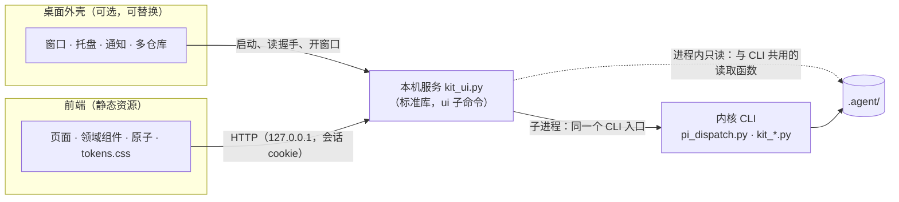

# Themis Tally 3.0 桌面端设计：本机服务、设计系统与可替换外壳

状态：**拟议，第 2 稿（2026-10-18），尚未送闸一**。第 11 节的四项用户已拍板（见 1.1），按 2gate 送 Codex 审核（上位设计 15.1：3.0 的实现走 2gate）。界面设计另见 `docs/themis-tally-3.0-桌面端-UI设计.md`。

- 分支：`themis-3.0`（本地，不推送），起点 `9461d31`（2.12.0，与本地 master 相同）。
- 上位设计：`docs/themis-tally-3.0-四端分层解耦架构.md`。本文细化它的 8.4（管理台）与 12 节的 M4，并按用户决定改写 1.3 的一条非目标与 15.2 第 9 项（见 1.1）。
- 参考：open-claude-ui（<https://github.com/Caho1/open-claude-ui>，提交 `638800b`，MIT）。只读阅读，没有运行、安装或构建其中任何东西。
- 下文的 `file:line`：
  - 本仓库的在 `9461d31` 上核对；
  - 参考仓库的在 `638800b` 上核对，路径相对它的根目录。
- 缩写：
  - PD = `scripts/pi_dispatch.py`
  - KC = `scripts/kit_config.py`
  - KR = `scripts/kit_roles.py`
  - KL = `scripts/kit_logs.py`
  - KP = `scripts/kit_plugins.py`
  - OCU = open-claude-ui

## 0. 审核变更对照表

尚未送审。

## 1. 范围

### 1.1 用户决定（2026-10-18）

- **先实现，后改 README**：README 的“简介”等章节等实现之后按实际情况改，不先写半成品状态。
- **桌面端的框架参考 OCU**：取它的长处，设计一套属于本项目的方案。
- 由此：
  - 上位设计 15.2 第 9 项（管理台的形式）由 A（本机网页）改为桌面端；
  - 1.3 的非目标“首期不做桌面安装包”随之改写。
- 本文的做法是两者的组合：
  - 管理台的后端仍是上位设计 8.4 的标准库本机服务；
  - 桌面外壳只负责启动服务、开窗口与系统集成；
  - 不装桌面应用时，CLI 照常全部可用；界面只在桌面应用里提供（不做浏览器模式，见下）。

第 11 节四项的拍板（2026-10-18）：

- **外壳用 Electron**。用户问“为啥不用 Claude Code 的架构”：Claude 的桌面应用就是 Electron 外壳加 React 界面（OCU 拆的就是它的 `app.asar`，见 3.2），本文的 Electron 方案正是这一路。后台不照搬：仍是现有的 Python 内核与本机服务。
- **花钱或集成的操作第一阶段不开放**（D6）：之后逐项开放，每次单独确认。
- **不做浏览器模式**：本机服务只由桌面外壳启动，引导地址只经管道交给外壳（D4、D14）。
- **先做桌面端 D1–D3**（第 9 节），内核 P2 之后再说。
- **界面由用户交给 Claude Design 实现**：依据是 `docs/themis-tally-3.0-桌面端-UI设计.md`；产出接入 `desktop/web` 之前由规划端审核（第 6 节）。

### 1.2 目标

1. **给人一个工作台**：看任务与 attempt 的状态和证据；像 CC Switch 那样切换角色与模型；看日志与用量；管理插件；看历史与审计。
2. **零信任不退化**：
   - 界面只显示内核写下的事实，不自报成功；
   - 每个界面操作都是一条已登记的 CLI 命令，写入经内核原有的锁、校验与审计；
   - 凭据的值永不出现。
3. **内核仍只依赖 Python 标准库**：不装桌面端，CLI 全部照常可用。
4. **外壳可替换**：Electron 与 Tauri 只差一层薄壳（D10），换外壳不动服务与前端。
5. **视觉是自己的**：从 Themis Tally 的品牌出发，不仿任何其他产品的外观。

### 1.3 不在本文

- 内核 P2–P6 的设计（状态账本与反馈、合同端流程、第二个 CLI、调度代理、无头审核端与 `drive`）：各自另出设计。本文只为它们预留页面位置，并标明“等待 P×”。
- README 的改写（1.1）。
- 发布、签名与自动更新的具体流程：D10 只定原则。

## 2. 现状（承重事实）

### 2.1 上位设计已定的约束

- **管理台**（上位设计 8.4，第 1101–1117 行）：
  - `ui` 子命令启动标准库 HTTP 服务；只绑 127.0.0.1，随机端口，随机令牌路径；
  - 拒绝外来 Host；写操作带页面令牌；空闲超时；`no-referrer`，不记请求正文；
  - 七个页面；“每个界面操作都对应一条 CLI 命令；代理用 CLI，人用界面”；
  - 不显示凭据值，不提供远程访问。
- **审计**（8.6，第 1137–1158 行）：`actor` 取 user-ui / user-cli / `agent:<role>`；`confirmation` 取 interactive / flag / none。
- **管理面的权限**（10 节第 1201、1206 行）与**不做**（14 节第 1306 行）：不显示凭据值；不能无确认地安装插件、扩权或归档证据；管理台只在用户本人的会话里打开。
- **原来的取舍**：
  - 15.2 第 9 项（第 1365–1368 行）推荐 A（本机网页），C（桌面应用）的代价写的是“引入非标准库依赖与打包”；
  - 1.3（第 58 行）：“首期不做桌面安装包：内核只依赖 Python 标准库，管理台用本机网页”。

### 2.2 已有的本机服务做法

2.7 的一次性凭据页（KC:1250–1330）已经是一个标准库本机服务：

- `ThreadingHTTPServer` 绑 127.0.0.1、端口 0（KC:1250、1315）；
- 随机令牌路径 `token_urlsafe(24)`（KC:1253），路径不对一律 404（KC:1276–1286）；
- 只接受 Host 为 127.0.0.1、localhost、::1（KC:1279–1280）；
- `Cache-Control: no-store`、`Referrer-Policy: no-referrer`（KC:1267–1274）；不记请求行与正文（KC:1264–1265）；
- 请求体上限 `MAX_BODY = 8192`（KC:65、1296）；`PAGE_TIMEOUT = 600` 秒到时关闭（KC:66、1326）。

桌面端的本机服务沿用这些做法，再补上 Origin 校验、CSRF 防护与 CSP（D4）。

### 2.3 CLI 的机读输出

- `status --json`（PD:8199–8201）；`decisions replay --json`（PD:8207–8209）。
- `config` 的 `show`、`history`、`runtime list|scan|probe`、`models`、`profile show`、`role show`、`preset list|show|diff`、`doctor` 都有 `--json`（KC:1405–1528）；`validate` 没有。
- `logs list|show|usage` 有 `--json`；`logs search` 没有（KL:958–980）。
- `plugins list|show|verify` 有 `--json`；`enable|disable` 有 `--dry-run` 预览（KP:771–791）。
- 输出都先过内核的脱敏：`redact_secrets`（PD:2647）、`redact_obj`（PD:2680），以及第二轮 D9 的各道防线。

### 2.4 写入的确认与审计

- **执行者**：KC 的审计记录写 `actor`，取自环境变量 `CODEKIT_ACTOR` 的自声明（KC:430、509–517），没设时记 `undeclared`。规则 `ACTOR_RE` 只认 `user` 与 `agent:<role>`（KC:431），上位设计 8.6 的 `user-ui` 目前写不进去。
- **运行中切换**（第二轮 D8）：在事务里、写入之前判断（KC:766–785）。有 attempt 在运行、这次写入又会改变 execution 或 contract 的生效绑定时：
  - 不带 `--yes` 就抛错，什么也不写；
  - 带 `--yes` 时审计记 `confirmation: flag`；
  - 无关时记 `none`。

### 2.5 内核的加载与保护

调度器只加载 `KIT_LOADED_FILES` 列出的模块（PD:96–101），这些文件在执行器的保护范围里。新增的 `kit_ui.py` 也要加进去。

### 2.6 规划端的权限示例

`.claude/settings.example.json`：30 条 allow；4 条 ask（`--probe-decisions`、`--assess`、`--out` 的两种写法）；1 条 deny（`Edit(/.agent/runs/**)`）。目前没有关于 `ui` 的规则。

### 2.7 Python 的查找

`scripts/dispatch-pi.sh:9–19` 依次试 `python3`、`python`、`py -3`，每个都试运行版本检查（Windows 的 `python3` 可能是应用商店的占位程序）。外壳找 Python 用同样的顺序。

### 2.8 品牌

`Logo/Logo.png` 是一面盾形：
- 天平与盾用海军蓝 `#012852`；
- 中间的符契用金色 `#D49C32`。

两个色值都由本仓库的像素采样得到。

## 3. 参考：open-claude-ui 拆解

### 3.1 它是什么

- 一个高仿 Claude 官方桌面端的组件与设计令牌样例库：
  - `code-examples/` 下有 26 个 `.tsx`、7 个 `.ts` 与 CSS；
  - `docs/` 下有 v1 八篇、v2 六篇逆向分析（package.json:4）；
  - peer 依赖 React 18、framer-motion、lucide-react（package.json:50–55），Electron 只是 devDependency（package.json:65）。
- 它不是能运行的桌面端骨架：
  - 没有应用外壳、IPC 设计、本地后端、状态管理、打包与更新；
  - 没有测试：package.json 没有 test 脚本，CI 只跑 typecheck、check:tokens、build（.github/workflows/ci.yml:18–21），`tsconfig.json:10` 为 `strict: false`。

### 3.2 借鉴什么

| 长处 | 依据 | 本文怎么用 |
|---|---|---|
| 分层：令牌 → 原子 → 领域组件 → 外壳；令牌层是纯 CSS 自定义属性，可以脱离 React 使用 | `code-examples/cds-theme.css`（183 个令牌）；README.md:40 | D8：`tokens.css` 不依赖框架，标准库的一次性凭据页也能用 |
| 宿主窗口与内容视图分开，内容视图单独开 `sandbox: true`、`contextIsolation: true` | `code-examples/createClaudeMainWindow.ts:49–58` | D10：外壳只开一个内容窗口，安全选项全部显式写出（它的宿主窗口没写，见 3.3） |
| 不可信内容放进 null-origin 沙箱，并校验消息来源 | `code-examples/EpitaxyIframeBridge.tsx:44、48–53、91` | D5：只在必须执行内容时用；第一阶段证据一律按纯文本呈现，不用 iframe |
| 授权判决带原因分类：`user_denied`、`policy_denied`、`PERMISSIONS_ERROR` | `docs/v1/03-会话核心流与指令交互引擎.md` 3.5.3 节 | D6：确认框的结果带原因，显示给用户 |
| 并发修改不静默覆盖：按 `against_sha256` 比对基线，不一致就让用户确认 | `docs/v1/06-系统级桌面架构与协作拓扑.md` 6.8.2 节（只在文档里） | D6：确认时记下读到的配置哈希，执行前不一致就重新预览 |
| 单一权威：副本只收快照，写操作回到权威执行 | 同上 6.8.1 节（只在文档里） | D2、D7：本机服务是唯一权威；多个窗口只读快照，写都经服务 |
| 流式输出的滚动图钉：用户输入后 150ms 内不抢滚动，离底 40px 内才跟随 | `code-examples/useClaudeScrollPinning.ts:36、57` | D7：日志跟随 |
| 统一 / 分屏两种差异视图 | `code-examples/StreamingDiffViewer.tsx:216–332` | D11：候选补丁查看 |
| 退避与上限 | `code-examples/useRateLimitBackoff.ts:14–15、50–57` | D7：断线重连；服务给的等待时间是下限，抖动只往后加（它把抖动乘在 Retry-After 上，见 3.3） |
| 容器查询的多档排版、Roving TabIndex 键盘导航 | `docs/v1/06-…md` 6.5、6.6 节；`code-examples/useClaudeRovingFocus.ts` | D8：窄窗口与键盘操作 |
| 不分发商业字体与音频，用系统字体栈 | `assets/README.md:5–13` | D8：同样只用系统字体，也不用声音 |

### 3.3 不照搬什么

| 问题 | 依据 | 本文的做法 |
|---|---|---|
| 授权卡片在界面里自报成功：批准后本地等 1.2 秒就把状态改成 success | `code-examples/McpToolDecisionCard.tsx:65–69` | 这与“执行器的自述不是证据”正好相反。界面上的结果只来自内核的退出码与随后重新读到的状态（D6） |
| “始终允许”与“单次批准”的处理完全相同；330 秒回收只写在注释与文档里 | `code-examples/McpToolDecisionCard.tsx:58–72`；`docs/v1/03-…md` 第 347–354 行 | 不做“始终允许”：每次改绑定或花钱的操作都单独确认（D6） |
| 手势门禁取的是粘性的 `hasBeenActive`：页面点过一次之后，后续消息都放行 | `code-examples/EpitaxyIframeBridge.tsx:60–64` | 一次确认只放行一条命令：由服务签发一次性确认号（D6） |
| 宿主窗口只设了 `preload`，没有显式的 `sandbox`、`contextIsolation`、`nodeIntegration`；全仓没有 CSP、权限请求处理、导航与新窗口拦截 | `code-examples/createClaudeMainWindow.ts:43–45` | D10 全部显式写出，并有测试（10.4） |
| 确认框的注释说“焦点被锁在弹窗内部”，代码里没有焦点管理 | `code-examples/ConfirmationDialog.tsx:17` | D8：对话框做焦点陷阱，关闭后焦点返回，有测试（10.2 的 W6） |
| 多代理看板是演示数据：“4 个活动 Agent”写死，状态从不转换 | `code-examples/CoworkAgentCanvas.tsx:94、119` | 四端视图等内核 P2 的状态账本（D11 的依赖表） |
| 令牌契约不严：按 `--cds-[a-z0-9-]+` 扫描 `code-examples/*.ts(x)`，用到 62 个，其中 13 个不在 `cds-theme.css` 里（如 `--cds-accent`、`--cds-bg-neutral`）；检查脚本只核对 AGENTS.md 里用反引号列出的变量 | `scripts/check-tokens.mjs:21–22` | D8：组件里用到的每个变量都必须在 `tokens.css` 里定义，组件里不许写死颜色，CI 检查 |
| 总导出包含 Electron 窗口工厂，后者静态导入 `electron` | `src/index.ts:38`；`code-examples/createClaudeMainWindow.ts:12` | 前端与外壳分成两个包，前端不依赖外壳 |
| 品牌与来源：logo 底色是 Claude 的陶土色 `#d97757`，字体栈首位是专有字体 AnthropicSans；多个文件头写着“逆向还原自 Claude Desktop” | `assets/images/logo.svg:2`；`code-examples/tailwind.config.js:29`；`code-examples/createClaudeMainWindow.ts:3`；`code-examples/EpitaxyIframeBridge.tsx:3` | 只借结构与交互模式，不复制它的文件、令牌数值、圆角、配色、文案与命名（D8，第 7 节） |

### 3.4 结论

OCU 的价值在“怎么分层”和“哪些交互细节值得做”，不在代码本身：
- 它的组件大多是演示件，业务状态写在组件内部；
- 安全基线不全；
- 它仿的是另一家公司的产品外观。

本文只借它的结构与模式，代码与视觉都自己写。

## 4. 决策与理由

### D1 定位

- 桌面端是“人的工作台 + 管理面”，不是第五个角色：它不起草、不审核、不执行，也不替任何角色做判断。
- 代理用 CLI，人用界面（上位设计 8.4）：
  - 每个界面操作都对应一条已登记的 CLI 命令；
  - 界面能做的，CLI 都能做；反过来不一定。
- 界面显示的状态与结论只来自内核写下的记录，界面自己不推断“成功”。

### D2 架构



- **内核不变**：仍只依赖标准库。
- **本机服务 `kit_ui.py`** 是唯一的后端，也是安全边界（D4）：
  - 路由 → CLI 命令（D3）；
  - 写一律经 CLI 子进程。
- **前端**是静态资源（D9），由本机服务托管，只在桌面外壳的窗口里打开（不做浏览器模式，1.1）。
- **外壳**只做系统集成（D10）：找 Python、启动服务、读握手、开窗口、托盘与通知。它不含业务逻辑，也不直接调用 CLI。
- 为什么不让外壳直接调用 CLI（例如在 Electron 主进程里用 `child_process`）：
  - API 会写在 TypeScript 里，Python 的测试覆盖不到；
  - 换外壳就要重写一遍；
  - 安全边界会分散在外壳与服务两处，不好测。

### D3 路由怎么执行命令

- **路由表**：每条路由登记以下几项（5.2）：
  - 对应的 CLI 命令（argv 模板）；
  - 参数校验规则；
  - 读或写；
  - 超时；
  - 是否作为后台作业。

  服务启动时用内核真正的解析器核对每条模板都能解析（10.1 的 U4）。
- **写命令与会运行外部 CLI 的读命令：子进程执行**。
  - 命令为 `<当前解释器> <kit>/scripts/pi_dispatch.py --repo <仓库> <argv…>`；有 `--json` 的读 stdout，退出码原样返回。
  - argv 用列表传递，不经 shell。
  - 为什么不在服务进程里直接调用 CLI 的处理函数：
    1. 处理函数把结果打印到 stdout，进程内只能靠重定向 stdout 取结果，多个请求并发时会互相串；
    2. `config doctor`、`runtime probe` 要运行外部 CLI，耗时数十秒，进程内调用会卡住其他请求；
    3. 每次调用要单独设 `CODEKIT_ACTOR=user-ui`，进程内只能改全局环境。
  - 子进程把这三件事都隔开了，也和用户在终端里敲同一条命令逐字节相同。代价是每次多一次 Python 启动（数百毫秒量级，未测）。
- **快的只读路由：进程内调用与 CLI 共用的读取函数**。
  - 适用于状态列表、证据文件的按段读取（D7）。
  - 这些函数只读、返回数据、不打印；对应的 CLI 命令（`status --json`、新增的 `logs cat`）调用的是同一个函数，由 10.1 的 U9 比对两边输出一致。
- **环境**：子进程继承服务的环境，另设 `CODEKIT_ACTOR=user-ui`。服务本身不读凭据，凭据仍由内核按 2.7 的分层查找。
- **并发**：
  - 读命令最多并行 4 个（可配）；
  - 写命令逐个执行。内核的配置锁本来也会串行化，第二轮 D7 的事务规则不变。
- **超时与取消**：
  - 每条路由有超时；
  - 超时或客户端取消时，结束整个子进程树（沿用 PD 的进程监督做法）；
  - 作业状态只在服务内存里，服务退出即丢弃，不写 `.agent/`。

### D4 本机服务的安全

- **监听**：只绑定 127.0.0.1，端口随机（0）。每个仓库同时只有一个服务：`.agent/.ui.lock/`（被忽略）记下 pid 与端口；已有活着的服务时，新进程报告它并退出 1，不另起服务。
- **会话**：“引导地址 → cookie”：
  - 服务启动时生成一次性随机串 nonce，组成引导地址 `http://127.0.0.1:<port>/bootstrap/<nonce>`；
  - 引导地址只写进 stdout 的握手行，交给启动它的外壳（5.1），不打印到终端，也不写日志；
  - 外壳在窗口里打开它；第一次访问时，服务设置会话 cookie（32 字节随机令牌，`HttpOnly; SameSite=Strict; Path=/`），并重定向到 `/`；引导地址随即作废；
  - 令牌不出现在地址栏、历史与引用里，页面脚本也读不到（HttpOnly）。
- **Host 校验**：只接受 `127.0.0.1:<port>` 与 `localhost:<port>`，防 DNS 重绑定。沿用 KC:1279–1280 的做法，再加上端口。
- **CSRF**：
  - 只有 GET（读）与 POST（写）两种方法；
  - POST 要求 `Origin` 与服务自身相同、`Content-Type: application/json`、自定义头 `X-Themis-UI: 1`；
  - 不开 CORS。
- **响应头**：
  - `Content-Security-Policy: default-src 'none'; script-src 'self'; style-src 'self'; img-src 'self' data:; font-src 'self'; connect-src 'self'; frame-ancestors 'none'; base-uri 'none'; form-action 'self'`；
  - `X-Content-Type-Options: nosniff`；`Referrer-Policy: no-referrer`；
  - API 响应 `Cache-Control: no-store`。
- **请求体**：只收 JSON，上限 64 KiB；字段按路由的规则校验（例如 profile 名必须符合 ID 规则）；不合格时返回 400，不回显原值。
- **日志**：不记请求正文、令牌与 cookie；访问记录只有路由名、状态码与耗时，只保存在内存里。
- **空闲关闭**：无请求超过 `ui.idle_timeout_seconds`（缺省 1800）、且没有作业在跑时退出；桌面模式下外壳退出，服务随之退出（监视父进程）。
- **二道脱敏**：子进程的 stdout（JSON）与 stderr 行在返回前再过一次 `redact_obj` / `redact_secrets`。内核已经脱过敏，这里是第二道。
- **不是安全沙箱**：同一系统账户下，以上是流程约束，不是隔离（README 的安全须知照旧）。同账户的进程能连本机端口，也能附加到外壳进程上读取它的内存。

### D5 不可信内容怎么呈现

- 下列内容都是数据，不是指令：
  - 证据：`events.jsonl`、`stderr.log`、`executor-report.*`、`candidate.patch`、`checks/` 下的日志；
  - 执行器与模型的输出；
  - 仓库里的文件内容。
- 前端一律按文本节点渲染，不用 `innerHTML` / `dangerouslySetInnerHTML`。代码与补丁做语法着色时，也只生成文本节点与类名。
- Markdown（`summary.md`、复审记录、合同）用白名单渲染器：
  - 不渲染原始 HTML；
  - 链接只显示，点击时确认，再交给系统浏览器打开，且只允许 http/https。
- 第一阶段不在界面里执行任何内容：不做 HTML 预览，不跑脚本。将来真要预览时：
  - 用 null-origin 沙箱 iframe，不给 `allow-same-origin`，也不给 `allow-popups`；
  - 校验消息来源（3.2 借鉴的做法）；
  - 不认粘性的手势状态（3.3）。
- 大文件按需截取：按字节偏移与上限读取（D7），前端不整份加载 `events.jsonl`（沿用 AGENTS.md 的读法）。

### D6 写操作与确认

界面上的操作分四档：

| 档 | 例子 | 第一阶段 | 规则 |
|---|---|---|---|
| 读 | 状态、证据、日志、用量、配置、插件、历史、审计 | 有 | 不需要确认 |
| 改配置 | `config role set`、`preset use/save/remove`、`profile add/edit/remove`、`runtime add/remove`、`plugins enable/disable`、`config rollback` | 有 | 先预览，再确认，再执行（见下） |
| 花钱或集成 | `smoke`、`prepare`、`run`、`verdict`、`integrate`、`branch`、`mark`、`status --assess`、`config secret set --verify` | **待用户决定**（11 节第 2 项） | 若开放：每次单独确认；确认框写明后果，例如“会把代码发送给执行模型的提供商并产生费用”；没有“始终允许”；内核的门禁与预检一项不减 |
| 不提供 | 改或删 `.agent/runs/` 下的证据；显示凭据值；从网络安装插件；代替代理操作 | 无 | — |

**改配置的流程**：

1. **预览**：服务运行这条命令的预览，不写任何文件：
   - 插件用现有的 `--dry-run`；
   - 改绑定的写命令新增 `--dry-run --json`（D13），报告：
     - 这次写入改变哪些角色的生效绑定；
     - 当前在运行的 attempt；
     - 是否需要 `--yes`。

   预览同时记下当前配置的哈希。
2. **确认**：确认框显示：
   - 将要运行的 CLI 命令；
   - 预览结果；
   - 需要 `--yes` 时的原因。

   用户确认后，服务签发一个一次性确认号：60 秒内有效，绑定这条 argv 与那份配置哈希。
3. **执行**：写请求必须带确认号。服务核对确认号，并检查配置哈希没变，否则返回 409 并要求重新预览；核对通过后才运行命令。只有预览说需要时才带 `--yes`。
   - 预览只是提示：有没有在运行的 attempt，仍由内核在写入的那一刻判断（第二轮 D8）。
   - 预览之后才开始的 attempt，会让不带 `--yes` 的写入被内核拒绝。界面照实显示内核的提示，回到第 1 步。
4. **结果**：只看子进程的退出码与随后重新读到的状态。
   - 界面不做乐观更新，也不自报成功；
   - 失败时显示内核的报错（已脱敏），附原因分类：用户取消、内核拒绝、配置已变、超时。
5. **审计**：
   - `actor` 记 `user-ui`（D13 扩展 `ACTOR_RE`）；
   - `confirmation` 按内核现有规则记：带 `--yes` 为 `flag`，否则 `none`。

### D7 实时状态与日志跟随

- **状态快照**：服务调用与 `status --json` 共用的函数，从 `.agent/runs/` 计算 attempt 列表（只读）。
- **推送**：
  - `GET /api/v1/events` 用 Server-Sent Events。服务每 2 秒算一次快照，有变化才推送增量。
  - 前端断线后按退避重连：服务给出的等待时间是下限，抖动只往后加。
  - 会话 cookie 对 EventSource 同样有效。
- **日志跟随**：
  - 按字节偏移读取证据文件，单次上限 256 KiB，返回下一段的偏移；
  - 读取函数与新增的 `logs cat`（D13）共用，只认证据目录下的相对路径，不跟随链接，输出脱敏；
  - 前端用滚动图钉（3.2）。
- **运行中的进度**：`status` 的文本输出已有“已完成的工具调用次数、已用时间、长时间没有工具调用”（PD:7303–7327 的 `_live_progress`），`--json` 里还没有。D13 给 `status --json` 的运行中 attempt 补一个 `live` 对象：`tool_calls`、`elapsed_seconds`、`deltas_since_last_tool`、`long_idle`，与文本输出同一个来源。
- **运行健康**：
  - 只显示上面那条“长时间没有工具调用”的提示；
  - `status --assess` 会调用决策模型，属于“花钱”一档（D6）。
- 多个窗口共用同一个服务的快照，写都回到服务（3.2 的“单一权威”）。

### D8 设计系统（Tally DS）

- **令牌**：`tokens.css` 里只有 CSS 自定义属性，前缀 `--tt-`，分三层。
  - **品牌原色**：海军蓝 `#012852`、符契金 `#D49C32`（2.8），以及由它们推出的明暗阶梯。
  - **语义令牌**：四级表面、文字、发丝边框、焦点环、危险、警告、链接。
  - **状态令牌**：内核的每个 attempt 状态各一个，共 17 个：PREPARING、PREPARED、PREPARE_FAILED、RUNNING、COLLECTING、NEEDS_REVIEW、PASS、ACCEPTED_WITH_EXCEPTION、REVISE、BLOCKED、ESCALATE、INFRA_FAILURE、TIMEOUT、CANCELLED、INTEGRATED、ABANDONED、SUPERSEDED（PD 里出现的全部状态名，见 PD:81–88、4700、6037）。状态标签除了颜色还配图标与文字，不只靠颜色区分。
  - 亮色与暗色两套，跟随系统，也可手动切换。
  - 具体数值见 UI 设计文档（`docs/themis-tally-3.0-桌面端-UI设计.md` 第 3 节），已按 WCAG AA 核算对比度，不取自 OCU。
- **排版**：
  - 只用系统字体栈，中文优先：
    - Windows：Microsoft YaHei UI、Segoe UI；
    - macOS：PingFang SC、SF；
    - Linux：Noto Sans CJK SC。
  - 等宽字体：Cascadia Mono、SF Mono、Consolas。
  - 不打包字体文件。
- **动效**：只用于状态变化与展开收起，100–200ms；尊重 `prefers-reduced-motion`。没有声音，也没有氛围光效。
- **分层**：
  - `tokens.css`；
  - 原子组件：按钮、分段选择、状态标签、对话框、表格、代码块、空状态；
  - 领域组件：attempt 卡片、证据面板、补丁查看、角色绑定卡、方案切换、确认框、日志跟随；
  - 页面。

  `tokens.css` 不依赖框架。2.7 的一次性凭据页可以改用它的配色（可选，D13）。
- **可访问性**：
  - 对话框有焦点陷阱，关闭后焦点回到触发它的按钮；
  - 列表用 Roving TabIndex；
  - 所有操作都能用键盘完成；
  - 用容器查询适配窄窗口。
- **契约检查**：脚本扫描前端源码：
  - 组件里用到的每个 `--tt-*` 都必须在 `tokens.css` 里定义；
  - 组件里不许写死颜色值；
  - 状态令牌必须覆盖内核导出的全部状态名。

  CI 跑这个检查（对照 3.3 的契约漏洞）。

### D9 前端技术栈

- **语言与框架**：TypeScript（`strict: true`）+ React 18 + Vite。
- **样式**：普通 CSS 加令牌。不用 Tailwind 与 framer-motion：动效需求小，可以少两个依赖。
- **图标**：用一套许可清楚（MIT 或 ISC）的 SVG 图标，按需拷入，并记录来源与许可。
- **依赖**：用锁文件固定版本，`npm ci` 安装；不在运行时从网络加载任何资源（CSP 的 `connect-src 'self'` 也会挡住）。
- **状态**：
  - 页面状态从服务的快照与 SSE 推导，不在组件里存业务状态（对照 3.3 的演示件做法）；
  - 写操作走统一的“预览 → 确认 → 执行 → 重读”流程（D6）。
- **测试**：
  - 组件与流程用 Vitest；
  - 契约检查（D8）；
  - 端到端用 Playwright 的 Electron 支持驱动桌面应用，连本机服务与夹具仓库（10.3）。

### D10 桌面外壳（Electron，用户已定；保留换 Tauri 的余地）

**外壳只做五件事**：

1. **找 Python 与 kit**：
   - Python 的查找顺序同 `scripts/dispatch-pi.sh:9–19`，也可以在设置里指定；
   - kit 可以是设置里指定的 ThemisTally 目录，或者目标仓库里由 `kit_install` 装好的 `scripts/pi_dispatch.py`。
2. **启动服务**：运行 `python <kit>/scripts/pi_dispatch.py --repo <仓库> ui --desktop --assets <应用自带的前端目录>`。只读 stdout 的第一行握手；之后只监视进程，不读它的输出内容。
3. **开窗口**：
   - 先加载握手给出的引导地址，之后只允许服务自己的 origin；
   - 窗口用不落盘的会话分区，cookie 不写磁盘。
4. **系统集成**：托盘；通知（attempt 结束、等待验收）；在资源管理器中显示文件；每个仓库单实例；切换多个仓库。
5. **退出**：关闭窗口时结束服务；服务意外退出时提示，并允许重启。

**Electron 的安全设置全部显式写出**（对照 3.3）：

- `contextIsolation: true`、`sandbox: true`、`nodeIntegration: false`、`webSecurity: true`、`allowRunningInsecureContent: false`；不开 `webviewTag`。
- preload：
  - 不用 preload；或者只暴露两个经过校验的函数：“在资源管理器中显示”“发通知”；
  - 参数只接受 `.agent/` 下的相对路径与固定的通知类型。
- 导航与外部链接：
  - `setWindowOpenHandler` 一律拒绝；
  - `will-navigate` 只允许服务自己的 origin；
  - 外部链接要用户确认后交给 `shell.openExternal`，而且只允许 http/https。
- `session.setPermissionRequestHandler` 与 `setPermissionCheckHandler` 一律拒绝。
- 打开 Electron Fuses：
  - 关闭 `RunAsNode`、`EnableNodeOptionsEnvironmentVariable`、`EnableNodeCliInspectArguments`；
  - 开启 `OnlyLoadAppFromAsar` 与 `EnableEmbeddedAsarIntegrityValidation`。
- 自动更新缺省关闭；应用不向 127.0.0.1 以外的任何地址发请求。
- 打包用 electron-builder，先做 Windows（NSIS），macOS 与 Linux 之后再做；签名另定。

**为什么用 Electron**（用户 2026-10-18 拍板，1.1）：

- 这就是 Claude 桌面应用的架构：Electron 外壳加 React 界面；OCU 走的也是这条路，交互模式可以直接对照；
- Pi 本来就需要 Node.js（README 的环境要求），开发机不用另装工具链；
- Electron 在 Windows 上最成熟。
- 代价：
  - 安装包大（Electron 应用通常上百 MB，未测）；
  - 攻击面大。这一点靠上面的显式设置与 10.4 的测试来约束。

**Tauri 作为备选**：安装包小，权限按能力声明；但构建要 Rust 工具链，而且各平台 WebView 的行为不同。外壳的契约只有上面五件事，换成 Tauri 只需重写这一层。

### D11 页面与命令

| 页面 | 内容 | 对应命令 | 现在可做 |
|---|---|---|---|
| 总览 | 运行中的 attempt（已用时间、工具调用次数、“长时间没有工具调用”的提示）；待验收（NEEDS_REVIEW）；已通过待集成；最近的配置变更 | `status --json`；`config history --json` | 是 |
| 任务与 attempt | 任务列表；attempt 的状态、摘要、范围、检查、变异、结论；候选补丁（统一 / 分屏）；执行报告（纯文本）；事件跟随 | `logs list/show --json`；新增的 `logs cat`（D13） | 是 |
| 角色与模型 | 四个角色的绑定与模式；方案一键切换（先看 `preset diff` 与预览）；profile 的增改删 | `config role/profile/preset … --json` 与对应的写命令 | 是 |
| CLI 运行时 | 已登记的 runtime、命令来源、版本；扫描、探测、模型列表；就绪总览（含 `--record`） | `config runtime …`、`config models`、`config doctor` | 是（作业） |
| 凭据 | 每个环境变量名在哪一层找到；录入时打开 2.7 的一次性页面 | `config secret check`；`config secret set` | 是 |
| 日志与用量 | 检索；执行端与规划端的 token 用量 | `logs search`（补 `--json`）、`logs usage --json` | 是 |
| 插件 | 列表、核对、启停（先用 `--dry-run` 预览权限差异） | `plugins …` | 是 |
| 历史与审计 | 配置写入的历史、快照差异、回滚 | `config history …`、`config rollback` | 是 |
| 需求与合同 | 需求、概要步骤、合同候选、审核简报、ContractReview | 等 P2、P3 的命令 | 否（推测：13.5 节已把 P3 改为更轻的形态，开工前要用户决定） |
| 四端拓扑 | 四个角色当前在做什么，以及交接记录 | 等 P2 的状态账本 | 否（推测） |
| 反馈流 | 调度内核与调度代理的反馈 | 等 P2、P5 | 否（推测） |
| 推进 | `drive` 推进到下一个需要用户的关口 | 等 P6 | 否（推测） |

### D12 代理与界面的边界

- `ui` 是给人用的命令：
  - AGENTS.md 写明代理不启动、也不驱动管理台；
  - Codex 沙箱一节不把 `ui` 列为可运行的命令。
- `.claude/settings.example.json` 给 `Bash(bash scripts/dispatch-pi.sh ui*)` 加 deny。
- 界面上的写操作在审计里记 `user-ui`，与代理的 `agent:<role>` 分开（D6）。
- 这些都是流程约束：同一系统账户下，代理的进程仍能连本机端口（D4）。

### D13 模块与接入

- **新增 `scripts/kit_ui.py`**（标准库）：本机服务、路由表、子进程执行、SSE、静态资源托管。
  - 调度器登记 `ui` 子命令，惰性转交，方式与 `config`、`logs`、`plugins` 相同；
  - 加进 `KIT_LOADED_FILES`（PD:96–101）。
- **KC**：
  - `ACTOR_RE` 加 `user-ui`（KC:431）；
  - `config validate` 补 `--json`；
  - 改绑定的写命令（`role set`、`preset use`、`profile edit/remove`、`runtime add/remove`、`rollback`）加 `--dry-run --json`：只计算 2.4 里内核的判断，不写文件、不记审计；
  - 2.7 的一次性凭据页可以改用 `tokens.css` 的配色（可选）。
- **PD**：`status --json` 给运行中的 attempt 补 `live` 对象（D7），文本输出不变。
- **KL**：
  - `logs search` 补 `--json`；
  - 新增只读的 `logs cat <run> <相对路径> [--offset N] [--limit N] --json`：按字节截取，只认证据目录下的相对路径，不跟随链接，输出脱敏。这样“读证据文件”也有对应的 CLI 命令（D1）。
- **共用的只读函数**：状态列表、证据文件按段读取。KL 与 PD 现有的实现抽成返回数据的函数，CLI 与服务都调用它们（D3）。
- **新目录 `desktop/`**：
  - `desktop/web/` 是前端，`desktop/shell/` 是 Electron 外壳，各自有 `package.json` 与锁文件；
  - `.gitignore` 加 `desktop/**/node_modules/`、`desktop/**/dist/`、`.agent/.ui.lock/`，`gitignore.append.txt` 加 `.agent/.ui.lock/`。
- **`kit_install`**：只装 Python 文件（`kit_ui.py` 随 `KIT_LOADED_FILES` 一起装），不装 `desktop/`。桌面应用单独安装，自带前端资源，可以指向任何仓库。

### D14 前端资源从哪来

- 前端只随桌面安装包提供（用户决定不做浏览器模式，1.1）：安装包自带构建好的前端，用 `--assets` 传给服务。
- 构建产物不提交进仓库；开发时用 Vite 的开发服务器，只在开发机上。
- 服务找不到 `--assets` 指向的资源时拒绝启动并退出 2，不显示残缺的页面。

## 5. 接口

### 5.1 `ui` 子命令

```
ui --desktop --assets <目录> [--idle-timeout <秒>]
```

- 只给桌面外壳用（不做浏览器模式，1.1）；不带 `--desktop` 时退出 2，提示“管理台只由桌面应用启动”。
- stdout 写一行握手 JSON：`{"themis_ui": 1, "bootstrap": "http://127.0.0.1:<port>/bootstrap/<nonce>", "origin": "http://127.0.0.1:<port>", "pid": <pid>}`；之后不再向 stdout 写任何内容。
- 父进程退出时，服务自己退出。
- **退出码**：
  - 0：正常关闭（空闲超时或外壳退出）；
  - 2：用法错误，或找不到前端资源；
  - 1：已有服务在运行，或其他错误。

### 5.2 路由（第一阶段）

| 方法与路径 | 对应的 CLI | 类别 |
|---|---|---|
| GET `/api/v1/meta` | `--version`；另给仓库目录名（不含上级路径） | 读 |
| GET `/api/v1/status` | 与 `status --json` 共用函数（D3） | 读 |
| GET `/api/v1/events` | SSE，基于上一行（D7） | 读 |
| GET `/api/v1/attempts?task=` | `logs list [--task] --json` | 读 |
| GET `/api/v1/attempts/<task>/<attempt>` | `logs show <task>/<attempt> --json` | 读 |
| GET `/api/v1/attempts/<task>/<attempt>/file?path=&offset=&limit=` | 与 `logs cat … --json` 共用函数（新增） | 读 |
| GET `/api/v1/search?q=&task=` | `logs search … --json`（补） | 读 |
| GET `/api/v1/usage` | `logs usage --json` | 读 |
| GET `/api/v1/config`、`/config/validate` | `config show --json`、`config validate --json`（补） | 读 |
| GET `/api/v1/config/history`、`/config/history/<n>` | `config history [show <n>] --json` | 读 |
| GET `/api/v1/roles`、`/profiles`、`/presets`、`/presets/<a>/diff/<b>`、`/runtimes` | `config role show`、`profile show`、`preset list`、`preset diff <a> <b>`、`runtime list`（都带 `--json`） | 读 |
| POST `/api/v1/jobs`，`kind` 为 `doctor`、`doctor-record`、`runtime-scan`、`runtime-probe`、`models` | `config doctor [--record]`、`runtime scan`、`runtime probe <id>`、`models <runtime>`（都带 `--json`） | 读（作业） |
| GET `/api/v1/jobs/<id>`；POST `/api/v1/jobs/<id>/cancel` | — | 读 |
| GET `/api/v1/plugins`、`/plugins/<id>` | `plugins list`、`plugins show <id>`（`--json`） | 读 |
| GET `/api/v1/secrets/<name>` | `config secret check <name>` | 读 |
| POST `/api/v1/preview` `{"action", "args"}` | 对应写命令的 `--dry-run --json`；返回预览、配置哈希与一次性确认号（D6） | 读 |
| POST `/api/v1/roles/<role>` | `config role set <role> <profile 或模式> [--yes]` | 改配置 |
| POST `/api/v1/presets/<name>/use`、`/save`、`/remove` | `config preset use|save|remove <name> [--yes]` | 改配置 |
| POST `/api/v1/profiles/<id>`（add / edit / remove） | `config profile add|edit|remove …` | 改配置 |
| POST `/api/v1/runtimes/<id>`（add / remove） | `config runtime add|remove …` | 改配置 |
| POST `/api/v1/plugins/<id>/enable`、`/disable` | `plugins enable|disable <id>` | 改配置 |
| POST `/api/v1/config/rollback/<n>` | `config rollback <n> [--yes]` | 改配置 |
| POST `/api/v1/secrets/<name>/set` | 启动 `config secret set <name>` 的一次性页面，把它的地址交给外壳另开窗口 | 改配置 |

“花钱或集成”一档的路由在第一阶段不登记（D6）。

### 5.3 响应信封

```json
{"ok": true, "exit_code": 0, "data": {}, "messages": ["WARN …"], "command": ["config", "role", "show", "--json"], "elapsed_ms": 412}
```

- **字段**：
  - `data`：子进程 stdout 里的 JSON；命令没有 `--json` 时为 null；
  - `messages`：stderr 里的 ERROR / WARN 行，已脱敏；
  - `command`：显示用的 argv，已脱敏，不含仓库的绝对路径。
- **HTTP 状态**：
  - 路由或参数错误：400；
  - 未认证：401；
  - Host 或 Origin 不对：403；
  - 确认号缺失、过期，或配置已变：409；
  - 命令本身失败仍返回 200，看 `ok` 与 `exit_code`。

## 6. 执行方式

- 属于保护范围、由规划端直接做（与第二轮相同）：
  - `kit_ui.py`、调度器登记、`KIT_LOADED_FILES`；
  - KC 与 KL 的改动；
  - 规则文件与权限示例。
- **前端 `desktop/web`**：用户把 UI 设计文档交给 Claude Design 实现（1.1）。产出接入仓库之前，由规划端审核：
  - 第 10 节的前端测试与契约检查；
  - D5（不可信内容只按文本呈现）、D6（不自报成功、确认流程）、D8（令牌契约）的规则；
  - 依赖与许可（D9）。
- **外壳 `desktop/shell`**：新文件、能独立验证。按 2.10 的做法写合同交给执行端；规划端先写 oracle（10.4）。
- 按 2gate：本文闸一通过后才开工；实现按第 9 节的阶段分片，每片过闸二。

## 7. 刻意不做

- **不放业务逻辑**：外壳与前端里不写业务逻辑；外壳不直接调用 CLI。
- **不照搬 OCU**：不复制它的文件、令牌数值、圆角、配色、文案与命名；不用它的 logo 与字体名；不把它的逆向分析结论当作本项目的事实。
- **不做“始终允许”**；不做乐观更新，界面不自报成功。
- **不暴露凭据与网络**：不显示凭据值；不提供远程访问；不监听回环地址以外的接口。
- **不动证据**：不改、不删证据；不做证据归档（等上位设计 8.2 的 `logs archive`）。
- **不开放花钱与集成**：第一阶段不开放花钱或集成的操作，等 11 节第 2 项。
- **不执行内容**：界面里不执行证据或模型输出中的任何内容。
- **不连外网**：不自动更新，不收集遥测，不向 127.0.0.1 以外发请求。
- **不打包字体与声音**：不打包商业字体，也不用声音。
- **不动内核**：不为桌面端改变内核的门禁、合同格式与证据布局。

## 8. 影响面清单

### 8.1 要改的

| 位置 | 改动 |
|---|---|
| `scripts/kit_ui.py`（新） | D2–D7、D13 |
| PD 的解析器与 `KIT_LOADED_FILES`（PD:96–101） | 登记 `ui`，惰性转交；状态列表抽成共用函数；`status --json` 补 `live` |
| KC:431 `ACTOR_RE` | 加 `user-ui` |
| KC 的解析器与改绑定的写命令 | `config validate --json`；`--dry-run --json` |
| KL | `logs search --json`；新增 `logs cat`；按段读取抽成共用函数 |
| `.claude/settings.example.json` | `ui` 的 deny |
| `AGENTS.md` | 代理不启动、不驱动管理台；Codex 沙箱一节 |
| `.gitignore`、`gitignore.append.txt` | `.agent/.ui.lock/`；`desktop/` 的构建产物 |
| `desktop/web/`、`desktop/shell/`（新） | D8–D10 |
| `tests/test_kit_ui.py`（新）；`desktop/` 下的测试 | 第 10 节 |
| 上位设计 1.3、8.4、12 节 M4、15.1、15.2 第 9 项、16 节 | 记下用户决定并指向本文（与本文同一提交） |
| README、CHANGELOG | 实现之后再改（1.1） |

### 8.2 刻意不改的

- 内核的门禁、合同、证据布局、状态机与退出码。
- 现有 CLI 命令的语义与输出。只补 `--json`、`--dry-run`，新增 `logs cat`。
- `kit_install` 的安装清单（`desktop/` 不装进目标仓库）。

## 9. 上线顺序与回滚

| 阶段 | 内容 | 依赖 | 完成标准 |
|---|---|---|---|
| D0 | 本文与闸一 | 用户拍板 11 节 | 零 Blocking |
| D1 | `kit_ui.py` 的读路由、SSE 与安全基线；`logs cat` 与各处补的 `--json`；前端的令牌、原子组件与只读页面 | 无 | 10.1、10.2 全过 |
| D2 | 改配置的路由、预览、确认号与确认框；`ACTOR_RE`；`--dry-run --json` | D1 | 10.1 的 U5–U8 通过；审计记 `user-ui` |
| D3 | Electron 外壳与 Windows 安装包 | D1 | 10.3、10.4 全过 |
| D4 | 花钱或集成的操作（若用户同意） | D2；11 节第 2 项 | 每次确认；门禁不减 |
| D5 | 需求与合同、四端拓扑、反馈流、推进 | 内核 P2、P3、P5、P6 | 各阶段另定 |

回滚：每个阶段都只加不改。撤掉 `ui` 的登记就回到现状。界面的写入都是现有的 CLI 命令，留下的配置与审计和 CLI 写入的完全一样，不需要迁移。

## 10. 测试计划

### 10.1 本机服务（`tests/test_kit_ui.py`，Python）

| 编号 | 失败场景 | 断言 |
|---|---|---|
| U1 | 不带 cookie、cookie 错、引导地址被用第二次 | 401 / 404，不返回任何数据 |
| U2 | `Host: evil.example:<port>`（DNS 重绑定） | 403 |
| U3 | POST 不带 `X-Themis-UI`、`Origin` 不同、`Content-Type` 不是 JSON | 403 / 415，命令没有运行（子进程替身的记录为空） |
| U4 | 新加一条路由，却没有对应的 CLI 命令 | 用内核真正的解析器解析每条 argv 模板，解析不了就失败；写路由的集合与 CLI 写命令的集合比对 |
| U5 | 配置里有令牌形状的值与键名（第二轮 D9 的夹具） | 所有响应的 `data`、`messages`、`command` 都不含它们 |
| U6 | 确认号缺失、过期、用第二次、换了参数、配置哈希变了 | 409，命令没有运行 |
| U7 | 经界面执行 `config role set` | 审计的 `actor` 为 `user-ui`；只有预览说需要时才带 `--yes` |
| U8 | 预览之后有 attempt 开始，再执行不带 `--yes` 的切换 | 内核拒绝，配置不变；界面拿到内核的提示 |
| U9 | `/api/v1/status` 对比 `status --json`；`file` 路由对比 `logs cat --json` | 同一夹具上字段完全一致 |
| U10 | `doctor` 作业被取消或超时 | 子进程树被结束；作业记为取消或超时 |
| U11 | 不带 `--desktop` 启动；找不到前端资源；已有服务在运行 | 分别退出 2、2、1，提示原文；握手行之外 stdout 没有任何输出 |
| U12 | 任意响应 | 带 CSP、`nosniff`、`no-referrer`；API 响应带 `no-store` |
| U13 | 空闲超时；`--desktop` 的父进程退出 | 服务退出，锁目录被清除 |
| U14 | `logs cat` 读证据目录之外的文件、路径经过链接、超过上限 | 拒绝；超过上限时截断并给出下一段的偏移 |
| U15 | `--dry-run --json` | 不写任何文件、不记审计；报告的“是否需要 `--yes`”与真正写入时内核的判断一致（固定夹具） |

### 10.2 前端（Vitest）

| 编号 | 失败场景 | 断言 |
|---|---|---|
| W1 | 执行报告里有 ``、`<script>` | 按原文显示为文本；DOM 里没有对应的元素 |
| W2 | Markdown 里有原始 HTML 与 `javascript:` 链接 | 不渲染 HTML；链接被拒绝 |
| W3 | 写操作返回退出码 3 | 显示内核的报错，状态不变；不显示“成功” |
| W4 | 组件里用到未定义的 `--tt-*`，或写死颜色 | 契约检查失败 |
| W5 | 内核新增一个 attempt 状态 | 状态令牌的覆盖检查失败（状态名与内核导出的列表比对） |
| W6 | 对话框打开后按 Tab | 焦点不离开对话框；关闭后回到触发它的按钮 |

### 10.3 端到端（Playwright 的 Electron 支持，夹具仓库）

打开总览 → 进入一个 NEEDS_REVIEW 的 attempt → 查看补丁与摘要 → 切换方案（确认框里显示 CLI 命令与预览）→ 审计里出现一条 `user-ui` 记录。

### 10.4 外壳（Electron）

| 编号 | 失败场景 | 断言 |
|---|---|---|
| E1 | 窗口的安全选项被改松 | 读取 `webPreferences` 并与快照比对：`contextIsolation`、`sandbox`、`nodeIntegration: false`、`webSecurity` |
| E2 | 页面尝试 `window.open`、导航到外部地址、请求权限 | 全部被拒绝 |
| E3 | preload 暴露的接口 | 与允许清单完全相同；参数越界（`.agent/` 以外的路径）被拒绝 |
| E4 | 找不到 Python、服务握手失败、服务崩溃 | 提示原因；不留下僵尸进程 |
| E5 | Fuses | 打包后的二进制上 `RunAsNode` 等为关闭 |

## 11. 用户拍板（2026-10-18 已定）

已定：第 1 项 Electron（用户问“为啥不用 Claude Code 的架构”，Electron 就是 Claude 桌面应用的架构）；第 2 项 A；第 3 项 C（不做浏览器模式）；第 4 项 A。下面保留当时的选项，供闸一核对。

1. **外壳**：
   - A（推荐）：Electron；
   - B：Tauri；
   - C：先只做浏览器模式，外壳以后再说。
2. **界面能不能触发花钱或集成的操作**（`smoke`、`run`、`verdict`、`integrate` 等）：
   - A（推荐）：第一阶段只读加改配置，之后逐项开放，每次单独确认，内核门禁不减；
   - B：第一阶段就开放；
   - C：永远不开放，只在规划端会话里做。

   背景：现在 AGENTS.md 要求派遣必须由用户在对话里明确要求，开放按钮就改变了这条授权的方式。
3. **前端产物怎么分发**：
   - A（推荐）：桌面安装包自带；浏览器模式要先在本地构建；
   - B：把构建产物提交进仓库，由 CI 核对可以复现；
   - C：不做浏览器模式。
4. **先做哪个**：
   - A（推荐）：桌面端 D1–D3，都基于现有命令；
   - B：先做内核 P2（状态账本与反馈），桌面端之后；
   - C：两条线并行。
