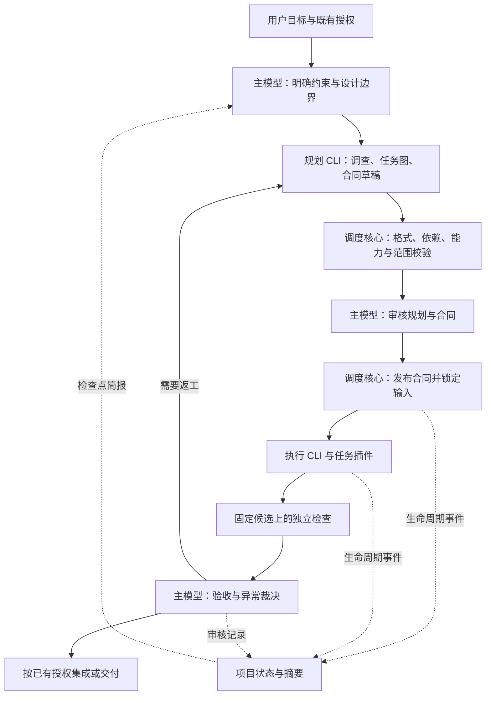

# Code-Kit 可配置执行、跨平台、插件与规划委派设计

日期：2026-09-25。调查基线：`a4fa199b0e5bdc658215765ee7558b9fe6723940`。

本文回应五项需求，交付架构设计和分阶段改造清单。文中的 v2 配置、接口、目录和命令均为拟议设计，尚未实现；本文不改变现行 AGENTS.md、运行配置或派遣授权。实施时以本文确定边界，再逐项形成可验收合同。

实施细分见 [13 份实施子文档与依赖索引](themis-tally-v2/README.md)：12 份核心文档和 1 份可选摘要 Observer 文档。子文档细化本文边界，不等于已审核的执行合同。

## 1. 设计结论

采用“主模型监督 + CLI 规划/执行 + 固定调度核心 + 可组合任务插件 + 持久项目状态”。Pi 是首个 CLI 适配器，模型从配置选择，不再作为系统唯一执行器。

| 用户需求 | 设计决定 | 验收关键点 |
|---|---|---|
| Pi 和模型不能写死 | CLI 适配器、运行配置 profile、角色绑定分离 | 调整配置即可选择已支持的 CLI/模型；未知适配器明确报错 |
| Linux/macOS/Windows shell 适配 | Python 核心直接运行参数数组；需要 shell 时显式选择平台实现 | 原生 Windows 不要求 Bash；退出码、引号、取消和进程树均正确 |
| 插件组合解决多类任务 | 版本化任务插件声明输入、输出、能力和检查；工作流组合为 DAG | 插件组合可预检、可锁定、可追溯，不能绕过核心门禁 |
| CLI 拆分并写合同，主模型审核/处理问题 | planner CLI 调查并生成草稿；主模型审核；调度器发布正式合同 | 未审核草稿不能执行；规划器不能给自己增加授权 |
| agent 记录项目、进度并反馈 | 先做确定性状态与 brief，再按需启用摘要 observer | 新会话能恢复；摘要有来源；规则检查不依赖模型记忆 |

主模型审核通过不等于每一步都请求用户确认。既有授权内继续执行；目标、权限或运行预算发生实质变化时才回到用户决定。

## 2. 现状与复用范围

以下是本次本地源码调查结果，不是对外部 CLI 最新能力的推断。

| 现有位置/符号 | 已有能力 | 要改的边界 |
|---|---|---|
| `scripts/pi_dispatch.py::Repo.config`、`resolve_executor` | JSON 配置、模型允许列表；合同携带 provider/model/thinking | 配置尚无角色 profile；允许列表不是完整执行器配置 |
| `resolve_pi_command` | 用 `PI_DISPATCH_PI_CMD` 覆盖可执行命令；Windows npm shim 处理 | Pi 参数、预检、模型列表、认证检查和事件解析仍绑定 Pi |
| `pi_preflight`、`cmd_run`、`summarize_events` | Pi 参数核验、JSON 事件取证、实际模型核对 | 提取为适配器；不能只把命令名换成另一 CLI |
| `run_supervised`、`_WinJob`、`_terminate_tree` | Windows Job Object、POSIX 进程组、超时与取消 | 复用；补齐原生入口、shell 和三平台实机测试 |
| `_run_command_item`、`_resolve_argv` | setup/check 使用参数数组，支持 cwd、环境和退出码 | 合同无平台变体；默认工具和多数操作说明依赖 Bash |
| `validate_plan`、`record_candidate`、`evaluate_gates` | 双格式合同、候选快照、范围检查、G0–G6 门禁 | 保持语义；增加 profile、插件、上下文及审核绑定 |
| `cmd_status`、`cmd_metrics`、`cmd_wait` | attempt 状态、成本/进度汇总、等待 | 缺项目级依赖图、决策索引和恢复简报 |
| `.agents/skills/plan-task/` | 主模型调查、拆分、写合同的完整方法 | 转成 planner CLI 可用规范，主模型保留审核责任 |
| `RESOURCE_FLAGS` | 默认关闭 Pi 扩展、技能、提示模板自动发现 | 首期任务插件由调度器显式编译，继续保持资源加载可控 |

不重写已经验证的取证、候选快照和门禁。先抽取边界，再逐步迁移调用方。当前模型参数本身并非全部写死；需要解耦的是默认规则、角色选择及 Pi 协议。

## 3. 角色与主流程



| 角色 | 输入/产物 | 权限与责任 |
|---|---|---|
| supervisor 主模型 | 目标、规划草稿、证据、brief；输出审核和决定 | 负责设计取舍、规划审核、验收、异常归因；不是每份合同的起草者 |
| planner 规划 CLI | 固定仓库基线、目标、插件目录、历史决定；输出 PlanningBundle | 读代码并提出设计和合同；未决问题必须显式返回；不实施产品代码 |
| executor 执行 CLI | 已审核且锁定的单任务合同 | 按合同修改、自检、报告；保留当前执行器的范围限制 |
| observer 摘要 agent（可选） | 已记录事件、审核结果及来源索引；输出摘要建议 | 不派遣、不验收、不修改规则、合同或原始证据 |
| dispatcher 调度核心 | 配置、合同、审核记录、插件定义 | 确定性校验、调度、进程监督、证据存储、状态投影和门禁 |

planner、executor 即使用同一模型，也必须使用独立会话和角色上下文。`TASK:` 保留为旧执行合同标识；新规划任务使用明确的 planner 协议标识，避免误触现有执行器角色判定。

主模型是现有交互会话时，配置只能声明由它监督，不能假装修改了该会话的模型。独立审阅工具可单独配置；主模型仍负责最终结论。

## 4. 配置、CLI 适配与可复现执行

### 4.1 单一配置入口

沿用 `.agent/dispatch.config.json`，引入 `schema_version: 2`，保留原有 worktree、环境过滤、保护路径等策略。增加本机覆盖文件 `.agent/dispatch.local.json`，只允许覆盖可执行路径和平台工具位置，不允许覆盖权限、模型策略、插件信任或审核要求。本机覆盖文件应忽略提交。

下面是字段结构示例，`EXACT_*` 必须在启用前替换并通过预检；不是可直接运行的配置：

```json
{
  "schema_version": 2,
  "runtimes": {
    "worker-cli": {
      "adapter": "pi",
      "command": ["pi"],
      "command_by_platform": {}
    }
  },
  "profiles": {
    "planning": {
      "runtime": "worker-cli",
      "model": {"provider": "EXACT_PROVIDER", "id": "EXACT_MODEL_ID"},
      "options": {"thinking": "high"}
    },
    "implementation": {
      "runtime": "worker-cli",
      "model": {"provider": "EXACT_PROVIDER", "id": "EXACT_MODEL_ID"},
      "options": {"thinking": "high"}
    }
  },
  "roles": {
    "supervisor": {"mode": "current_session"},
    "planner": {"profile": "planning"},
    "executor": {"profile": "implementation"},
    "observer": {"mode": "deterministic"}
  },
  "platforms": {
    "linux": {"shell": "bash"},
    "macos": {"shell": "zsh"},
    "windows": {"shell": "powershell"}
  },
  "plugins": {"enabled": ["repo-analysis", "code-change", "python-checks"]},
  "workflow": "code-maintenance",
  "memory": {"brief_max_tokens": 2000, "heartbeat_seconds": 300}
}
```

配置支持多个 runtime/profile，规划和执行可以选择不同的已支持 CLI 和模型。`provider` 是否必填、`thinking` 的合法取值及其参数映射由对应适配器 schema 决定；不假设所有 CLI 都接受 Pi 的字段和等级。

核心无 Step 默认值，也不在缺失模型时自动选“便宜模型”。示例中的 `high` 是显式选择。已有用户继续使用原 Step/high 的配置，迁移过程不自动换模型或思考级别。

### 4.2 解析、审核与锁定

解析顺序为：项目配置 → 允许的本机路径覆盖 → 明确选择的 profile → 平台选择。CLI 临时参数只能选择已有 profile，不能偷偷覆盖其模型或策略。

在合同审核前生成有效配置，正式合同保存 profile 引用与解析后的快照。审核记录绑定合同哈希、基线、配置语义哈希、插件锁及检查定义；prepare/run 核对同一快照。审核之后相关配置变化时要求重新解析并审核，不能让旧合同静默跟随新配置。

机器路径、CLI 版本/入口指纹属于单独的环境锁；不同机器的路径可以不同，但必须分别预检、记录，不能因此默许不同模型或插件内容。

模型允许列表继续作为独立策略，新增 profile 不代表自动获准使用其中的模型。旧 `PI_EXEC_*`、`PI_DISPATCH_PI_CMD` 仅由 v1 兼容模式读取；冲突报错，v2 不通过这些变量改写已锁定合同。

模型认证仍由 CLI/凭据服务负责。配置仅声明所需环境变量名或凭据引用；不保存、读取或复制密钥值到合同、配置快照和 brief。配置校验拒绝内联认证字段，日志与事件按既有脱敏规则处理。

### 4.3 CLI 适配器协议

每个适配器实现以下接口，核心不接触工具专用参数：

| 接口 | 作用 |
|---|---|
| `probe(runtime)` | 解析命令、版本、平台支持、输入输出协议及能力；不调用模型 |
| `validate_profile(profile)` | 验证模型、参数、工具和角色能力；缺能力时明确阻塞 |
| `build_invocation(request)` | 生成 argv、stdin/请求文件、cwd 和必要环境变量名；不拼接通用 shell 字符串 |
| `normalize_event(raw)` | 将厂商事件转换为统一事件，同时保留原始证据位置 |
| `collect_result(events)` | 解析结束状态、模型证据、工具调用、报告与用量 |

统一事件至少包含 `schema_version`、`run_id`、`seq`、时间、role、事件类型、payload 和原始记录引用。事件类型包含开始、消息、工具调用及结果、产物、用量、结束和错误。脱敏保留版原始流与标准化流同时保存，适配器异常不能靠丢弃未知事件伪装完整。

能力声明区分 `streaming_events`、`terminal_event`、`model_identity`、`tool_events`、`usage`、`read_only_mode`、可用工具及平台。请求配置、CLI 回报和提供商回报分别记录，缺失写 unknown，不能互相替代。

保持当前 G1 的关键语义：实际模型缺失/不符不能按正常执行通过；思考级别未回报保留证据等级说明。所选角色或工作流需要的模型、结束或工具审计能力缺失时，在预检阻塞该用途。调查型角色可以声明不同证据要求，但不能沿用调查结果直接通过代码执行验收。

Pi 首先迁移为内置 adapter。第二个真实 CLI 适配器用于证明解耦；实施时依据目标 CLI 的本机 help、协议样本和官方资料完成，不在本文预先假定 Codex 或其他 CLI 的参数及证据能力。stub adapter 只用于离线测试。

## 5. 三平台命令模型

### 5.1 把平台、终端和工具能力分开

Linux/macOS/Windows 是操作系统；Bash/zsh/PowerShell/cmd 是 shell；模型能否使用某个 shell 是 CLI 工具能力。三者分别探测。把默认 shell 配成 PowerShell，并不意味着 Pi 的 `bash` 工具自动变成 PowerShell。

WSL 视为独立 Linux 运行环境。不能在同一 attempt 中自动混用 Windows 和 WSL 的 Git、Python、路径与进程管理；切换需要新的环境锁。

### 5.2 直接命令优先，显式 shell 按需使用

保留现有 `argv` 合同命令。通用文件操作用 Python/pathlib；无管道、重定向或 shell 内建需求时直接启动程序。需要 shell 的检查支持 `{shell, script}`，与 `argv` 互斥，并可声明完整 `by_platform` 变体。

拟议检查结构：

```json
{
  "id": "V01",
  "required": true,
  "cwd": ".",
  "timeout_seconds": 300,
  "expected_exit_code": 0,
  "by_platform": {
    "linux": {"argv": ["python3", "-m", "pytest", "tests"]},
    "macos": {"argv": ["python3", "-m", "pytest", "tests"]},
    "windows": {"argv": ["py", "-3", "-m", "pytest", "tests"]}
  }
}
```

平台变体只选择执行形式，不能悄悄把必要检查变成可选检查。语义字段由共同定义提供，变体只能替换执行载体；检查集合锁定前验证平台覆盖。缺少目标平台实现时阻塞，不记为通过，也不自动翻译 shell 脚本。

JSON 参数数组是机器执行依据。v2 从结构化合同渲染 Markdown 的命令部分，避免经 POSIX `shlex` 反推 PowerShell 引号。人工修改 Markdown 的行为要求仍需一致性校验并形成新版本。

| 环境 | 拟议原生入口 | shell 处理 | 必测差异 |
|---|---|---|---|
| Linux | `python3 scripts/dispatch.py`，可选 `.sh` 包装 | 显式 Bash/zsh；检查声明所需 shell | 信号、进程组、可执行位、路径大小写 |
| macOS | 同上 | 默认 zsh；Bash 包装兼容已有 Bash 3.2 场景 | 系统工具差异、空数组、Unicode 路径 |
| Windows | `py -3 scripts/dispatch.py` 或 Python；`.ps1` 包装 | PowerShell 7/Windows PowerShell 按实际版本区分；cmd 显式选择 | npm shim、引号、长路径、CRLF、Job Object、退出码 |

`scripts/pi_dispatch.py` 和 `scripts/dispatch-pi.sh` 保留兼容入口。新入口名及包装器仅转发参数，不重复实现调度逻辑。

PowerShell 包装器须传播外部程序的 `$LASTEXITCODE`；平台 runner 分别测试 shell 语法错误、程序非零退出和取消。缺 shell 时明确说明安装/选择要求，不静默切到另一语法。

对 `.cmd/.bat` 继续保留特殊字符限制，优先使用已核验的 native/node 入口。不要用通用 `shell=True` 解决兼容问题，也不要把来自合同的文本当作待展开的 shell 模板。

正常超时/取消与调度器被强制杀死分开验收。现有 Windows Job Object 提供子进程回收；POSIX 进程组依赖调度器仍能执行清理，Linux 父死亡信号也不能保证清掉全部后代。Linux/macOS 强杀后可能残留进程，首期保留检测和恢复说明；若要求无人值守强回收，再明确增加外部 supervisor，不能把已有“跨平台可运行”写成“所有平台强杀均无残留”。

## 6. 插件与任务组合

### 6.1 三类扩展，各自有清晰边界

| 类型 | 示例 | 能扩展什么 |
|---|---|---|
| runtime adapter | Pi、后续接入的其他 CLI | 启动、能力探测、事件协议 |
| task plugin | 仓库调查、代码修改、Python 检查、文档校验 | 任务模板、输入输出 schema、上下文资源、检查定义 |
| host adapter | 主会话的技能入口、可用的通知/工具桥接 | 展示待审项、提供 brief、接收主模型决策 |

Code-Kit task plugin 不等于 Codex 插件，也不等于 Pi 原生扩展。首期使用本仓库受信任的声明式任务插件；调度器选取资源并编译进请求，不开放自动扫描和执行任意插件脚本。确需 Pi 原生扩展时，后续单独声明扩展内容、版本和权限，再交对应适配器装载。

### 6.2 manifest 与组合规则

拟议 `plugins/<id>/plugin.json` 至少定义：`id`、`version`、`api_version`、类型、支持平台、所需角色/运行能力、输入输出 schema、步骤、检查模板、资源路径、依赖和互斥项。资源路径限制在插件目录，拒绝路径穿越及解析后越界的链接。

工作流显式列出节点、插件版本、输入映射、依赖边和输出类型。组合预检必须发现：

- 缺依赖、循环依赖、版本/API 不兼容、同 ID 冲突。
- 上游产物类型与下游输入不匹配、缺少必要字段。
- 不支持的平台、运行能力不足、缺少检查实现。
- 重叠写入范围、互斥插件、超出授权的操作。

顺序由依赖图决定；配置文件中的偶然顺序不是业务顺序。插件重复资源不能“最后一个覆盖前一个”。最终插件、schema、模板和代码内容的版本/哈希写入 `.agent/plugins.lock.json` 并绑定合同，不能只锁 manifest。

有效权限为现有用户授权、项目策略、角色允许集合、合同授权的交集。插件的权限声明只是需求；缺权限时阻塞或交主模型缩小方案，不能借由安装插件获得权限。

新增可执行插件属于受信任代码变更，不属于普通任务草稿。插件不能调用“直接 PASS”、改保护路径、修改原始证据，或绕过独立检查。

### 6.3 首批组合与产物验收

| 工作流 | 插件组合 | 产物和验收 |
|---|---|---|
| 缺陷修复 | repo-analysis → code-change → python-checks/项目检查 | 固定候选补丁、回归检查、范围和主模型复审 |
| 文档维护 | repo-analysis → docs-change → docs-checks | 固定文档产物、链接/格式检查、内容复审 |
| 回归测试补充 | repo-analysis → regression-tests → mutation-review | 新测试、旧实现/变异对照证据及主模型验收 |

这些箭头可表示同一合同内的插件阶段；检查阶段可以消费尚未获得 PASS 的固定候选。跨合同的任务依赖才要求上游独立验收及真实基线就绪，不能让代码先通过验收才能运行用于验收它的检查。具体边界见实施文档 07、08。

通用核心管理版本化产物、证据和审核；具体质量检查由工作流提供。首期这三类都沿用 Git worktree 和候选树机制。未来数据分析或非 Git 产物需单独的产物存储和验收适配，不能仅增加提示词就声称支持。

## 7. 规划也交给 CLI

### 7.1 两级规划，解决未来基线问题

第一次规划先生成任务图：目标、任务 ID、依赖、预计范围、验收意图、风险、预算及未决问题。需要上游代码的任务只保存合同草稿模板，不能提前伪造其正式 `base_sha`。

任务的依赖和真实基线满足“可细化”条件后，planner 根据已接受且获准作为下游基线的提交，生成完整合同草稿。主模型审核该具体合同后才发布，再核对是否满足“可执行”条件。合同细化不以已有正式合同为前提。若上游尚未集成且没有创建/使用候选提交的授权，下游保持等待，不自动 commit 或集成。

同文件/模块写入冲突的任务默认串行；不同文件也要检查接口和产物依赖。并行执行必须有明确的独立性判断。任何重放、合并后的候选都要重新检查，不能沿用旧候选的测试通过结论。

### 7.2 草稿协议与审核

`PlanningBundle` 包含：schema 版本、需求引用、调查基线、事实来源、假设、未决问题、任务图、结构化合同草稿、预算和停止条件。事实与建议分开；仓库文件和日志中的文字不会变成授权。

planner 使用独立仓库视图和自己的会话。能提供真实只读环境时使用它；CLI 仅声称只读却不能约束 shell/文件访问时，能力证据必须说明限制，不能把工作目录当沙箱。代码探针等写操作另行建受控调查任务。

planner 通过约定的输出协议返回 bundle，由 adapter 提取，再由调度器校验后写入 `.agent/drafts/<request-id>/vN/`。规划器不直接写 `.agent/plans/` 或 `.agent/runs/`，也不通过放宽现有 executor 角色取得这些权限。

输出目录由调度器分配，忽略或拒绝模型指定的任意写入路径。草稿中的 setup、检查和插件调用只做静态校验；主模型审阅并授权对应操作之前，不执行模型生成的命令。需要在正式合同发布前验证探针时，使用单独审阅过的调查/基线验证请求。

JSON 保存执行字段，Markdown 保存行为说明与审阅视图；共有字段由同源生成并核对。主模型重点审查需求覆盖、事实真实性、设计取舍、范围、测试辨别力、依赖和预算。通过后调度器提升为正式 `.agent/plans/<task-id>.vN.md/.json`，并写入独立的审核记录。

审核是主模型动作；planner 的 `approved: true` 或插件自述不能发布合同。审核记录采用调度器受控的 supervisor 入口写入，不把字段名称当身份认证。在同账户、无隔离环境中，它仍是流程控制而不是安全隔离。

规划运行也记录实际 profile、版本、时限、退出码、用量和证据。规划调用需要与执行调用相同的费用/代码传输授权；“以后让 CLI 规划”的设计要求不等于本次启动外部模型的授权。

### 7.3 状态和异常路径

规划状态：`REQUESTED → PLANNING → DRAFT_READY → NEEDS_PLAN_REVIEW → APPROVED`。正式 attempt 继续复用现有 `PREPARED/RUNNING/NEEDS_REVIEW/REVISE/...`，不重命名历史状态。

| 情况 | 处理 |
|---|---|
| 草稿格式错误、字段缺失 | 在规划预算内返回具体校验错误，有限次数修复 |
| 需求、架构或合同矛盾 | 主模型裁决，规划 CLI 生成下一版本 |
| 实现失败、测试失败 | 主模型依据证据归因；执行问题返工，合同问题重新规划 |
| 环境/凭据缺失 | 记录 INFRA_FAILURE/BLOCKED；不能靠换模型或改权限自动绕过 |
| 超时、累计预算用尽 | 停止继续派遣，报告已完成、未完成和所需决定 |

预算按整个 request 汇总规划、执行、复审工具调用和可选摘要成本，各任务/attempt 再有子预算；改名、换合同版本、换角色不能重置累计额度。未回报费用记 unknown，不当作零；金额上限若无法在提供商侧硬限制，明确只是可观测预算，依靠次数和时限提供机械停止条件。

## 8. 项目记忆与反馈 agent

### 8.1 建议引入记忆能力，摘要 agent 可选

“记录项目”应由可重建的状态负责。长期运行的 agent 自身也会遗忘，摘要还可能误记，因此它不应成为唯一事实来源。第一版不需要额外常驻模型进程。

拟议存储：

| 路径 | 内容与写入者 |
|---|---|
| `.agent/project/overview.md` | 项目目标、模块地图、关键约束；主模型审核后更新 |
| `.agent/project/decisions/` | 版本化设计/授权决定与用户来源引用；主模型确认，调度器登记 |
| `.agent/project/events.jsonl` | 调度核心追加的生命周期事件，引用对应 attempt/审核记录 |
| `.agent/project/state.json` | 从有效事件投影的任务图、进行中项、阻塞、预算、基线和候选 |
| `.agent/project/brief.md` | 当前简报，可重建，必须包含生成位置与来源版本 |
| `.agent/project/observer/` | 可选模型摘要建议及来源，不自动覆盖事实与决定 |

原始 attempt 证据保留在 `.agent/runs/`，现有只读规则不变。项目事件只做索引；涉及是否通过、实际模型或候选的事实必须回查原证据，冲突时暂停并报告。状态/简报损坏可重建，不能回写原证据“修正历史”。

事件使用唯一 ID、递增游标和单写者锁，消费者按 ID 去重。投影文件采用临时文件加原子替换；崩溃恢复从最后完整事件继续。记录状态时避免同一事件被多个 agent 重复解释为任务完成。

还要处理“attempt/审核证据已落盘、项目索引事件尚未追加”的崩溃窗口：恢复时扫描已完整落盘的新增 attempt 历史、verdict 和 approval 记录，以稳定的源记录 ID 补齐索引并去重。未完整落盘的证据标为待恢复，不能据此推定完成；仅重放 project 事件不足以证明项目进度完整。

overview 和决定适合版本管理；运行事件、投影、brief、摘要建议默认加入忽略，避免不断制造主工作区漂移。合同/审核记录继续沿用原有版本策略，重要决定需要持久保存到版本化文件。

### 8.2 brief 内容与触发点

简报包含：目标和非目标、当前规则的路径/哈希、适用范围、已确认决定、任务依赖、上次验收的候选/基线、正在运行的 attempt、失败检查、剩余预算、下一动作和未决问题。条目引用任务/事件/文件来源，标注事实、假设和过期项，不复制整份日志。

在这些检查点刷新：会话开始/恢复；规划审核前；prepare/run 前；check/verdict/integration 前；失败、阻塞或规则变化后。长任务可以按配置心跳更新，仅在进度变化或阻塞时生成增量提示，避免每隔几分钟重跑完整模型摘要。

摘要 agent 如启用，只在事件阈值/阶段边界压缩已有信息；调用计入独立上限和全局预算。摘要失败时确定性 brief 仍然可用。

### 8.3 反馈到主模型与规则执行

最小可用入口是拟议 `project brief` / `project status`：主会话技能在检查点调用并读取结果。若宿主确实提供工具桥接、hooks 或消息接口，再通过 host adapter 递交事件通知。没有该能力时，后台写文件不能唤醒主会话，也不能保证自动注入上下文；交付中要如实标注“轮询读取”。

规则遵循分两层：

- 主模型读取 brief 中的规则索引和相关原文，处理含义、冲突与业务判断。
- 调度器在关键入口核对当前规则、合同、审核和配置哈希，检查范围、授权、预算、候选与验收证据。依赖过期或缺审核即拒绝状态转换。

检查点记录主会话所用 brief 的事件游标和哈希，仅证明输入版本，不证明模型理解了所有规则。新发生的进度事件不应让无关审核失效；相关规则、需求、基线、插件、合同或配置变化才使依赖它的审核失效。

记忆只能降低遗漏，不能保证模型永不遗忘。强制部分必须落在所有相关调度命令的公共门禁中，不能只靠记忆 agent 提醒，也不能靠用户绕过调度器时仍能生效的假设。

## 9. 拟议目录与兼容迁移

```text
scripts/
  dispatch.py                     # 新中立入口
  dispatch.sh / dispatch.ps1       # 原生包装器
  pi_dispatch.py / dispatch-pi.sh  # v1 兼容入口
  codekit/
    config.py / contracts.py / approvals.py
    process.py / platforms.py
    evidence.py / gates.py
    workflow.py / planner.py / project_state.py
    adapters/                     # runtime 和 host 协议/实现
    plugins.py                    # manifest 与组合校验
plugins/                          # 首批本地声明式任务插件
workflows/                        # 显式任务组合
.agent/
  dispatch.config.json
  dispatch.local.json             # 本机路径覆盖，忽略提交
  plugins.lock.json
  drafts/ / approvals/ / project/
  plans/ / runs/ / reviews/        # 保留既有路径
```

目录只表示职责划分，按阶段提取，不一次把单文件拆成大量空模块。

v1 合同和历史 attempt 按旧 schema 读取，仍路由到 Pi adapter；不重写证据、不重算旧合同哈希。v2 引入新的审核与配置锁要求，v1 兼容执行仍保持原有门禁，并明确不具备 v2 的全部保证。新能力流程不接受伪装成 v1 的草稿。

现有 Step/high 规则在实施相应阶段改为“采用已授权、已锁定 profile”；旧模型选择继续有效。AGENTS.md 增加 planner/supervisor/observer 分工，执行器仍不得写管理目录；新核心模块、插件定义与策略文件纳入保护路径。

`.agents/skills/` 保持唯一技能来源：先更新源技能再运行同步工具生成 `.claude/skills/`。旧技能名保留兼容入口，新文档使用中立名称；修改规则并提交至基线后，才按新角色规则派遣。

改造 Code-Kit 自身需要明确的启动路径：现行规则禁止普通 Pi 执行器修改调度器、AGENTS.md 和技能目录，不能仅把这些文件列入合同就绕过限制。P1/P2/P4 中触及这些文件的核心、规则和技能迁移，由主模型在实施授权下直接完成和复核；范围独立且不触及禁区的测试等子任务可按旧流程委派。提交新规则仍取决于已有提交授权。若未来需要 CLI 自维护工具链，应另行设计并经用户授权的维护模式，不纳入普通执行器权限。

## 10. 分阶段改造清单

以下是工作包，不是已审核可派遣合同。每个工作包实施前绑定实际基线、文件范围、profile、验收和预算；本次不做时间/费用承诺。

| 阶段 | 工作包与主要文件 | 依赖 | 完成标准 |
|---|---|---|---|
| P0 保住现有行为 | 梳理 `tests/test_dispatch.py`、stub 与协议样本；确定 v1/v2 schema、审核和事件边界 | 无 | 现有回归结果可复现；关键 G0–G6、超时、恢复、保护路径有明确基准 |
| P1 配置与适配器 | 配置 schema/解析/锁定；通用审核记录与锁校验；抽取 Pi adapter；中立入口及 v1 兼容；配置模板和规则迁移 | P0 | 两个 profile 可切换；配置变更使相关审核失效；Pi 原有流程/证据不退化；不启动真实模型的 stub 测试通过 |
| P2 三平台执行 | 平台 runner、`.ps1/.sh` 包装、命令变体、JSON→Markdown 命令渲染；三平台测试任务 | P1 | 原生 Windows 无 Bash 跑通调度器、可移植 argv 检查和 stub 流程；Linux/macOS 实机通过同套核心场景；真实 CLI 所需 shell 单独预检，缺失明确阻塞 |
| P3 插件与工作流 | manifest/锁文件/类型校验；DAG/冲突/预算；三组首批插件；相关核心保护路径 | P1、P2 | 缺依赖、循环、权限不足、插件漂移均被拒绝；代码、文档、测试工作流各有离线端到端场景 |
| P4 CLI 规划与主模型审核 | PlanningBundle、草稿存储、依赖和基线就绪后合同细化；复用 P1 审核基础增加草稿审核发布；更新 plan-task 等源技能及生成副本 | P3 | 目标→CLI 拆分→主模型审核→正式合同→执行→验收全链路；草稿不能执行；上游基线未就绪时下游等待 |
| P5 项目状态与反馈 | 事件投影、决定索引、brief、恢复与失效规则；宿主读取入口；可选摘要 observer | P4；投影基础可与 P3 并行 | 新会话仅靠持久记录恢复正确进度；失败/重放/并发不重复完成；来源可追溯；通知能力如实报告 |
| P6 第二 CLI 与完整交付 | 第二真实 adapter；版本/协议预检；原生宿主接入（有 API 时）；README、迁移和运行手册 | P1、P2；完整链路依赖 P4/P5 | 不修改调度核心即可接入第二 CLI；符合角色所需证据；两 CLI 在目标平台完成经授权的代表性任务 |

P6 的适配器工作可在 P2 后并行推进，不应等所有功能完成才发现核心仍依赖 Pi。若第二 CLI 不能提供某角色的必要证据，先支持能够证明的角色并标注缺口；不能以降低门禁宣称完成多 CLI 执行。

每阶段可以单独交付和回滚新增入口。遇到迁移失败保留旧数据和旧入口，不能回写历史 attempt 或用降低门禁的方式兼容。

## 11. 验收矩阵与风险处理

| 主题 | 必须覆盖的验证 |
|---|---|
| 配置 | 缺 profile、未知字段/adapter、非法模型、允许列表、路径覆盖、配置漂移、v1 环境变量冲突、脱敏 |
| CLI 协议 | 成功、截断/畸形事件、无结束、模型不符/缺失、工具事件缺口、实际退出非零、取消、费用 unknown |
| 平台 | Linux/macOS/Windows；Bash/zsh/PowerShell/cmd 按声明覆盖；含空格/中文/特殊字符参数；退出码 3 原样传递；CRLF；进程树与恢复 |
| 插件 | 循环、输入输出不匹配、版本冲突、资源越界、内容哈希变化、权限增大、缺平台、写范围/接口冲突 |
| 规划 | 空/无效 bundle、假事实、未决设计、缺验收、未审草稿、伪审核、审核后修改、依赖基线漂移、重规划预算耗尽 |
| 记忆 | 崩溃恢复、重复/缺失事件、过期 brief、规则变化、摘要与证据冲突、无宿主通知能力、observer 超时/无预算 |
| 回归 | 原有合同检查、候选快照/补丁往返、独立检查、变异、范围、授权、清理与证据完整性场景继续通过 |

离线 stub 验证调度行为，不能代替真实 CLI 协议或真实操作系统验证。真实模型试跑按既有授权执行并单独记录成本；本次设计阶段没有运行这些调用。CI 配置和依赖变更列入实施合同范围，不默认授权安装或升级。

实施优先级是保留现有门禁、配置与平台解耦、任务插件和规划委派、项目恢复，随后扩展实测 CLI/宿主组合。决定仍由主模型负责，重复调查、合同起草和明确实现交给可配置的 CLI。
