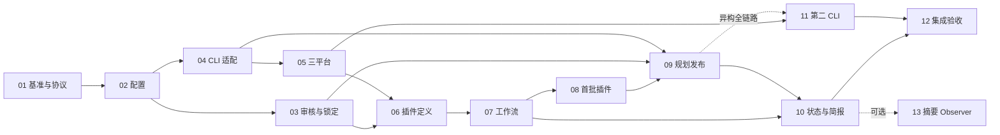

# Code-Kit v2 实施文档索引

[返回总设计](../themis-tally-v2-design.md) · [仓库 README](../../README.md)

本目录将总设计拆成 **13 份实施子文档：12 份核心文档 + 1 份可选增强文档**。本索引不计入 13 份。模块 01 已实施并进入收尾验收，阶段计划、实测结果与剩余平台限制见 [01 实施入口](01-baseline/README.md)。02–13 仍为待实施设计；具体状态以各模块实施记录为准。

## 1. 文档清单与依赖

| 编号 | 实施文档 | 直接前置 | 对应总设计阶段 | 核心产物 |
|---|---|---|---|---|
| 01 | [基准与公共协议](01-baseline-and-protocols-审阅增强版.md) | 无 | P0 | 回归基准、公共标识、资源引用、兼容约定 |
| 02 | [配置与角色绑定](02-config-and-profiles-审阅增强版.md) | 01 | P1 | runtime/profile/role 解析、语义快照 |
| 03 | [审核记录与输入锁定](03-approvals-and-locks-审阅增强版.md) | 01、02 | P1 | 通用审核、输入哈希、失效和操作检查 |
| 04 | [CLI 适配器与 Pi 迁移](04-cli-adapters-and-pi-审阅增强版.md) | 01、02 | P1 | adapter 协议、Pi 实现、统一事件证据 |
| 05 | [三平台命令与入口](05-cross-platform-runtime-审阅增强版.md) | 04 | P2 | 平台 runner、包装器、命令变体 |
| 06 | [插件定义与锁定](06-plugin-manifests-and-locks-审阅增强版.md) | 02、03、05 | P3 | manifest、内容锁、能力与资源校验 |
| 07 | [工作流与任务调度](07-workflows-and-scheduling-审阅增强版.md) | 03、06 | P3 | DAG、冲突、就绪、request 累计预算 |
| 08 | [首批任务插件](08-builtin-task-plugins-审阅增强版.md) | 06、07 | P3 | 修复、文档、测试三类组合 |
| 09 | [CLI 规划与合同发布](09-planning-and-contracts-审阅增强版.md) | 03、04、07、08 | P4 | PlanningBundle、草稿审核、正式合同 |
| 10 | [项目状态与恢复简报](10-project-state-and-brief-审阅增强版.md) | 基础：01、03、07；完整接入：09 | P5 | 进度投影、决定索引、brief、恢复入口 |
| 11 | [第二种真实 CLI 接入](11-second-cli-adapter.md) | 04、05；异构全链路接入：09 | P6，可提前 | 第二 adapter、真实能力矩阵 |
| 12 | [集成验收与迁移交付](12-integration-and-migration-审阅增强版.md) | 01–11 | P6 | 完整验收、兼容迁移、使用手册 |
| 13 | [摘要 Observer（可选）](13-optional-observer.md) | 10；复用 04、07 | P5 可选增强 | 可追溯摘要、预算上限、降级策略 |

## 2. 推荐实施顺序

图展示主要依赖，完整前置以表格为准。03 与 04 可在 02 后并行；11 在 05 后就开始适配，避免最后才发现核心仍依赖 Pi。10 的事件存储与投影可在 07 后开始，规划状态的完整接入待 09。13 不阻塞 12，核心记忆能力由 10 提供。

这里的可并行表示逻辑依赖允许，仍要核对实际文件和接口冲突。多个模块触及现有 `scripts/pi_dispatch.py` 时，先划定接入点或按顺序集成；不能因为文档编号不同就同时覆盖同一文件。后续合同必须基于已接受的真实代码状态，集成后的候选重新检查。

## 3. 公共接口的归属

| 约定 | 定义文档 | 其他模块如何使用 |
|---|---|---|
| 标识、ResourceRef、哈希和序列化、unknown 用量 | 01 | 引用同一规则，不复制出不同字段定义 |
| runtime/profile/role、有效配置及本机覆盖 | 02 | 选择已有 profile，不自行覆盖模型 |
| 审核记录、`input_refs`、失效检查 | 03 | 配置/合同/插件锁都是被审核输入 |
| CLI 能力、调用请求、原始与统一事件 | 04 | 新 CLI 实现接口，不改调度门禁 |
| argv/shell、平台选择、进程终止 | 05 | adapter 生成调用，runner 负责监督 |
| manifest、插件锁、资源与权限需求 | 06 | 工作流使用已锁定插件，不由插件授予权限 |
| DAG、就绪、领取、累计预算 | 07 | 先接人工合同，再接规划 CLI |
| 任务模板与工作流示例 | 08 | 依赖 06/07 的公开接口，不另建调度器 |
| PlanningBundle、草稿与正式合同发布 | 09 | 复用 03 审核；不能把模型自述当审核 |
| 项目事件投影、brief、恢复与宿主读取 | 10 | 由证据重建，不把摘要当事实来源 |

01 先提供最小公共协议；后续文档定义各自详细 schema。跨模块接口有必要变化时，同时更新接口归属文档和使用方的验收项，不由执行器临时猜测。

## 4. 从实施说明到执行合同

每份文档都包含目标与非目标、依赖、现状、接口、预计文件范围、实施步骤、带编号的验收标准、兼容恢复和建议小包。`02-A01` 等是实施验收编号，`01-T1` 等只是小包标识，均不等于调度器已经接受的 task-id 或 plan-key。

准备实施某个小包时，重新确认当前基线与上游验收结果，确定确切文件范围、行为、检查命令、profile 和预算，再生成 `.agent/plans/` 中的 Markdown/JSON 合同。下游合同不提前填写尚不存在的上游提交，也不一次将整份大模块作为单轮执行任务。

07 区分“可细化合同”与“可执行任务”，09 在前者满足时起草合同；任务自身的修改、检查、验收属于合同内阶段，不要求代码先获 PASS 才能运行用来证明它的检查。跨合同的任务依赖仍要求上游结果已接受且真实基线可用。

主模型负责设计取舍、审核与异常处理。等 09 上线后，后续符合条件的调查、拆分和合同草稿由规划 CLI 承担；这次系统自身的启动改造不能假设尚未实现的规划能力已经可用。

现行 AGENTS.md 对 Pi 执行器的保护仍然有效。调度核心、规则和技能源的修改由主模型在后续实施授权下直接完成；独立且不触及保护范围的子任务可以按既有流程委派。实际模型调用、配置变更和提交等行为仍按既有授权执行，本文档不是新增权限来源。

## 5. 交付与验收原则

- 每个模块保存自己的验收映射；总体验收 12 汇总这些结果，不用一次全量测试替代模块证据。
- 离线 stub、真实 CLI、真实操作系统是三类证据，分别记录；未运行项和缺少能力必须可见。
- 规划与执行使用独立 role/profile，可指向不同 CLI/模型；主模型当前会话由宿主控制，配置不会替它换模型。
- 状态日志和 brief 属于 10 的必需能力；后台通知取决于宿主接口，摘要模型属于 13 的可选能力。
- 各阶段及时迁移相关规则、保护路径、技能源和生成副本；12 负责完整性复核，不把这些前置工作拖到最后。
- v1 合同和原始证据保留，恢复/回滚不得重写历史，也不能通过关闭门禁恢复执行。

需要从头开始时先读 [01](01-baseline-and-protocols-审阅增强版.md)；确定实现某一模块时，读取该文档及表格列出的直接依赖。总设计负责架构方向，本目录负责可实施边界，实际合同负责具体一次执行。
